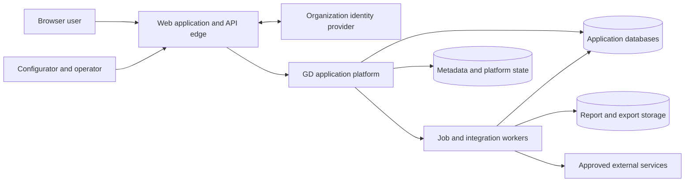
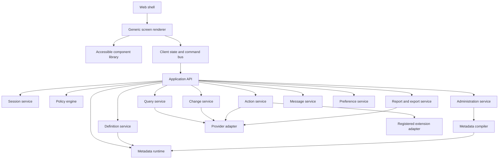
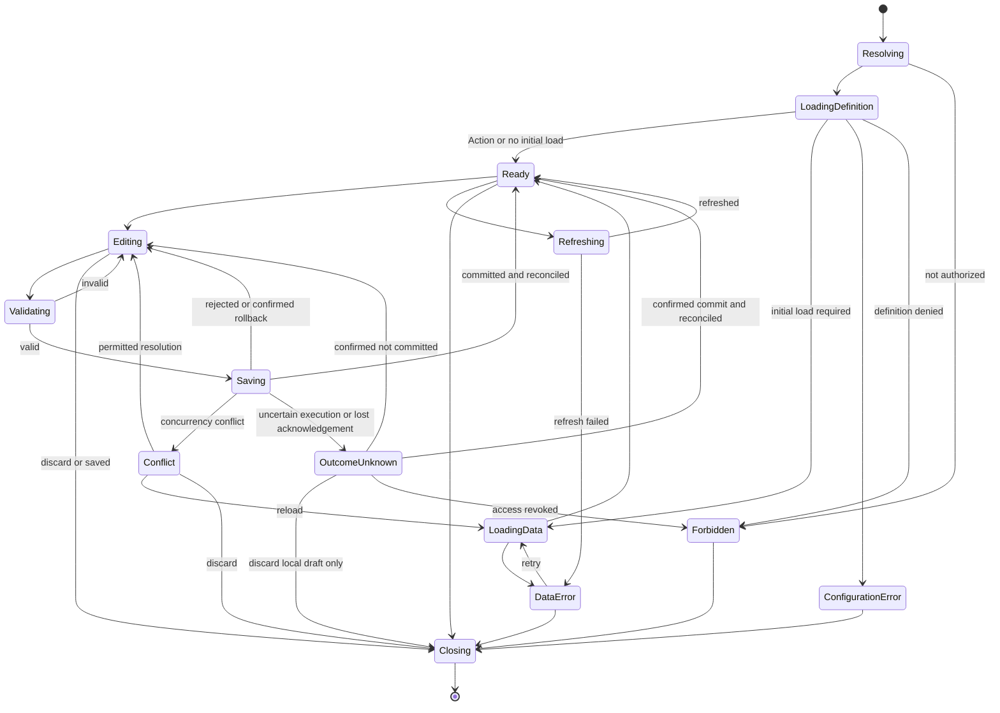
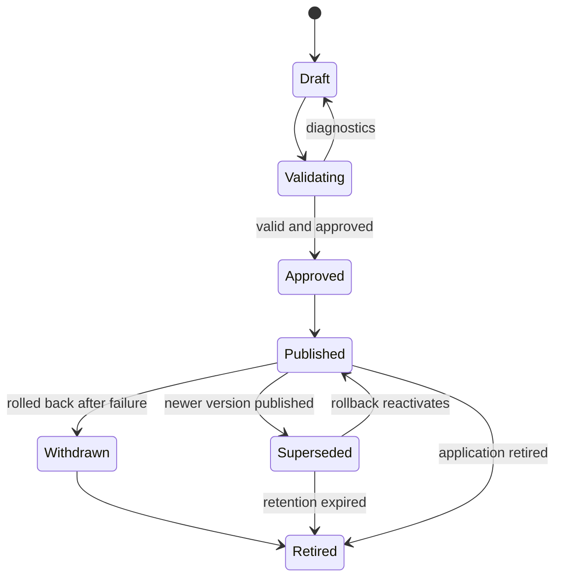
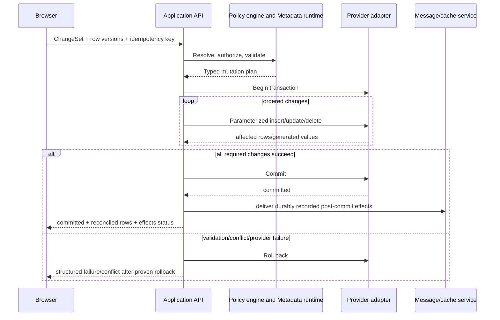
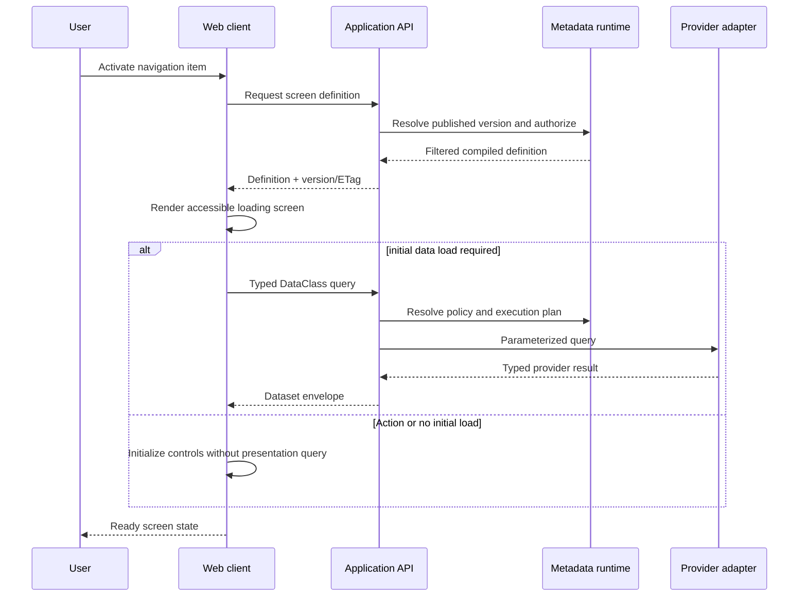

# GDFramework Modern Web System Design

**Status:** Controlled working design baseline 0.10  
**Date:** 10 October 2026  
**Owner:** Migration technical lead  
**Legacy checksum-manifest SHA-256:** `fc29779b9588a41cb9da10c486f1f0b35ca2108baf50fb8892086587ee320027`  
**Target:** Modern web-based equivalent of the GDFramework application platform  
**Functional authority:** [GD Framework Functional Specification 0.12](GDFramework%20Functional%20Specification.md)  
**Delivery authority:** [GDFramework Rebuild Master Plan and Design 0.13](GDF_MIGRATION_MASTER.md)  
**Technology status:** The logical architecture is technology-neutral by decision. Web direction is selected (D-001), sign-in is OpenID Connect with a server-side session (D-005), and the platform store and application providers are engine-agnostic and selected by configuration (D-013, D-004). The client framework, service runtime, transport, hosting, and the first qualified engines remain Gate C selections (GDF_MIGRATION_MASTER.md section 17)

**Reference implementations of the target layouts:** [Runtime web mockup](../prototype/gdframework-web-mockup.html) and [GD Studio administration mockup](../prototype/gdframework-admin-mockup.html). They show every screen family and the authoring workflow with sample data and are the visual reference for sections 7–9 and 11.4 (GDF_MIGRATION_MASTER.md section 3.5). They are non-normative for behavior: where they and this document differ, this document governs.

## Change history

| Version | Date | Summary |
|---|---|---|
| 0.1 | 2026-09-06 | Initial complete design baseline |
| 0.2 | 2026-09-09 | Requirement/NFR citations per section, candidate labelling for open decisions (D-002, D-003, D-005, D-007), unified component vocabulary, session-model reconciliation, metadata compatibility-range definition, printing default, online-only clarification, document-reference updates, change history |
| 0.3 | 2026-09-10 | Version citations corrected; screen-lifecycle diagram completed (refreshing, forbidden, data-error exits); compatibility major version defined; unsaved-change protocol defined; Preference/Message/Report services added to the controlled vocabulary; section 34 decisions mapped to register IDs D-013..D-016; testing rule stated normatively |
| 0.4 | 2026-09-10 | Section 7.7 desktop-bound behavior reinterpretation under D-017; compatibility major version limited to DataClass and key-set changes with field-level compatibility; preference scope restored to FR-CUSTOM-008; arbitrary-depth navigation made conditional on FR-NAV-008; version state machine gains Superseded and Withdrawn with a rollback path; field-type mapping table; message-dialog contract; auto-refresh pause tied to DEF-038; vocabulary and endpoint candidate labelling; Satisfies lines for sections 6 and 33; browser support matrix assigned to the D-001 ADR; personalization persistence timing noted against DEF-003 |
| 0.5 | 2026-09-10 | Premise corrected: no deployed legacy instance, metadata, users, or consumers exist. Compatibility adapter, legacy callers, side-by-side routing, cutover, and retirement removed (sections 5, 6, 28, 29, 33, 36); WDES-014 and WDES-015 withdrawn; metadata lifecycle starts at Draft and web authoring is a first-release capability (D-015); section 28 restated as delivery sequencing; Appendix C restated as configuration to be authored; D-018..D-020 added to section 34; NFR-COMP-001 citations removed; prototypes recorded as the reference implementations of the layouts and of the authoring workflow |
| 0.6 | 2026-09-13 | Design-review corrections: explicit pending layout scope, safe mutations and keys, authored capabilities, messages, startup and security, lifecycle, preference identity, gate alignment, and citations; no pending product or defect decision approved |
| 0.7 | 2026-10-04 | Coherence review: preserve default DataClass caching; register pending D-021 dual-source scope; define uncertain-save reconciliation, durable post-commit effects, protected authoring, filtered-definition cache isolation, and withdrawal admission rules; record source-manifest identity and new verification requirements. No product, defect, or technology approval implied |
| 0.8 | 2026-10-10 | Owner decisions recorded. D-017 approved: section 7.7 and 8.5 reinterpretations, Detach and Reattach, two-level navigation, and legacy control scope are requirements, not candidates. D-011 approved with every DEF-* row decided, so the DEF-003, DEF-005, DEF-012, DEF-013, and DEF-038 behaviors are binding. D-020 decided: aggregation, limit processing, and PLM are out of scope. D-005 decided: OpenID Connect with a server-side session and an HttpOnly cookie (sections 10.1, 15.1, 15.3). D-013 and D-004 decided in direction: engine-agnostic, configurable platform store and providers (new section 11.6). User records are live administration data outside publication (D-022, new section 15.6). WDES-025, WDES-026, and WDES-027 added. The stack stays technology-neutral; D-001, D-002, D-003, D-007, D-008, and D-014 are unchanged |
| 0.9 | 2026-10-10 | Administrative roles decided. D-023: a fixed set of platform administrative roles governs the authoring tool itself, separate from application roles and business access, granted inside the tool with a second-person approval, immediate revocation, no self-changes, and bootstrap platform administrators from deployment configuration (new section 15.7). WDES-028 added |
| 0.10 | 2026-10-10 | Access model corrected to the owner's direction. An application configuration is self-contained and is the unit of drafts, validation, approval, publication, digest, and rollback (new section 11.7). Each application owns its roles and users, which are versioned and published with it; the live, platform-wide user list of 0.8 and identity-provider group mappings are withdrawn (section 15.6 rewritten; D-022 revised, ADR-008 supersedes ADR-006). Section 15.7 restated as Studio access, unrelated to any application, with the security administrator maintaining roles and users in application drafts. Sections 5, 7.6, 11.1, 12.9, 13.2, 14.7, 15.2, and Appendix C aligned; WDES-027 and WDES-028 restated |

## 1. Purpose and authority

This document defines the complete target design for a modern web-based
equivalent of the legacy GDFramework. It translates the reverse-engineered
functional specification into an implementable browser, service, data,
security, integration, deployment, and operational architecture.

The target is not a collection of individually hard-coded replacement pages.
It is a metadata-driven application platform. A common web shell and generic
screen engine shall construct applications, navigation, fields, grids,
commands, validation, data access, reports, security, and personalization from
versioned metadata. Application-specific components are permitted only where
the generic model has an explicitly approved extension point.

This document governs target-system structure. The functional specification
remains normative for observable behavior and functional scope. If this design and
a functional requirement conflict, the functional requirement prevails until
an approved decision changes it. Legacy defects are not preserved: every row of
the defect disposition table (DEF-001..DEF-038) in [functional specification section 31](GDFramework%20Functional%20Specification.md#31-legacy-defects-and-compatibility-decisions) was decided as Fix or Retire under policy decision D-011 on 10 October 2026, and those dispositions bind this design.

## 2. Design scope

### 2.1 Included

The design covers:

- browser application shell, responsive layout, navigation, tabs, popups,
  global commands, status, notifications, and controlled sign-out;
- metadata acquisition, validation, compilation, versioning, publication,
  caching, and runtime interpretation;
- the generic screen engine and all seven legacy screen families;
- the web component equivalents of every legacy custom control used by the
  shell or generic form;
- grids, field forms, master-detail, actions, trees, junction editing, charts,
  lookup controls, filtering, searching, grouping, sorting, personalization,
  change indication, refresh, printing, reports, and file export;
- typed DataClass queries, parameters, joins, caching, CRUD, transactions,
  concurrency, audit stamping, provider translation, and generated keys;
- identity, authorization, field/command security, secrets, audit, privacy, and
  defensive handling of executable legacy metadata;
- asynchronous messages, long-running jobs, external adapters, observability,
  recovery, deployment, and testing;
- no Aggregator, Limit Server, or PLM behavior: decision D-020 placed those
  modules out of scope, and sections 20.3 and 20.4 are retained only to state
  what reopening that scope would require.

### 2.2 Excluded unless separately approved

- preserving insecure or erroneous behavior merely because it existed;
- installing ActiveX controls, COM components, VB6 runtimes, or Microsoft
  Office on an end-user computer;
- allowing the browser to connect directly to a database, file share, helper
  DLL, or service credential;
- accepting SQL, provider implementation types, connection strings, or
  executable instructions through runtime business requests; protected metadata
  authoring is a distinct control-plane contract under section 11.4, not a way
  to execute caller-supplied instructions;
- reproducing dormant, unfinished, source-only, or historical PLM features
  without an approved scope decision (D-019; D-020 has excluded PLM,
  aggregation, and limit processing);
- selecting a programming language, UI framework, database product, cloud,
  container platform, or identity vendor in this baseline. The design fixes
  protocols and boundaries (for example OpenID Connect under D-005) and leaves
  every product behind them replaceable.

## 3. Design outcomes

The system shall provide the following outcomes:

1. A user opens a supported browser, authenticates once, and sees only the
   applications, navigation, screens, data, fields, and commands they may use.
2. The same generic web runtime can host all metadata-defined applications.
3. The server is the authority for metadata, authorization, validation,
   transactions, provider access, audit, and executable actions.
4. Configuration changes are versioned, validated, previewable, publishable,
   reversible, and attributable.
5. A screen definition produces deterministic UI and service behavior across
   supported browsers and locales.
6. The reference DataClass semantics are preserved without exposing legacy
   implementation objects in modern contracts.
7. Applications and DataClasses are delivered incrementally as authored,
   versioned metadata.
8. Operations can diagnose every request using a correlation identifier and
   can distinguish host, metadata, authorization, application-database,
   provider, extension, and client failures.

## 4. Governing design principles

- **Metadata first:** application behavior is configuration, not duplicated UI
  code.
- **Server authority:** the browser may improve usability but cannot grant
  access, validate security, or determine transaction truth.
- **Semantic identity:** stable IDs and command keys drive behavior; captions,
  icons, positions, and localized text are presentation.
- **Typed boundaries:** dates, times, decimals, nulls, binaries, keys, versions,
  enums, and failures have explicit representations.
- **Safe by construction:** values are parameterized, identifiers are
  allow-listed, secrets are externalized, and unsafe metadata is rejected at
  compilation.
- **Atomic by default:** a change set commits completely or not at all unless a
  separately specified workflow permits partial success.
- **Accessible by default:** keyboard, focus, semantic roles, contrast, zoom,
  screen readers, and reduced motion are component acceptance criteria.
- **Progressive delivery:** provider, workflow, and application coverage is
  expanded behind measurable gates rather than by a single release.
- **Replaceable infrastructure:** contracts and application rules do not depend
  on a UI framework, database driver, COM, ADO, or hosting vendor. The
  platform's own store and every application data source are reached through
  adapters chosen by configuration, never by code that assumes one database
  product (D-013, D-004; section 11.6).
- **Observable operation:** an outcome that cannot be correlated, audited, and
  supported is incomplete.

## 5. Actors and system boundaries

| Actor | Target interaction |
|---|---|
| Business user | Uses configured applications, queries and edits data, runs actions and reports, personalizes views, and receives messages |
| Privileged user | Performs approved high-risk or administrative commands subject to explicit policies and audit |
| Application configurator | Authors, validates, previews, publishes, and retires metadata versions |
| Support operator | Reviews safe diagnostics, health, job outcomes, metadata versions, and correlation traces |
| Security administrator | Maintains the roles and users of each application configuration, reviews access, and ends sessions in an emergency |
| Database owner | Registers approved connections, provider capabilities, DDL contracts, and service identities |
| Integration owner | Maintains external action, validation, lookup, reporting, and service adapters |
| Automated client | Uses an explicitly published API contract and service identity; it never impersonates an interactive user by request fields |

The browser, public API edge, application platform, worker processes, metadata
store, application databases, identity provider, secret store, object storage,
and external integrations are separate trust and failure boundaries.

## 6. Target architecture

**Satisfies:** FR-ARCH-001 (spec §6); NFR-SCALE-001, NFR-REL-003, NFR-OBS-001.

### 6.1 Context



### 6.2 Runtime containers

| Container | Responsibility | Scaling/state model |
|---|---|---|
| Web client | Shell, renderer, interaction state, accessibility, local presentation preferences, and API orchestration | Static assets; per-tab transient state; no trusted business state |
| Web/API edge | TLS termination, authentication integration, security headers, routing, request limits, and static asset delivery | Stateless; scaled to the NFR-SCALE-001 concurrency profile |
| Application API | Hosts the Session service, Definition service, Query service, Change service, Action service, Administration service, Policy engine, and Metadata runtime, plus the Preference service, Message service, and Report and export service | Scaled to NFR-SCALE-001; durable state externalized |
| Metadata compiler | Validates authored definitions, resolves references and options, produces immutable runtime bundles, and calculates compatibility diagnostics | On demand and during publication; deterministic output |
| Job worker | Exports, reports, large queries, scheduled work, external calls, and retryable processing | Scaled to NFR-SCALE-001 and NFR-PERF-004 with durable queue and leases |
| Provider adapter | Typed query/change execution and dialect translation for each approved data source (one adapter per provider) | Hosted with API or workers; bounded connection pools |
| Metadata store | Versioned definitions, role mappings, personalization, messages, jobs, audit pointers, and publication state | Transactional database reached only through the platform store adapter (section 11.6); the engine is a deployment configuration choice among qualified engines, with backup and migration controls |
| Distributed cache | Optional immutable metadata and query result caches, invalidation, and short-lived coordination | Non-authoritative; safe to discard and rebuild |
| Object storage | Generated report/export files and large immutable artifacts | Encrypted, lifecycle-controlled, access by short-lived authorization |
| Telemetry platform | Structured logs, traces, metrics, alerts, dashboards, and audit export | Separate access boundary and retention policy |

### 6.3 Component dependencies



Component names in this diagram, section 6.2, section 12, and section 14 are
the controlled vocabulary for this document: Metadata compiler, Metadata
runtime, Policy engine, Query service, Change service, Action service, Session
service, Definition service, Administration service, Preference service,
Message service, Report and export service, and Provider adapter.

The renderer depends only on a published web view model. It does not interpret
raw database rows, connection details, SQL, provider-specific types, or legacy
bit masks. The metadata compiler translates those concerns into a normalized
runtime bundle.

## 7. Web application shell

**Satisfies:** FR-START-*, FR-SPLASH-*, FR-SHUT-*, FR-APP-*, FR-SHELL-*, FR-NAV-*, FR-WIN-* (spec §§7, 9–11); NFR-PERF-002, NFR-UI-001, NFR-ACC-001, NFR-SEC-001.

### 7.1 Page structure

The authenticated page shall contain:

1. a skip link and accessibility landmarks;
2. an application header with product/application identity, global commands,
   status, help, notifications, and user menu;
3. a collapsible navigation region;
4. a resizable divider on sufficiently wide displays;
5. a workspace holding one or more screen tabs;
6. an optional contextual details/popup layer;
7. a live status region for request and validation feedback;
8. a nonvisual route/state layer so URLs can restore permitted application,
   screen, tab, subkey, and safe criteria state.

On narrow viewports, navigation becomes a modal drawer and details reflow below
or into a full-screen dialog. No required function may depend on hover, precise
mouse movement, or desktop window coordinates.

### 7.2 Application selection

- The API returns only authorized active applications in authorized groups.
- The user's valid default application opens first; otherwise the first valid
  application is selected.
- Switching application changes the route, navigation, metadata bundle,
  command context, message scope, and personalization scope.
- If a dirty screen would be discarded, the shell presents Save, Discard, and
  Cancel according to authorization and screen capability.
- A switch never transfers one application's cached data or permissions into
  another application's context.

### 7.3 Navigation

The target navigation component replaces both legacy Outlook-bar and tree
modes with one responsive semantic model supporting configured presentation
variants:

- ordered groups and terminal items;
- icons with text alternatives or decorative semantics;
- two-level grouping (groups and terminal items) as the authored model.
  Decision D-017 does not require a standard-Windows-menu mode or an
  arbitrary-depth submenu hierarchy, so neither is built (FR-NAV-008);
- expand/collapse, initial expansion, selection, keyboard arrows, Home/End,
  type-ahead, and Enter/Space activation;
- application-owned items and user-defined shortcuts, with personal menus
  shown consistently in every presentation variant (DEF-005, Fix);
- authorized drag/reorder or explicit Move controls for personal menus;
- optimistic personalization updates with rollback on failure, persisted at
  the time of change rather than at shutdown (DEF-003, Fix, in its stronger
  form; FR-NAV-USER-007 and FR-SHUT-003 change only in timing);
- refresh when publication, authorization, or relevant system messages change.

Only terminal items with an authorized screen target are activatable. Missing,
inactive, cyclic, unauthorized, or orphaned targets produce compiler diagnostics
and are excluded from the published navigation bundle.

### 7.4 Workspace, tabs, and dialogs

- A normal navigation action opens or activates a uniquely keyed workspace tab.
- Metadata controls whether multiple instances of a screen are allowed and
  whether subkeys form part of tab identity.
- The configured single-instance rule takes precedence over navigation-item
  identity. When it applies, another menu item activates the existing instance;
  the first-opening item's preference scope stays attached until that tab closes.
  When multiple instances are allowed, tab identity includes the originating
  navigation item (menu/submenu), preserving separate preference scopes.
  Reopening after closure uses the newly selected item's preferences.
- Tab labels use configured captions and expose dirty, loading, error, and
  attention state without relying on color alone.
- Closing a dirty tab invokes the common unsaved-change protocol.
- Modal child screens use accessible dialogs with focus trapping, Escape/Close
  rules, focus restoration, and background inertness.
- Modeless legacy popups become workspace panels, nonmodal dialogs, or separate
  routes according to their interaction contract; browser popup windows are not
  the default.
- Split positions and last active tab may be stored as user preferences but
  shall be clamped to a usable layout when viewport or zoom changes.

**Unsaved-change protocol.** Whenever an action would discard a dirty screen
(closing a tab, switching application, signing out, following a forced
refresh or incompatible metadata publication, or a security/session
revocation), the shell:

1. blocks the action and presents Save, Discard, and Cancel, offering Save
   only when the screen is saveable and the user is authorized to save; an
   unresolved write outcome is not saveable (sections 8.2 and 14.6);
2. on Save, runs the Appendix A.2 sequence and continues the action only if
   the change set commits; a validation failure, conflict, or unknown outcome
   returns to the screen with the action cancelled;
3. on Discard, releases the draft and continues; on Cancel, leaves the screen
   and draft untouched;
4. for a revocation or expiry, where waiting for the user is not permitted,
   gives the safest notice available and discards the draft (section 19); and
5. never persists the draft durably on the client as a side effect.

Discard or sign-out releases the local draft, not an already admitted server
operation. For an uncertain save, explain that the operation may still commit;
durable server reconciliation continues even after the screen or session closes.

Every other section that invokes the "unsaved-change protocol" refers to this
definition.

### 7.5 Global command bar

The global command bar exposes semantic commands such as application switch,
refresh metadata, export all, messages, help, diagnostics, and sign out. Each
command has a stable key, visible label, optional icon, tooltip/help text,
keyboard behavior, authorization policy, enabled predicate, progress state, and
result announcement. Position and caption never determine command identity.

### 7.6 Startup and shutdown

Startup proceeds as follows:

1. load versioned static assets under a restrictive security policy;
2. establish or resume an authenticated session;
3. require that the selected application's published configuration lists the
   authenticated subject as an active user holding at least one of its roles
   (FR-SEC-002..003; section 15.6); otherwise show a blocking security message and load no application data;
   retrieve session capabilities and valid application choices;
4. select the requested/default application;
5. retrieve the published shell/navigation metadata bundle;
6. restore permitted user preferences and route;
7. execute authorized initialization DataClasses on the server unless
   no-data-load is active (FR-DC-005), using the cache rules in section 14.7;
   expose failure/retry without claiming startup succeeded, then connect the
   message channel; and
8. render the first usable state with loading placeholders and retryable errors.

Sign-out and session expiry end the server-side session and clear its cookie
(D-005; sections 10.1 and 15.1), user-specific caches, in-memory rows, draft
edits, message channels, and sensitive diagnostics. Browser unload is not
trusted to persist changes. Dirty work must be explicitly saved; a best-effort
navigation warning is a usability aid, not a transaction mechanism.

The client is online-only (section 34). Loss of connectivity or an unreachable
API places the shell and affected screens in a blocked-with-retry state that
preserves in-memory drafts; it is not an offline mode and never queues writes
for later replay.

### 7.7 Desktop-bound behaviors and their web reinterpretation

Functional specification section 32.1 lists verified legacy behaviors whose
literal form depends on a desktop process, the workstation, a local file
system, an installed Office application, an operating-system window, or explicit
element-coordinate placement requiring a responsive-layout decision. Decision
D-017 approved the web equivalents below on 10 October 2026
(GDF_MIGRATION_MASTER.md section 17; ADR-002, section 30.4). They are
requirements of this design and replace the literal legacy behavior of the
cited rows; FR-INV-012 is satisfied by this table.

| Area | Requirements | Approved web equivalent |
|---|---|---|
| Identity | FR-START-009, FR-SEC-001 | The subject is established by the organization identity provider (sections 10.1, 12.1, 15.1; NFR-SEC-001). Workstation identity is never an authority. Debug impersonation is replaced by the audited support mechanism in section 23.3. |
| Layout | FR-SEC-010, FR-SHELL-003, FR-SHELL-004 | Split position, navigation expansion, and last application persist as preferences (section 16). Browser window size and maximized state belong to the browser; the legacy maximized-window option is lineage only, with no authored browser-window setting. |
| Element coordinates | FR-ELEM-002, FR-FIELD-002 | Responsive ordering and grouping as defined in section 8.5. Authored order and group replace top/left coordinates; no pixel or twip position is authored or honored. |
| Detach and reattach | FR-WIN-005, FR-WIN-006, FR-WIN-007, FR-TOOL-004 | A Detach command (stable key, section 8.8) opens the screen in a separate browser window or standalone route that shares the session and the unsaved-change protocol; a Reattach command returns it to the workspace. The drag gesture and desktop focus rectangle have no equivalent. Both commands are part of the platform and are offered according to hosted or detached state. |
| Diagnostics | FR-START-008, FR-SHELL-008, FR-SYSINFO-001, FR-SYSINFO-002, FR-LOG-001, FR-LOG-002, FR-LOG-005, FR-LOG-006 | No client file, folder, or log is written. Session diagnostics are server-side structured telemetry correlated by session (section 23). The global command bar exposes About (application, client build, API and metadata versions, subject, locale, correlation ID) and, for authorized support users, a diagnostics view replacing System Explorer and the debug window (section 23.3). Administrator error mail becomes alert routing through the telemetry platform (section 23.1) under the FR-LOG-008 transport rule. |
| Print | FR-PRINT-003 | The print document opens in a print view or as a download (section 18.4); the invoking screen's bounds are not preserved. |
| Export | FR-EXCEL-005, FR-EXCEL-006, FR-EXCEL-007 | Each export is a server-generated file (section 18.3); Export All is one job producing a multi-sheet workbook-compatible file; generation failure is reported through the job and error contracts (sections 13.6, 21) rather than as an Excel diagnostic. |
| Messages | FR-SYSMSG-002 | Message audience is subject, role, application, group, or system (section 12.7). Any workstation-associated audience must be authored as an explicit subject mapping with defined ownership; browser-supplied workstation identity is not trusted. |

## 8. Generic screen engine

**Satisfies:** FR-SCREEN-*, FR-GRID-*, FR-FIELD-*, FR-MD-*, FR-ACTION-*, FR-TREE-*, FR-JUNCTION-*, FR-CHART-*, FR-ELEM-*, FR-LOOKUP-*, FR-TOOL-*, FR-CUSTOM-* (spec §§12–15, 20); NFR-PERF-002, NFR-UI-001, NFR-ACC-001, NFR-I18N-001.

### 8.1 Compiled screen definition

For each published display definition, the metadata runtime exposes a compiled
`ScreenDefinition` containing:

- application, screen, version, caption, subcaption, icon, help, and screen type;
- master, detail, lookup, action, report, and tree DataClass references;
- field definitions in deterministic order within their layout group;
- filter, search, sort, grouping, paging, refresh, popup, and child rules;
- command definitions and authorization requirements;
- layout regions, responsive hints, widths, alignment, frozen columns, and
  visibility rules;
- data types, formats, locale rules, defaults, mandatory state, edit behavior,
  value-list/lookup references, and validation policies;
- key, identity, concurrency, audit, and mutation policy;
- helper/extension references translated to approved adapter IDs;
- user-personalization capability and bounds;
- named capabilities and diagnostics for invalid or unsupported authored settings.

Authors store named capabilities, not positional Y/N strings or bit fields.
The lineage for this documented compatibility mapping is distributed across
functional specification sections 15 (screen capabilities and extended options),
28.1 (option-string interpretation), and 28.6 (display definitions). Those
sections retain the reference semantics under FR-INV-010; they do not define an
executable importer or alternative compiler input format. Unresolved positional
meanings remain subject to FR-TOOL-007 before a named capability is bound.

The definition is immutable after publication and identified by application,
screen, and metadata version. The browser shall never merge unrelated versions
inside one screen instance.

### 8.2 Screen lifecycle



The renderer shall expose explicit loading, empty, ready, editing, validating,
saving, outcome-unknown, refreshing, conflict, forbidden, configuration-error,
data-error, and unreachable (blocked-with-retry, section 7.6) states. In the diagram, *empty*
is the Ready state with zero rows, and *unreachable* is an overlay that any
state entering a request (LoadingDefinition, LoadingData, Refreshing,
Validating with server rules, Saving) can enter and leave without changing the
underlying state. A dirty Editing or Conflict state leaves through the
unsaved-change protocol (section 7.4). Controls are enabled from capability and
state, not ad hoc event order.

When a write's execution or acknowledgement is uncertain, OutcomeUnknown takes
precedence over the generic unreachable overlay. Retain the original operation
identity, idempotency key, input digest, and draft in memory. Disable Save, Add,
Delete, and action replay for that unresolved change set; offer Check status,
support correlation, and local-draft close choices instead. Status checks never
execute the mutation. Resolve to Ready only after a proven commit and authorized
value reconciliation, or to Editing after proof that no changes committed.
An indeterminate status remains blocked; it is not permission to use a new key.

### 8.3 Screen type mapping

| Legacy type | Web equivalent | Required behavior |
|---|---|---|
| 1 Grid | Virtualized data grid page | Typed columns, paging/virtualization, selection, editing, sorting, grouping, filtering, context commands, personalization, export, refresh, and change highlighting |
| 2 Field | Responsive record form | Label/control/help/error association, ordered focus, defaults, lookup, validation, record navigation where configured, and CRUD commands |
| 3 Master-detail | Coordinated master region and detail grid/form | Stable master selection, detail parameter propagation, child refresh, parent/child insert-update-delete, dirty-state coordination, and transactional policy |
| 4 Command/action | Parameter form and action result view | Typed inputs, confirmation, idempotency for every mutation, server execution, progress, cancellation semantics, and structured result |
| 5 Tree/detail | Accessible hierarchical browser with detail panel | Lazy/eager loading policy, selection-driven detail query, expansion state, keyboard support, and key overrides |
| 6 Junction insert | Dual-list or searchable association editor | Available/selected sets, duplicate prevention, bulk association, validation, and atomic insertion |
| 7 Chart | Accessible chart with data table | Metadata-defined series/category/format, filtering, resize, text summary/table alternative, image/export policy, and no information conveyed only by color |

An unsupported or internally inconsistent type is rejected during metadata
publication. The runtime shall not silently substitute a grid.

The runtime prototype implements each family with sample data and is the
layout reference: Order register (grid), Customer records (field), Inventory
by product (master-detail), Repricing action and Run limit check (action),
Regional hierarchy (tree/detail), Customer products (junction), and Sales
performance (chart). Its Welcome page is a shell landing page, not a screen
family. Run limit check is a plain Action DataClass demonstrating type 4,
not specialist Limit Server behavior under D-020.

### 8.4 Field and column types

The component registry maps normalized metadata field types to accessible web
controls. It shall support at minimum:

- read-only text and formatted value;
- single-line and multiline Unicode text;
- integer, decimal, percentage, and currency input;
- date, time, local date-time, and instant input with explicit time-zone rules;
- Boolean checkbox/switch where meaning is unambiguous;
- single-select dropdown, radio group, and autocomplete;
- multi-select list/tag picker where an authored application requires it;
- lookup text plus search action and returned key/display values;
- icon/image indicator with textual alternative;
- hyperlink and approved application command;
- hidden keys, audit fields, row versions, and computed fields;
- popup/subscreen launchers; and
- criteria-only operators and value controls.

Legacy `field_type` values (functional specification section 14.2) map to
those controls as follows; the compiler rejects any other value.

| `field_type` | Legacy element | Web component | Criteria role |
|---:|---|---|---|
| 1 | Textbox with label | Text, numeric, or date input chosen from the column data type and format | No |
| 2 | Dropdown with label | Single-select dropdown or autocomplete bound to the value-list DataClass (section 8.7) | No |
| 3 | Popup selection with label | Lookup input with search action returning separate key and display values | No |
| 4 | Checkbox with label | Boolean checkbox using the configured stored-value mapping | No |
| 5 | Criteria textbox | Criteria text, numeric, or date input feeding a dynamic parameter or criteria list | Yes |
| 6 | Criteria dropdown | Criteria single-select bound to the value-list DataClass | Yes |
| 7 | Criteria popup | Criteria lookup input returning key and display values | Yes |
| 8 | Criteria checkbox | Criteria Boolean checkbox | Yes |
| 9 | Action command button | Registered command (section 8.8) executing the screen's Action DataClass through the Action service (section 12.5) | Yes |
| 10 | Label | Static instructional text with no data binding | No |
| 11 | Hidden criteria | Hidden criteria value bound to a dynamic parameter; never rendered and never editable from the browser | Yes |
| 12 | Calendar popup | Date input with picker honoring the configured format | No |
| 13 | GD Form popup | Subscreen launcher opening another compiled screen as a modal selector and exchanging typed form parameters (FR-LOOKUP-007) | No |
| 14 | Criteria calendar popup | Criteria date input with picker | Yes |

The browser uses native semantics where they meet the interaction contract and
the shared component library otherwise. Metadata cannot inject markup, script,
styles, event handlers, URLs, or arbitrary component names.

### 8.5 Layout

The legacy form honored explicit top/left positions converted from twips
(FR-ELEM-002, FR-FIELD-002). Decision D-017 replaced that with responsive
layout: an author sets the order of each element and the group or region it
belongs to, and the renderer places it. No coordinate is authored, stored, or
honored. The layout must satisfy NFR-UI-001, including zoom and narrow-view
access, and provides:

- explicit label/control association;
- minimum/maximum widths and documented overflow;
- deterministic order across viewport sizes;
- one-column reflow at narrow widths;
- sticky or frozen behavior only where it leaves required content reachable;
- resizable regions with keyboard alternatives;
- user preferences bounded by metadata and accessibility rules; and
- print-specific layout separate from interactive layout.

### 8.6 Validation and defaults

Validation is defined once in the normalized metadata model and executed at two
levels:

- the browser performs immediate type, required, length, range, format,
  cross-field, and lookup feedback for usability; and
- the server repeats all authoritative rules, authorization, current-data,
  concurrency, helper, and business validation before execution.

Defaults are evaluated by the server when they depend on user, role,
application, database, time, sequence, or other trusted context. A client may
display server-provided defaults but may not invent audit or authority values.
Validation results identify the stable field ID, code, localized message key,
severity, and optional remediation. Focus moves to the first invalid field only
after a submit attempt and without discarding the full error summary.

### 8.7 Value lists and lookups

- Small static value lists may be included in the screen bundle.
- Large, dynamic, secured, or parameterized lists use a paged lookup endpoint.
- Stored row values are distinct from displayed localized labels.
- Dependencies between fields invalidate and reload affected values.
- Unknown retained legacy values remain visible and diagnosable even when no
  longer selectable for new input, if the business contract requires this.
- Lookup results return approved key/display fields only.
- Search is debounced and cancellable; short-query limits prevent broad scans.

### 8.8 Commands and command bus

All shell, screen, grid, row, field, popup, and context-menu actions are
registered as semantic commands. A command definition contains:

| Property | Meaning |
|---|---|
| `key` | Stable protocol identifier; the legacy toolbar keys (spec §26.9.1) are the canonical key set |
| `scope` | Global, application, screen, selection, row, field, or dialog |
| `labelKey` | Localizable label; never used as identity |
| `iconKey` | Approved design-system icon |
| `policy` | Server authorization policy and optional client capability hint |
| `enableWhen` | Safe declarative state predicate over compiled context |
| `confirmation` | None, confirm, typed confirmation, or reason required |
| `execution` | Local presentation action, query, change, server action, report, export, or navigation |
| `concurrency` | Reentrant, single-flight, queued, or mutually exclusive group |
| `shortcut` | Optional nonconflicting keyboard shortcut |

The web command bar preserves the behavioral role of `CSFPToolbar` and
`CSFPButton`, including configured ordering, visibility, enabled state,
tooltips, grouped actions, and a frozen construction phase. It does not preserve
pixel-level rendering or ActiveX event plumbing.

## 9. Web component equivalence

| Legacy control | Modern component | Preserved contract | Web-specific treatment |
|---|---|---|---|
| `CSFPToolbar` | Semantic command bar | ordered button collection, command keys, visibility, enabled state, click routing, freeze/build behavior | roving focus, overflow menu, responsive collapse, ARIA toolbar semantics |
| `CSFPButton` | Command button/menu button | caption, key, icon, tooltip, pressed/enabled/visible state, click event | native button semantics, loading state, touch target, no caption-based dispatch |
| `CSFPButtons` | Command collection model | indexed/keyed access and ordered mutation during construction | immutable published collection; keyed state updates |
| `CSFPPanel` | Layout panel/surface | border, caption, child containment, resize participation | CSS layout regions, semantic heading/region, responsive sizing |
| `CSFPSplitter` | Resizable separator | linked panes, min/max bounds, drag completion and position | pointer and keyboard resizing, ARIA separator, saved bounded preference |
| `CSFPDropDown` (lineage only under D-017) | Select/combobox | values, selected key, display text, enabled/read-only state, change event | accessible listbox/combobox, async paging when required |
| `CSFPTextLookup` (lineage only under D-017) | Lookup input with search trigger | editable/display text, lookup button event, host-provided retrieval | lookup dialog/service owned by host; control never executes SQL |
| Outlook bar hierarchy | Navigation groups/tree | group/items, order, selected item, expansion, icon/caption, activation | unified responsive navigation with the two-level model; no deeper hierarchy (D-017, FR-NAV-008) |
| Legacy grid OCX | Data grid | columns, rows, selection, editing, grouping, sorting, filtering, frozen columns, context actions | virtualization, semantic table/grid modes, server paging, keyboard and screen-reader acceptance |
| Legacy tabs/docking | Workspace tab/panel system | active screen identity, close, resize, modal/modeless relationships | route integration, responsive panels, no OS-level docking dependency |
| Tooltip helper | Design-system tooltip/help | delayed contextual description | never the sole source of required information; keyboard/touch accessible |

Ordinary dropdown and lookup behaviors in section 8.4 remain required. D-017
decided that the dormant `CSFPDropDown` and `CSFPTextLookup` contracts, the
custom Outlook controls, and the tooltip helper are not carried into the
generic screen as distinct contracts (FR-CTL-USE-005..007, FR-CTL-LU-006); the
two rows above record which standard component covers the same need.
Design-time-only setter guards are not reproduced: splitter orientation and
bounds are compiled view-model properties (FR-CTL-API-005, DEF-033).

Component properties that affect observable behavior remain part of the
compiled view model. Design-time property pages, window handles, COM persistence
bags, device-context drawing, and ActiveX lifecycle events have no target-system
equivalent.

## 10. Client architecture and state

### 10.1 State ownership

| State | Owner | Persistence |
|---|---|---|
| Published definitions and capability hints | Server; filtered for the current subject | Private, subject/application/policy-version-scoped reuse under section 14.7; never a shared public response or authority for access |
| Authentication/session | Identity and API edge | Server-side session established by OpenID Connect (D-005, section 15.1). The browser holds only an opaque session cookie that script cannot read; identity-provider tokens never reach the browser. The client never parses, stores, or forwards the credential. This row is the authority for sections 7.6 and 15.3 |
| Current route/application/tab | Web client | URL plus optional session restoration |
| Query criteria, sort, page, selection | Screen instance | URL only when safe; otherwise memory/session state |
| Draft row edits | Screen instance | Memory by default; no silent durable storage of sensitive data |
| Saved layouts/filters/formats/menus | Server preference service | Versioned per subject/application/screen |
| Data/query cache | Server; optional short client reuse | Scoped, expiring, invalidated; cleared on sign-out |
| Jobs and generated files | Server/worker | Durable state and controlled object storage |
| Notifications | Server message service | Durable delivery/read state where required |

### 10.2 Request coordination

- Every screen instance has a cancellation scope.
- A later query supersedes an earlier query for the same purpose; stale
  responses are ignored by request ID.
- Saves use single-flight behavior per change set.
- Every mutation has an idempotency key, preserved across transport retries and
  status checks; unresolved writes use OutcomeUnknown, never read-style retry.
- Navigation and metadata publication changes do not silently destroy drafts.
- Retry is automatic only for safe idempotent reads or operations with an
  explicit idempotency key and known outcome.
- The browser distinguishes connectivity loss, API unreachable, dependency
  unavailable, timeout, cancellation, and application errors. Connectivity
  loss and API unreachable are blocked-with-retry states under the online-only
  model (sections 7.6 and 34), not an offline mode.

### 10.3 Browser support

The product shall support the browser set defined in the browser support
matrix, which the D-001 framework ADR (GDF_MIGRATION_MASTER.md section 17) owns
and publishes with the framework selection; every supported combination shall
meet NFR-UI-001 and NFR-ACC-001. The support matrix must define minimum versions, operating systems, assistive
technology combinations, cookie/storage constraints, download behavior, and
enterprise security policies. Unsupported browsers receive a clear blocking
message before application data is loaded.

The web client shall use progressive enhancement and standards-based APIs. It
shall not require extensions, ActiveX, Java applets, installed Office, local
administrator rights, mapped drives, or direct access to internal databases.

## 11. Metadata platform

**Satisfies:** FR-META-*, FR-STATE-*, FR-SEC-* (spec §§8, 28, 41); NFR-REL-001 (atomic publication), NFR-BUILD-001 (reproducible compilation).

### 11.1 Metadata domains

The normalized target model preserves the semantics of these legacy families:

| Domain | Principal entities |
|---|---|
| Application | Application group, application, shell options, defaults, ownership, active state |
| Connection | Logical data source, provider type, timeout, capabilities, safe secret reference, active state |
| DataClass | Query/action source, read/write routing, parameter set, cursor/paging/cache policy, keys, mutation, audit, concurrency, join, lineage |
| Navigation | Menu, submenu/item, parent relationship, sequence, caption, icon, target, ownership, personal shortcut state |
| Display | Screen/display definition, screen type, master/detail relation, popup mode, filter strategy, report, options, helper references, refresh |
| Element | Field/column identity, order and layout group, data binding, type, format, default, key, visibility, editability, lookup, validation, grouping, sizing, master-detail role |
| Parameter | Parameter, set, ordered membership, type, source, default/current binding, substitution marker, dynamic context |
| Report/tree | Report, report column/operation, tree relation/key override, chart definition, output policy |
| Security | Owned by each application configuration and published with it (section 15.6): role, user (identity-provider subject, active state, default flag, role membership, override), screen/command/field policy, row scope (data-scope predicates over trusted context) |
| Personalization | Layout, visible columns, order, width, sort, group, filter, format, menu/shortcut, application preference |
| System | Named settings, messages, message store/delivery state, error/audit records, ID allocation lineage |

### 11.2 Version and publication model

Metadata is managed as immutable versions:



- A draft records its author, creation time, schema version, tool version,
  and warnings.
- Draft changes use stable IDs and revision control.
- Validation produces errors, warnings, translations, and unsupported-option
  diagnostics with exact entity paths.
- Publication is atomic for an application scope. Users see either the previous
  or new complete version.
- Active sessions receive a version-change notification. New screens use the
  new version; existing dirty screens are not force-reloaded while the new
  version is within their metadata compatibility range (section 11.5).
- Rollback reactivates the superseded known-good immutable version and marks
  the failed version Withdrawn; it does not edit history, and a withdrawn
  version must be cloned into a new draft and pass validation and approval before
  publication. The original withdrawn version remains non-executable.
- Every API result records the metadata version that governed it.

**Withdrawal and retirement admission rule.** Publication state overrides
structural compatibility. No new query, change, action, report, or job execution
may be admitted under a Withdrawn or Retired definition, even if its IDs and
types still match. Check state on every execution admission and before returning
a definition or conditional-cache response. Rollback changes publication state
atomically; notification delivery is not the enforcement boundary.
Admission records the publication-state revision and is serialized with
withdrawal, so concurrent requests have an auditable before/after boundary.

Open affected screens stop new execution and expose re-validation against the
active known-good definition or the unsaved-change protocol. Save is unavailable
under the withdrawn definition. Queued work is blocked before starting; running
multi-step work rechecks admission before each new execution step. Transactions
already admitted before withdrawal may complete under their recorded definition
and must report their real outcome; withdrawal does not pretend to undo them.
Unknown operations remain reconcilable through read-only status checks, and
completed outputs are subject to current access and withdrawal policy at download.
The distinction between admitted work and new work is audited and tested.

### 11.3 Compilation and validation

The compiler shall:

1. parse authored definitions without executing them;
2. normalize authored nulls, booleans, named capabilities, enum values,
   identifiers, ordering, and data types; reject positional option strings;
3. resolve all foreign references and detect cycles/orphans/duplicates;
4. translate screen, element, command, validation, parameter, and provider
   options into typed structures;
5. reject executable client code, unregistered helpers, raw credentials,
   malformed identifiers, unsafe substitution, and unknown critical options;
   enforce the legacy parameter type 3 alternatives below;
6. calculate effective defaults and inheritance explicitly;
7. validate provider capabilities and read/write consistency;
8. validate security coverage and deny by default when ambiguous;
9. produce shell, navigation, screen, dataset, policy, report, and localization
   bundles; and
10. generate a deterministic digest for audit, cache, and deployment comparison.

Warnings may be published only under an approved rule. Errors block the
affected publication unit. The compiler output is reproducible from the same
input, compiler version, and approved environment-independent configuration.

**Parameter type 3 replacement.** Database-object selection uses authored
allow-lists mapping stable keys to server-owned identifiers. Predicate fragments
become typed expression trees under sections 13.4 and 17. Other executable
behavior requires a D-019-approved adapter. Raw SQL fragments and unsupported
substitutions are compilation errors. Requests carry typed values and approved
selection keys only; adapters validate and quote identifiers separately from
bound values.

### 11.4 Authoring and administration

Governed web authoring is a first-release capability (D-015 adopted), because
no legacy metadata rows exist to import. The minimum authoring path needed for
the first vertical slice is delivered in Phase 3 and completed in Phase 4
(GDF_MIGRATION_MASTER.md section 13). Authoring shall use the same APIs and
validation pipeline as programmatic submission or promotion of newly authored configuration and support:

- search and dependency navigation;
- schema-aware editors rather than raw JSON/SQL fields where possible;
- side-by-side version differences;
- impact analysis listing applications, screens, DataClasses, roles, reports,
  and tests affected;
- preview against a nonproduction environment and representative roles;
- maker/checker approval for security, connection, action, and executable
  integration changes;
- scheduled publication and one-action rollback; and
- complete audit history with reasons.

The GD Studio prototype is the reference implementation of this workflow:
applications, navigation, screens, fields, commands, DataClasses, connections,
value lists, reports, security, validation results, version history, draft
comparison, impact analysis, publication checklist, and rollback.

**Control-plane input boundary.** Runtime query/change/action/report requests
contain stable approved IDs and typed values, never executable definitions.
Separately authorized administration APIs may accept untrusted draft DataClass
query templates and procedure references as definition data. Provider selection
is limited to server-registered catalogue IDs approved under D-004; arbitrary
driver types, class names, executable paths, connection strings, and secret
values remain prohibited on both boundaries. Connection drafts contain logical
IDs and validated secret references only.

Draft submission and structural validation never execute submitted SQL. Parse
templates, validate identifiers against the connection owner's object catalogue,
bind values, and reject unsupported statements and unsafe substitution. Any
executable integration outside this model requires D-019. Executable query,
action, connection, and security changes require maker/checker approval bound to
the exact immutable candidate digest; edits invalidate that approval. Preview
execution is a separate authorized request in a nonproduction environment using
bounded, least-privilege provider credentials and representative policies.
Publication is the only route from a draft to runtime execution eligibility.
Audit author, reviewer, digest, diagnostics, and publication identity without
logging secrets. D-005 and D-015 select the authority/approval mechanisms, not
exceptions to these boundaries.

### 11.5 Metadata compatibility range

Every published definition has two version attributes:

- the *definition version*: the immutable compiler digest that identifies the
  exact published bundle (sections 8.1 and 13.3) and is recorded on every API
  result; and
- the *compatibility major version*: an integer per screen, assigned by the
  compiler, that is incremented only when the set of DataClass identifiers
  referenced by the screen or the key field set changes; every other change,
  including adding, removing, or retyping a field, republishes under the same
  major version and is evaluated field by field below.

A published definition is *compatible* with a client-held state (dirty screen,
draft change set, or saved preference) when, for that screen:

- the compatibility major version is unchanged; and
- the identifier and type of every field the client state binds to are
  unchanged (a field removed or retyped in the new version breaks only the
  states that bind to it; states that do not bind to it stay compatible).

Captions, help text, icons, ordering, widths, localization, and added optional
fields do not change the major version and do not break compatibility. When a new version is outside the range, the
client shall either discard the held state through the unsaved-change protocol
or re-validate it against the new version before any save; the server rejects
a change set whose declared metadata version is outside the current compatible
range. The compiler computes and publishes the range with each version so
sections 12.6, 13.1, 16, and Appendix A.3 can evaluate it without client-side
inference.

Compatibility is not execution authority. Section 11.2's publication-state
admission rule and current authorization are checked first. A Superseded version
may support compatible held state; a Withdrawn or Retired version cannot be used
to start new execution merely because this structural test passes.

### 11.6 Platform store portability

Decision D-013 does not select a database product. The platform's own state
(versioned definitions, publication state, policy and role mappings,
preferences, messages, jobs, operation records, pending effect intents, and
audit pointers) is held in a transactional relational store reached only
through a *platform store adapter*. Which engine a deployment uses is
configuration: a logical store ID mapped to a qualified engine, endpoint,
secret reference, and pool, in the same way section 14.3 maps application
connections (ADR-005, GDF_MIGRATION_MASTER.md section 30.7).

- Platform services depend on the store contract (typed operations and
  transaction scopes), never on an engine's SQL dialect, driver types, or
  proprietary features. Engine-specific SQL, DDL, type mapping, locking, and
  error classification live inside that engine's adapter.
- The store contract requires only capabilities every qualified engine must
  provide: ACID transactions at read-committed isolation or stronger, unique
  and foreign-key constraints, optimistic concurrency by version value, atomic
  conditional update (used for leases, key allocation, and publication-state
  admission), ordered paged range reads, exact decimal and UTC instant storage,
  Unicode text, and large text or binary values for compiled bundles.
- An engine is *qualified* when its adapter passes the platform store
  conformance suite: the same executable tests for every engine, covering each
  contract operation, concurrency and isolation behavior, schema migration
  forward and back across one release, backup and restore, and failure
  classification. A deployment may select only a qualified engine; an unknown
  or unqualified engine ID fails startup validation.
- The schema is defined once as a logical model and delivered as versioned
  migrations for each qualified engine. Migrations for all qualified engines
  ship in the same release and are tested together.
- A deployment runs the platform store on one engine at a time. Changing the
  engine of an existing deployment is a controlled data move through the store
  contract, with backup, verification, and rollback; it is not a runtime
  switch.
- The platform store and application databases are separate concerns and may
  run on different engines. The business-transaction guarantees of section
  14.6 (operation identity, outcome fencing, durable effect intents) are
  proven for each application provider, not by the platform store.
- Application providers follow the same rule under D-004: none is privileged,
  and each is an adapter enabled by configuration once its matrix passes
  (section 14.2).

No engine is named in this design. The first engines to be qualified are
selected at Gate C together with the D-008 runtime, because driver
availability depends on the runtime. To keep the agnostic claim testable, the
conformance suite must pass on at least two engines before Gate E (WDES-025);
until then the platform is portable by design and qualified only on the
engines that have passed.

### 11.7 The application configuration as the unit

An application configuration is self-contained. It holds one application's
properties, navigation, screens, DataClasses, connections, value lists,
reports, roles, and users (section 15.6), and nothing that belongs to another
application. It is the unit of everything in sections 11.2 to 11.5: each
application has its own drafts, validation, approvals, publication,
definition digest, version history, compatibility range, and rollback, and
publishing one application never changes another.

Nothing is shared between application configurations. A reference from one
application's configuration to another application's screen, DataClass,
connection, value list, report, role, or user is a compilation error. Two
applications that need the same list, connection, or person each declare
their own.

Outside every application configuration, at platform level, are the
registered provider catalogue and the deployment mapping of connections
(sections 11.4 and 14.3), the connection owners' object catalogues, the
registered extension adapters (section 20.1), system settings and system
messages, and Studio access (section 15.7).

## 12. Application services

### 12.1 Session service

Builds the trusted `SessionContext` from host-established identity (the
OpenID Connect subject of the server-side session, section 15.1), current
application selection, effective roles/claims, locale, time zone, correlation
context, and supported client/API versions. It never accepts caller-provided
roles or audit identity as authority. Missing/inactive identity mappings and
missing active assignments block startup (section 7.6).

Record last successful login and last explicit logout per user/application
assignment with server timestamps and session IDs (FR-SEC-009, FR-SHUT-002).
Expiry, revocation, and connection loss are distinct audit events; lost browser
connections are not explicit logouts. Concurrent sessions must not move these
timestamps backwards.

### 12.2 Definition service

Returns authorized, compiled, versioned shell/navigation/screen definitions.
It applies policy filtering so unauthorized applications, navigation items,
screens, fields, and commands are not disclosed. The API still enforces the
same policies on execution.

### 12.3 Query service

Resolves a stable DataClass ID, validates parameters, authorization, limits,
sort/filter policy, and consistency request, then invokes a provider adapter.
It returns a typed schema, rows, total/continuation information when supported,
metadata/data version tokens, safe warnings, and correlation details.

### 12.4 Change service

Processes ordered inserts, updates, and deletes as an authorized `ChangeSet`.
It applies defaults, validation, field write policy, keys, generated identity,
audit stamps, logical/physical delete rules, optimistic concurrency,
transactions, reconciliation, and post-commit invalidation/messages.

### 12.5 Action service

Executes only registered action definitions. Actions declare input/output
schemas, policy, timeout, transaction behavior, idempotency, side effects,
confirmation level, synchronous/asynchronous mode, and adapter. Arbitrary
procedure names or helper identifiers from browser requests are rejected.
Mutating actions use the operation identity, uncertain-outcome, and durable
effects protocol in section 14.6; a reconnect cannot submit them as fresh work.

### 12.6 Preference service

Stores validated personal menus, layouts, visible columns, widths, order,
grouping, sorting, filters, formats, split positions, and application defaults.
Each preference is scoped to subject, application, navigation item (menu and
submenu), screen, optional screen subkey, metadata compatibility range
(section 11.5), and type. This preserves the FR-CUSTOM-008 scope, so one
screen reached from two navigation items keeps two stored personalizations.
For a single-instance screen, section 7.4 selects the first-opening item's
scope until closure; activating it through another item neither applies nor
overwrites that other item's preferences. Invalid or obsolete fields are ignored with diagnostics and
can be reset to published defaults.

### 12.7 Message service

Stores and delivers typed messages by subject, role, application, group, or
system audience with validity windows, priority, acknowledgement/read state,
and safe payload. It supports polling fallback and a live server-to-browser
channel. Delivery is at least once; clients de-duplicate by message ID.

### 12.8 Report and export service

Generates metadata-defined tabular reports, cross-tabs, charts, print-ready
documents, and workbook-compatible files without desktop Office automation.
Small exports may stream synchronously; large outputs are durable jobs. The
service rechecks authorization at generation and download time and applies field
security, locale, formatting, row limits, classification, retention, and audit.
Generated output remains linked to its definition; business downloads fail
closed when that definition is Withdrawn or Retired (section 11.2). Retaining a
file for audit does not make it downloadable by a business user.

### 12.9 Administration service

Provides policy-controlled metadata publication, Studio role grants
(section 15.7), cache invalidation, job management, system-message
administration, safe diagnostics, configuration status, and support actions. Operational access is separate from business-user
access and is never enabled by a client-side flag.

## 13. Service contracts

**Satisfies:** FR-DC-*, FR-PARAM-*, FR-DML-*, FR-LOG-* (spec §§16, 18, 22, 29); NFR-PERF-001, NFR-REL-001, NFR-SEC-003, NFR-OBS-001, NFR-I18N-001.

> **Candidate contract.** The transport, encoding, live-update channel, and
> dataset wire shape in this section are the recommended candidate pending
> decisions D-002 and D-007 in GDF_MIGRATION_MASTER.md section 17; they do not
> pre-empt those decisions and become binding only through an approved ADR.

### 13.1 Protocol baseline

The browser/API boundary shall use TLS-protected, versioned HTTP APIs with a
documented machine-readable contract. JSON is the default structured format;
streaming downloads use appropriate file media types. The candidate live message
channel is Server-Sent Events or WebSocket, to be confirmed by the D-002
transport ADR against proxy, scale, and security requirements; neither is
selected here. Polling remains the compatibility fallback in every case.

Every request carries or receives:

- API version;
- correlation ID;
- authenticated session context at the host;
- application context where required;
- metadata version or compatibility range (section 11.5) where state depends on it;
- idempotency key for every mutation, including mutating commands/actions; and
- conditional version token for cache/concurrency operations.

### 13.2 Logical endpoints

The paths below define responsibilities, not a mandatory framework syntax.
In these paths `datasetId` is the DataClass identifier (section 14.1); the
path segment keeps the wire-level noun while the metadata entity is the
DataClass.

| Method and path | Purpose |
|---|---|
| `GET /auth/sign-in`, `GET /auth/callback`, `POST /auth/sign-out` | OpenID Connect redirect, callback, and sign-out handled by the host (section 15.1); outside the versioned business API and never called with business data |
| `GET /api/v1/session` | Current trusted subject, locale, capabilities, authorized applications, and API compatibility |
| `POST /api/v1/session/application` | Select an authorized application context |
| `GET /api/v1/applications/{applicationId}/shell` | Versioned shell options, navigation, global commands, and message settings |
| `GET /api/v1/screens/{screenId}` | Authorized compiled screen definition |
| `POST /api/v1/datasets/{datasetId}/query` | Typed query with parameters, filters, sort, paging, and refresh policy |
| `POST /api/v1/datasets/{datasetId}/changes` | Atomic authorized insert/update/delete change set |
| `POST /api/v1/datasets/{datasetId}/validate` | Optional authoritative preflight validation without commit |
| `GET /api/v1/operations` | Bounded, currently authorized recent/unresolved operation list so the subject can recover operation IDs after reopening or signing in |
| `GET /api/v1/operations/{operationId}` | Read the currently authorized execution/reconciliation status; never replay work |
| `POST /api/v1/operations/status` | Resolve status using the original idempotency key when the acceptance response or operation ID was lost; read-only despite POST |
| `GET /api/v1/lookups/{lookupId}` | Paged secured value-list/lookup query |
| `POST /api/v1/actions/{actionId}/executions` | Execute or enqueue a registered action |
| `POST /api/v1/reports/{reportId}/jobs` | Create report/print/export work |
| `GET /api/v1/jobs/{jobId}` | Authorized progress and outcome |
| `POST /api/v1/jobs/{jobId}/cancel` | Request cancellation when supported |
| `GET /api/v1/files/{fileId}` | Authorized, expiring generated-file download |
| `GET/PUT/DELETE /api/v1/preferences/{type}/{scopeId}` | Read, replace, or reset validated user preferences |
| `GET /api/v1/messages` | Current/paged message inbox |
| `GET /api/v1/messages/stream` | Live message and invalidation channel (candidate shape; the D-002 ADR may replace it with a WebSocket endpoint) |
| `POST /api/v1/messages/{messageId}/acknowledgement` | Record required acknowledgement/read action |
| `POST /api/v1/admin/metadata/drafts` | Submit control-plane definition data under section 11.4 and start non-executing validation |
| `POST /api/v1/admin/metadata/versions/{versionId}/publish` | Publish an immutable candidate only after its separate digest-bound approval requirements are met |
| `GET /api/v1/admin/studio-users`, `POST /api/v1/admin/studio-users/{studioUserId}/grants`, `POST /api/v1/admin/grants/{grantId}/approval` | List Studio users; propose, approve, reject, withdraw, or revoke a Studio role grant under the section 15.7 rules. Application roles and users have no endpoint of their own: they are part of the application draft submitted through the metadata endpoints |
| `GET /api/v1/health/live` | Process liveness only |
| `GET /api/v1/health/ready` | Readiness of required platform dependencies, access restricted as appropriate |

### 13.3 Typed dataset envelope

A dataset response contains metadata separately from values:

```json
{
  "datasetId": "orders",
  "definitionVersion": "digest:...",
  "columns": [
    {
      "id": "orderId",
      "type": "int64",
      "nullable": false,
      "key": true,
      "writable": false
    },
    {
      "id": "amount",
      "type": "decimal",
      "precision": 19,
      "scale": 4,
      "nullable": false,
      "writable": true
    }
  ],
  "rows": [
    {
      "rowId": "opaque-stable-row-token",
      "version": "opaque-concurrency-token",
      "values": { "orderId": 42, "amount": "1250.5000" }
    }
  ],
  "page": { "continuationToken": null, "returned": 1 },
  "correlationId": "..."
}
```

Decimal values use a lossless representation. Instants use ISO 8601 UTC;
date-only and time-only values remain distinct. Binary values use a controlled
download/reference contract when large. Null is distinct from empty string,
zero, false, and absent property. Column IDs, not captions or ordinal position,
bind values.

### 13.4 Query contract

A query contains DataClass ID, typed parameter values, a structured filter
expression, allow-listed sort/group fields, requested page size/continuation,
and refresh/consistency intent. The server validates the expression against the
definition and translates it to provider parameters. Raw SQL fragments are not
part of the public contract.

Filter expressions support approved comparison, range, null, set, contains,
starts-with, logical AND/OR, and context-filter operations according to field
type and provider capability. Complexity, depth, value count, and page limits
are enforced.

### 13.5 Change contract

Each change identifies operation, stable client row token, key, original
version, changed field values, and optional relationship context. The response
contains:

- overall `inProgress`, `committed`, `rejected`, `conflict`, `failed`, or `unknown` outcome;
- one result per input row using the client row token;
- generated keys and authoritative values after commit;
- field and row validation problems;
- concurrency conflicts without exposing unauthorized current values;
- transaction/reconciliation status; and
- correlation ID.

The request envelope also identifies application, screen/definition context,
and idempotency key. Acceptance and result envelopes include a stable operation
ID, business outcome, reconciliation state, and post-commit-effects state
(`pending`, `complete`, or `attention`). Status retrieval is authorized by the
current subject/application policy; an operation ID or key is not an access
credential. Withhold result fields the caller can no longer read while retaining
safe outcome/correlation information. Section 14.6 defines deduplication and
recovery; status lookup cannot submit a new change.

An HTTP success code does not mean the business change committed; clients use
the structured outcome. Conversely, expected validation and conflict results
are not reported as unexpected server failures.

### 13.6 Error contract

Errors follow a stable problem structure containing type/code, safe title and
detail, status, correlation ID, retryability, transaction outcome, field
problems, and optional dependency category. Stack traces, SQL, credentials,
connection strings, internal hostnames, and sensitive values are never returned
to a normal client.

## 14. DataClass and provider execution

**Satisfies:** FR-DC-*, FR-PARAM-*, FR-JOIN-*, FR-INSERT-*, FR-UPDATE-*, FR-DELETE-*, FR-DML-*, FR-REFRESH-*, FR-CONN-* (spec §§16, 18, 19, 25); NFR-PERF-001, NFR-PERF-003, NFR-REL-001, NFR-REL-002, NFR-SEC-003.

### 14.1 DataClass model

A `DatasetDefinition` is the compiled, published form of a DataClass produced
by the Metadata compiler for the Metadata runtime; DataClass remains the name
of the metadata entity. A target `DatasetDefinition` preserves:

- stable ID/name and source type;
- read connection, optional write connection, and explicit single-target or
  dual-source routing intent (`dc_defn_write_to_both` lineage; D-021);
- query, procedure, function, XML, service, or adapter operation identity;
- typed ordered parameters and dynamic bindings;
- result fields and key/order expectations;
- paging, timeout, cache, refresh, and invalidation policy;
- insert/update/delete capability;
- update target, ordered unique key, generated fields, logical delete, audit
  fields, and concurrency fields;
- join definition and duplicate/multiple-match behavior;
- field- and operation-level authorization;
- consumers and metadata lineage.

### 14.2 Provider adapter contract

Each provider implements capability discovery, connection opening, typed command
binding, query, transaction, change execution, cancellation, timeout, error
classification, type normalization, resource cleanup, and health checks.

Provider-specific syntax is isolated in the adapter. Application services
operate on typed commands and validated logical identifiers. Adapters shall be
tested against real supported provider versions for null, decimal, Unicode,
date/time, Boolean, binary, identity, affected rows, concurrency, transaction,
timeout, cancellation, and connection-loss behavior.

The reference implementation (GDF_MIGRATION_MASTER.md sections 23 and 29)
supported SQL Server, Sybase, Oracle, Access, XML datasets, and registered
service/helper adapters; that is lineage, not a target provider list. Under
D-004 the platform is provider-agnostic: no engine is privileged or assumed,
an application's connections name a provider from the registered catalogue,
and a provider is supported only when its adapter exists and its matrix
passes. Enabling a qualified provider for a deployment is configuration, not
a code change. Access or local-file sources should be isolated in
a controlled worker rather than mounted into the web tier.

### 14.3 Connection management

- Metadata refers to a logical connection ID, never a secret-bearing string.
- Deployment configuration maps that ID to provider, endpoint/database, secret
  reference, pool, timeout, encryption, and availability policy.
- Unknown, blank, inactive, or ambiguous IDs fail closed.
- Pools are bounded per provider and workload; exhaustion is observable.
- Read and write routing is explicit.
- Connections and transactions never cross public service boundaries.
- Credential rotation does not require metadata republishing.

### 14.4 Query execution

1. Resolve session, application, metadata version, and DataClass.
2. Authorize DataClass and field access.
3. Bind dynamic and supplied parameters with trusted values overriding
   authority-sensitive inputs.
4. Validate filter, sort, page, and maximum-cost policy.
5. Build a provider command from the approved definition.
6. Execute with cancellation, timeout, telemetry, and deterministic cleanup.
7. Normalize schema/types and remove unauthorized fields.
8. Apply an approved runtime join or report transformation if defined.
9. Cache only an immutable correctly scoped result.
10. Return the typed envelope and version data.

### 14.5 Runtime joins

Legacy cross-source joins are supported in a bounded join engine when they
cannot be moved safely to a database or service:

- master and child queries execute under the same authorized application
  context;
- join keys and comparison/null rules are declared;
- output contains master fields plus nonduplicate child fields;
- zero, one, and multiple child matches follow explicit metadata policy;
- row and memory limits prevent unbounded in-process joins;
- ordering is deterministic; and
- results never cache across an incomplete security scope.

For large joins, the compiler requires a materialized/database-side strategy or
an asynchronous job rather than interactive in-memory execution.

### 14.6 Change execution and concurrency



Optimistic concurrency requires an explicit version/stamp or approved original
value comparison. Zero affected rows on an expected update/delete is a conflict
or missing-row result, never silent success. If a provider failure leaves commit
outcome unknown, the API returns `unknown`, prevents unsafe automatic retry, and
records reconciliation work.

**Operation identity and recovery.** Before executing a mutation, durably reserve
the idempotency key within trusted subject/application and operation/DataClass
scope, together with an immutable normalized input digest and operation ID.
The same key and digest identifies the same operation; a changed digest is
rejected. Concurrent duplicate submissions cannot execute twice. Each selected
provider must prove a durable outcome/fencing strategy linked to the business
transaction, including commit followed by a lost acknowledgement. A central
record updated independently of the business transaction is not sufficient proof.
The D-004 provider ADR records the strategy; unsupported mutations fail closed.

Expose in-progress and indeterminate reconciliation separately from proven
committed, rejected, conflict, or rolled-back outcomes. Retries/status checks
reuse the original key; they never allocate fresh keys or replay an unknown
transaction. An operations worker or named support owner resolves uncertainty
from provider-backed evidence, not from the presence/absence of a UI response.
Retain the deduplication/fencing record through the reconciliation and supported
retry window; after retention expires, reject reuse of an expired key rather
than treating it as a new mutation. Expiry rejection requires durable tombstone
or verifiable issuance/expiry evidence; deleting the only record cannot make an
old key new. Unresolved operations cannot expire out of recovery. Record
retention and escalation policy in the provider/operations ADR. Server recovery
survives browser close, sign-out,
host restart, and withdrawal of the original definition (status-only access).
After reopening/sign-in, the subject retrieves a bounded authorized operation
list; no durable browser draft/key storage is required to find unresolved work.

**Dual-source writes (FR-DC-004).** D-021 records scope at Gate B and selects a
provider-qualified execution/recovery strategy at Gate C if required by the
first slice, otherwise before dependent Phase 4 implementation or publication.
An admitted dual-source definition declares
both logical targets, the mutation/key mapping for each, its atomicity domain,
and coordinator capability. Use one provably shared transaction where possible,
or a coordinated atomic protocol with durable participant outcomes and recovery.
Two independent commits, sequential best-effort writes, or compensation described
as rollback do not satisfy the default atomic change-set guarantee. Participant
failure must produce a proven all-target rollback or an explicit `unknown`
outcome with durable reconciliation; never claim success for a partial commit.
Compilation blocks dual-source definitions while the scope decision or capability
proof is missing. This gate neither retires FR-DC-004 nor approves D-021. Any
alternative non-atomic workflow requires a separately approved behavior change.

**Durable post-commit effects.** Record required invalidation/message intents
with stable event IDs and operation lineage atomically with the business changes,
or through a provider-qualified equivalent that can reconstruct every committed
intent after a crash. Deliver only after proven commit, with durable pending
state, bounded retries, deduplication, and support escalation. A lost event
delivery does not cause the business mutation to be replayed. Confirmed business
commit remains `committed` with effects `pending` or `attention`; never report
rollback solely because publication failed. Cache readers validate a committed
generation watermark or bypass a potentially stale entry while pending effects
make the declared freshness bound unprovable. The provider ADR records this
proof before the DataClass is cache-eligible. The first slice may use a database
outbox/poller without a distributed broker; D-014 chooses any later broker.

Before commit, a single-row update/delete affecting more than one target row
fails the entire atomic change set and triggers rollback (FR-DML-006,
FR-INV-003). Providers must establish exact target-row counts separately from
trigger side effects or procedure aggregate counts; an adapter unable to prove
the bound cannot support that mutation. Return `failed` after confirmed rollback,
or `unknown` with reconciliation if the transaction outcome is indeterminate.

**Framework-managed keys (FR-DML-010).** Use a transactional allocation record
keyed by application/table with the configured increment. An atomic locked update
reserves the next value or a bounded block, committing the reservation before
returning it. Concurrent reservations cannot overlap. A database sequence is an
equivalent only where it preserves this scope and increment. No process-local
maximum-plus-one allocation is permitted. Business rollback or worker failure may
leave gaps; reserved values are never reissued. Detect overflow, exhaustion, and
existing-key collisions and fail before business commit. Idempotent retries
reconcile the original mutation before allocating a new key; unknown outcomes
are never blindly replayed.

After committed logical delete, remove or requery the visible row (DEF-012,
Fix). After every commit, reconcile generated values and audit stamps from the
server (DEF-013, Fix).

### 14.7 Caching and refresh

Unfiltered immutable compiler bundles may be shared internally by application
and definition digest; they are not public Definition service responses.
Authorization-filtered shell/navigation/screen definitions and capability hints
are private. Their cache key and ETag include subject (or a proven equivalent
policy scope), application/group, definition digest, current policy revision,
locale, and every response-affecting preference/scope. Reauthorize cache hits
and conditional responses before returning content or 304. Never place these
responses in shared browser/proxy caches; sensitive definitions are no-store,
and permitted private client reuse is cleared on subject/application change or
revocation. The policy revision of an application changes when its roles or
users are published (section 15.6) and invalidates that application's
filtered entries. Test two differently entitled subjects using the same
definition digest, including conditional requests.

Preserve FR-DC-009: a successfully loaded DataClass is cached and reused while
valid by default. The compiler must first prove bounded storage, complete
security/parameter scope, lifetime, and invalidation/freshness rules; missing
proof blocks the definition rather than silently changing its default. An
explicit always-refresh policy follows FR-DC-010. Cache eviction/expiry makes
an entry invalid and triggers reload. A distributed cache is optional; bounded
server-local immutable caches may implement the initial slice and are never
authoritative business state. Initialization is the explicit startup-load policy
below, not an exception to default caching.

Initialization DataClasses loaded during startup (section 7.6) retain their
results in a bounded server-side initialization cache under the application,
parameter, and security scope below. Initialization is an explicit cache policy,
subject to the same scope and invalidation checks as other cached DataClasses.
These datasets are not prefetched into the browser. A later authorized screen
query may reuse a valid scoped result or reload after invalidation or expiry.

A data cache key includes DataClass/definition version, application, every
result-affecting parameter/filter/sort/page, locale when formatting is server
side, current policy revision, and security/data-scope fingerprint. Cache hits
recheck current authorization and publication state before returning data.
Writes invalidate only after commit under the durable-effects protocol in
section 14.6.
Forced refresh bypasses lookup but cannot weaken authorization. Auto-refresh
pauses while the screen is dirty, hidden, disconnected, or saving and resumes
under an explicit screen policy. This is an intentional difference from the
legacy interval refresh, recorded as DEF-038 (Fix) in functional specification
section 31. Overlapping refresh requests coalesce.

## 15. Security design

**Satisfies:** FR-SEC-* (spec §8); NFR-SEC-001, NFR-SEC-002, NFR-SEC-003, NFR-SCALE-001 (no cross-user/application leakage).

### 15.1 Trust model

The browser and all request data are untrusted. Identity is established by the
approved organization identity provider at the host. Session, application,
role, and data-scope authority are derived server-side. Client capability flags
exist only to improve presentation.

**Sign-in and session (D-005; ADR-004, GDF_MIGRATION_MASTER.md section 30.6).**
Interactive users sign in through OpenID Connect, using the authorization code
flow with PKCE against the organization's identity provider. Any
standards-compliant provider is admissible and none is named here. The host is
the relying party and keeps the identity-provider tokens on the server. After
sign-in it creates a server-side session and gives the browser only an opaque,
unguessable session identifier in a cookie marked HttpOnly, Secure, and
SameSite and scoped to the application origin. The identifier is regenerated
at sign-in, and the session has idle and absolute lifetimes set in deployment
configuration within bounds the security owner approves. Every request
resolves the session on the server, so sign-out, expiry, and administrative
revocation take effect on the next request. Sign-out ends the server session
and, where the provider supports it, the provider session. Session state is
held in a shared store so that no API instance needs affinity (section 25).

Automated clients do not use the cookie session. Their service-identity
mechanism is the remaining part of D-005 and is decided before the first
automated contract is published; none is in the first slice.

### 15.2 Authorization

Authorization combines:

- authenticated subject and service identity;
- application/group entitlement;
- role or claim membership;
- a user-specific display-option row replacing the cumulative role result for
  that screen, including explicit grants and denials (FR-SEC-008);
- screen, DataClass, operation, action, report, administrative, and command policy;
- field read/write policy;
- row/data-scope predicates derived from trusted context; and
- active dates/status and emergency revocation.

Display-option overrides are resolved server-side before capabilities are
emitted. They do not bypass active assignment, row scope, revocation, or other
independent authorization boundaries. Test absent overrides, explicit grants and
denials, and invalidation after changes.

The default is deny. Definition delivery is filtered to avoid unnecessary
disclosure, and every data/action endpoint independently authorizes execution.
Role changes invalidate sessions/capability caches. Because every request
resolves the server-side session (section 15.1), session revocation takes
effect on the next request; a change to an application's roles or users
takes effect when that application's configuration is published, which
changes its policy revision and invalidates filtered caches under section
14.7.
NFR-SEC-001 governs. Row/data-scope
predicates are defined in the metadata Security domain (section 11.1, row
scope), compiled into the policy bundle, and evaluated only by the Policy
engine against trusted session context; the section 29 security tests cover
row scope alongside field and command policy.

### 15.3 Web protections

The selected implementation shall provide:

- TLS for all traffic and encryption for managed storage;
- the D-005 session cookie (section 15.1): HttpOnly, Secure, SameSite,
  host-scoped, identifier regenerated at sign-in, with idle and absolute
  lifetimes;
- CSRF protection on every state-changing request, because the session cookie
  is ambient: an anti-forgery token or equivalent custom-header check, plus
  origin and referrer validation;
- restrictive Content Security Policy and no unsafe metadata-injected markup;
- output encoding and safe URL allow-lists;
- clickjacking protection and deliberate embedding policy;
- input/body/filter/page/rate limits;
- dependency, source, secret, container, and infrastructure scanning;
- controlled CORS limited to approved origins;
- download content-disposition/type hardening and malware policy where needed;
- administrative network/access restrictions; and
- independent penetration testing before the first production release
  (GDF_MIGRATION_MASTER.md section 13, Phase 5).

### 15.4 Secrets and connections

Connection credentials, API keys, certificates, and signing keys live in an
approved secret store or workload identity system. References, not values,
appear in deployment configuration. Secrets are never included in metadata
bundles, API responses, source, telemetry, or generated reports.

### 15.5 Audit

Audit records are append-only under an approved retention policy and capture
time, trusted subject/service, application, operation, target, policy decision,
metadata version, outcome, correlation ID, and change summary. High-risk
administration records before/after definition hashes and approval identity.
Sensitive row values are minimized, classified, masked, or referenced according
to policy.

### 15.6 Application roles and users

Access to a business application is defined inside that application's
configuration and nowhere else (decision D-022 as revised; ADR-008,
GDF_MIGRATION_MASTER.md section 30.10). Each application configuration owns
its own roles and its own users (section 11.7). Nothing is shared: a person
who uses two applications has a user entry in each, and each entry names only
roles of its own application.

- An **application role** holds permissions on that application's screens,
  commands, and fields, with its field policies and row scopes (section
  15.2).
- An **application user** is an entry identified by the identity-provider
  subject. It holds a display name, email, and region; the active state
  (FR-SEC-002); a default flag (FR-SEC-004); the roles of this application
  the person holds, which are cumulative (FR-SEC-005, FR-SEC-006); and
  user-specific overrides, each replacing the combined role result for one
  screen of this application (FR-SEC-008). It holds no password or other
  credential; sign-in belongs to the identity provider (section 15.1).

Roles and users are versioned configuration. They are edited in the
application's draft, validated with it, approved with it, and take effect
only when that application's configuration is published (section 11.2).
Adding a user, removing one, or changing a user's roles is therefore a
configuration change like any other: the definition digest covers it, it can
be compared and rolled back, and its publication changes the application's
policy revision, which invalidates filtered definitions and capability caches
for that application (section 14.7).

A subject can start an application only when that application's published
configuration lists them as an active user holding at least one of its active
roles (FR-SEC-002, FR-SEC-003; section 7.6 step 3). The application that
opens first is the first, in application order, whose entry for the subject
is marked default; otherwise it is the first the subject can start
(FR-SEC-004). An override cannot bypass an inactive entry, a missing role,
row scope, or revocation.

There is no mapping from identity-provider groups to application roles:
access comes only from the application's own user list.

Last login and last logout per user and application are operational data
written by the Session service (FR-SEC-009, section 12.1). They are not part
of the configuration.

Removing access urgently does not wait for a publication. Disabling the
person at the identity provider stops sign-in, and ending their sessions
takes effect on the next request (sections 15.1 and 19). Removal from the
application's user list then follows through publication.

### 15.7 Studio access: Studio roles and Studio users

Who may do what in the authoring tool (GD Studio) is governed separately and
has nothing to do with any application (decision D-023; ADR-007,
GDF_MIGRATION_MASTER.md section 30.9). A Studio role grants nothing in a
business application, and being a user of an application grants nothing in
Studio; a Studio user needs no application user entry.

Studio roles are a fixed set defined by the platform. They are not authored
and are not part of any application configuration.

| Studio role | May |
|---|---|
| Platform administrator | Grant and revoke Studio roles; nothing else |
| Configurator | Create or delete an application configuration; change an application draft other than its connections, roles, and users; validate it; publish an approved candidate; roll back; and retire (section 11) |
| Approver | Record one of the publication approvals the D-015 approval model requires, for the approval area the role names |
| Security administrator | Change the roles and users in an application draft (section 15.6), and end sessions |
| Support operator | Read audit, versions, and diagnostics (section 23.3) |
| Database owner | Register and change the connections in an application draft, and maintain the approved object catalogue (sections 11.4 and 14.3) |
| Integration owner | Maintain the registered extension adapters (section 20.1) |

A person may hold several Studio roles. A Studio user record holds the
identity-provider subject, display name, email, and role grants, and no
credential.

Studio role grants are live administration data: outside every application
configuration, draft, digest, and publication, and audited at every step.
They follow these rules:

- **Two people to grant.** A platform administrator proposes a grant with a
  reason. A pending grant confers nothing. A different platform administrator
  approves or rejects it, and on approval it takes effect on the next request.
- **Immediate revocation.** A platform administrator revokes a Studio role
  with a reason and it takes effect on the next request; revocation is the
  fail-safe direction and does not wait for a second person.
- **No self-administration.** Nobody may propose, approve, reject, or revoke
  a change to their own Studio roles, and the approver is neither the
  proposer nor the recipient.
- **Bootstrap.** Deployment configuration names the bootstrap platform
  administrators by identity-provider subject (section 27.3). That is how the
  first Studio users exist without anyone granting them. A bootstrap role is
  read-only in the authoring tool and changes only by a controlled deployment
  change.
- **Never fewer than two.** A platform administrator role cannot be revoked
  if fewer than two platform administrators would remain, because every grant
  needs a second one. A grant to a platform administrator needs a third,
  since the approver can be neither the proposer nor the recipient; a
  deployment whose platform administrators are to hold other Studio roles
  names at least three.

The server evaluates Studio access on every administrative request
(WDES-003); the authoring tool only reflects it. The separation-of-duties
rule that an author cannot approve their own candidate (section 11.4) applies
in addition to these roles.

## 16. Personalization

**Satisfies:** FR-SEC-* personalization rows, FR-NAV-*, FR-CUSTOM-* (spec §§8, 10, 20); NFR-SEC-002, NFR-UI-001.

The system supports saved column visibility/order/width, grouping, sorting,
filters, formats, split position, last/default application, navigation expansion,
and personal shortcuts where enabled. Preferences are data, not executable
metadata.

- Published defaults are immutable for a version.
- User preferences overlay only fields marked personalizable.
- The overlay is validated against stable IDs and bounded values.
- Application and screen versions declare preference compatibility through the
  metadata compatibility range (section 11.5).
- Removed fields/options are ignored and reported, not allowed to break a page.
- Reset deletes the overlay and immediately restores published defaults.
- Preferences follow the authenticated subject and approved profile scope, not
  a specific workstation registry.

## 17. Filtering, search, sort, and grouping

**Satisfies:** FR-CRIT-*, FR-FILTER-*, FR-SEARCH-*, FR-CUSTOM-* (spec §§17, 20); NFR-SEC-003, NFR-I18N-001, NFR-PERF-001.

The web UI builds typed expressions from allowed fields and operators. It
supports screen criteria, local result filtering for bounded loaded data,
server-side filtering, context filtering from master/popup/application state,
search next/previous where meaningful, multi-column sort, grouping, and saved
filters.

The compiled definition determines:

- allowed fields/operators and whether case/locale sensitivity is meaningful;
- local versus server execution;
- required criteria and initial defaults;
- maximum expression complexity and set size;
- null/blank handling;
- whether a filter is personal, shared, or fixed; and
- whether result totals are exact, estimated, or unavailable.

Filter expressions are authored as structured expressions; the compiler
rejects free SQL fragments. Any executable predicate requires an approved
server adapter and is never evaluated in the browser.

## 18. Reporting, charts, printing, and export

**Satisfies:** FR-REPORT-*, FR-EXCEL-*, FR-CHART-*, FR-PRINT-* (spec §21); NFR-PERF-004, NFR-ACC-001, NFR-I18N-001.

### 18.1 Reports

Report definitions identify source DataClass/version, authorized fields,
parameters, grouping, aggregates, cross-tab axes, formats, titles, locale,
output types, limits, and retention. Reports use the same query authorization
and provider boundaries as screens.

### 18.2 Charts

Charts are generated from an authorized typed result. The chart component
supports configured categories, series, aggregation, format, legends, labels,
and responsive resize. Every chart has an accessible name, text summary, and
equivalent data table or downloadable accessible representation. Palette and
markers meet contrast and color-independence rules.

### 18.3 Export

- Export current respects current authorized fields, filters, sort, and scope.
- Export all reproduces the legacy workbook-style multi-screen/application
  workflow only for approved DataClasses and within the NFR-PERF-004 export
  profile.
- Files are generated server-side in supported open or workbook-compatible
  formats without Office automation.
- Formula-injection protection is applied to spreadsheet-compatible output.
- Large exports are jobs with progress, cancellation where safe, expiry, audit,
  and authorized download.
- Hidden fields are not automatically exportable; export authorization is
  evaluated independently.

### 18.4 Printing

The default is a server-rendered print document generated by the report and
export service under the same authorization as reports. An accessible browser
print layout is an ADR-approved alternative for specific screens only. Either
form preserves captions, columns, formats, page headers,
grouping, and orientation where defined. Browser screen layout is not assumed
to be a printable contract.

## 19. Messages and real-time behavior

**Satisfies:** FR-SYSMSG-*, FR-MSG-*, FR-REFRESH-* (spec §§19, 22–23); NFR-SEC-001, NFR-ACC-001, NFR-OBS-001.

System messages support stable type, audience, application scope, priority,
effective/expiry times, display mode, payload, acknowledgement, and status.
Examples include information, warning, forced refresh, metadata/navigation
invalidation, application availability, and session/security notices.

| Reference intent (spec section 23) | Target type | Handling |
|---|---|---|
| Client message box | `dialogNotice` | Accessible administrator-text dialog under section 22; later message processing continues independently of acknowledgement |
| Immediate client shutdown | `terminateSession` | Stop new work, terminate the targeted session, give the safest notice and discard under section 7.4 item 4; no Save/Cancel veto |
| Dataset refresh | `invalidateDataset` | Mark the named cached DataClass stale for refresh on next access; this intent alone does not force immediate queries |
| Form refresh | `refreshScreen` | Refresh open screens bound to the named master or detail DataClass, with dirty-state safeguards and request coalescing |
| Polling-frequency change | `setPollingInterval` | Apply the configured interval; zero resolves to the ten-second runtime default under FR-SYSMSG-001 until its documented conflict is decided; reject negative/non-numeric values; retain the setting for fallback during live delivery |
| Generic message | `notification` | Route to scoped inbox/status presentation with severity and acknowledgement policy |

All six types use the audience, timing, expiry, deduplication, and audit contract.
Unknown types cannot execute actions. FR-ACC-016 tests every intent, future and
duplicate delivery, dirty screens, and live/polling transitions; shutdown also
verifies FR-SHUT-005.

The server publishes through a live channel and retains polling compatibility.
The client de-duplicates, orders where required, defers future messages, ignores
expired messages, announces accessible notifications, and never executes code
from payloads. A refresh message respects dirty-state safeguards. Security or
session revocation overrides local edits after providing the safest permitted
user notice.

## 20. External extensions and specialist services

**Satisfies:** FR-EXT-*, FR-AGG-*, FR-LIMIT-*, FR-PLM-* (spec §§24, 27, 43); NFR-SEC-003, NFR-REL-002.

### 20.1 Extension model

The legacy helper-DLL extension points, where decision D-019 admits them,
become registered server-side adapters implementing one of these typed
contracts:

- field/record validation;
- derived value or function;
- lookup/value provider;
- external service request;
- database-specific operation;
- action/job;
- report transformation; or
- notification delivery.

Each registration declares version, owner, input/output schemas, required
policy, timeout, retry/idempotency, side effects, transaction relationship,
secret references, data classification, health, and deployment unit. Metadata
refers only to an approved registration ID. Dynamic loading of an arbitrary
class or executable path is prohibited.

### 20.2 Isolation

Extensions with incompatible runtimes, elevated privileges, local-file access,
or unreliable behavior run out of process behind a constrained protocol. Bulkhead,
timeout, circuit-breaker, and resource limits prevent one extension from
exhausting the platform. Failures are translated to stable categories and
retain correlation across the boundary.

### 20.3 Aggregator

Out of scope: decision D-020 excluded aggregation on 10 October 2026 (ADR-003).
If a later decision reopens it, aggregation definitions become versioned typed
pipelines with explicit input schemas, group keys, operations, ordering,
null/decimal rules, output schema, limits, and deterministic tests. Small
interactive aggregation may run in the application/provider layer; large or
scheduled aggregation runs as a job.

### 20.4 Limit processing

Out of scope: decision D-020 excluded limit processing and the historical PLM
capabilities on 10 October 2026 (ADR-003). The reference application's Run
limit check screen is a plain Action DataClass and is unaffected (section
8.3). If a later decision reopens it, limit rules, AND/OR sequencing, thresholds,
jurisdiction/COB context, schedules, recipients, violation persistence,
acknowledgement, and notification templates become an independently deployable
rules/job module. It uses explicit rule versions, effective dates, replayable
inputs, idempotent alert creation, audit, and reconciliation. Historical partial
code does not define behavior without a product decision.

## 21. Jobs and background processing

**Satisfies:** FR-REPORT-*, FR-EXCEL-*, FR-AGG-*, FR-LIMIT-* (spec §§21, 27); NFR-PERF-004, NFR-REL-001, NFR-REL-002, NFR-OBS-001.

Long-running exports, reports, bulk actions, scheduled refresh, external calls,
aggregation, and limit checks use durable jobs.

A job contains stable ID, type, owner subject/service, application, metadata
version, policy snapshot/reference, input digest, idempotency key, state,
progress, timestamps, lease, attempts, result/error, output references, expiry,
and correlation lineage. States are queued, running, cancellation-requested,
succeeded, failed, cancelled, and outcome-unknown.

Retries require a classified transient failure and idempotent operation. Poison
jobs stop after a bounded attempt policy and alert support. Workers renew leases;
expired leases are reclaimed only when duplicate execution is safe or guarded
by idempotency. Job output access is reauthorized at read/download time.
Withdrawal is also checked at execution admission and each new job step under
section 11.2. Cancellation or lease recovery never replays an unresolved mutation;
the operation ledger and reconciliation protocol survive job failure.

## 22. Error handling and user feedback

**Satisfies:** FR-MSG-*, FR-DIALOG-*, FR-LOG-*, FR-SYSINFO-* (spec §22); NFR-OBS-002, NFR-ACC-001, NFR-PERF-003 (timeout produces a diagnosable error).

The web client presents:

- field errors adjacent to fields and in a summary;
- row errors attached to row identity;
- conflict choices that never overwrite silently;
- retry for safe recoverable reads;
- progress and cancellation for long operations;
- persistent correlation ID for support;
- safe actionable wording rather than raw provider errors; and
- status announcements that do not steal focus unnecessarily.

Message dialogs preserve the FR-DIALOG-001 contract: the six standard button
sets (OK; OK/Cancel; Yes/No; Yes/No/Cancel; Retry/Cancel; Abort/Retry/Ignore),
a designated default button, a severity icon with a text alternative, a title,
modal or modeless presentation, keyboard shortcuts, and a returned result that
identifies the chosen button. Legacy inline markup (FR-DIALOG-002) is
translated by the Message service, not the browser, into a closed rich-text
model limited to bold, color, line break, and the related emphasis tokens;
unknown tokens render literally, and no HTML, script, or URL in message text
is ever interpreted (WDES-004).

Configuration errors name the affected application/screen/entity for authorized
support users while business users receive a safe unavailable message. A broken
screen does not crash the shell. Global failure pages preserve sign-out and
support correlation access.

## 23. Observability and support

**Satisfies:** FR-LOG-*, FR-SYSINFO-* (spec §22); NFR-OBS-001, NFR-OBS-002.

### 23.1 Telemetry

Every operation emits a distributed trace from edge through application,
provider/extension, job, and storage boundaries. Structured fields include
correlation, trace/span, operation, authenticated subject pseudonymous ID,
application, screen/DataClass/action, metadata version, provider/connection ID,
duration, row/byte counts, cache result, transaction result, outcome code, and
retry count.

Metrics cover request rate/latency/errors, authentication/authorization denial,
metadata compile/publication, query/change rows, connection-pool utilization,
cache, message lag, queue depth/age, job duration/outcome, export size, dependency
health, browser error rate, and active versions.

### 23.2 Health

- Liveness proves the process can respond and does not query downstream systems.
- Readiness proves required platform dependencies for new traffic.
- Provider health is reported separately and does not automatically mark every
  application unavailable.
- Deep diagnostics are restricted and never exposed through public anonymous
  health endpoints.

### 23.3 Support views

Authorized support can search by correlation ID, inspect safe request lineage,
metadata version, policy outcome, dependency category, job state, publication
history, and known incidents. Support cannot view secrets or unrestricted data
and cannot impersonate users without a separately audited approved mechanism.

## 24. Performance, scalability, and resilience

**Satisfies:** NFR-PERF-001, NFR-PERF-002, NFR-PERF-003, NFR-PERF-004, NFR-SCALE-001, NFR-REL-001, NFR-REL-002, NFR-REL-003 (spec §§33, 44).

The measurable floors are defined in
[functional specification section 44](GDFramework%20Functional%20Specification.md#44-non-functional-requirements)
and are not restated here: interactive read (NFR-PERF-001), first usable UI
(NFR-PERF-002), interactive change (NFR-PERF-003), large export (NFR-PERF-004),
concurrency profile (NFR-SCALE-001), atomicity (NFR-REL-001), resource cleanup
(NFR-REL-002), host recovery (NFR-REL-003), service objective (NFR-AVAIL-001),
and recovery objectives (NFR-DR-001). Production evidence may strengthen these
through controlled change to the specification.

### 24.1 Scale strategy

- Static client assets are content-hashed and cacheable.
- APIs and workers hold no required local session state so instances can be
  added to meet NFR-SCALE-001 and NFR-AVAIL-001.
- Internal metadata bundles are immutable and cache efficiently by digest;
  filtered responses remain private and policy-scoped under section 14.7.
- Queries use server paging/continuation and result limits.
- Grids virtualize rendering but do not claim all rows are loaded.
- Large exports/reports/actions move to jobs.
- Connection pools, queues, worker concurrency, memory, and response sizes are
  bounded per dependency/workload.
- Backpressure returns explicit retry guidance rather than allowing resource
  collapse.

### 24.2 Resilience

- Timeouts are explicit at edge, application, provider, extension, and job
  boundaries and ordered to preserve useful diagnostics.
- Cancellation propagates where the underlying dependency supports it.
- Circuit breakers apply only to classified dependency failures and do not hide
  authorization or validation errors.
- Retries use jitter and only for safe/idempotent operations; uncertain
  mutations use status/reconciliation under section 14.6, never fresh replay.
- Cache loss affects performance, not correctness.
- A metadata publication is atomic and rollbackable.
- Graceful shutdown stops new work, drains bounded in-flight work, and releases
  leases/connections.

## 25. Availability, backup, and disaster recovery

**Satisfies:** NFR-AVAIL-001, NFR-DR-001, NFR-REL-003 (spec §44).

The following are constraints on decision D-003 (host topology), not topology
choices: the runtime shall support multiple service instances without session
affinity unless the D-002 live-channel ADR temporarily requires it; the
metadata/platform database shall have high-availability capability sufficient
for NFR-AVAIL-001 and NFR-DR-001; and object storage and queues shall use
durability policies aligned to job/output retention.

Backups cover metadata versions, publication state, role mappings managed by
the platform, preferences, messages, job state, audit references, and required
configuration, operation/fencing records, and pending effect intents. Restore
exercises prove the stated RTO/RPO and include integrity checks, provider-outcome
reconciliation before admitting retries, secret/identity reattachment, cache
rebuild, and active-version
verification. Application-database recovery remains governed by each owning
system but its objectives and dependencies are recorded.

## 26. Accessibility, responsive design, and localization

**Satisfies:** FR-CTL-* accessibility/scaling rows (spec §26); NFR-ACC-001, NFR-UI-001, NFR-I18N-001 (spec §44; not-applicable rows excepted).

All supported workflows shall meet the WCAG 2.2 AA-equivalent acceptance floor
in the NFR baseline. Required behaviors include semantic landmarks/headings,
logical focus order, visible focus, full keyboard operation, screen-reader
names/roles/states, error identification, adequate contrast, non-color cues,
zoom/reflow through 200%, accessible dialogs/grids/trees/menus/tooltips, touch
targets, reduced-motion support, and no timing traps without extension.

All text is Unicode and localizable by stable message keys. Locale and time zone
are explicit session preferences subject to organization policy. Protocol values
are invariant. Date-only, local time, local date-time, and UTC instant remain
distinct. Number, currency, percentage, date, and time formatting is metadata-
driven within an allow-listed formatting model. Sorting/filter semantics that
differ by locale or database are documented and tested.

## 27. Deployment and environment design

**Satisfies:** FR-PROJ-*, FR-DEP-*, FR-CMD-*, FR-BUILD-* (not-applicable rows excepted) (spec §§37–39, 42); NFR-BUILD-001, NFR-DR-001, NFR-SEC-003.

### 27.1 Environments

At minimum, separate development, automated integration, test, staging,
and production environments exist. Each has independent credentials and data
policy. Production metadata/data is not copied to lower environments without
approved sanitization.

### 27.2 Build and release

- A clean checkout on a pinned build image restores, builds, tests, scans, and
  packages reproducibly.
- Client assets, APIs, workers, database migrations, metadata compiler, and
  adapter packages are versioned and traceable to source.
- Artifacts are immutable, signed where required, and promoted rather than
  rebuilt per environment.
- Infrastructure and configuration are reviewable and repeatable.
- Database migrations are forward-tested, backup-aware, and have a rollback or
  forward-recovery plan.
- Release records include compatible API, metadata schema/compiler, client,
  provider, and adapter versions.

### 27.3 Runtime configuration

Environment configuration contains public endpoints, identity authority/client
settings, the bootstrap platform administrators (section 15.7), logical
connection mappings, secret references, feature/routing flags, limits, telemetry destinations, retention, locale defaults, and dependency
timeouts. Configuration is schema-validated at startup. Machine paths and
developer registry state are prohibited.

### 27.4 Deployment topology

This section states constraints on decision D-003, not a topology choice.
Managed processes, containers, or equivalent isolated services behind an
approved web edge are all admissible. Whatever D-003 selects must support the
NFR-SCALE-001 concurrency profile, NFR-AVAIL-001, NFR-REL-003 restart
recovery, health checks, zero/low-downtime rollout, secret injection, network
policy, telemetry, controlled egress, backups, and rollback. The selection is
recorded by ADR (GDF_MIGRATION_MASTER.md section 30) without changing the logical
boundaries here.

## 28. Delivery sequencing

**Satisfies:** DEF-001..DEF-038 dispositions (spec §31), spec §§30, 32, 34; NFR-SEC-001, NFR-REL-001.

No legacy instance exists, so nothing is migrated, routed side by side, cut
over, or retired. The platform and its first application are delivered in the
phases of GDF_MIGRATION_MASTER.md section 13.

### 28.1 Delivery units

The preferred delivery unit is a coherent vertical slice: an authored
application screen, its DataClasses, provider behavior, actions, reports,
security, preferences, messages, and acceptance fixtures. A slice is not
complete when only its visual page exists.

### 28.2 Authoring first

1. The first application is defined in Phase 1 with an owner and acceptance
   scenarios.
2. Its slice screens are authored through the minimum authoring path
   (section 11.4, D-015) in Phase 3; the full authoring tool is completed in
   Phase 4.
3. The compiler validates every authored definition (section 11.3) and
   produces errors and warnings for orphaned references, unsafe SQL, unknown
   options, unregistered adapters, and ambiguous security.
4. A compiled preview and human-readable difference report accompany every
   publication.

### 28.3 Application databases

The platform provisions its own metadata store on whichever qualified engine
the deployment configures (D-013, section 11.6). Each authored application
designs or connects to its own application database, on any qualified
provider, under D-004 and D-010 through least-privilege service identities. Database schema or
stored-procedure changes are controlled changes of that application, with
migration and rollback plans as in section 27.2.

## 29. Testing and quality strategy

**Satisfies:** spec §§31, 33 (acceptance suite) and every applicable NFR-* ID in spec §44 through the layers below; NFR-REL-002, NFR-SEC-002, NFR-ACC-001, NFR-BUILD-001 are cited directly.

Observable behavior shall be tested with real implementations, protocol
fixtures, lightweight purpose-built fakes at protocol boundaries, and real
provider/integration environments appropriate to the boundary. Mocking
frameworks that substitute generated doubles for real boundaries are
prohibited. This rule is normative here and in GDF_MIGRATION_MASTER.md section
11; CONTRIBUTING.md restates it for contributors.

| Test layer | Required coverage |
|---|---|
| Metadata compiler | Every entity/field/option/enum, defaults, nulls, relationships, cycles, invalid references, unsafe input, deterministic digest, publication compatibility; default-cache eligibility and dual-source capability gates |
| Component | Keyboard, focus, semantics, validation, responsive states, toolbar, splitter, dropdown, lookup, navigation, grid, dialog, status, message |
| Screen renderer | All seven screen types, every field type, command/state lifecycle, dirty/close, empty/loading/error/forbidden/conflict states; OutcomeUnknown blocks fresh mutation and preserves status-only reconciliation |
| Contract | API schemas, versions, typed values, nulls, errors, pagination, idempotency, conditional versions, backward compatibility |
| Provider integration | Single-row counts of zero/one/multiple, unknown counts and trigger/procedure counts, concurrent key allocation and exhaustion; duplicate submissions and durable outcome lookup; all-target commit/rollback and participant recovery for each D-021-admitted pair; real serialization, parameters, types, queries, transactions, identity, concurrency, failure, timeout, cancellation, cleanup for every supported provider; the platform store conformance suite run unchanged against every qualified store engine, including migration, restore, and rejection of an unqualified engine at startup (section 11.6) |
| Security | OpenID Connect sign-in and callback validation, session cookie attributes, identifier regeneration, CSRF rejection, next-request effect of sign-out/expiry/revocation on every instance (section 15.1); authentication, cross-user/application isolation, field/row-scope/command policies (section 15.2), injection, XSS, CSRF, secrets, downloads, admin boundaries, revocation; authoring-versus-execution inputs, digest-bound approvals, policy-scoped definition caches/304 responses, and withdrawn/retired admission |
| Conformance | Workflows and requests against the expected outcomes recorded in the functional specification and its approved dispositions and decisions |
| Workflow | Startup, application switch, navigation, query, criteria/filter, CRUD, master-detail, action, refresh, preferences, report/export/print, messages, shutdown |
| Accessibility | Automated checks plus manual keyboard, screen reader, zoom/reflow, contrast, dialogs, grids, trees, charts, and error handling |
| Performance | NFR profiles, cold/warm cache, concurrency, large exports, long jobs, browser responsiveness, provider pool limits |
| Reliability | Multi-row fail-safe rollback, allocator restart/rollback gaps and idempotent retry; lost acceptance/commit replies and status recovery, expired-key rejection, crash after commit before event delivery, duplicate events, invalidation backlog, withdrawal with open/queued/in-flight work; failure at each transaction boundary, unknown outcome, process restart, queue lease, cache loss, dependency outage, publication rollback, and the NFR-REL-002 repeated cancellation/timeout/failure soak |
| Deployment | Clean build, package promotion, configuration validation, migration, health, rolling update, rollback, backup/restore |

The master section 11 and this table describe one strategy: Characterization
feeds Conformance; UI/control behavior maps to Component and Screen renderer;
Operational maps to Workflow, Reliability, and Deployment. Shared contract,
provider, security, accessibility, and performance evidence is reused.

Every applicable functional requirement, NFR, and approved defect disposition maps to one
or more acceptance tests in the traceability matrix generated into
[GDF_DOCUMENT_CONTROL.md section 8](GDF_DOCUMENT_CONTROL.md#8-requirement-traceability-matrix)
from the FR-*/NFR-*/DEF-* rows of the functional specification and the
`WDES-*` rows of section 33 of this document.

## 30. Operational model

### 30.1 Ownership

Named owners are required for the web client/design system, application API,
metadata compiler/store, each provider, every external adapter, identity/policy,
data protection, telemetry/on-call, and each application slice. An unowned
integration cannot enter production.

### 30.2 Runbooks

Runbooks cover authentication failure, metadata publication failure/rollback,
screen configuration error, provider outage, pool exhaustion, slow query,
transaction outcome unknown, queue backlog, failed/poison job, extension
failure, message lag, export cleanup, secret rotation, access revocation,
incident data handling, and restore.
Unknown-operation and pending-effects runbooks name escalation owners, evidence
sources, retention windows, and resolution criteria; support must not replay a
mutation to discover whether it committed. Withdrawal runbooks distinguish
blocked new work from already admitted transactions and retained audit outputs.

### 30.3 Service-level indicators

Primary indicators are successful usable screen load, query latency/success,
committed change latency/success, authorization correctness, job completion age,
message delivery lag, dependency availability, metadata publication success,
and browser uncaught-error rate. Availability calculations exclude approved
maintenance but do not hide dependency-caused user failure.

## 31. Privacy and data lifecycle

Data classification is recorded for DataClasses, fields, exports, reports,
messages, logs, and adapter payloads. The platform minimizes collection and
exposure, applies masking where required, restricts lower-environment use,
records purpose/owner, and enforces retention/deletion policies.

Browser caches and storage shall not persist sensitive datasets beyond the
approved session model. Generated files have owner/scope, encryption, expiry,
revocation, and deletion. Logs avoid row values by default. Support and
telemetry access is role-controlled and audited.

## 32. Technology selection constraints

Later technology selection (decision D-008 for the service runtime and the
D-001 framework ADR for the client) must demonstrate, through a scored ADR and
working spike, support for:

- accessible virtualized grids, trees, dialogs, splitters, command bars, forms,
  charts, and responsive layouts;
- typed contract generation and validation;
- an OpenID Connect relying party with server-side sessions shared across
  instances (D-005, section 15.1) and server-side policy enforcement;
- asynchronous I/O, cancellation, streaming, jobs, live messages, and
  horizontal scale;
- supported drivers for at least two candidate store engines and the
  transaction/type behavior the store contract requires, so the platform store
  adapter can be qualified on more than one engine (D-013, section 11.6);
- secure secret integration and deployment configuration;
- structured telemetry and distributed tracing;
- deterministic builds, dependency scanning, supported lifecycle, and team
  operability; and
- realistic browser performance at the NFR profiles.

The spike shall implement one metadata-defined grid and field form, secured
query/change, lookup, toolbar, splitter/navigation, error handling, tracing,
and a real target provider. A visually impressive shell without the metadata,
security, and data boundaries is not sufficient evidence.

## 33. Design verification requirements

**Satisfies:** FR-INV-001..FR-INV-012 (spec §32) through the verification requirements below; each `WDES-*` row is the design-level check for one or more invariants.

| ID | Requirement |
|---|---|
| WDES-001 | One compiled metadata version shall deterministically produce shell, navigation, screen, dataset, policy, report, and localization bundles with a reproducible digest. |
| WDES-002 | The browser shall render all seven screen types and mapped custom-control behaviors without ActiveX, COM, installed Office, or direct database access. |
| WDES-003 | All application, screen, field, row, command, report, action, and administrative authorization shall be rechecked by the server. |
| WDES-004 | Runtime business requests shall contain approved IDs and typed values, never executable SQL/definitions, connection strings, implementation types, class names, scripts, markup, or secrets. Protected authoring submissions are untrusted definition data under section 11.4 and cannot execute on submission; connection strings, arbitrary implementation types, executable paths, and secret values are prohibited on both boundaries. |
| WDES-005 | Query and change contracts shall preserve nulls, types, decimal precision, date/time semantics, row identity, key generation, concurrency, and accurate transaction outcomes. |
| WDES-006 | Every published command shall use a stable semantic key independent of caption, icon, position, and localization. |
| WDES-007 | A metadata publication shall be immutable, atomic within its publication scope, attributable, observable, and rollbackable to a known-good version. |
| WDES-008 | Saved personalization shall be scoped, version-compatible, bounded, resettable, and incapable of changing authorization or executable behavior. |
| WDES-009 | Large or long-running report, export, action, aggregation, and limit work shall use durable jobs with bounded retry, authorization, audit, progress, and expiry. |
| WDES-010 | The implementation shall meet every measurable NFR or record an approved time-limited exception with owner, risk, compensating control, and expiry. |
| WDES-011 | Each production provider and external adapter shall pass real integration tests for serialization, transport/execution, response parsing, failure behavior, cleanup, and security. |
| WDES-012 | Every request, provider/extension call, job, failure, and generated output shall be traceable by correlation ID without exposing secrets or unrestricted data. |
| WDES-013 | The complete supported workflow set shall pass automated and manual WCAG 2.2 AA-equivalent acceptance at the defined viewport/zoom profiles. |
| WDES-016 | A broken screen, provider, report, extension, or metadata unit shall fail within its defined boundary and shall not crash or disclose data through the common shell. |
| WDES-017 | Sign-out, expiry, and subject/application switching shall clear or re-scope all sensitive client state, caches, message channels, and drafts according to the unsaved-change protocol. |
| WDES-018 | Deployment artifacts shall be reproducible, immutable, version-compatible, scanned, promoted between environments, health-checked, and rollbackable. |
| WDES-019 | Privileged authoring shall validate templates/catalogue references without execution, bind maker/checker approval to the exact candidate digest, invalidate approval on edits, and isolate authorized nonproduction preview from publication and runtime execution. |
| WDES-020 | Every mutation shall have durable scoped operation identity and input-digest deduplication, a provider-proven outcome/fencing strategy, authorized status lookup, and an OutcomeUnknown client state that cannot replay uncertain work as a fresh mutation. |
| WDES-021 | Required post-commit effects shall survive crashes, retry with stable event identity, and preserve accurate committed business outcomes; pending invalidation shall not allow cache reuse outside its proven freshness bound. |
| WDES-022 | Withdrawn/Retired definitions shall block new execution regardless of structural compatibility; open screens, queued work, admitted transactions, status recovery, and output downloads shall follow the explicit withdrawal protocol. |
| WDES-023 | Filtered definitions/capability hints and conditional responses shall be authorized and scoped by subject/policy, application, version, and response-affecting context; shared internal compiler caching shall never expose another subject's filtered response. |
| WDES-024 | Dual-source definitions shall remain blocked until D-021 scope and provider-qualified atomicity/recovery are approved and tested; independent commits or compensation shall not be reported as an atomic rollback. |
| WDES-025 | The platform store and every application provider shall be reached only through adapters selected by deployment configuration. No platform service shall contain engine-specific SQL or driver types; every engine offered as a platform store shall pass the same store conformance suite; an unknown or unqualified engine shall fail startup validation; and the suite shall pass on at least two engines before the platform is described as engine-agnostic. |
| WDES-026 | Interactive sign-in shall use OpenID Connect with a server-side session. Browser script shall never hold identity-provider tokens or read the session cookie; the cookie shall be HttpOnly, Secure, and SameSite with its identifier regenerated at sign-in; every state-changing request shall pass CSRF validation; and sign-out, expiry, and revocation shall take effect on the next request on every instance. |
| WDES-027 | Each application configuration shall own its roles and users and share nothing with another application. A cross-application reference shall fail compilation; a change to an application's roles or users shall take effect only through publication of that application's configuration and shall be covered by its definition digest; publishing one application shall leave every other application unchanged; a subject who is not an active user of the application holding one of its roles in the published configuration shall be refused; and a user entry shall hold no credential. |
| WDES-028 | Studio roles shall be a fixed platform set, unrelated to any application: a Studio role shall grant nothing in a business application and an application role nothing in the authoring tool. A grant shall confer nothing until a second platform administrator, who is neither the proposer nor the recipient, approves it; revocation shall be immediate; nobody shall change their own Studio roles; bootstrap platform administrators shall come only from deployment configuration; fewer than two platform administrators shall never remain; and every step shall be audited and rechecked by the server. |

## 34. Decisions and their status

The logical architecture is technology-neutral by decision: it fixes
protocols, boundaries, and behavior and leaves every product replaceable. The
table separates what is decided from the selections that remain for Gate C or
later (GDF_MIGRATION_MASTER.md sections 17 and 30). Nothing here is a hidden
assumption.

| Decision | Register ID and status | Evidence required or recorded |
|---|---|---|
| Browser UI framework and design system | D-001 (framework ADR) | Accessibility and performance spike across grid/form/tree/dialog/splitter/chart workflows |
| API language/runtime and hosting model | D-008 | Team support, lifecycle, async/streaming, identity, provider drivers, telemetry, scale, and cost |
| Contract style and live channel | D-002, D-007 | HTTP/JSON baseline, schema generation, event proxy behavior, reconnect, security, and compatibility |
| Metadata/platform database | D-013 (direction decided: engine-agnostic and configurable, section 11.6; ADR-005) | First qualified engine selected at Gate C with D-008; conformance suite on at least two engines before Gate E (WDES-025) |
| Queue, cache, and object storage | D-014 | Delivery/lease semantics, durability, encryption, expiry, scale, portability, and support |
| Authentication and authorization implementation | D-005 (decided: OpenID Connect with a server-side session, section 15.1; ADR-004) | Identity-provider product is a deployment choice; service identity for automated clients is decided before the first automated contract; WDES-026 |
| Provider scope | D-004 (direction decided: provider-agnostic and configurable, section 14.2; ADR-005) | First qualified provider selected at Gate C with D-008; each further provider passes its matrix before it is enabled |
| Deployment topology and cloud/on-premises placement | D-003 | Network/database reachability, identity, data residency, operations, resilience, recovery, and cost |
| Metadata authoring scope | D-015 (adopted: governed web authoring in the first release, section 11.4) | Approval model and ownership |
| Offline behavior | D-016 (default adopted: online-only, section 7.6) | Any offline editing requires an ADR with explicit encrypted storage, conflict, expiry, and support design |
| Desktop-bound behavior and legacy control scope | D-017 (approved; ADR-002) | Every functional specification section 32.1 row approved as section 7.7 states, including Detach and Reattach and responsive layout; legacy control scope rows FR-CTL-API-005 and FR-CTL-USE-005..007 and navigation depth FR-NAV-008 decided (section 9) |
| Format token model | D-018 | Technology-neutral display and output format tokens and their mapping from the legacy VBA-format semantics (FR-ELEM-008) |
| Extension contract scope | D-019 | Which legacy helper contracts (section 20.1; spec §24) become registered adapter contracts and which are retired |
| Specialist component scope | D-020 (decided: out of scope; ADR-003) | PLM, aggregation, and limit processing (sections 20.3–20.4; spec §§27, 43) are excluded; reopening requires a new decision |
| Application access model | D-022 (decided as revised: each application configuration owns its roles and users, published with it, sections 11.7 and 15.6; ADR-008 supersedes ADR-006) | WDES-027 |
| Studio access | D-023 (decided: fixed Studio roles, unrelated to any application, granted in the authoring tool with second-person approval and deployment-configured bootstrap, section 15.7; ADR-007) | WDES-028; the approver areas follow the D-015 approval model |
| Dual-source write scope and execution | D-021 | Gate B scope decision for FR-DC-004; atomicity domain, coordinator/provider capabilities, durable participant outcomes, and recovery proof before any admitted dual-source capability is implemented or published |

None of these decisions may weaken the logical boundaries, functional
requirements, or acceptance floors without controlled approval.

## 35. Definition of implementation-ready

Implementation may begin with a vertical slice when:

1. the selected slice's application metadata is authored and its referenced
   database objects are catalogued;
2. its reference behavior is specified with characterization fixtures, and its
   defect dispositions and D-017 decisions are approved (done for every row on
   10 October 2026); D-021 scope is recorded
   at Gate B and, if the first slice admits dual-source writes, its execution/recovery
   strategy is approved and provider-qualified at Gate C (before dependent
   Phase 4 implementation/publication if admitted only in later groups);
3. Gate C is passed: D-001, D-005, and D-008 are decided, and the first
   qualified provider (D-004) and platform-store engine (D-013) are selected; D-002, D-003, D-007, D-014, D-015 (approval model), and D-016
   are decided or explicitly deferred with a documented safe default, each
   recorded by ADR as required by master section 18;
4. API, metadata, policy, provider, component, and telemetry contracts are
   versioned;
5. security and operations boundaries are approved, and the Phase 3 slice plan
   assigns threat-model work and accessibility acceptance cases;
6. the Phase 2 foundation, CI, test environment, and first-provider fixtures
   with a least-privilege identity exist; slice deployment, monitoring, and
   rollback evidence is delivered in Phase 3, and production backup and
   operational readiness are completed before the Phase 5 release gate;
7. the traceability matrix generated into GDF_DOCUMENT_CONTROL.md section 8
   includes the slice's functional IDs and `WDES-*` design requirements; and
8. product, security, database, UI/workflow, operations, and test owners accept
   the slice plan.

## 36. Definition of complete web equivalent

The web replacement is complete only when:

- every active application, navigation item, screen, field, command, DataClass,
  role, preference, report, action, message, provider, and extension has a
  controlled catalogue entry and implemented disposition;
- all seven in-scope screen families and all required custom-control behaviors
  are provided by the generic web runtime;
- all applicable functional, defect-disposition, NFR, security, accessibility,
  provider, operational, and `WDES-*` tests pass;
- behavior matches the functional specification, and every intentional
  difference is an approved disposition or decision;
- production performance, availability, recovery, audit, support, and data
  lifecycle evidence meets the controlled targets; and
- the platform runs with no VB6, COM, ActiveX/OCX, ADO-recordset, or desktop
  Office dependency.

## Appendix A — Principal end-to-end sequences

### A.1 Open a screen



### A.2 Save edits

1. User invokes the stable Save command.
2. Browser validates visible draft values and presents a complete error summary
   if invalid.
3. Browser sends one change set with row tokens, original versions, changed
   fields, metadata version, and idempotency key.
4. Server authenticates, authorizes, resolves current compatible metadata,
   validates all rows/fields/helpers, and produces a typed mutation plan.
5. Provider executes the plan in the required transaction.
6. On a proven business commit, generated keys and authoritative stamps reconcile (DEF-013, Fix)
   into the browser, dirty state clears, and durably recorded post-commit effects deliver.
   Pending/failed effect delivery does not change the committed business outcome.
7. On validation failure, draft values remain and fields/rows receive errors.
8. On conflict, the UI offers only approved reload/compare/resolution actions.
9. On rollback or unknown outcome, the UI states that result precisely and does
   not claim success or retry unsafely.
10. For uncertainty, enter OutcomeUnknown and resolve the original operation by
    ID/key through status-only requests; server recovery continues if the UI closes.

### A.3 Metadata publication

1. Authorized configurator creates a draft version in the authoring tool.
2. Compiler normalizes and validates the full publication unit.
3. Automated definition, security, provider, component, and regression tests
   run against the immutable candidate digest.
4. Required approvers review differences, diagnostics, impact, and evidence.
5. Publication transaction marks the candidate active and previous version
   retained.
6. Caches key by the new version; a system event notifies active clients.
7. New screen instances use the new version. Dirty existing screens remain on
   their version while it is within the metadata compatibility range (section
   11.5) until saved/closed or safely migrated; outside the range they must
   discard or re-validate.
8. Failure triggers controlled rollback to the previous immutable version and
   correlated incident evidence. The failed definition becomes non-executable
   under section 11.2 even if structurally compatible; notify affected screens
   and block queued/new work without misreporting already admitted outcomes.

### A.4 Large export

1. User invokes an authorized export command with current query state.
2. Server validates fields, scope, size estimate, format, and policy.
3. A durable job records the metadata/query/policy version and input digest.
4. Worker queries pages under bounded resources, formats values, applies
   spreadsheet safety, and writes encrypted output.
5. Progress/events update the client.
6. On completion, the user receives an expiring authorized download reference.
7. Download is reauthorized and audited; file expires and is deleted by policy.

## Appendix B — Legacy-to-web responsibility map

This map records which target component takes over each responsibility of the
reference implementation. No legacy component is retained.

| Legacy responsibility | Target responsibility |
|---|---|
| `MainWindow.frm` shell/navigation/tabs | Web shell, navigation model, workspace/tab manager, global command bus |
| `frmGDGeneric.frm` runtime form generation | Compiled definition service plus generic screen renderer/state machine |
| `CAppClient` orchestration/security/preferences/messages | Browser API client plus server session, preference, and message services |
| `CAppServer` dataset catalogue/service facade | Application API, metadata runtime, query/change/action services |
| `CDB` connection/query/transaction/DML | Logical connection factory and real provider adapters |
| `CDataset` metadata/cache/update policy | Typed `DatasetDefinition`, query/change policy, immutable cache |
| ADO recordsets/XML | Versioned typed dataset/query/change envelopes |
| Custom OCX controls | Accessible shared web component library described in section 9 |
| Helper DLL interfaces | Registered typed server adapters or isolated integration workers |
| Registry/INI/startup switches | Validated environment configuration and user/application preferences |
| Excel automation | Server-side file generation and controlled download |
| VB timers/polling | Managed live message channel, polling fallback, scheduled jobs, and coalesced refresh |
| File/database/error notification logs | Structured traces, logs, metrics, audit, and alert routing |
| COM deployment/registration | Immutable web/service packages, API versions, and deployment manifests |

## Appendix C — Configuration to be authored

The architecture and generic metadata model are defined. No deployed
configuration exists, so the following are authored in the rebuilt platform
for each application (functional specification section 34):

- application groups, applications, and shell options;
- navigation groups and items;
- screens, elements, commands, and layouts for every screen family in use;
- DataClasses, parameters, joins, and their database objects;
- roles, users, and screen, command, field, and row policies, for each
  application;
- value lists, reports, charts, and export definitions;
- system messages and settings; and
- registered extension adapters, where D-019 admits them.

These items instantiate the design; they do not reopen the schema-derived
metadata contract documented in functional specification section 28.

## Appendix D — Functional coverage map

| Functional specification area | Target design coverage |
|---|---|
| Product, actors, and context (§§4–6) | §§1–6 |
| Startup, splash/loading, and controlled shutdown (§7) | §§7.6, 10.1–10.2, 22, 25 |
| Identity, authorization, and personalization (§8) | §§12.1, 12.6, 15–16, 31 |
| Main shell and global toolbar (§9) | §§7.1–7.2, 7.5, 8.8 |
| Navigation and personal menus (§10) | §§7.3, 12.6, 16 |
| Windows, tabs, docking, splitters, and popups (§11) | §§7.1, 7.4, 7.7, 8.5, 9 |
| Generic screen lifecycle (§12) | §§8.1–8.2, 10.2, Appendix A |
| Seven screen types (§13) | §8.3 |
| Screen elements, field types, defaults, value lists, and lookups (§14) | §§8.4–8.7 |
| Screen toolbar and commands (§15) | §§7.5, 8.8, 9 |
| DataClasses, parameters, cache, and runtime joins (§16) | §§11, 12.3, 14.1, 14.4–14.7 |
| Criteria, filtering, searching, sorting, and grouping (§17) | §§13.4, 17 |
| Insert, update, delete, keys, audit, transactions, and concurrency (§18) | §§12.4, 13.5, 14.6, Appendix A.2 |
| Refresh and auto-refresh (§19) | §§10.2, 14.7, 19 |
| Grid customization and change indication (§20) | §§8.3, 9, 16–17 |
| Reports, Excel-compatible export, charts, and printing (§21) | §§12.8, 18, 21 |
| Messages, status, logging, errors, and diagnostics (§22) | §§7.1, 7.7, 12.7, 13.6, 19, 22–23 |
| Asynchronous system messages (§23) | §§12.7, 19, 21 |
| Validation/function/service/database helpers (§24) | §§12.5, 20.1–20.2 |
| Data sources and connection management (§25) | §§14.2–14.4, 15.4 |
| Complete custom-control library and generic UI integration (§26) | §§8.8–9 |
| Aggregator and Limit Server (§27) | §§20.3–20.4, 21 |
| Metadata dictionary and physical-schema lineage (§28) | §§11.1–11.4, 14.1, Appendix C |
| End-to-end interaction sequences (§29) | Appendix A |
| Dormant, unfinished, and historical components (§30) | §§2.2, 20.3–20.4 |
| Legacy defects and compatibility decisions (§31, DEF-001..DEF-038) | §§1, 29 |
| Re-platforming invariants (§32, including §32.1) | §§3–4, 7.7, 33, 36 |
| Minimum replacement acceptance suite (§33) | §§24, 26, 29, 33, 35–36 |
| Configuration to be authored and coverage boundary (§§34–35) | §§11.4, 28, 34–36, Appendix C |
| Source, projects, dependencies, startup grammar, components, internal state, lineage, and PLM boundary (§§36–43) | §§6, 10–11, 14, 20, 27–29, Appendix B–C |
| Non-functional requirements (§44): performance NFR-PERF-001, NFR-PERF-002, NFR-PERF-003, NFR-PERF-004 | §§8, 13–14, 18, 21, 24 |
| Non-functional requirements (§44): scale and reliability NFR-SCALE-001, NFR-REL-001, NFR-REL-002, NFR-REL-003 | §§6.2, 11.2, 14.6, 15, 20.2, 21, 24, 27.4, 29 |
| Non-functional requirements (§44): availability and recovery NFR-AVAIL-001, NFR-DR-001 | §§24–25, 27 |
| Non-functional requirements (§44): security NFR-SEC-001, NFR-SEC-002, NFR-SEC-003 | §§10.1, 12.1, 13–15, 17, 20, 28.3 |
| Non-functional requirements (§44): observability NFR-OBS-001, NFR-OBS-002 | §§13.6, 22–23, 30.3 |
| Non-functional requirements (§44): accessibility, layout, and locale NFR-ACC-001, NFR-UI-001, NFR-I18N-001 | §§7–9, 10.3, 18.2, 22, 26 |
| Non-functional requirements (§44): build NFR-BUILD-001 (NFR-COMP-001 is not applicable) | §§11.3, 27.2, 29 |
