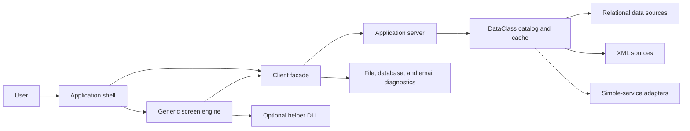

# GD Framework Functional Specification

Document status: Controlled working baseline 0.13 (framework scope covered from source; metadata schema reconstructed; no deployed configuration exists, so applications are authored in the rebuild)
Prepared: 1 August 2026; reviewed and controlled: 6 September 2026; consolidated: 9 September 2026; corrected: 4 October 2026; decisions recorded: 10 October 2026; references updated: 12 October 2026
System lineage reviewed: GD Framework 1.0–1.2, GFDGUI, GFDClient, GFDServer, GFDGUICtls  
Primary purpose: technology-neutral behavioral reference for rebuilding the framework as a web platform

Document home: `docs/GDFramework Functional Specification.md`  
Document control: [GDF_DOCUMENT_CONTROL.md](GDF_DOCUMENT_CONTROL.md)  
Legacy evidence-path base: `${LEGACY_SOURCE_ROOT}/Docs`
Legacy checksum-manifest SHA-256: `fc29779b9588a41cb9da10c486f1f0b35ca2108baf50fb8892086587ee320027`  
Change history: see GDF_DOCUMENT_CONTROL.md section 6

| Version | Date | Summary |
|---|---|---|
| 0.3 | 2026-08-01 | Initial audit baseline |
| 0.4 | 2026-09-06 | Scope and portability corrections |
| 0.5 | 2026-09-06 | Metadata schema adopted as primary evidence |
| 0.6 | 2026-09-09 | Consolidation: non-functional requirements and defect dispositions merged in; technology-neutral rewording; invariant and acceptance IDs; glossary |
| 0.7 | 2026-09-10 | Section 31 subordinated to decision D-011 with the disposition vocabulary defined; FR-DEP-003 closed as a replacement requirement consistent with NFR-PERF-004; FR-ACC-019 extended to NFR-AVAIL-001 and NFR-DR-001 with operational-evidence verification stated; section 15 reserved positions 13–15 and FR-TOOL-008 security rule for positions 16–20; section 33 classification column; section 44 measurable wording for the read fixture, concurrency mix, export memory, scan severity, and compatibility verification |
| 0.8 | 2026-09-10 | Section 32.1 register of desktop-bound behaviors requiring web reinterpretation under decision D-017, with the affected rows reclassified `REPLATFORM DECISION` and FR-INV-012 added; FR-ACC-004 accepts the approved web equivalent; DEF-038 records the auto-refresh loss of uncommitted edits; DEF-003 proposed disposition notes change-time persistence |
| 0.9 | 2026-09-10 | Premise corrected: no deployed instance, metadata rows, users, or consumers exist. Section 2 rewritten as the evidence boundary; `NOT APPLICABLE` classification added and applied to coexistence and deployment rows; discovery-evidence conditions replaced by product-decision conditions (D-017, D-019, D-020); physical-DDL and production-calibration wording removed; section 34 restated as configuration to be authored; NFR-COMP-001 marked not applicable; decision pointers added to every `REPLATFORM DECISION` row |
| 0.10 | 2026-09-13 | Review reconciliation: coordinate reinterpretation registered as pending D-017; named-capability mapping clarified without importer scope; invariant gate and applicable custom-control acceptance corrected |
| 0.11 | 2026-10-04 | Coherence review: preserve default caching, attach dual-source scope to pending D-021, replace impossible legacy runtime/deployment acquisition instructions with source-derived decisions and authoring, and exclude NFR-COMP-001 from active acceptance. Existing defect and desktop reinterpretation approvals remain pending |
| 0.12 | 2026-10-10 | Owner decisions recorded: D-011 disposition policy approved and every DEF-001..DEF-038 row decided (32 Fix, 6 Retire, none Preserve); every section 32.1 row and the legacy control scope approved under D-017; D-020 decided out of scope. Affected rows carry the `decided` classification suffix; DEF-035 disposition reworded to drop a legacy-resource import; document file names updated to the `GDF_` prefix |
| 0.13 | 2026-10-12 | Updated delivery-plan, ADR, and generated-traceability links after the governing documents were reduced and split by responsibility; no functional behavior or disposition changed |

Relative source paths in this specification are intentionally preserved from
the legacy review. Resolve paths such as `../AppControls` and
`../../GenData/AppGUI` against the legacy evidence-path base above, not against
this document's new migration-project location.

## 1. Document purpose

This document specifies the externally observable and configuration-driven behavior of the complete repository-visible GD Framework, including its application shell, generic user interface, client and server libraries, data layer, custom controls, extension contracts, and specialist components. It is the normative functional baseline for rebuilding the system on a modern technology stack.

This is not a transcription of the VB6 implementation. Requirements describe behavior that the replacement must preserve unless a behavior is explicitly classified as a legacy defect, dormant feature, unsupported design, or open decision.

The specification has four goals:

1. Define every verified framework capability and user interaction.
2. Define the metadata contract from which applications, navigation, screens, data access, security, and reporting are generated.
3. Separate shipped behavior from historical intent and unfinished work.
4. Define the configuration and decisions required to specify newly authored applications completely.

## 2. Completeness boundary

The source code and metadata database schema together specify the framework engine and the configuration grammar used to construct GD applications. The schema is sufficient to infer the metadata entities, keys, relationships, option fields, and assembly rules for application groups, applications, navigation, screens, controls, DataClasses, parameters, security, reports, messages, and personalization. Section 28 records that reconstructed metadata contract.

Nothing beyond the reviewed source tree and its documents exists. The legacy system is not deployed anywhere: there is no populated metadata database, no application database, no helper binary, no user population, and no dependent consumer, and none of these will be obtained. Consequently:

- application names, menus, screens, fields, DataClass operations, roles, value lists, reports, and business actions are not recoverable from any deployment; they are authored anew in the rebuilt platform using the section 28 grammar;
- requirements marked `METADATA-DEPENDENT` describe schema-derived configuration behavior whose instances the rebuild defines through authoring;
- requirements marked `RUNTIME-VERIFY` or `DOCUMENT CONFLICT` cannot be observed in a running build and are resolved by reading or by a recorded product decision (GDF_MIGRATION_MASTER.md section 7), which is then the tested behavior;
- requirements marked `NOT APPLICABLE` assumed a deployed instance or a coexisting legacy consumer and are retained only so their identifiers stay stable; and
- the measurement profiles in section 44 are provisional acceptance profiles, not calibrations from production.

The legacy system is therefore a behavioral reference, not a system to be migrated. Preserving a legacy defect requires a recorded product reason (section 31, D-011); the expected default is Fix or Retire.

## 3. Evidence and classification

### 3.1 Evidence sources

| Evidence ID | Source | Role |
|---|---|---|
| E-GUI-MAIN | `../../GenData/AppGUI/MainWindow.frm` | Main application shell and navigation |
| E-GUI-GENERIC | `../../GenData/AppGUI/frmGDGeneric.frm` | Metadata-driven screen engine |
| E-GUI-MODULE | `../../GenData/AppGUI/modMainGUITemplate.bas` | Display option constants and startup |
| E-GUI-DIALOGS | `../../GenData/AppGUI/*.frm` | Filters, layout, popup, message, preview, about, and utility dialogs |
| E-CLIENT | `../AppClient/CAppClient.cls` | Client orchestration, security, messages, persistence, and server facade |
| E-SERVER | `../AppServer/CAppServer.cls` | Server initialization, dataset catalog, and service facade |
| E-DATA | `../AppServer/CDB.cls`, `../AppServer/CDataset.cls` | Connections, caching, query execution, and DML generation |
| E-CONTROLS | `../AppControls/*` | Reusable toolbar, panel, splitter, dropdown, lookup, and Outlook controls |
| E-INTERFACES | `../AppInterfaces/*` | Extension-point contracts |
| E-PROJECTS | `../**/*.vbp`, `../../GenData/AppGUI/*.vbp` | Compiled membership, startup objects, compatibility mode, binary names, and dependencies |
| E-HARNESS | `../Z_Harness_GDHelperDll/*`, `../Z_Harness_RDS_Plugin/*`, `../AppControls/test/*` | Interface and control test/example implementations |
| E-BINARIES | `../AppClient/bin/*`, `../AppServer/bin/*`, `../AppControls/bin/*`, `../../GenData/AppGUI/BIN/*` | Retained x86 PE versions, hashes, embedded type libraries, COM classes/events, and release lineage |
| E-ARCHIVES | `../AppControls.zip`, `../AppServer.zip`, `../Release/V_1_0_r.zip`, `../../GenData/AppGUI/frmCustomSkeleton.zip` | Older source/binary snapshots and repaired/divergent file variants |
| E-CONFIG | `../*.ini`, `../../GenData/AppGUI/*.ini`, `../../GenData/AppGUI/GUITemplate_Notes.txt` | Startup directive examples, aliases/typos, and insecure historical secret handling |
| E-RESOURCES | `*.frx`, `*.ctx`, `*.pgx`, `*.WMF`, `*.vbw`, `MSSCCPRJ.SCC`, `*.lnk` | Embedded UI resources plus nonfunctional IDE/source-control/developer-machine artifacts |
| E-SQL-LEGACY | `../../GenData/AppGUI/foreignkeys.sql` | Unreferenced SQL Server 2000-era `gd_*` generic-datastore foreign-key fragment |
| E-DOC-META | `GD Framework Metadata Reference.doc` | Historical metadata definitions |
| E-DOC-INTRO | `GD Application Framework Introduction.doc` | Historical feature overview |
| E-DOC-SPEC | `GD Framework Specification.doc` | Early framework/server/data-source functional and architectural scope |
| E-DOC-PROGRAMMER | `GD Framework Metadata Programmer's Guide.doc`, `GenFormDataNotes.doc` | Metadata/programmer workflow and retained implementation notes |
| E-DOC-REQUESTS | `GD Framework Enhancement Requests.doc` | Defects, intended enhancements, and implementation notes |
| E-DOC-PLM | `old/PLM Components Overview.doc`, `old/PLM Server System Specification.doc`, `old/PLM Components Outstanding Work.doc` | Historical PLM architecture, limit processing, scheduling, pooling, and unfinished-work context |
| E-DOC-ARCHIVE | `old/GenFormDataNotesold.doc`, `*.wbk`, `~WRL0005.tmp` | Older document snapshots used only to detect superseded wording or otherwise-lost requirements; the enhancement backup is wholly contained in the current document, while the metadata backups add only older/deprecated wording |
| E-DOC-SCHEMA | `old/GDFramework Objects.xls` | Older physical metadata-object inventory containing 29 field/index definition blocks |
| E-META-MODEL | E-DOC-META, E-DOC-PROGRAMMER, and E-DOC-SCHEMA combined with the recordsets and fields consumed in E-CLIENT, E-SERVER, and E-GUI-GENERIC | Reconstructed metadata-schema evidence set relied on by section 28; `SCHEMA-INFERRED`; no physical DDL or populated rows exist, so the rebuild defines its own physical schema from this logical model |
| E-DOC-ENH-XLS | `old/GD Framework Enhancements.xls` | Empty enhancement-tracker template (column headings only); no independent issues or requirements |
| E-DOC-OFFSITE | `old/Global Control Room Offsite - Mark.ppt` | Historical PLM/GD component architecture, marketing claims, and three legacy runtime screenshots |

### 3.2 Classification values

| Value | Meaning |
|---|---|
| `VERIFIED` | Implemented behavior is directly traceable in source. |
| `SCHEMA-INFERRED` | The metadata structure or relationship is reconstructed from the database schema, metadata reference, physical-object inventory, and source usage. |
| `METADATA-DEPENDENT` | The metadata model is known; the configured instances are authored in the rebuild, because no populated metadata rows exist. |
| `PHYSICAL-DDL-VERIFY` | Logical behavior is known; storage-level types, constraints, defaults, indexes, and triggers are decided by the rebuild's metadata-store design (D-013), because no production DDL exists. |
| `RUNTIME-VERIFY` | Source intent is clear but exact legacy behavior cannot be observed in this rebuild; resolve ambiguity by source reading or a recorded product decision and test the decided modern behavior, never by building/running the reference. |
| `DOCUMENTED-ONLY` | Historical documentation claims the feature, but implementation was not found. |
| `DORMANT` | Compiled or retained code has no active call path. |
| `SOURCE-ONLY` | A substantive implementation is retained in source but is not a member of any supplied project. |
| `UNFINISHED` | A partial implementation or explicit stub exists. |
| `PARTIAL CODE` | Some executable path exists, but the complete feature contract or a required dependency is absent. |
| `TEMPLATE` | Development example/skeleton, not a deployed end-user feature. |
| `HISTORICAL` | Superseded source or behavior retained only as lineage evidence. |
| `HISTORICAL FIX` | A repair recorded in historical evidence whose inclusion in the reviewed production binary is not established. |
| `OUT-OF-SCOPE` | Evidence belongs to an adjacent product/component and is not part of the reviewed GD Framework project set. |
| `BUILD-UNVERIFIED` | Project/source evidence is internally inconsistent or requires unavailable registered binaries, so a clean build is not established. |
| `LEGACY-DEFECT` | Observable or likely erroneous legacy behavior; it must not become an implicit replacement requirement. |
| `DOCUMENTED INTENT` | Documentation and/or scaffolding describes intended behavior that is not complete enough to classify as shipped. |
| `CONFIGURATION RULE` | Constraint that valid metadata must satisfy. |
| `VERIFIED LIMITATION` | A known boundary of an implemented feature. |
| `HISTORICAL DEFECT` | Defect recorded by the original project documents; current-build behavior may require runtime confirmation. |
| `REPLACEMENT REQUIREMENT` | Mandatory behavior or safeguard for the new platform even where the legacy implementation is absent or defective. |
| `REPLACEMENT HARDENING` | Required modern reliability, security, or failure-handling improvement rather than a legacy parity behavior. |
| `REPLATFORM DECISION` | Behavior whose modern representation requires an explicit product/architecture decision. The decision ID follows in parentheses; the suffix `decided` records that the decision has been taken in GDF_MIGRATION_MASTER.md section 7, and the decided behavior is then the requirement. |
| `DOCUMENT CONFLICT` | Two evidence sources disagree; resolve through source/document reading or a recorded product decision under the section 2 evidence boundary. |
| `DESIGN-TIME` | Development-tool behavior that is not part of end-user runtime behavior. |
| `VERIFIED INTENT` | Executable control flow expresses the intended behavior, but a defect or unavailable dependency prevents it from being treated as reliably shipped. |
| `NOT APPLICABLE` | The requirement assumed a deployed legacy instance, deployed binaries, or a coexisting legacy consumer. None exists, so the row is retained only for identifier stability and lineage and is not a replacement requirement. |

Multiple values separated by `/` indicate that a requirement has more than one evidence/status characteristic.

## 4. Product definition

The GD Framework is a configurable data-presentation application host. A single installed client can host multiple application groups and applications. Runtime metadata defines data sources, datasets (“DataClasses”), menus, screens, fields, security, reports, user-specific layouts, and system messages.

The system comprises:

- a desktop application shell (`GFDGUI`);
- a reusable generic screen engine (`frmGDGeneric`);
- a client service facade (`GFDClient`);
- a server/data-management facade (`GFDServer`);
- a custom-controls library (`GFDGUICtls`);
- extension interfaces for validation, derived values, database access, and simple services;
- specialist aggregation and limit-processing servers.

## 5. Actors

| Actor | Description |
|---|---|
| End user | Views, searches, filters, edits, exports, prints, and personalizes authorized screens. |
| Power user | Creates personal menu groups/items and saves personal screen layouts where permitted. |
| Application configurator | Defines application groups, applications, menus, DataClasses, screens, parameters, reports, and permissions in metadata. |
| System administrator | Manages users, roles, system parameters, system messages, diagnostics, and error notifications. |
| External helper | COM component supplying application-specific validation or calculated-field behavior. |
| Simple service | External service adapter supplying recordset-shaped data. |
| Database/data source | Supplies metadata and business data and accepts permitted mutations. |

## 6. System context and logical architecture

| ID | Requirement | Classification |
|---|---|---|
| FR-ARCH-001 | The replacement may change deployment boundaries, but it shall preserve the separation between application metadata, screen-generation behavior, data access, and optional application-specific extensions. | REPLACEMENT REQUIREMENT |

## 7. Application startup and shutdown

### 7.1 Startup configuration

| ID | Requirement | Classification |
|---|---|---|
| FR-START-001 | The application shall start through a splash experience and proceed to main-shell initialization. | VERIFIED |
| FR-START-002 | Startup options shall be accepted from command-line arguments or a default `GFD.ini` file. | VERIFIED |
| FR-START-003 | Non-empty command-line arguments shall override the default INI content. | VERIFIED |
| FR-START-004 | `/CONFIG@<path>` shall redirect initialization to a named configuration file. A filename without a directory shall resolve beneath the executable directory. | VERIFIED |
| FR-START-005 | An absent, empty, or invalid redirected configuration file shall prevent successful startup and display a critical error. | VERIFIED |
| FR-START-006 | Startup shall support application-group selection, database-type override, database-connection override, debug mode, SQL debugging, no-file-log, no-mail, no-initial-data-load, display-definition refresh, user impersonation, message-polling interval, and custom splash image options where implemented. | VERIFIED / METADATA-DEPENDENT |
| FR-START-007 | Connection credentials shall be supplied through a secure secret mechanism in the replacement; plaintext tracked configuration is explicitly prohibited. | REPLACEMENT REQUIREMENT |
| FR-START-008 | Initialization shall create a client log and an application-specific temporary folder. | VERIFIED / REPLATFORM DECISION (D-017 decided) |
| FR-START-009 | Initialization shall collect workstation and user identity, with optional debug impersonation. | VERIFIED / REPLATFORM DECISION (D-017 decided) |
| FR-START-010 | Initialization shall create and initialize the application server, establish a client session, load system configuration, and load initialization DataClasses unless suppressed. | VERIFIED |
| FR-START-011 | Startup failure at any required stage shall abort display of the main application. | VERIFIED |

### 7.2 Splash behavior

| ID | Requirement | Classification |
|---|---|---|
| FR-SPLASH-001 | The splash shall show product identity while initialization is in progress. | VERIFIED |
| FR-SPLASH-002 | Initialization status messages shall update the splash caption until the main shell is displayed. | VERIFIED |
| FR-SPLASH-003 | A configured custom splash image shall replace or augment the default product image. | RUNTIME-VERIFY |
| FR-SPLASH-004 | The splash shall wait for its configured minimum display period before transferring control. | VERIFIED |

### 7.3 Controlled shutdown

| ID | Requirement | Classification |
|---|---|---|
| FR-SHUT-001 | Exit shall close all hosted and floating child forms. | VERIFIED |
| FR-SHUT-002 | Exit shall record the user’s logout time. | VERIFIED |
| FR-SHUT-003 | Exit shall persist personal menus and application-group window settings where applicable. | VERIFIED |
| FR-SHUT-004 | Exit shall stop timers, disconnect server resources, close database connections, and release COM objects. | VERIFIED |
| FR-SHUT-005 | Immediate-shutdown system messages may terminate the session without preserving unsaved screen edits. | VERIFIED |
| FR-SHUT-006 | All user-initiated close paths in the replacement shall run the same controlled-shutdown sequence. | REPLACEMENT REQUIREMENT |

## 8. Identity, authorization, and personalization

| ID | Requirement | Classification |
|---|---|---|
| FR-SEC-001 | A framework-controlled application shall identify the current user from workstation identity unless an authorized debug override is supplied. | VERIFIED / REPLATFORM DECISION (D-017 decided) |
| FR-SEC-002 | The user must exist in metadata and be active. Otherwise initialization shall fail with a security message. | VERIFIED |
| FR-SEC-003 | The user must have at least one active application assignment in the selected application group. | VERIFIED |
| FR-SEC-004 | The default application shall be the first assigned application marked as default; if none is marked, the first authorized application shall be used. | VERIFIED |
| FR-SEC-005 | Application, menu, and screen-option access shall be derived from role membership and user overrides. | VERIFIED / METADATA-DEPENDENT |
| FR-SEC-006 | Role permissions shall be cumulative across all roles assigned to the user. | VERIFIED / RUNTIME-VERIFY |
| FR-SEC-007 | For secured screen options, a capability shall be enabled only when it is enabled by the screen and allowed by effective security. | VERIFIED |
| FR-SEC-008 | A user-specific display-option row shall override the cumulative role result for that screen. | VERIFIED |
| FR-SEC-009 | The system shall track last login and last logout timestamps per user/application assignment. | VERIFIED |
| FR-SEC-010 | Personal application-group settings shall include main-window width, height, and splitter position. | VERIFIED / REPLATFORM DECISION (D-017 decided) |
| FR-SEC-011 | Personal screen settings may include visible columns, column order, width, sorting, grouping, filters, format, frozen columns, and flash-change configuration. | VERIFIED |

## 9. Main application shell

### 9.1 Layout

The shell contains a global toolbar, left navigation area, resizable splitter, tab strip, child-form container, large and small image lists, and a four-panel status bar.

| ID | Requirement | Classification |
|---|---|---|
| FR-SHELL-001 | The shell title shall display the configured application-group caption. | VERIFIED |
| FR-SHELL-002 | When configured, the active application description shall be appended to the shell title. | VERIFIED |
| FR-SHELL-003 | The shell shall restore user-specific dimensions and splitter position, falling back to application-group defaults. | VERIFIED / REPLATFORM DECISION (D-017 decided) |
| FR-SHELL-004 | The shell shall start maximized when application-group option 20 is enabled. | VERIFIED / REPLATFORM DECISION (D-017 decided) |
| FR-SHELL-005 | Resizing the shell or moving the splitter shall resize the tab region, child container, and every docked child screen. | VERIFIED |
| FR-SHELL-006 | The navigation pane and child pane shall remain independently resizable within configured splitter limits. | VERIFIED |
| FR-SHELL-007 | The status bar shall expose general information, database/server status, date, and time panels. | VERIFIED |
| FR-SHELL-008 | Double-clicking the status bar shall open the system explorer. | VERIFIED / REPLATFORM DECISION (D-017 decided) |

### 9.2 Global toolbar

| ID | Requirement | Classification |
|---|---|---|
| FR-SHELL-TB-001 | Debug mode shall add a Debug Window command. | VERIFIED |
| FR-SHELL-TB-002 | More than one authorized application shall add a Select Application command using the configured caption or “Select Application”. | VERIFIED |
| FR-SHELL-TB-003 | System parameter `xl_export_all=Y` shall add Export All to Excel. | VERIFIED |
| FR-SHELL-TB-004 | About and Exit commands shall always be present. | VERIFIED |
| FR-SHELL-TB-005 | Export All shall invoke the export contract on every open form other than the shell and place outputs into one workbook after the first export. | VERIFIED / RUNTIME-VERIFY |

### 9.3 Application switching

| ID | Requirement | Classification |
|---|---|---|
| FR-APP-001 | The selector shall list authorized applications using short name and description. | VERIFIED |
| FR-APP-002 | Cancelling selection shall leave the current application unchanged. | VERIFIED |
| FR-APP-003 | Selecting an application shall update active application ID, key, description, caption behavior, and the server’s active-application property. | VERIFIED |
| FR-APP-004 | Application switching shall clear and rebuild navigation from the selected application’s metadata. | VERIFIED |
| FR-APP-005 | DataClasses whose dynamic parameters depend on the active application shall refresh according to cache/parameter rules. | VERIFIED / METADATA-DEPENDENT |

## 10. Navigation and personal menus

### 10.1 Navigation modes

| ID | Requirement | Classification |
|---|---|---|
| FR-NAV-001 | Application-group option 1 shall select TreeView navigation; otherwise Outlook-style navigation shall be used. | VERIFIED |
| FR-NAV-002 | TreeView option 2 shall expand top-level nodes initially. | VERIFIED |
| FR-NAV-003 | TreeView option 3 shall display node icons. | VERIFIED |
| FR-NAV-004 | Top-level menu records shall be ordered by menu sequence. | VERIFIED |
| FR-NAV-005 | Submenu records shall be associated by menu ID and ordered by submenu sequence. | VERIFIED |
| FR-NAV-006 | Selecting a terminal submenu with a nonzero display-definition control ID shall open that screen. | VERIFIED |
| FR-NAV-007 | Menu captions, descriptions, keys, icons, and tooltips shall be supplied by metadata. | VERIFIED / METADATA-DEPENDENT |
| FR-NAV-008 | The replacement shall not implement a standard-Windows-menu navigation mode or an arbitrary-depth submenu hierarchy unless a recorded product decision (D-017) requires it; their absence from the active main-shell implementation is recorded in section 30. | DOCUMENTED-ONLY / REPLATFORM DECISION (D-017 decided) |

### 10.2 Outlook navigation

| ID | Requirement | Classification |
|---|---|---|
| FR-NAV-OUT-001 | Each top-level menu shall appear as a selectable Outlook group. | VERIFIED |
| FR-NAV-OUT-002 | Each submenu shall appear as a group item with large/small icon and tooltip. | VERIFIED |
| FR-NAV-OUT-003 | System submenus shall use a composite runtime key so repeated metadata keys remain distinguishable. | VERIFIED |
| FR-NAV-OUT-004 | User-defined submenus shall be merged with system submenus in their owning group. | VERIFIED |
| FR-NAV-OUT-005 | Selecting an item shall resolve its menu/submenu IDs and display-definition control ID before opening a screen. | VERIFIED |

### 10.3 User-defined menus

| ID | Requirement | Classification |
|---|---|---|
| FR-NAV-USER-001 | A user shall be able to create a personal top-level group with a generated unique key and default caption. | VERIFIED |
| FR-NAV-USER-002 | A user shall be able to create a personal item beneath the active group. | VERIFIED |
| FR-NAV-USER-003 | A personal group’s caption and tooltip shall be editable. | VERIFIED |
| FR-NAV-USER-004 | A personal item’s caption, tooltip, and target display definition shall be editable. | VERIFIED |
| FR-NAV-USER-005 | Only user-owned groups and items shall expose edit/delete commands. | VERIFIED |
| FR-NAV-USER-006 | Deletion shall require confirmation. | VERIFIED |
| FR-NAV-USER-007 | Newly created unsaved objects shall be removed locally; persisted objects shall be marked for deletion and written during controlled shutdown. | VERIFIED |
| FR-NAV-USER-008 | Personal menus shall retain deterministic sequence and ownership information. | VERIFIED / RUNTIME-VERIFY |
| FR-NAV-USER-009 | Personal menus are not loaded by the active TreeView code path. The replacement product decision shall explicitly define parity or correction. | LEGACY-DEFECT |

## 11. Window, tab, docking, and popup behavior

| ID | Requirement | Classification |
|---|---|---|
| FR-WIN-001 | Every non-popup generic screen shall initially be docked in the shell container. | VERIFIED |
| FR-WIN-002 | A docked screen shall have a tab whose key uniquely maps to the hosted screen instance and whose caption follows the screen caption. | VERIFIED |
| FR-WIN-003 | Selecting a tab shall bring its associated form to the front and send other contained forms behind it. | VERIFIED |
| FR-WIN-004 | Closing a docked screen shall remove its tab and hosted-form reference. | VERIFIED |
| FR-WIN-005 | Dragging a docked screen header beyond the movement threshold shall undock it to a floating, resizable top-level window. | VERIFIED / RUNTIME-VERIFY / REPLATFORM DECISION (D-017 decided) |
| FR-WIN-006 | The undocking gesture shall draw a desktop focus rectangle indicating the destination and eventual window size. | VERIFIED / REPLATFORM DECISION (D-017 decided) |
| FR-WIN-007 | A floating screen shall expose a Dock command that returns it to the shell. | VERIFIED / REPLATFORM DECISION (D-017 decided) |
| FR-WIN-008 | Modal popup screens shall not be added to the shell tabs and shall return an explicit OK/CANCEL result. | VERIFIED |
| FR-WIN-009 | Popup selection screens shall return configured key and display-field values through form-parameter objects. | VERIFIED |
| FR-WIN-010 | Optional popup multi-selection shall join returned values using the configured one-character delimiter. | VERIFIED / RUNTIME-VERIFY |
| FR-WIN-011 | Optional popup text editing shall be controlled by screen-element options. | VERIFIED / METADATA-DEPENDENT |
| FR-WIN-012 | The replacement shall not assume per-screen window-position persistence for loaded/floating screens unless a recorded product decision (D-017) requires it; its absence from the reviewed active code shall be recorded as a disposition. | DOCUMENTED-ONLY |

## 12. Generic screen creation lifecycle

| ID | Requirement | Classification |
|---|---|---|
| FR-SCREEN-001 | Opening a screen shall create a fresh generic-screen instance and assign its display-definition control ID before initialization. | VERIFIED |
| FR-SCREEN-002 | Initialization shall receive the client facade, active application ID/key/caption, image list, optional form parameters, and originating menu properties. | VERIFIED |
| FR-SCREEN-003 | The screen shall request its master display configuration, DataClass definition, screen-element definition, dynamic parameters, user field configuration, user filters, user format, and effective security. | VERIFIED |
| FR-SCREEN-004 | A configured detail display definition shall be loaded for master-detail behavior. | VERIFIED |
| FR-SCREEN-005 | The screen title shall use the display caption or originating submenu caption according to extended option 19. | VERIFIED |
| FR-SCREEN-006 | The active application caption shall be appended unless display option 18 suppresses it. | VERIFIED |
| FR-SCREEN-007 | The secondary title shall display the configured subcaption when one is set; otherwise it shall display the record-count/filter-state text defined by FR-GRID-010 and section 26.9.2. Extended option 20 hides the secondary title entirely. | VERIFIED |
| FR-SCREEN-008 | The screen icon shall resolve from the shared image list and fall back safely when the configured icon is unavailable. | VERIFIED |
| FR-SCREEN-009 | Unless no-data-load option 19 is enabled or the screen is an Action view, initial data shall be retrieved during initialization. | VERIFIED |
| FR-SCREEN-010 | A failure to load required configuration, DataClass information, detail configuration, helper interface, or screen data shall prevent successful display and emit a critical message. | VERIFIED |
| FR-SCREEN-011 | The screen shall generate its toolbar and view-specific controls only after configuration and security have been resolved. | VERIFIED |
| FR-SCREEN-012 | Configured saved user filters shall be applied after view initialization. | VERIFIED |
| FR-SCREEN-013 | A configured positive auto-refresh interval shall start periodic refresh. | VERIFIED |

## 13. Supported screen types

### 13.1 Grid view (`dsp_type=1`)

| ID | Requirement | Classification |
|---|---|---|
| FR-GRID-001 | The screen shall display the master DataClass as an unbound data grid. | VERIFIED |
| FR-GRID-002 | Grid columns shall be generated from active screen-element definitions in configured order. | VERIFIED |
| FR-GRID-003 | Columns shall support text, icon, icon-plus-text, and checkbox presentation. | VERIFIED |
| FR-GRID-004 | Editing shall support none, text, checkbox, dropdown value list, and calendar modes. | VERIFIED |
| FR-GRID-005 | Column visibility, caption, width, alignment, format, sizing, sorting, grouping, and default grouping shall come from metadata and user overrides. | VERIFIED |
| FR-GRID-006 | The grid shall synchronize its displayed rows with the in-memory dataset through read/add/update callbacks rather than direct data binding, so that edits and inserts are reflected in the dataset before persistence (legacy: unbound GridEX events over an ADO recordset). | VERIFIED |
| FR-GRID-007 | Display option 16 shall make the add-new row visible at the top. | VERIFIED |
| FR-GRID-008 | Display option 20 shall decorate editable column headers with an edit indicator. | VERIFIED |
| FR-GRID-009 | The Group By display option shall show the Group By panel and permit column dragging; the option position that gates it, and its relationship to the Customize View command, are stated in FR-TOOL-007. | VERIFIED |
| FR-GRID-010 | The secondary screen caption shall display record count and filtered state when no configured subcaption applies; FR-SCREEN-007 defines the precedence between subcaption and record-state text. | VERIFIED |

### 13.2 Field view (`dsp_type=2`)

| ID | Requirement | Classification |
|---|---|---|
| FR-FIELD-001 | The screen shall display one current record using dynamically created labeled controls. | VERIFIED |
| FR-FIELD-002 | Controls shall follow explicit top/left coordinates when provided and calculated field/tab order otherwise. | VERIFIED / REPLATFORM DECISION (D-017 decided) |
| FR-FIELD-003 | Previous and Next commands shall cycle through records and wrap at BOF/EOF. | VERIFIED |
| FR-FIELD-004 | The secondary caption shall show current absolute position and total count where supported by the cursor. | VERIFIED |
| FR-FIELD-005 | When no rows exist, all generated controls shall be reset to empty/default state. | VERIFIED |

### 13.3 Master-detail view (`dsp_type=3`)

| ID | Requirement | Classification |
|---|---|---|
| FR-MD-001 | The master portion shall be a field view and the detail portion shall be generated from the referenced detail display definition. | VERIFIED |
| FR-MD-002 | Screen elements marked as master-detail foreign keys shall relate the current master row to detail rows. | VERIFIED |
| FR-MD-003 | Moving the master record shall realign and refresh the visible detail rows. | VERIFIED |
| FR-MD-004 | Mutations shall target the master or detail DataClass according to current screen mode. | VERIFIED |
| FR-MD-005 | Foreign-key values shall be propagated into newly inserted detail records. | VERIFIED |

### 13.4 Command/action view (`dsp_type=4`)

| ID | Requirement | Classification |
|---|---|---|
| FR-ACTION-001 | An Action view shall generate criteria controls, labels, and action command buttons without loading a normal presentation dataset. | VERIFIED |
| FR-ACTION-002 | Clicking an action button shall validate criteria and execute the configured Action DataClass synchronously. | VERIFIED |
| FR-ACTION-003 | The Action DataClass result shall expose `ReturnValue`, `ReturnCode`, and `RowsAffected`. | VERIFIED / METADATA-DEPENDENT |
| FR-ACTION-004 | Completion or failure shall be reported through the standard message system. | VERIFIED |

### 13.5 Tree/detail view (`dsp_type=5`)

| ID | Requirement | Classification |
|---|---|---|
| FR-TREE-001 | The screen shall generate a hierarchical tree from structured master data. | VERIFIED / METADATA-DEPENDENT |
| FR-TREE-002 | Selecting a node shall expand it when it has children and initialize/filter the associated detail grid from node tag data. | VERIFIED |
| FR-TREE-003 | A resizable internal splitter shall separate the tree and detail grid. | VERIFIED |
| FR-TREE-004 | The detail grid shall use the referenced detail display definition and dynamic parameters derived from the node. | VERIFIED |

### 13.6 Junction insert view (`dsp_type=6`)

| ID | Requirement | Classification |
|---|---|---|
| FR-JUNCTION-001 | The view shall present grid data but create new junction rows from criteria-control values rather than direct grid entry. | VERIFIED |
| FR-JUNCTION-002 | Add shall validate all relevant criteria, add a recordset row, extract control values, insert it through the master DataClass, and refresh. | VERIFIED |

### 13.7 Chart view (`dsp_type=7`)

| ID | Requirement | Classification |
|---|---|---|
| FR-CHART-001 | The screen shall generate criteria controls and a chart whose categories and series are derived from DataClass and report metadata (legacy: MSChart-compatible chart control). | VERIFIED |
| FR-CHART-002 | Screen/report column metadata shall identify category/X-axis and data-series values. | VERIFIED / METADATA-DEPENDENT |
| FR-CHART-003 | Selecting a chart point shall show its value as a tooltip. | VERIFIED |
| FR-CHART-004 | The chart shall resize with the screen. | VERIFIED |
| FR-CHART-005 | The replacement shall not implement additional chart types or a chart-view editor unless a recorded product decision requires it; their absence from the reviewed code is recorded in section 30. | UNFINISHED |

## 14. Screen elements and dynamic controls

### 14.1 Common element contract

Every screen element is identified by application ID, screen-definition ID, and column ID. An optional screen-definition subkey permits runtime selection of a subset of columns.

| ID | Requirement | Classification |
|---|---|---|
| FR-ELEM-001 | `display_type=C` shall identify criteria controls; other supported values shall restrict an element to all, grid, or field presentation. | VERIFIED |
| FR-ELEM-002 | Explicit top and left positions are stored in the legacy layout unit; the legacy layout unit (twips, 1/1440 inch) shall be converted to device-independent units by the replacement so that configured layouts are preserved (legacy: twips). | VERIFIED / REPLATFORM DECISION (D-017 decided) |
| FR-ELEM-003 | Column index shall determine grid order; field index shall determine field layout/tab order. | VERIFIED |
| FR-ELEM-004 | Column caption shall supply grid/report headings, while column description shall supply field labels and explanatory text. | VERIFIED |
| FR-ELEM-005 | Datafield shall identify the corresponding DataClass recordset field. | VERIFIED |
| FR-ELEM-006 | Default values shall initialize criteria controls and may populate hidden values on insert. | VERIFIED |
| FR-ELEM-007 | Visibility shall be independent of whether an element participates in criteria or insert/update processing. | VERIFIED |
| FR-ELEM-008 | Display/output format shall use VBA-compatible formatting semantics in the legacy system; the replacement shall define equivalent technology-neutral format tokens or a compatibility mapping. | VERIFIED / REPLATFORM DECISION (D-018) |
| FR-ELEM-009 | A mandatory editable element shall reject empty input and identify the field to the user. | VERIFIED |
| FR-ELEM-010 | Text input longer than the underlying recordset field size shall be rejected before grid update. | VERIFIED |
| FR-ELEM-011 | Numeric, string, database-object, and date/time criteria datatypes shall be preserved when constructing server criteria. | VERIFIED |
| FR-ELEM-012 | Duplicate DataClass field names are unsupported and shall be rejected during configuration validation in the replacement. | VERIFIED / REPLACEMENT REQUIREMENT |

### 14.2 Field types

| `field_type` | Element | Required behavior |
|---:|---|---|
| 1 | Textbox with label | Display/edit a DataClass value. |
| 2 | Dropdown with label | Display/edit using a configured value-list DataClass. |
| 3 | Popup selection with label | Open a record selector and retain separate key and display values. |
| 4 | Checkbox with label | Map stored character/boolean values to checked state. |
| 5 | Criteria textbox | Capture typed filter/action/parameter input. |
| 6 | Criteria dropdown | Capture a key from a value-list DataClass. |
| 7 | Criteria popup | Capture key/display values from a record selector. |
| 8 | Criteria checkbox | Capture boolean criteria. |
| 9 | Action command button | Invoke the screen’s configured Action DataClass. |
| 10 | Label | Display non-data instructional text. |
| 11 | Hidden criteria | Supply criteria/parameter data without visible UI. |
| 12 | Calendar popup | Select and format a date for a normal field. |
| 13 | GD Form popup | Open another metadata-defined screen as a selector. |
| 14 | Criteria calendar popup | Select and format a date used as criteria. |

### 14.3 Value lists and popups

| ID | Requirement | Classification |
|---|---|---|
| FR-LOOKUP-001 | A value-list element shall identify a DataClass, key field, and display field. | VERIFIED |
| FR-LOOKUP-002 | Grid dropdowns shall load their items from the value-list DataClass. | VERIFIED |
| FR-LOOKUP-003 | Field dropdowns shall align the displayed selection with the stored DataClass value. | VERIFIED |
| FR-LOOKUP-004 | Popup selectors shall display only the configured field list and optionally include the bound/key column. | VERIFIED |
| FR-LOOKUP-005 | A popup result shall retain the key separately from the human-readable text. | VERIFIED |
| FR-LOOKUP-006 | A configured popup may allow multiple row selection and return delimiter-joined keys and captions. | VERIFIED / RUNTIME-VERIFY |
| FR-LOOKUP-007 | A GD Form popup shall exchange one or more `CFormParam` values, each containing key datafield/value and display datafield/value. | VERIFIED |
| FR-LOOKUP-008 | Popup cancellation shall not apply a selection. | VERIFIED |
| FR-LOOKUP-009 | Calendar cancellation shall clear the target value; selection shall honor the configured date format. | VERIFIED / RUNTIME-VERIFY |

## 15. Screen toolbar and commands

Screen capability flags are stored as positional `Y/N` characters. For positions 1–15, effective security can turn an enabled screen option off; positions 13–15 are reserved and carry no defined command in the reviewed source. Positions 16–20 are not processed by the legacy security merge even though position 16 (grid add-new row) is an editing capability; FR-TOOL-008 below governs how the replacement treats them.

| Position | Command/behavior | Functional result |
|---:|---|---|
| 1 | Save | Validate and persist edits. |
| 2 | Add | Initiate or commit new-row behavior appropriate to the view. |
| 3 | Delete | Confirm and logically or physically delete the current row. |
| 4 | Refresh | Reapply criteria/parameters and reload data. |
| 5 | Filter | Open/apply the filtering workflow. Historical metadata describes this as removed pending enhancement, but active code contains it. |
| 6 | Excel | Export the current screen. |
| 7 | Customize View | Open the summary dialog for grouping, fields, sorting, filtering, and format. Position/key mapping subject to FR-TOOL-007. |
| 8 | Search | Generate search inputs and locate a matching row. |
| 9 | Group By panel | Show the grid grouping target and allow dragging. Position/key mapping subject to FR-TOOL-007. |
| 10 | Previous | Move to the previous record, wrapping to the end. |
| 11 | Next | Move to the next record, wrapping to the beginning. |
| 12 | Print Preview | Preview the current grid. |
| 16 | Grid add-new row | Show the grid’s add-new row. |
| 17 | Pre-display report transform | Reformat/pivot data before presentation instead of only during output. |
| 18 | Omit application name | Do not append the active application caption to the screen title. |
| 19 | No initial data load | Display the screen shell without retrieving its main DataClass. |
| 20 | Editable-column icon | Display an edit overlay in editable grid column headers. |

Extended options:

| Position | Behavior |
|---:|---|
| 1 | Refresh the view after successful data modification. |
| 2 | Flash changed grid cells. |
| 19 | Use submenu caption instead of display-definition caption. |
| 20 | Hide the row-count secondary caption. |

| ID | Requirement | Classification |
|---|---|---|
| FR-TOOL-001 | Only configured and authorized commands shall be created. | VERIFIED |
| FR-TOOL-002 | Save, Add, Delete, and Refresh captions may be overridden per display definition. | VERIFIED |
| FR-TOOL-003 | Toolbar images shall be produced by overlaying the screen icon with a command icon when both exist. | VERIFIED |
| FR-TOOL-004 | Dock and Close shall be available according to hosted/popup state. | VERIFIED / REPLATFORM DECISION (D-017 decided) |
| FR-TOOL-005 | Unknown toolbar keys shall result in a critical diagnostic rather than silent execution. | VERIFIED |
| FR-TOOL-006 | A non-updateable/non-insertable DataClass shall disable incompatible mutation commands even if metadata requests them. | HISTORICAL DEFECT / REPLACEMENT REQUIREMENT |
| FR-TOOL-007 | Customize View / Group By option mapping: the toolbar builder (section 26.9.1) creates one command with key `GroupBy` and caption `Customise View`, gated by the single symbolic display option `GROUPBY`, which opens the customization dialog for grid, master/detail, and grid-junction views; the option table above lists Customize View at position 7 and the Group By panel (FR-GRID-009) at position 9. Resolve the positional ambiguity from available constants/source under D-009; if it remains ambiguous, record the intended named capabilities at Gate B before their mapping is accepted. No running legacy build or executable positional importer is required. | RUNTIME-VERIFY |
| FR-TOOL-008 | Every screen capability position that enables an editing or data-exposing behavior, including position 16 (grid add-new row) and any reserved position later assigned, shall be subject to effective security in the replacement; positions 17–20 are presentation options and need no security merge. Positions 13–15 remain reserved in the lineage mapping; authors cannot assign them unsupported named behavior. | REPLACEMENT REQUIREMENT |

## 16. Data retrieval, parameters, and caching

### 16.1 DataClass abstraction

A DataClass is a named, configured data operation that resolves to a tabular dataset (legacy: ADO recordset) or an action result. System DataClasses use reserved IDs from 1 to 999 inclusive; configured application DataClasses historically use IDs of 1000 and above (1000 belongs to the application range).

| ID | Requirement | Classification |
|---|---|---|
| FR-DC-001 | A DataClass shall be retrievable by numeric ID or unique name. | VERIFIED |
| FR-DC-002 | Supported operation types shall include select SQL, action SQL, stored procedure returning data, parameterized stored procedure returning status, function call, XML source, and simple-service result. | VERIFIED / METADATA-DEPENDENT |
| FR-DC-003 | A DataClass shall identify its read connection and may identify a different write connection. | VERIFIED |
| FR-DC-004 | A DataClass may write changes to both configured data sources. D-021 records modern scope at Gate B and the provider-qualified atomicity/recovery strategy before dependent implementation/publication; dual-source definitions fail closed while approval or capability proof is missing. This safety gate is not retirement of the legacy capability, and no sequential partial-commit behavior is implicitly accepted. | VERIFIED / RUNTIME-VERIFY / REPLATFORM DECISION (D-021) |
| FR-DC-005 | DataClasses marked as initialization datasets shall load during startup unless no-data-load is active. | VERIFIED |
| FR-DC-006 | Other DataClasses shall initialize on first access. | VERIFIED |
| FR-DC-007 | A DataClass may be returned as an in-memory tabular dataset or as marshalled XML according to configuration (legacy: ADO recordset). | VERIFIED |
| FR-DC-008 | Cursor location, cursor type, fetch/cache size, and refresh mode shall be configurable. | VERIFIED |
| FR-DC-009 | By default a loaded dataset shall be cached and reused while valid. | VERIFIED |
| FR-DC-010 | Refresh mode “always refresh” shall bypass the cache. | VERIFIED |
| FR-DC-011 | Client refresh requests, parameter changes, cache age expiration, display-definition refresh mode, and system messages may invalidate or bypass cached data. | VERIFIED |
| FR-DC-012 | Criteria requests shall create a transient predicate without permanently changing the configured base operation. | VERIFIED |
| FR-DC-013 | Retrieval failure shall return no recordset and emit an error appropriate to the calling context. | VERIFIED |

### 16.2 Dynamic parameters

| Type | Meaning |
|---:|---|
| 1 | Numeric substitution value |
| 2 | String substitution value |
| 3 | Database object/dynamic SQL fragment |
| 4 | Date/time string |
| 5 | String with trailing wildcard |
| 6 | String with leading wildcard |
| 7 | String with leading and trailing wildcards |
| 8 | DataClass/recordset value for external calls |
| 98 | Active screen-definition subkey |
| 99 | Active application key |

| ID | Requirement | Classification |
|---|---|---|
| FR-PARAM-001 | Dynamic parameters shall be grouped into ordered parameter sets associated with DataClasses. | VERIFIED |
| FR-PARAM-002 | A parameter marker in configured SQL/action text shall be substituted with the current parameter value using datatype-appropriate quoting/wildcards. | VERIFIED |
| FR-PARAM-003 | Screen criteria controls shall update matching parameters through configured bound columns. | VERIFIED |
| FR-PARAM-004 | Parameter type 99 shall be maintained automatically from the selected application key. | VERIFIED |
| FR-PARAM-005 | Parameter type 98 shall re-filter the active screen-element definition by subkey and rebuild affected grid columns. | VERIFIED |
| FR-PARAM-006 | Master-detail and popup form parameters shall populate matching dynamic parameters. | VERIFIED |
| FR-PARAM-007 | A cached DataClass whose parameter values changed shall be refreshed. | VERIFIED |
| FR-PARAM-008 | Parameter ordering shall be preserved for external interface calls. | VERIFIED / METADATA-DEPENDENT |

### 16.3 Runtime DataClass joins

| ID | Requirement | Classification |
|---|---|---|
| FR-JOIN-001 | A master DataClass may declare an ordered set of child DataClasses to be merged in memory. | VERIFIED / METADATA-DEPENDENT |
| FR-JOIN-002 | Master and child join columns shall be non-empty, valid, ordered lists of equal cardinality. | VERIFIED / CONFIGURATION RULE |
| FR-JOIN-003 | The merged schema shall contain master fields plus nonduplicate child fields. | VERIFIED |
| FR-JOIN-004 | Each master row shall be matched to child rows by the configured field pairs and enriched with child values. | VERIFIED |
| FR-JOIN-005 | Join configuration shall define whether a child cache is reused when the master refreshes. | VERIFIED |
| FR-JOIN-006 | Cartesian/multiple-match behavior shall be explicitly configured; reconcile historical documentation and source by reading or a recorded Gate B product decision, then test the decided behavior in the modern implementation. | RUNTIME-VERIFY |
| FR-JOIN-007 | The capability shall support joins across different connection/source types. | VERIFIED / METADATA-DEPENDENT |

## 17. Criteria, filtering, searching, and sorting

### 17.1 Criteria controls

| ID | Requirement | Classification |
|---|---|---|
| FR-CRIT-001 | Criteria controls shall be created above the primary view and laid out from metadata. | VERIFIED |
| FR-CRIT-002 | Mandatory criteria shall be validated before refresh, action execution, or dependent popup retrieval. | VERIFIED |
| FR-CRIT-003 | Criteria shall be transmitted either through dynamic parameters or as parallel operator/value/datatype/column lists. | VERIFIED |
| FR-CRIT-004 | Hidden criteria shall participate without a visible control. | VERIFIED |
| FR-CRIT-005 | Criteria popup value lists may themselves depend on already entered dynamic parameters. | VERIFIED |

### 17.2 Filtering

| ID | Requirement | Classification |
|---|---|---|
| FR-FILTER-001 | A filter consists of column identity, column caption, operator, and value. | VERIFIED |
| FR-FILTER-002 | Multiple filters shall be combined with logical AND in the legacy workflow. | VERIFIED |
| FR-FILTER-003 | The filter dialog shall allow add, remove, and clear-all operations. | VERIFIED |
| FR-FILTER-004 | Grid context commands shall support “Filter By Selection” (`=`) and “Filter Excluding Selection” (`<>`). | VERIFIED |
| FR-FILTER-005 | Remove Filters shall clear all active screen filters. | VERIFIED |
| FR-FILTER-006 | Local filtering shall apply the active filters to the in-memory dataset without re-querying the source and shall update the grid and record count (legacy: ADO recordset `Filter`). | VERIFIED |
| FR-FILTER-007 | Server filtering shall re-query the DataClass using constructed criteria. | VERIFIED |
| FR-FILTER-008 | The screen caption shall append `[Filtered]` while one or more filters are active. | VERIFIED |
| FR-FILTER-009 | Persisted user filters shall be loaded on screen initialization and may be reset through customization. | VERIFIED |
| FR-FILTER-010 | The replacement shall not implement filter modes 3 and 4 (grid-filter UI) unless a recorded product decision requires it; the partial scaffolding is recorded in section 30. | UNFINISHED |

### 17.3 Search and sorting

| ID | Requirement | Classification |
|---|---|---|
| FR-SEARCH-001 | Search-capable definitions shall generate search fields from eligible screen elements. | VERIFIED |
| FR-SEARCH-002 | Search shall locate the next matching record from the current position and support configured datatypes/operators. | VERIFIED |
| FR-SEARCH-003 | Search behavior shall work in master or detail mode against the active recordset. | VERIFIED |
| FR-SEARCH-004 | Grid column-header clicks shall toggle configured sort order. | VERIFIED |
| FR-SEARCH-005 | Group-header clicks shall toggle group sort order and refresh grouping. | VERIFIED |
| FR-SEARCH-006 | The customization Sort dialog shall support multiple ordered sort keys and clear-all. | VERIFIED |
| FR-SEARCH-007 | The historical grouped-grid search defect shall be tested and corrected in the replacement. | LEGACY-DEFECT |

## 18. Create, read, update, and delete behavior

### 18.1 General mutation rules

| ID | Requirement | Classification |
|---|---|---|
| FR-DML-001 | Mutation shall be permitted only for DataClasses configured as insertable/updateable and screens exposing the authorized command. | VERIFIED / REPLACEMENT HARDENING |
| FR-DML-002 | The current screen mode shall select the master or detail DataClass. | VERIFIED |
| FR-DML-003 | Client-side recordset changes shall be validated before server persistence. | VERIFIED |
| FR-DML-004 | The server shall generate DML only against the configured unique update table. | VERIFIED |
| FR-DML-005 | The configured update-unique-key list shall contain the full primary key in correct order. | CONFIGURATION RULE |
| FR-DML-006 | A fail-safe shall prevent one row operation from unexpectedly affecting multiple database rows. | VERIFIED |
| FR-DML-007 | A successful mutation shall report affected-row count. | VERIFIED |
| FR-DML-008 | Configured insert/update/delete user and timestamp columns shall be populated automatically. | VERIFIED / METADATA-DEPENDENT |
| FR-DML-009 | Database-managed autonumber columns shall be excluded from generated insert values according to configured primary-key ID columns. | VERIFIED |
| FR-DML-010 | Framework-managed automatic keys shall be allocated using application/table ID metadata and increment rules. | VERIFIED |
| FR-DML-011 | Optional post-mutation refresh shall reload the screen and reconcile server-generated values/timestamps. | VERIFIED |

### 18.2 Insert

| ID | Requirement | Classification |
|---|---|---|
| FR-INSERT-001 | Grid Add shall expose/commit the add-new row; grid event handling shall copy editable values and defaults into a new recordset row. | VERIFIED |
| FR-INSERT-002 | Field-view Add shall validate fields, add a recordset row, extract generated-control values, assign keys/defaults/stamps, and call DataInsert. | VERIFIED |
| FR-INSERT-003 | Master-detail detail inserts shall copy master-detail foreign-key values from the current master. | VERIFIED |
| FR-INSERT-004 | Junction inserts shall use criteria controls as the row source. | VERIFIED |
| FR-INSERT-005 | Checkbox fields with no explicit selection shall have deterministic boolean defaults. | VERIFIED / HISTORICAL FIX |

### 18.3 Update

| ID | Requirement | Classification |
|---|---|---|
| FR-UPDATE-001 | Grid Save shall commit the current grid edit and persist pending recordset changes. | VERIFIED |
| FR-UPDATE-002 | Field-view Save shall validate and copy generated-control values into the current record before persistence. | VERIFIED |
| FR-UPDATE-003 | Update timestamp concurrency checks shall use configured key and timestamp information where enabled. | VERIFIED / RUNTIME-VERIFY |
| FR-UPDATE-004 | The local cache shall be reconciled with database-generated update timestamp/user values. | HISTORICAL DEFECT / REPLACEMENT REQUIREMENT |

### 18.4 Delete

| ID | Requirement | Classification |
|---|---|---|
| FR-DELETE-001 | Delete shall require explicit confirmation. | VERIFIED |
| FR-DELETE-002 | When logical delete is disabled, the current row shall be physically deleted through the DataClass. | VERIFIED |
| FR-DELETE-003 | When logical delete is enabled, the configured delete timestamp/user fields shall be updated rather than physically removing the row. | VERIFIED |
| FR-DELETE-004 | Logical delete shall fail safely when required delete fields are absent. | VERIFIED |
| FR-DELETE-005 | After successful deletion, field and grid views shall move/refresh to a valid remaining row and update row counts. | VERIFIED / HISTORICAL DEFECT |
| FR-DELETE-006 | Delete with no rows shall show an informational message and perform no server operation. | VERIFIED |

## 19. Refresh and auto-refresh

| ID | Requirement | Classification |
|---|---|---|
| FR-REFRESH-001 | Refresh shall validate mandatory criteria before querying. | VERIFIED |
| FR-REFRESH-002 | Refresh shall cancel an incomplete grid add-new row before replacing data. | VERIFIED |
| FR-REFRESH-003 | Refresh shall preserve the current row position where the dataset supports stable row identity and the row remains available after reload (legacy: ADO bookmark). | VERIFIED |
| FR-REFRESH-004 | Non-dynamic criteria shall be sent as additional server criteria; dynamic criteria shall update parameter values before a normal DataClass refresh. | VERIFIED |
| FR-REFRESH-005 | Pre-display report transformations shall be reapplied after data retrieval. | VERIFIED |
| FR-REFRESH-006 | View-specific UI shall be repopulated: grid rows, field controls, master/detail alignment, tree nodes/detail, or chart. | VERIFIED |
| FR-REFRESH-007 | Auto-refresh shall execute the same refresh behavior on the configured interval. | VERIFIED |
| FR-REFRESH-008 | An external form-refresh system message shall refresh every open screen whose master or detail DataClass matches the message parameter. | VERIFIED INTENT / LEGACY-DEFECT |

## 20. Grid customization and visual change indication

| ID | Requirement | Classification |
|---|---|---|
| FR-CUSTOM-001 | Customize View shall summarize active fields, filters, groups, sorts, and format. | VERIFIED |
| FR-CUSTOM-002 | Users shall be able to select visible fields and reorder them. | VERIFIED |
| FR-CUSTOM-003 | Users shall be able to configure multiple groups and sort direction. | VERIFIED |
| FR-CUSTOM-004 | Users shall be able to configure multiple sort keys and direction. | VERIFIED |
| FR-CUSTOM-005 | Table format shall support header/grid fonts and colors, gridlines, frozen columns, and even/odd row colors. | VERIFIED |
| FR-CUSTOM-006 | Card formatting shall support card/header fonts; decide card-view scope from source/document semantics or a recorded Gate B product decision because metadata marks several card options as reserved. No running legacy build is required. | VERIFIED / RUNTIME-VERIFY |
| FR-CUSTOM-007 | Users may save customization as personal defaults or request reset to metadata defaults. | VERIFIED |
| FR-CUSTOM-008 | Saved settings shall be scoped by application, menu, submenu, user, screen definition, and optional screen subkey. | VERIFIED |
| FR-CUSTOM-009 | Changed-cell flashing shall compare the refreshed dataset to a prior image using the configured unique key. | VERIFIED |
| FR-CUSTOM-010 | A changed cell shall receive a configured format/color and revert after the configured delay. | VERIFIED |
| FR-CUSTOM-011 | Flash comparison shall not be considered reliable when rows change without a stable unique key. | VERIFIED LIMITATION |

## 21. Reporting, Excel export, and printing

Chart presentation (`dsp_type=7`) is specified in section 13.7; this section covers report transformation, Excel export, and print preview only.

### 21.1 Report definitions and transformation

| ID | Requirement | Classification |
|---|---|---|
| FR-REPORT-001 | A display definition may reference a report definition. | VERIFIED |
| FR-REPORT-002 | Report type shall distinguish standard output, cross-tab transformation, and chart-oriented output. | VERIFIED / METADATA-DEPENDENT |
| FR-REPORT-003 | Report columns shall define caption, source datafield, format, operation, and evaluation/display sequence. | VERIFIED / METADATA-DEPENDENT |
| FR-REPORT-004 | A cross-tab shall derive unique break values, create output columns, apply aggregation/domain functions, and order inputs as required by the cross-tab column. | VERIFIED |
| FR-REPORT-005 | A report transformation may occur before display or only when producing output, according to display option 17. | VERIFIED |
| FR-REPORT-006 | Report output shall preserve configured groupings and criteria descriptions where supported. | VERIFIED |

### 21.2 Excel export

| ID | Requirement | Classification |
|---|---|---|
| FR-EXCEL-001 | A screen with Excel enabled shall export its active dataset using visible/report-defined columns. | VERIFIED |
| FR-EXCEL-002 | Field, grid, master-detail, tree/detail, and transformed-report data shall select the appropriate active recordset for export. | VERIFIED / RUNTIME-VERIFY |
| FR-EXCEL-003 | Export shall exclude internal or explicitly omitted columns. | VERIFIED |
| FR-EXCEL-004 | Export shall supply a valid sheet name and screen/report caption. | VERIFIED |
| FR-EXCEL-005 | Individual-screen export shall create a new workbook. | VERIFIED / REPLATFORM DECISION (D-017 decided) |
| FR-EXCEL-006 | Export All shall append subsequent screen exports to the workbook opened by the first screen. | VERIFIED / REPLATFORM DECISION (D-017 decided) |
| FR-EXCEL-007 | Excel startup or copy failure shall produce a critical diagnostic. | VERIFIED / REPLATFORM DECISION (D-017 decided) |
| FR-EXCEL-008 | Text fields that look numeric, whitespace, formats, and large datasets shall be covered by replacement acceptance tests because historical defects were recorded. | HISTORICAL DEFECT |

### 21.3 Print preview

| ID | Requirement | Classification |
|---|---|---|
| FR-PRINT-001 | Print Preview shall render the current grid, including its visible columns, grouping, and formatting, as paginated printable output (legacy: GridEX preview engine). | VERIFIED |
| FR-PRINT-002 | Preview shall support pagination status, zoom, page navigation, print, and close. | VERIFIED |
| FR-PRINT-003 | The preview window shall open at the invoking screen’s bounds and resize its preview surface. | VERIFIED / REPLATFORM DECISION (D-017 decided) |

## 22. Messages, status, logging, and diagnostics

### 22.1 Message classes

The framework differentiates normal trace messages, function headers, warnings, errors, critical errors, security messages, client messages, client status messages, and system messages.

| ID | Requirement | Classification |
|---|---|---|
| FR-MSG-001 | Server messages shall be converted to client messages and routed through one client message handler. | VERIFIED |
| FR-MSG-002 | During startup, ordinary client progress messages shall update the splash. | VERIFIED |
| FR-MSG-003 | After startup, warning/client messages shall use the custom message dialog. | VERIFIED |
| FR-MSG-004 | Critical and security messages shall include available source, number, line, and description information. | VERIFIED |
| FR-MSG-005 | Status messages shall update the named status-bar panel or the default information panel. | VERIFIED |
| FR-MSG-006 | Message verbosity shall determine which noncritical messages are passed to the UI/log. | VERIFIED |
| FR-MSG-007 | The client message handler shall prevent recursive re-entry while processing a message. | VERIFIED |
| FR-MSG-008 | A modal response request shall return the user’s selected standard message-box result to the caller. | VERIFIED |

### 22.2 Custom message dialog

| ID | Requirement | Classification |
|---|---|---|
| FR-DIALOG-001 | The dialog shall support the standard button combinations (OK; OK/Cancel; Yes/No; Yes/No/Cancel; Retry/Cancel; Abort/Retry/Ignore), a designated default button, severity icons, title, modal/modeless behavior, keyboard shortcuts, and a returned result identifying the chosen button (legacy: VB `MsgBox` style constants). | VERIFIED |
| FR-DIALOG-002 | Message text shall interpret legacy inline markup for bold, color, line breaks, and related emphasis tokens. | VERIFIED |
| FR-DIALOG-003 | Modeless system messages shall not block the message-polling loop. | VERIFIED |

### 22.3 Logs and error notification

| ID | Requirement | Classification |
|---|---|---|
| FR-LOG-001 | Each client session shall create a timestamped local log in the system temporary directory unless no-file-log is active. | VERIFIED / REPLATFORM DECISION (D-017 decided) |
| FR-LOG-002 | Debug mode shall display log output in the debug window. | VERIFIED / REPLATFORM DECISION (D-017 decided) |
| FR-LOG-003 | SQL debugging shall expose executed SQL through diagnostics. | VERIFIED |
| FR-LOG-004 | Serious errors shall be inserted into the configured system error-log DataClass where available. | VERIFIED |
| FR-LOG-005 | Serious errors may be emailed to configured system administrators unless mail is disabled. | VERIFIED / REPLATFORM DECISION (D-017 decided) |
| FR-LOG-006 | Error mail shall contain diagnostic context and collected system information. | VERIFIED / REPLATFORM DECISION (D-017 decided) |
| FR-LOG-007 | Failure of database logging shall fall back to the local log without recursively failing. | VERIFIED INTENT / RUNTIME-VERIFY |
| FR-LOG-008 | The replacement shall not depend on legacy MAPI/CDO; notification transport shall be replaceable and securely configured. | REPLACEMENT REQUIREMENT |

### 22.4 System information

| ID | Requirement | Classification |
|---|---|---|
| FR-SYSINFO-001 | About shall display application, component, client, server, database, user, workstation, and environment information available through `CSystemInfo`. | VERIFIED / REPLATFORM DECISION (D-017 decided) |
| FR-SYSINFO-002 | System Explorer shall display system information hierarchically and expose selected-node detail. | VERIFIED / REPLATFORM DECISION (D-017 decided) |
| FR-SYSINFO-003 | System information shall be refreshable on demand. | VERIFIED |

## 23. Asynchronous system messages

| Code/intention | Required behavior |
|---|---|
| Client message box | Display administrator-supplied text without blocking later message processing. |
| Immediate client shutdown | Run immediate session close behavior. |
| Dataset refresh | Mark the named cached DataClass for refresh on next access. |
| Form refresh | Refresh open screens bound to the named master or detail DataClass. |
| Polling-frequency change | Change the client’s system-message query interval. |
| Generic system message | Deliver through the general system-message route. |

| ID | Requirement | Classification |
|---|---|---|
| FR-SYSMSG-001 | The client shall poll messages at the configured interval, defaulting to ten seconds in current code when the configured value is zero. Historical documentation says ten minutes; the source-derived ten-second behavior is the reference pending a recorded Gate B product decision, not a legacy runtime observation. | VERIFIED / DOCUMENT CONFLICT |
| FR-SYSMSG-002 | Messages shall be selected for the current user ID or workstation name. | VERIFIED / REPLATFORM DECISION (D-017 decided) |
| FR-SYSMSG-003 | Only ready messages whose valid time has arrived shall be processed. | VERIFIED |
| FR-SYSMSG-004 | A message shall be marked processed and persisted before or during delivery so it is not repeatedly delivered. | VERIFIED |
| FR-SYSMSG-005 | Delivery failures shall be logged as critical diagnostics. | VERIFIED |
| FR-SYSMSG-006 | Future-dated messages shall remain pending. | VERIFIED |
| FR-SYSMSG-007 | Broadcast behavior shall be implemented by creating one target message per user/workstation or by an equivalent modern fan-out mechanism. | DOCUMENTED-ONLY / REPLACEMENT REQUIREMENT |

## 24. External extension contracts

### 24.1 Validation helper

`IGDValidationHelper` defines:

- `ValidationFieldsRequest(requestorField, fieldList, returnMessage)`
- `ValidateField(requestorField, fieldNames, values, returnMessage)`

| ID | Requirement | Classification |
|---|---|---|
| FR-EXT-VAL-001 | A display definition may name a helper component to provide application-specific validation. | VERIFIED |
| FR-EXT-VAL-002 | The component shall implement the validation interface before the screen is accepted. | VERIFIED |
| FR-EXT-VAL-003 | Screen-element `external_validation` and helper-event options shall determine when validation is requested. | DOCUMENTED INTENT |
| FR-EXT-VAL-004 | The replacement shall not treat save-time or grid pre-update helper validation as active behavior unless decision D-019 admits the validation-helper contract; the commented-out invocation and placeholder comments are recorded as DEF-011. | UNFINISHED / REPLATFORM DECISION (D-019) |

### 24.2 Function/derived-value helper

`IGDFunctionCallHelper` defines:

- `FunctionFieldsRequest(requestorField, fieldList, returnMessage)`
- `FunctionCall(requestorField, fieldNames, values, returnValue, returnMessage)`

| ID | Requirement | Classification |
|---|---|---|
| FR-EXT-FUNC-001 | A screen element marked `external_process` may derive its displayed value from other row fields through the helper interface. | DOCUMENTED INTENT / PARTIAL CODE |
| FR-EXT-FUNC-002 | The helper shall declare required fields, receive corresponding row values, and return a derived value and diagnostic message. | DOCUMENTED INTENT |
| FR-EXT-FUNC-003 | The replacement shall not implement function-helper derived values unless decision D-019 admits the function-helper contract; the never-assigned interface and suppressed error are recorded as DEF-010. | UNFINISHED / LEGACY-DEFECT / REPLATFORM DECISION (D-019) |

### 24.3 Simple service helper

`IGDSimpleServiceHelper` defines connect, query, and disconnect operations. Query accepts a request string plus column-name and value-list recordsets and returns a recordset and message.

| Member | Signature | Purpose |
|---|---|---|
| `Connect` | only the member name is recorded in the reviewed source; the rebuild defines its own typed adapter contract under D-019 | Establish the adapter session for a connection of type Simple Service (FR-EXT-SVC-001). |
| `Query` | `Query(request, columnNames, valueList, returnRecordset, returnMessage)` — parameter order as described in prose; exact types are not recorded in the reviewed source, and the rebuild defines its own typed adapter contract under D-019 | Execute one request built from the ordered parameter set and return a recordset-shaped result plus diagnostic message (FR-EXT-SVC-002, FR-EXT-SVC-003). |
| `Disconnect` | only the member name is recorded in the reviewed source; the rebuild defines its own typed adapter contract under D-019 | Release the adapter session on connection close/shutdown (FR-EXT-SVC-004). |

| ID | Requirement | Classification |
|---|---|---|
| FR-EXT-SVC-001 | A connection of type Simple Service shall instantiate its configured helper and invoke its connect contract. | VERIFIED |
| FR-EXT-SVC-002 | A Simple Service DataClass shall map an ordered parameter set into request, column-name, and value-list inputs. | VERIFIED / METADATA-DEPENDENT |
| FR-EXT-SVC-003 | Query results shall be normalized to the same dataset abstraction used by database and XML sources. | VERIFIED |
| FR-EXT-SVC-004 | Connection close/shutdown shall call the adapter’s disconnect contract. | VERIFIED |
| FR-EXT-SVC-005 | The included RDS plugin is an example harness and contains incomplete/error-prone behavior; it is not a normative adapter implementation. | DORMANT / UNFINISHED |

### 24.4 Database helper

`IGDDbHelper` permits an extension to request a named framework DataClass.

| Member | Signature | Purpose |
|---|---|---|
| `RequestGDDataClassRecordset` | `RequestGDDataClassRecordset(name)` — return and parameter types are not recorded in the reviewed source; the rebuild defines its own typed contract under D-019 | Return the dataset of the named framework DataClass to an extension component. |

| ID | Requirement | Classification |
|---|---|---|
| FR-EXT-DB-001 | The replacement shall offer a stable service interface for extension access to a named DataClass only if decision D-019 admits the database-helper contract; otherwise the contract is retired. | DOCUMENTED INTENT / REPLATFORM DECISION (D-019) |

## 25. Data sources and connection management

| Connection type | Legacy behavior/status |
|---:|---|
| 1 | Sybase database through ADO/ODBC |
| 2 | Microsoft SQL Server through SQLOLEDB |
| 3 | Oracle 8+ through ADO provider |
| 4 | Microsoft Access through ODBC |
| 5 | XML data source from file/blob configuration |
| 6 | Simple Service adapter DLL |
| Future/documented | DCOM, Excel reader, delimited text reader, Trade Server |

| ID | Requirement | Classification |
|---|---|---|
| FR-CONN-001 | Multiple named data-source connections shall be usable concurrently by one application group. | VERIFIED |
| FR-CONN-002 | A connection shall expose type, timeout, the logical connection name, redacted database/server/user diagnostics, connected state, and transaction state; credentials and full connection strings are never exposed (see FR-CONN-006). | VERIFIED / REPLACEMENT HARDENING |
| FR-CONN-003 | Connections shall be opened on demand and may be closed after inactivity according to timeout. | VERIFIED |
| FR-CONN-004 | A request against a closed timed-out connection shall transparently reconnect. | VERIFIED INTENT / RUNTIME-VERIFY |
| FR-CONN-005 | Begin, commit, and rollback transaction operations shall be available per named connection. | VERIFIED |
| FR-CONN-006 | Database credentials shall never be displayed in diagnostics, committed configuration, or client logs in the replacement. | REPLACEMENT REQUIREMENT |
| FR-CONN-007 | Unsupported future source types shall not be assumed in scope until active metadata or implementations demonstrate their use. | DOCUMENTED-ONLY |

## 26. Custom control library

### 26.1 CSFPToolbar and CSFPButton

| ID | Requirement | Classification |
|---|---|---|
| FR-CTL-TB-001 | The toolbar shall manage a keyed ordered button collection and raise a button-click event containing the logical button object. | VERIFIED |
| FR-CTL-TB-002 | Button styles shall include normal, separator, placeholder, and menu-bar styles. | VERIFIED |
| FR-CTL-TB-003 | Buttons shall support key, caption, description, image, tooltip, enabled, visible, pressed, mixed, tag, caption color, group key, and position/size properties. | VERIFIED |
| FR-CTL-TB-004 | A placeholder button may host another control with configurable alignment and width. | VERIFIED |
| FR-CTL-TB-005 | Grouped buttons shall enforce group press/pop behavior. | VERIFIED |
| FR-CTL-TB-006 | Horizontal and vertical orientation, small/large button sizes, flat/3D appearance, and dark/light background shall be supported. | VERIFIED |
| FR-CTL-TB-007 | Overflow shall expose directional scrolling controls and maintain the first visible button. | VERIFIED |
| FR-CTL-TB-008 | Frozen mode shall defer expensive repositioning while buttons are added in bulk. | VERIFIED |
| FR-CTL-TB-009 | Parent/surrogate toolbars shall forward events and temporarily replace/restore button collections. | VERIFIED |

### 26.2 CSFPPanel

| ID | Requirement | Classification |
|---|---|---|
| FR-CTL-PNL-001 | The panel shall display primary and optional secondary captions plus an optional image. | VERIFIED |
| FR-CTL-PNL-002 | Image size/position, margins, caption offset, fonts, colors, appearance, and enabled state shall be configurable. | VERIFIED |
| FR-CTL-PNL-003 | Click and mouse events shall be raised consistently from the panel’s constituent controls. | VERIFIED |

### 26.3 CSFPSplitter

| ID | Requirement | Classification |
|---|---|---|
| FR-CTL-SPLIT-001 | The splitter shall support horizontal/vertical orientation, minimum/maximum/position, bar width, background, and appearance. | VERIFIED |
| FR-CTL-SPLIT-002 | Dragging shall display feedback, resize adjacent hosted controls, and raise old/new position when complete. | VERIFIED |
| FR-CTL-SPLIT-003 | Optional design-time resizing shall be supported by the legacy control but is not a runtime product requirement. | VERIFIED / DESIGN-TIME |

### 26.4 CSFPDropDown

| ID | Requirement | Classification |
|---|---|---|
| FR-CTL-DD-001 | The dropdown shall display a text field plus list, expose selected key/index, and raise item selection. | VERIFIED |
| FR-CTL-DD-002 | It shall support keyboard selection, scrolling, allow-entry, locked/enabled, Return-as-Tab, fonts, and colors. | VERIFIED |
| FR-CTL-DD-003 | Existing/new/amended/deleted status may automatically control foreground color. | VERIFIED |

### 26.5 CSFPTextLookup

| ID | Requirement | Classification |
|---|---|---|
| FR-CTL-LU-001 | The control shall expose textbox editing and a lookup button while forwarding standard text/mouse/keyboard events. | VERIFIED |
| FR-CTL-LU-002 | It shall support full, partial, or disabled lookup; predefined SQL ID; source; case conversion; field name; associated control; extra conditions; and hidden-field list. | VERIFIED |
| FR-CTL-LU-003 | It shall maintain separate display text and code value plus validation status/last validated text. | VERIFIED |
| FR-CTL-LU-004 | It shall support automatic selection, mandatory state, selection APIs, maximum length, space padding, and Return-as-Tab. | VERIFIED |
| FR-CTL-LU-005 | It shall coordinate status/clearing of associated form fields. | VERIFIED |
| FR-CTL-LU-006 | The replacement shall not carry `CSFPTextLookup` into the generic screen unless a recorded product decision (D-017) requires it; no active generic-form consumer exists in the supplied standard project (DEF-030, FR-CTL-USE-005). | DORMANT / REPLATFORM DECISION (D-017 decided) |

### 26.6 Custom OutlookBar

| ID | Requirement | Classification |
|---|---|---|
| FR-CTL-OUT-001 | The control shall manage keyed groups and keyed buttons with large/small icon modes. | VERIFIED |
| FR-CTL-OUT-002 | It shall expose button/header/mouse events, hit testing, group expansion, scrolling, add/remove/clear, tooltips, and drag icons. | VERIFIED |
| FR-CTL-OUT-003 | The replacement shall not migrate the custom Outlook controls unless a recorded product decision (D-017) requires them; the active shell used the third-party JS Button Bar, not these controls; the absence of such a consumer shall be recorded as a disposition (FR-CTL-USE-006). | DORMANT |

### 26.7 Complete public control contract

The following table records the application-facing VB6 surface. COM automation members inherited from `IUnknown`/`IDispatch` are omitted because they are transport plumbing rather than product behavior. Original misspellings are retained where they are part of the binary contract.

| Component | Public properties/collections/methods | Events |
|---|---|---|
| `CSFPToolbar` | `ShowScrollButtons`, `ImageList`, `ImageListLarge`, `Buttons`, `Appearance`, `Orentation`, `ButtonSize`, `BackColor`, `Frozen`, `SurrogateToolbar`, `ParentToolbar` | `ButtonClick(Button As CSFPButton)`, background `Click()` |
| `CSFPButtons` | `Add([Index], [Key], [Caption], [style], [Image], [ToolTipText])`, default `Item(IndexOrKey)`, `Count`, `Remove`, `Clear`, hidden `_NewEnum`/source `NewEnum` enumeration member | None |
| `CSFPButton` | `Description`, `Enabled`, read-only `Height`, `Image`, `Key`, `MixedState`, `style`, `Tag`, `ToolTipText`, `Value`, `Caption`, `Visible`, read-only `Width`, `GroupKey`, read-only `Left`, read-only `Top`, `PlaceHolderWidth`, `CaptionColor`, `PlaceHolderAttachedControl`, `PlaceHolderAttachedControlAlignment`, read-only `Index` | Routed through its owning toolbar |
| `CSFPPanel` | `Caption`, `CaptionTwo`, `PanelPicture`, `PanelPicturePosition`, `Appearance`, `Font`, `PanelLeftMargin`, `PanelRightMargin`, `PanelCaptionOffset`, `BackColor`, `ForeColor`, `PictureSize`, `PictureCustomX`, `PictureCustomY`, `Enabled`, `CaptionTwoVisible`, `CaptionTwoFont` | `Click`, `MouseDown`, `MouseUp` |
| `CSFPSplitter` | `Orientation`, `Refresh([ForceRefresh])`, `SplitterBarBG`, `BackColor`, `SplitterBarWidth`, `SplitterBarAppearance`, `Position`, `PositionMax`, `PositionMin`, `ResizeAtDesignTime` | `SplitterBarMoved(OldPosition, NewPosition)` |
| `CSFPDropDown` | `ListItems`, `BorderColor`, `BackColor`, `Enabled`, `Font`, `ForeColor`, read-only `Text`, `SelectedIndex`, `SelectedKey`, `Click`, `AllowEntry`, `StatusAutoColor`, `Status`, `StatusColorNew`, `StatusColorAmended`, `StatusColorDeleted`, `StatusColorExisting`, `Locked`, `ReturnAsTab` | `ItemClick(Item As MSComctlLib.ListItem)` |
| `CSFPTextLookup` | `FieldsNotToShow`, `Font`, `Text`, `Enabled`, `Locked`, `ForeColor`, `BackColor`, `LookUp`, `SelStart`, `SelLength`, `SelText`, `MaxLength`, `Mandatory`, `Alignment`, `CodeName`, `PreDefinedSQLID`, `AssociatedControl`, `AutoSelect`, `ReturnAsTab`, `LookUpType`, `CancelChangeEvent`, `CodeValue`, `PartialOperator`, `FieldName`, `StoreQuery`, `Validated`, `LookUpSource`, `LookUpVersion`, `ExtraConditionList`, `LookUpCase`, `LookUpCaption`, `LastvalidatedText`, `DataTable`, `ValidatedLookUpAction`, `StatusAutoColor`, `Status`, `StatusColorNew`, `StatusColorAmended`, `StatusColorDeleted`, `StatusColorExisting`, `SpacePadding`, read-only `hwnd` | `ButtonClick`, `Change`, `Click`, `DblClick`, `KeyDown`, `KeyPress`, `KeyUp`, `MouseDown`, `MouseMove`, `MouseUp` |
| `OutlookBar` | `Font`, keyed `Groups`, `Add`, `Clear`, `Count`, `HitTest`, `GetDragIcon`, `ImageListSmall`, `ImageList` | `ButtonClick(GroupKey, ButtonKey, ImageKey)`, `HeaderClick(GroupKey)`, `MouseDown`, `MouseUp`, `MouseEnter`, `MouseExit` |
| `OutlookGroup` | public `Status` string, `IconMode`, `Font`, keyed `Buttons`, `Add`, `Caption`, `HitTest`, `ImageListSmall`, `ImageList`, `Key`, read-only `HeaderHeight`, `Count`, `Remove`, `Clear` | `HeaderClick`, `ButtonClick`, mouse enter/exit/down/up, internal `PleaseRefresh` |
| `OutlookButton` | write-only `ImageListSmall`/`ImageList`, `Font`, `Enabled`, public `MouseUp`, `Refresh`, `PopoutIcon`, `ForeColor`, `SmallImage`, `Image`, `Caption`, `HasToolTip`, `DragImage`, `Key`, `IconMode` | `ButtonClick`, `MouseDown`, `MouseUp`, `MouseEnter`, `MouseExit` |
| `CToolTip` | `Font`, `TxtColor`, `BkColor`, `VisibleTime`, `DelayTime`, `TipWidth`, `Style`, `SetToolTipObj`, `SetToolTipItem`, `DelToolTip`, misspelled `AjustItemRect` | None; source-only and not compiled into the OCX |
| `clsGroupButtonKey` | Internal, non-creatable and non-exposed state holder with public-in-project `ButtonKey As String`, `ButtonIndex As Variant`, and `ButtonGroupKey As String`; used to enforce toolbar button groups | None |
| `modCSFPToolbar`, `modCSFPTextLookUp`, `modAPI` | Internal project-wide toolbar dimensions/caption height, separator/pressed color, lookup recursion/change guards, and Win32 declarations; these are implementation support, not consumer controls | None |
| `CSFPSplitterGeneral` | Design-time editor for orientation, position, minimum/maximum, bar width/appearance, design-time resize, and forced alignment through `Refresh(True)` | VB6 property-page lifecycle only; no end-user runtime event |

#### 26.7.1 Public fields and property type/access contract

`RW`, `RO`, and `WO` mean read/write, read-only, and write-only from an application consumer. Indexed properties show the required index argument in parentheses.

| Component | Exact application-facing field/property types and access |
|---|---|
| `CSFPToolbar` | Public RW fields: `ShowScrollButtons As Boolean`, `ImageList As Object`, `ImageListLarge As Object`, `Buttons As CSFPButtons`. RW properties: `Appearance As CSFPtlbrAppearanceConstants`, `Orentation As CSFPtlbrOrentationConstants`, `ButtonSize As CSFPtlbrButtonSizeConstants`, `BackColor As CSFPtlbrBackColorConstants`, `Frozen As Boolean`, `SurrogateToolbar As CSFPToolbar`, `ParentToolbar As CSFPToolbar`. |
| `CSFPButtons` | RO default indexed `Item(Index As Variant) As CSFPButton`; RO `Count As Integer`; hidden RO `_NewEnum As IUnknown` whose source member is `NewEnum`. |
| `CSFPButton` | RW `Description As String`, `Enabled As Boolean`, `Image As Variant`, `Key As String`, `MixedState As Boolean`, `style As CSFPtlbrButtonStyleConstants`, `Tag As Variant`, `ToolTipText As String`, `Value As CSFPtlbrValueConstants`, `Caption As String`, `Visible As Boolean`, `GroupKey As String`, `PlaceHolderWidth As Single`, `CaptionColor As OLE_COLOR`, `PlaceHolderAttachedControl As Object`, `PlaceHolderAttachedControlAlignment As CSFPtlbrPlaceholderAlignments`; RO `Height As Single`, `Width As Single`, `Left As Single`, `Top As Single`, `Index As Integer`. |
| `CSFPPanel` | RW `Caption As String`, `CaptionTwo As String`, `PanelPicture As StdPicture`, `PanelPicturePosition As CSFPpnlPositionConstants`, `Appearance As CSFPpnlAppearanceConstants`, `Font As StdFont`, `PanelLeftMargin As Integer`, `PanelRightMargin As Integer`, `PanelCaptionOffset As Integer`, `BackColor As OLE_COLOR`, `ForeColor As OLE_COLOR`, `PictureSize As CSFPpnlPictureSize`, `PictureCustomX As Integer`, `PictureCustomY As Integer`, `Enabled As Boolean`, `CaptionTwoVisible As Boolean`, `CaptionTwoFont As StdFont`. |
| `CSFPSplitter` | RW `Orientation As OrientationEnum`, `SplitterBarBG As OLE_COLOR`, `BackColor As OLE_COLOR`, `SplitterBarWidth As SplitterBarWidthEnum`, `SplitterBarAppearance As SplitterBarAppearanceEnum`, `Position As Long`, `PositionMax As Long`, `PositionMin As Long`, `ResizeAtDesignTime As Boolean`; section 26.8 records which setters reject runtime use. |
| `CSFPDropDown` | Public RW field `ListItems As MSComctlLib.ListItems`. RW `BorderColor As OLE_COLOR`, `BackColor As OLE_COLOR`, `Enabled As Boolean`, `Font As Font`, `ForeColor As OLE_COLOR`, `SelectedIndex As Integer`, `SelectedKey As String`, `AllowEntry As Boolean`, `StatusAutoColor As Boolean`, `Status As Status`, `StatusColorNew As OLE_COLOR`, `StatusColorAmended As OLE_COLOR`, `StatusColorDeleted As OLE_COLOR`, `StatusColorExisting As OLE_COLOR`, `Locked As Boolean`, `ReturnAsTab As Boolean`; RO `Text As String`. |
| `CSFPTextLookup` | RW String: `FieldsNotToShow`, `Text`, `CodeName`, `AssociatedControl`, `PartialOperator`, `FieldName`, `LookUpCaption`, `LastvalidatedText`. RW Boolean: `Enabled`, `Locked`, `LookUp`, `Mandatory`, `AutoSelect`, `ReturnAsTab`, `CancelChangeEvent`, `StoreQuery`, `Validated`, `StatusAutoColor`. RW Long: `SelStart`, `SelLength`, `MaxLength`. RW Variant: `CodeValue`, `PreDefinedSQLID`, `SpacePadding`. RW object/font/color: `Font As StdFont`, `ForeColor As OLE_COLOR`, `BackColor As OLE_COLOR`, `ExtraConditionList As Object`, `DataTable As Object`, the four named `StatusColor* As OLE_COLOR`. RW enum/value: `Alignment As AlignmentConstants`, `LookUpType As CSFPTextLookupType`, `LookUpSource As LookUpSource`, `LookUpVersion As Integer`, `LookUpCase As LookUpCase`, `ValidatedLookUpAction As ValidatedActionType`, `Status As Status`. RW selected text `SelText As String`; RO `hwnd As Long`. |
| `OutlookBar` | RW `Font As Font`, `ImageListSmall As Object`, `ImageList As Object`; RO indexed `Groups(GroupKey As String) As Object`; RO `Count As Long`. |
| `OutlookGroup` | Public RW field `Status As String`. RW `IconMode As enumOutlookBarIconMode`, `Font As Font`, `Caption As String`, `ImageListSmall As Object`, `ImageList As Object`, `Key As String`; RO indexed `Buttons(ButtonKey As String) As Object`; RO `HeaderHeight As Long`, `Count As Long`. |
| `OutlookButton` | WO `ImageListSmall As Object`, `ImageList As Object`; RW `Font As Font`, `Enabled As Boolean`, `ForeColor As OLE_COLOR`, `SmallImage As String`, `Image As String`, `Caption As String`, `HasToolTip As Boolean`, `DragImage As String`, `Key As String`, `IconMode As enumOutlookBarIconMode`. |
| `CToolTip` | RW `Font As StdFont`, `TxtColor As Long`, `BkColor As Long`, `VisibleTime As Long`, `DelayTime As Long`, `TipWidth As Long`, `Style As TTStyle`. |
| Internal support | Non-exposed `clsGroupButtonKey` has `ButtonKey As String`, `ButtonIndex As Variant`, `ButtonGroupKey As String`. `modCSFPTextLookUp` holds project-wide Boolean `pu_bClearingFields`, `pu_bCancelChange`, and `pu_bChangingStatusFields`, `puc_sgSeperatorWidth=75` twips, and pressed-group color `puc_lGroupDownColor=&HBFBFBF`. `modCSFPToolbar` holds `puc_sgSmallButtonHeight=330`, `puc_sgSmallButtonWidth=360`, `puc_sgLargeButtonHeight=570`, `puc_sgLargeButtonWidth=600` twips, plus runtime-measured project-wide `puc_sgCaptionHeight`. |

#### 26.7.2 Exact public operation signatures

| Component | Operation signatures |
|---|---|
| `CSFPButtons` | `Add(Optional Index As Integer, Optional Key As String, Optional Caption As String, Optional style As CSFPtlbrButtonStyleConstants = CSFPtlbrDefault, Optional Image As Variant, Optional ToolTipText As String) As CSFPButton`; `Remove(Index As Variant)`; `Clear()`; `NewEnum() As IUnknown`. |
| `CSFPSplitter` | `Refresh(Optional ForceRefresh As Boolean = False)`. |
| `CSFPDropDown` | `Click()`. |
| `OutlookBar` | `Add(Caption As String, Key As String) As Object`; `Clear()`; `HitTest(x As Single, y As Single, Group As Object) As Object`; `GetDragIcon(GroupKey As String, ButtonKey As String) As IPictureDisp`. |
| `OutlookGroup` | `Add(Caption As String, Key As String, Optional Image As String, Optional SmallImage As String, Optional DragImage As String, Optional HasToolTip As Boolean = False) As Object`; `HitTest(x As Single, y As Single) As Object`; `Remove(ButtonKey As String)`; `Clear()`. |
| `OutlookButton` | `MouseUp(Button As Integer)`; `Refresh()`; `PopoutIcon()`. |
| `CToolTip` | `SetToolTipObj(objHwnd As Long, sTipText As String, Optional bCenter As Boolean = False)`; `SetToolTipItem(objHwnd As Long, nItem As Long, lft As Long, tp As Long, rght As Long, btm As Long, sTipText As String, Optional bCenter As Boolean = False)`; `DelToolTip(objHwnd As Long, Optional nItem As Long = -1)`; `AjustItemRect(objHwnd As Long, nItem As Long, lft As Long, tp As Long, rght As Long, btm As Long)`. |

#### 26.7.3 Exact event signatures

Unqualified VB6 event arguments are ByRef. `OutlookButton.MouseEnter` and `MouseExit` uniquely declare all four arguments ByVal; that distinction is retained below.

| Component | Event signatures |
|---|---|
| `CSFPToolbar` | `ButtonClick(Button As CSFPButton)`; `Click()`. |
| `CSFPPanel` | `Click()`; `MouseDown(Button As Integer, Shift As Integer, x As Single, y As Single)`; `MouseUp(Button As Integer, Shift As Integer, x As Single, y As Single)`. |
| `CSFPSplitter` | `SplitterBarMoved(OldPosition As Long, NewPosition As Long)`. |
| `CSFPDropDown` | `ItemClick(Item As MSComctlLib.ListItem)`. |
| `CSFPTextLookup` | `ButtonClick()`; `Change()`; `Click()`; `DblClick()`; `KeyDown(KeyCode As Integer, Shift As Integer)`; `KeyPress(KeyAscii As Integer)`; `KeyUp(KeyCode As Integer, Shift As Integer)`; `MouseDown(Button As Integer, Shift As Integer, x As Single, y As Single)`; `MouseMove(Button As Integer, Shift As Integer, x As Single, y As Single)`; `MouseUp(Button As Integer, Shift As Integer, x As Single, y As Single)`. |
| `OutlookBar` | `ButtonClick(GroupKey As String, ButtonKey As String, ImageKey As String)`; `HeaderClick(GroupKey As String)`; `MouseDown(Button As Integer, Shift As Integer, x As Single, y As Single)`; `MouseUp(Button As Integer, Shift As Integer, x As Single, y As Single)`; `MouseEnter(Button As Integer, Shift As Integer, x As Single, y As Single)`; `MouseExit(Button As Integer, Shift As Integer, x As Single, y As Single)`. |
| `OutlookGroup` | `HeaderClick(GroupKey As String)`; `ButtonClick(GroupKey As String, ButtonKey As String, ImageKey As String)`; mouse down/up/enter/exit signatures identical to `OutlookBar`; `PleaseRefresh()`. |
| `OutlookButton` | `ButtonClick(ButtonKey As String, ImageKey As String)`; `MouseDown(Button As Integer, Shift As Integer, x As Single, y As Single)`; `MouseUp(Button As Integer, Shift As Integer, x As Single, y As Single)`; `MouseEnter(ByVal Button As Integer, ByVal Shift As Integer, ByVal x As Single, ByVal y As Single)`; `MouseExit(ByVal Button As Integer, ByVal Shift As Integer, ByVal x As Single, ByVal y As Single)`. |

### 26.8 Enumerations, defaults, and state transitions

#### 26.8.1 Exact custom enumeration contract

Unassigned VB6 enum members increment from zero. The explicit values below therefore capture both the source and COM-visible numeric contract.

| Enumeration | Symbolic values and numeric values |
|---|---|
| `CSFPtlbrBackColorConstants` | `CSFPtlbrDarkGrey=0`; `CSFPtlbrLightGrey=1` |
| `CSFPtlbrAppearanceConstants` | `CSFPtlbrAppearance3D=0`; `CSFPtlbrAppearanceFlat=1` |
| `CSFPtlbrButtonStyleConstants` | `CSFPtlbrDefault=0`; `CSFPtlbrSeparator=3`; `CSFPtlbrPlaceholder=4`; `CSFPtlbrMenuBar=5` |
| `CSFPtlbrValueConstants` | `CSFPtlbrUnPressed=0`; `CSFPtlbrPressed=1` |
| `CSFPtlbrOrentationConstants` | `CSFPtlbrHorizontal=0`; `CSFPtlbrVertical=1` |
| `CSFPtlbrButtonSizeConstants` | `CSFPtlbrButtonSmall=0`; `CSFPtlbrButtonLarge=1` |
| `CSFPtlbrPlaceholderAlignments` | `CSFPAlignLeftTop=0`; `CSFPAlignLeftMiddle=1`; `CSFPAlignLeftBottom=2`; `CSFPAlignRightTop=3`; `CSFPAlignRightMiddle=4`; `CSFPAlignRightBottom=5`; `CSFPAlignCenterTop=6`; `CSFPAlignCenterMiddle=7`; `CSFPAlignCenterBottom=8` |
| `CSFPpnlPictureSize` | `PictureSmall=0`; `PictureLarge=1`; `PictureCustom=2` |
| `CSFPpnlPositionConstants` | `PanelLeft=0`; `PanelRight=1` |
| `CSFPpnlAppearanceConstants` | `AppearanceFlat=0`; `AppearanceInset=1`; `AppearanceRaised=2` |
| `OrientationEnum` | `Vertical=0`; `Horizontal=1` |
| `SplitterBarWidthEnum` | `Thin=0`; `Medium=1`; `Fat=2` |
| `SplitterBarAppearanceEnum` | `Flat=0`; `[3D]=1` |
| `Status` | `ExistingStatus=0`; `NewStatus=1`; `AmendedStatus=2`; `DeletedStatus=3` |
| `LookUpSource` | `LookUpTradeserver=0`; `LookUpStaticDataServer=1`; `LookUpNewBackOfficeTradeServer=2` |
| `LookUpCase` | `Normal=0`; `UpperCase=1`; `LowerCase=2` |
| `CSFPTextLookupType` | `CSFPTextLookupNone=0`; `CSFPTextLookupFull=1`; `CSFPTextLookupPartial=2` |
| `ValidatedActionType` | `ValidatedActionNone=0`; `ValidatedActionFull=1` |
| `enumOutlookBarIconMode` | `outbarLargeIcons=0`; `outbarSmallIcons=1` |
| `TTStyle` | `ttStyleStandard=1`; `ttStyleBalloon=2` |

#### 26.8.2 Defaults, rules, and state transitions

| Area | Verified contract |
|---|---|
| Toolbar enumerations | Background is dark/light grey; appearance is 3D/flat; button style is default/separator/placeholder/menu bar; value is unpressed/pressed; orientation is horizontal/vertical; size is small/large; placeholder alignment is the nine left/center/right by top/middle/bottom combinations. |
| Toolbar defaults | The control aligns itself to the top. Persisted-property defaults are horizontal, small buttons, 3D, scroll buttons hidden, and light grey. The shell overrides scroll buttons on while retaining 3D; the generic form enables scrolling and uses flat appearance. |
| Toolbar collection rules | Keys must be unique. A non-separator/non-placeholder captioned button requires an image. `Item` accepts key or index and returns no object for a missing item under suppressed errors. `Frozen=True` defers repositioning; returning to false lays out the accumulated buttons. Parent/surrogate relationships mirror collection mutations and route events, while direct mutation of a toolbar controlled by a surrogate raises an error. |
| Toolbar button state | `Enabled`, `Visible`, pressed `Value`, `MixedState`, `GroupKey`, and style immediately affect rendering/interaction. Grouped pressed buttons pop out peer buttons. Placeholder style may size and align a hosted external control inside the button region. Overflow controls scroll the first visible item when enabled. |
| Panel defaults | Ambient font/colors, 100-twip left/right margins and caption offset, left-side large picture, enabled, and hidden secondary caption. Persisted fallbacks are Times New Roman 18 for the main caption and 12 for the secondary caption, inset appearance, and captions “Caption”/“Caption Two”. |
| Panel layout/events | Image dimensions are small, large, or custom X/Y. Left/right image placement changes the remaining caption rectangle. Primary/secondary labels and picture/user-control mouse input are forwarded as panel events. Disabled state changes caption colors and suppresses normal interaction through the constituent controls. |
| Splitter defaults | Vertical, flat thin bar, 3D-light bar background, white pane background, design-time resize off. First resize places the bar at the midpoint and assigns 10% near/far limits when persisted values are zero. |
| Splitter movement | Every contained control is assigned to the near/far pane according to whether its original left/top lies before the bar. Dragging draws an XOR feedback rectangle, clamps to `PositionMin` and the far-side `PositionMax`, reformats contained controls on release, and raises old/new positions at runtime. `Orientation`, min/max, and `ResizeAtDesignTime` setters raise an error at runtime; `Position` remains settable. |
| Dropdown defaults/state | Tahoma 8, window colors, enabled, status auto-color off, status `New`, Return-as-Tab on. Status values are Existing/New/Amended/Deleted; default colors are black/dark blue/purple/light grey, and Deleted adds strike-through when auto-color is enabled. |
| Dropdown interaction | `ListItems` is the internal one-column ListView collection. Selection by click, Enter, key, or programmatic key/index copies item text, stores its index, and raises `ItemClick`; missing programmatic keys/indexes are ignored. Escape closes the popup, losing focus closes it, and no more than eight rows determine popup height. `SelectedIndex` returns `-1` and `SelectedKey` returns empty when nothing is selected. |
| TextLookup defaults | Left alignment, Tahoma 8, lookup visible, lookup type None, version 17, source Trade Server, operator `LIKE`, uppercase conversion, stored query on, Return-as-Tab on, auto-select/mandatory/status-auto-color off, status New, predefined SQL ID 0, no validated action, and the same four status colors as the dropdown. |
| TextLookup interaction | The control does not execute a lookup itself. Button click, ASCII 11, or leaving a nonempty unvalidated value raises `ButtonClick` for its host. Escape restores focus-entry text/selection; Return uses `SendKeys` to advance focus; ordinary text changes clear validation and chained associated controls and change Existing status to Amended. `CancelChangeEvent` suppresses the outward Change event and associated-field clearing. |
| TextLookup association/status | Host code supplies display `Text`, `CodeValue`, field/code names, source/version/query metadata, optional data table/conditions, and sets `Validated`. Associated controls are found by parent-control name and may form a chain; text/code/validated state is cleared on edit. Status and strike-through propagate through the chain only while status auto-color is enabled. |
| Outlook hierarchy | The bar dynamically loads keyed groups. One group is expanded while remaining group headers occupy the opposite edge; header selection recalculates layout. Groups dynamically load keyed buttons, support large/small icons, share image lists, and propagate group/button/image keys and mouse events. Hit testing can return group/button objects; drag-icon lookup returns the configured picture. |
| Tooltip defaults | Native common-controls tooltip window, standard style, width 300, pale background, black text, 500 ms delay, and 2,000 ms visibility. It supports whole-window and item-rectangle tools and destroys its native window on termination. |

#### 26.8.3 Persisted property-bag contract

These are the literal keys stored in VB6 form/control resources. They are lineage names, not required importer inputs, even when they differ from public property names.

| Component | Persisted keys and runtime-only state |
|---|---|
| `CSFPToolbar` | `Appearance`, `ShowScrollButtons`, misspelled `Orentation`, `ButtonSize`, `BackColor`. Images, button collection, frozen state, and parent/surrogate links are runtime assignments. |
| `CSFPPanel` | `FontName`, `FontSize`, `FontBold`, `FontItalic`, `FontStrikethrough`, `FontUnderline`; `CaptionTwoFontName`, `CaptionTwoFontSize`, `CaptionTwoFontBold`, `CaptionTwoFontItalic`, `CaptionTwoFontStrikethrough`, `CaptionTwoFontUnderline`; `ForeColor`, `BackColor`, `Appearance`, `PanelPosition`, `PanelLeftMargin`, `PanelRightMargin`, `PanelCaptionOffset`, `PictureCustomX`, `PictureCustomY`, `PictureSize`, `imgPanel`, `lblCaption`, `lblCaptionTwo`, `Enabled`, `CaptionTwoVisible`. Note the storage aliases `PanelPosition`, `imgPanel`, `lblCaption`, and `lblCaptionTwo`. |
| `CSFPSplitter` | `SplitterBarBG`, `SplitterBarWidth`, `SplitterBarAppearance`, `Orientation`, `Position`, `PositionMax`, `PositionMin`, `ResizeAtDesignTime`, `BackColor`. Contained-control pane assignment is recalculated, not stored as a separate collection. |
| `CSFPDropDown` | Font parts `FontName`, `FontSize`, `FontBold`, `FontItalic`, `FontStrikethrough`, `FontUnderline`; `AllowEntry`, `BorderColor`, `BackColor`, `ForeColor`, `Enabled`, `StatusAutoColor`, `Status`, `StatusColorAmended`, `StatusColorDeleted`, `StatusColorExisting`, `StatusColorNew`, `Locked`, `ReturnAsTab`. List contents, text, and selected key/index are runtime state. |
| `CSFPTextLookup` | `Alignment`; six `Font*` parts; `AutoSelect`, `FieldName`, `CodeName`, storage-name `Lookup`, storage-name `LookupType`, storage-name `LookupVersion`, `PartialOperator`, `StoreQuery`, `ReturnAsTab`, storage-name `PreDefSQLID`, storage-name `PredefinedLookUpSource`, `AssociatedControl`, `FieldsNotToShow`, `LookUpCase`, `LookUpCaption`, `ValidatedLookUpAction`, `StatusAutoColor`, `Status`, `Text`, `Locked`, `ForeColor`, `BackColor`, `MaxLength`, the four named `StatusColor*` keys, `Enabled`, `SpacePadding`, `Mandatory`. Selection, code value, validation flag/history, conditions, and data table are runtime state. |
| Custom Outlook hierarchy | No explicit `ReadProperties`/`WriteProperties` contract is implemented; groups and buttons are created dynamically and their keys, images, captions, status, image lists, and interaction state are runtime-populated. |
| `CToolTip` | No VB6 property bag; constructor defaults are applied to the source-only class instance. |

The shared dropdown/lookup status-color defaults are exact OLE color values: Existing `&H000000`, New `&HC00000`, Amended `&H800080`, and Deleted `&HC0C0C0`. Toolbar rendering constants are 360×330 twips for a small button and 600×570 twips for a large button; lookup separator width is 75 twips.

### 26.9 Generic UI and shell integration matrix

| Consumer | Custom control use | Exact role/status |
|---|---|---|
| Active `MainWindow` | `CSFPToolbar tbr` | Loads the shared small image list; conditionally adds Debug, application selector, and Export All; always adds About and Exit; separators preserve grouping. `ButtonClick` routes by stable key to debug, application switching, export, About, and controlled shutdown. |
| Active `MainWindow` | `CSFPSplitter splitter` | Contains both alternative left navigation controls (`JSBtnBar16.ButtonBar outbar` and `MSComctlLib.TreeView tvwMenu`) plus the right tab/form container. Restores user/default position, resizes all contained panes with the shell, persists the final position, and receives `SplitterBarMoved` to resize again. |
| Active `frmGDGeneric` | `CSFPToolbar tbr` | Receives the shell image list. Popup mode adds Select and Close; normal mode adds disabled Dock, a separator, and Close. After metadata/security resolution, it freezes layout, conditionally adds Move Next/Previous, Refresh, Save/Edit, Add, Delete, Excel, Group By, Filter, Search, and Print Preview, creates overlaid screen-specific icons, then unfreezes. |
| Active `frmGDGeneric` | toolbar event routing | Stable button keys call docking, unload/return, popup acceptance, CRUD, refresh, filtering, searching, export, grouping, record navigation/master-detail realignment, or preview. An unknown key raises a critical framework message. Custom user-toolbar generation is an empty success stub. |
| Active `frmGDGeneric` | `CSFPPanel pnl` | Serves as the draggable screen title strip. The embedded `picDrag` forwards drag down/move/up to `MainWindow` for undocking. The primary caption/icon comes from display/menu metadata. The secondary caption shows record count, current/total for field/master-detail where available, and `[Filtered]`; extended option 20 hides the secondary caption and removes the panel picture. |
| Active `frmGDGeneric` | Controls not used | Criteria and field widgets are standard VB textbox, combo, checkbox, command button, label, plus GridEX/calendar/popups. `CSFPDropDown`, `CSFPTextLookup`, the custom Outlook controls, and `CSFPSplitter` are not instantiated by the active generic form. Its tree/detail separator uses the separate form-level `CSplitter` helper and a picture box. |
| `frmChartViewEditor` | `CSFPToolbar`, `CSFPPanel` | Present in the standard project’s unfinished designer form, but no substantive command/editor behavior is implemented. |
| Source-only `frmGDQuery`, `frmGDApplications`, `frmCustomSkeleton` | `CSFPToolbar`, `CSFPPanel` | Older generic/application forms and a custom-form template; useful examples but not active routes. |
| Historical `Back/MainWindow.frm` | `CSFPToolbar`, `CSFPSplitter`, custom `OutlookBar` | Proves the custom Outlook hierarchy was used by an earlier shell generation. The active shell replaced it with `JSBtnBar16`; historical behavior must not be merged into the active baseline implicitly. |
| `AppControls/test/Form1` | `CSFPPanel` | Minimal visual host only; it contains no assertions or substantive interaction code. |

#### 26.9.1 Exact toolbar key-to-action protocol

Button identity is the `Key`, not its caption, image, or position. Separators have no key and are not routed.

| Consumer/key | Creation/availability rule and visible caption | Routed action |
|---|---|---|
| Shell `Debug` | Added only when the client `DebugMode` property is true; caption `Debug Window...`; image key `Debug`. | Calls the client debug screen. |
| Shell `SelectGDApplication` | Added only when more than one application is available; caption is metadata `chg_app_caption` or fallback `Select Application`, plus `...`; image key `icoSelect`. | Opens the application-selection popup and switches only after a non-cancelled selection. |
| Shell `XLExportAll` | Added only when system parameter `SYSTEM_XL_EXPORT_ALL` converts to true; caption `Export All To Excel...`; image key `Excel`. | Sets the wait pointer, asks every loaded form except the shell to export, reusing the workbook after the first export, then restores the pointer. |
| Shell `About` | Always added; caption `About...`; image key `About`. | Displays the multi-component About/system-information list. |
| Shell `Close` | Always added last; caption `Exit`; image key `Close`. | Runs controlled close, including geometry/splitter persistence and client data update. |
| Generic base `Select` | Popup forms only; caption/key `Select`; image key `icoSelect`; enabled. | Records the last key and accepts the popup selection through `PopupSelect`. |
| Generic base `Dock` | Non-popup forms only; caption/key and image key `Dock`; initially disabled while hosted. The shell enables it after undocking. | Rehosts the floating form in the shell and disables the button again. |
| Generic base `Close` | All generic forms; caption/key `Close`; image key `CloseForm`; enabled. | Records the last key and invokes the generic unload/return path. |
| Generic `Next` | Only field or master/detail view and display option `MOVENEXT`; caption `Next Record`; image key is form-icon key + `Next`. | Moves the master record next; for master/detail, switches to detail mode and realigns/reloads detail data. |
| Generic `Previous` | Same view restriction and option `MOVEPREVIOUS`; caption `Previous Record`; image key is form-icon key + `Previous`. | Moves the master record previous and performs the same master/detail realignment. |
| Generic `Refresh` | Display option `REFRESH`; default caption `Refresh`, overridable by metadata `dsp_btn_refresh_caption`; overlaid image key ends in `Refresh`. | Runs `DataRefresh` under a wait pointer. |
| Generic `Save` | Display option `EDIT`; default caption `Save`, overridable by `dsp_btn_save_caption`; overlaid image key ends in `Save`. | Runs `DataUpdate` under a wait pointer. |
| Generic `New` | Display option `ADD`; default caption `Add New`, overridable by `dsp_btn_add_caption`; overlaid image key ends in `New`. | Places GridEX new rows at the top and runs `DataInsert` under a wait pointer. |
| Generic `Delete` | Display option `DELETE`; default caption `Delete`, overridable by `dsp_btn_del_caption`; overlaid image key ends in `Delete`. | Runs confirmed `DataDelete(True)` under a wait pointer. |
| Generic `Excel` | Display option `EXPORT_EXCEL`; caption `Excel Export`; overlaid image key ends in `Excel`. | Exports the current screen under a wait pointer. |
| Generic `GroupBy` | Display option `GROUPBY`; caption `Customise View`; overlaid image key ends in `GroupBy`. | Opens the grouping/customization dialog only for grid, master/detail, or grid-junction views. |
| Generic `Filter` | Display option `FILTER`; caption `Filter`; overlaid image key ends in `Filter`. | Runs `DataFilter` under a wait pointer. |
| Generic `Search` | Display option `SEARCH`; caption `Search`; overlaid image key ends in `Search`. | Runs `DataSearch` under a wait pointer. |
| Generic `Printer` | Display option `PRINTPREVIEW`; caption `Print Preview`; overlaid image key ends in `Printer`. | Loads the preview form at the generic form's bounds and previews its GridEX. |
| Any unknown generic key | Cannot be produced by the verified standard builders. | Emits a critical “toolbar option is invalid” framework message. |

The generic builder sets `Frozen=True` while adding option-dependent commands and returns it to false to perform one layout. It inserts a separator before edit/delete/refresh/add commands when any of those four options is enabled. `m_bDataEditable` is true for those commands or for GridEX add-new-row mode. Security-adjusted display options therefore determine both command exposure and editability before the buttons are built.

#### 26.9.2 Exact panel and splitter consumption rules

| Integration | Observable rule |
|---|---|
| Generic primary panel | `pnl.Caption` and `PanelPicture` are populated from the resolved display/menu caption and form icon. The panel's contained `picDrag` mouse events are forwarded to the shell so a drag can undock the hosted form. |
| Generic secondary panel | Unless extended option 20 is set, the secondary caption is visible. Grid and tree views show `<record count> Records`; field view shows `<absolute position> of <master count> Records` when the position is known; master/detail shows the corresponding detail position/count; all other views use the master count. A nonempty master-filter collection appends ` [Filtered]`. |
| Generic panel suppression | Extended option 20 (`FORM_DISPLAY_OPTION_EXT_DISABLE_ROWCOUNT_CAPTION`) hides the secondary caption and removes the panel picture during initialization; subsequent caption refreshes leave it hidden. |
| Shell splitter restoration | If a user configuration row exists, its nonzero `split_start_pos` wins. Otherwise the application-group nonzero `split_start_pos` is used. Zero means retain the control's calculated/default position. |
| Shell splitter movement/resize | `SplitterBarMoved` resizes the splitter to the shell client area and resizes/refreshes the right tab and form container. Normal shell resize invokes the same pane-alignment responsibilities. |
| Shell splitter persistence | Controlled close writes the current `splitter.Position` to the user application-group configuration alongside shell height and width, then persists client data. |

### 26.10 Control integration requirements

| ID | Requirement | Classification |
|---|---|---|
| FR-CTL-API-001 | A compatibility inventory shall retain every public property, method, collection operation, enumeration value, event name, parameter order/type, read/write restriction, default, and persisted property name listed in sections 26.7–26.8 for every active custom control plus any dormant control accepted under FR-CTL-USE-006/007. | NOT APPLICABLE |
| FR-CTL-API-002 | A modern native UI may rename misspelled APIs, but any coexistence adapter shall continue to recognize binary names such as `Orentation` and `AjustItemRect`. | NOT APPLICABLE |
| FR-CTL-API-003 | Event acceptance tests shall verify event order and payload for toolbar buttons, splitter completion, dropdown selection, text lookup/edit/focus, panel mouse input, and Outlook header/button/mouse interactions. | REPLACEMENT REQUIREMENT |
| FR-CTL-API-004 | Property persistence tests shall instantiate controls with no saved properties and with a legacy property bag, then verify defaults, enum values, fonts/colors, sizing, status behavior, and round-trip persistence. | NOT APPLICABLE |
| FR-CTL-API-005 | Design-time-only property-page behavior shall be separated from runtime requirements; D-017 decides whether setters that historically reject changes remain guarded in the modern component contract or become explicitly supported modern behavior. No compatibility layer is required. | REPLATFORM DECISION (D-017 decided) |
| FR-CTL-USE-001 | The replacement shell shall preserve the observable toolbar and splitter behavior consumed by `MainWindow` without requiring the legacy OCX. | REPLACEMENT REQUIREMENT |
| FR-CTL-USE-002 | The replacement generic screen shall build toolbar commands only after metadata and security resolution and shall route commands by stable semantic key rather than button position. | VERIFIED / REPLACEMENT REQUIREMENT |
| FR-CTL-USE-003 | Popup and docked generic screens shall receive different base toolbar commands exactly as specified in section 26.9. | VERIFIED |
| FR-CTL-USE-004 | The generic title panel shall retain title/icon, secondary record-state caption, filtered indicator, optional suppression, and undocking gesture responsibilities even if implemented with separate modern components. | VERIFIED / REPLACEMENT REQUIREMENT |
| FR-CTL-USE-005 | The replacement shall not substitute `CSFPDropDown` or `CSFPTextLookup` for the active generic screen’s standard criteria controls unless a separate product decision deliberately changes that behavior. | REPLATFORM DECISION (D-017 decided) |
| FR-CTL-USE-006 | The custom Outlook controls shall be carried into the rebuild only by an explicit product decision (D-017) to reproduce the historical shell; they are not dependencies of the active shell. | DORMANT / REPLATFORM DECISION (D-017 decided) |
| FR-CTL-USE-007 | The `CToolTip` helper and design/test/template consumers shall remain outside production scope unless a recorded product decision (D-017) requires them. | SOURCE-ONLY / REPLATFORM DECISION (D-017 decided) |

## 27. Aggregation and specialist server components

### 27.1 Aggregator

| ID | Requirement | Classification |
|---|---|---|
| FR-AGG-001 | The aggregation server shall validate aggregation schemas and required input domains. | VERIFIED |
| FR-AGG-002 | It shall create break-value/control datasets, output columns, grouping columns, aggregation columns, and domain-function results. | VERIFIED |
| FR-AGG-003 | It shall support pivot/cross-tab processing and merging of process datasets. | VERIFIED |
| FR-AGG-004 | It shall expose asynchronous/process-control operations for setting parameters, starting, checking completion, and retrieving the last result. | VERIFIED |
| FR-AGG-005 | Aggregation schemas and business calculations are authored with the application if D-020 admits aggregation; no deployed schema or database export exists to recover. | METADATA-DEPENDENT |

### 27.2 Limit server

| ID | Requirement | Classification |
|---|---|---|
| FR-LIMIT-001 | The retained specialist limit-server source defines retrieval of limit types, limits by type, control/detail/extended/rule definitions, violations, violated rules, alerts, and underlying alert/control data. | SOURCE-ONLY / METADATA-DEPENDENT |
| FR-LIMIT-002 | The retained source defines a control contract with parameters for COB date, previous COB date, jurisdiction, and command line, plus start-processing, process-status, and parameter get/set operations. | SOURCE-ONLY |
| FR-LIMIT-003 | Processing iterates active limit types in evaluation sequence, creates the configured plugin class, requires its limit-processing interface, processes limit definitions, and persists violations, alerts, history, and violated-rule rows. | SOURCE-ONLY / PARTIAL CODE |
| FR-LIMIT-004 | Limit alert retrieval may resolve the limit control, its detail-definition DataClass, the analysis DataClass/table and GUID column/value, then return the underlying analysis rows associated with the violation. | SOURCE-ONLY / METADATA-DEPENDENT |
| FR-LIMIT-005 | The replacement shall not implement limit processing as a shipped framework feature unless decision D-020 brings it into scope; the supplied project set does not compile `CLimitServer`, and that absence is recorded in section 30. | DORMANT / BUILD-UNVERIFIED / REPLATFORM DECISION (D-020 decided) |
| FR-LIMIT-006 | If D-020 admits limit processing, author and approve exact rule truth tables, AND/OR sequencing, thresholds, jurisdiction/COB behavior, alert recipients/content, acknowledgement, adapter contracts, and database mutations; no deployed metadata, plugins, or procedures exist to recover. | METADATA-DEPENDENT |
| FR-LIMIT-007 | Historical PLM documents describe graphical rule editing, graphical execution paths, email/workflow alerts, automated scheduling, pooling, and client notification. These broader product intentions require explicit D-020 scope and newly authored contracts, not presumed deployed corroboration. | DOCUMENTED-ONLY |

## 28. Metadata dictionary

This section defines the reconstructed logical metadata model (evidence set E-META-MODEL). It is inferred from the metadata database schema lineage, the Metadata Reference and Programmer's Guide, the archived physical-object inventory, the recordsets requested by the client/server, and the fields consumed by the generic UI. Together these sources establish the configuration grammar independently of any particular deployment's row values. FR-META-006 (section 28.12) governs how physical names, semantics, keys, and defaults are carried into the replacement.

The metadata schema is reconstructed from schema documents, the archived physical-object workbook, and source usage. No production DDL or populated rows exist (section 2): physical types, indexes, defaults, and constraints are decided by the rebuild's metadata-store design (D-013), and configured applications are authored as set out in section 34.

### 28.1 `dsp_app_grp` — application group

| Attribute | Meaning |
|---|---|
| `app_grp_id` | Unique group identifier and top-level metadata partition. |
| `app_grp_sname` | Short name. |
| `app_grp_desc` | Main application caption. |
| `chg_app_caption` | Caption for the application-switch command. |
| `app_grp_options` | Positional options: TreeView, initial expansion, icons, refresh definitions, maximize. |
| `wnd_start_h`, `wnd_start_w` | Default shell dimensions. |
| `split_start_pos` | Default navigation splitter position. |
| `active` | Availability flag. |

### 28.2 `dsp_app` — application

| Attribute | Meaning |
|---|---|
| `app_grp_id`, `app_id` | Parent group and unique application identity. |
| `app_sname`, `app_desc` | Runtime key/short name and display description. |
| `show_as_caption` | Whether description appears in shell/screen captions. |
| `menu_style` | Historical selector for Outlook, Tree, or Windows menu. Active code uses group option for Outlook/Tree. |
| `active` | Availability flag. |

### 28.3 `dsp_db` — data-source connection

| Attribute | Meaning |
|---|---|
| `app_grp_id`, `dsp_db_id` | Group and connection identity. |
| `dsp_db_sname` | Unique logical connection name. |
| `dsp_db_type` | Source/adapter type. |
| `dsp_db_connstr` | Provider-specific connection or source location. |
| `dsp_db_timeout` | Inactivity/connection timeout. |
| `helper_dll` | Simple-service helper component. |
| `active` | Availability flag. |

### 28.4 `dsp_dc_defn` — DataClass

| Attribute | Meaning |
|---|---|
| `dc_defn_id`, `dc_defn_name`, `dc_defn_type` | Identity, unique name, and operation/source type. |
| `dsp_db_id`, `dsp_db_id_for_write`, `dc_defn_write_to_both` | Read/write source routing. |
| `dc_defn_init_sql` | Base SQL, procedure/function name, XML location semantics, or service request. |
| `dc_defn_init_dc` | Load during server initialization. |
| `dc_insertable`, `dc_updateable` | Mutation capabilities. |
| `dc_marshall_type` | XML or recordset transport. |
| `dc_cursor_location`, `dc_cursor_type`, `dc_cache_size` | Cursor/fetch behavior. |
| `dc_refresh_mode` | Client-controlled caching or always refresh. |
| `dc_update_unique_table`, `dc_update_unique_key` | DML target and full ordered key. |
| `dc_pk_id_cols` | Database-managed identity columns excluded from inserts. |
| insert/update/delete stamp flags and columns | Audit/logical-delete behavior. |
| `dsp_param_set_id` | Associated ordered dynamic parameters. |
| `join_defn_id` | Optional runtime join definition. |

### 28.5 Navigation metadata

`dsp_defn_menu` contains application ID, menu ID, caption, key, description, sequence, ownership, and active state. `dsp_defn_submenu` contains application/menu/submenu IDs, optional child-menu relationship, caption, key, icon, description, sequence, display-definition target, options, and optional user ownership.

The active Outlook implementation treats menus as exactly two levels. User menu/submenu persistence uses dirty and deleted states in memory and applies inserts, updates, or deletes during shutdown.

### 28.6 `dsp_defn_ctl` — display definition control

| Attribute | Meaning |
|---|---|
| `app_id`, `dsp_defn_ctl_id` | Application and unique display instance. |
| `dsp_caption`, `dsp_subcaption`, `dsp_form_icon` | Presentation identity. |
| `dc_defn_id`, `dsp_scrn_defn_id` | Master DataClass and screen-element definition. |
| `dsp_type` | Grid, field, master-detail, action, tree/detail, junction, or chart. |
| `detail_dsp_defn_ctl_id`, `dsp_child_popup_type` | Detail/child display relationship and popup mode. |
| `dsp_scrn_filter_type` | Local/server filter strategy. |
| `dsp_defn_report_id` | Optional transformation/output definition. |
| `dsp_options`, `dsp_options_ext` | Screen behavior flags. |
| button-caption overrides | Save/Add/Delete/Refresh labels. |
| `auto_refresh_interval` | Periodic refresh seconds. |
| `dsp_helper_dll`, `dsp_helper_events` | External extension and invocation flags. |

### 28.7 `dsp_scrn_defn` — screen element

Physical column names are shown only where the reviewed evidence records them; the remaining names are not recorded and are assigned by the rebuild's metadata-store design (D-013).

| Column | Meaning | Consumer/behavior |
|---|---|---|
| `app_id`, `dsp_scrn_defn_id`, column ID (physical name not recorded in the reviewed evidence) | Application, screen-definition, and column identity. | Section 14.1 element identity; FR-SCREEN-003 |
| screen-definition subkey (physical name not recorded in the reviewed evidence) | Optional subkey selecting a column subset at runtime. | FR-PARAM-005 (parameter type 98) |
| `display_type` | `C` = criteria control; other values restrict an element to all, grid, or field presentation. | FR-ELEM-001 |
| top/left position (physical name not recorded in the reviewed evidence) | Explicit coordinates in the legacy layout unit. | FR-ELEM-002, FR-FIELD-002 |
| column index, field index (physical name not recorded in the reviewed evidence) | Grid order and field layout/tab order. | FR-ELEM-003 |
| column caption, column description (physical name not recorded in the reviewed evidence) | Grid/report heading and field label/explanatory text. | FR-ELEM-004 |
| datafield (physical name not recorded in the reviewed evidence) | Corresponding DataClass field. | FR-ELEM-005 |
| default value (physical name not recorded in the reviewed evidence) | Criteria initialization and hidden insert values. | FR-ELEM-006 |
| edit type (physical name not recorded in the reviewed evidence) | None, text, checkbox, dropdown value list, or calendar editing. | FR-GRID-004 |
| key generation (physical name not recorded in the reviewed evidence) | Framework-managed automatic key allocation flag. | FR-DML-010 |
| column type, icons (physical name not recorded in the reviewed evidence) | Text, icon, icon-plus-text, or checkbox presentation and icon keys. | FR-GRID-003 |
| sort type (physical name not recorded in the reviewed evidence) | Configured sort behavior for column-header clicks. | FR-SEARCH-004 |
| visibility (physical name not recorded in the reviewed evidence) | Visible/hidden independent of criteria or insert/update participation. | FR-ELEM-007 |
| master-detail key (physical name not recorded in the reviewed evidence) | Marks the element as a master-detail foreign key. | FR-MD-002, FR-INSERT-003 |
| format, output format (physical name not recorded in the reviewed evidence) | Display and export formatting tokens. | FR-ELEM-008 |
| grouping, sizing/sorting/grouping permissions, alignment, width (physical name not recorded in the reviewed evidence) | Column presentation and user-override permissions. | FR-GRID-005 |
| value-list references (physical name not recorded in the reviewed evidence) | Value-list DataClass, key field, and display field. | FR-LOOKUP-001 |
| mandatory flag (physical name not recorded in the reviewed evidence) | Reject empty input on editable elements. | FR-ELEM-009 |
| datatype (physical name not recorded in the reviewed evidence) | Numeric, string, database-object, or date/time criteria datatype. | FR-ELEM-011 |
| `field_type` | Element type 1–14. | Section 14.2 |
| popup behavior options (physical name not recorded in the reviewed evidence) | Multi-selection, delimiter, and text-editing options for popups. | FR-WIN-010, FR-WIN-011, FR-LOOKUP-006 |
| `external_validation`, `external_process` | Helper-driven validation and derived-value flags. | FR-EXT-VAL-003, FR-EXT-FUNC-001 |

### 28.8 Parameter metadata

- `dsp_param`: group, ID, unique name, datatype/special type, current/default value, substitution marker, and bound column.
- `dsp_param_set`: group, ID, type, short name, description.
- `dsp_param_set_type`: type identity and description.
- `dsp_param_set_params`: ordered many-to-many relationship between set and parameter.

### 28.9 Report/tree metadata

- `dsp_defn_report`: application, report ID/type/name/description.
- `dsp_defn_report_cols`: report ID, column ID/caption/format/datafield/operation/sequence.
- `dsp_defn_tree`: display/detail relationships and tree key overrides; exact authored semantics are resolved from source or a recorded product decision and tested in the rebuild.

### 28.10 Security and user metadata

Physical column names are shown only where the reviewed evidence records them; the remaining names are not recorded and are assigned by the rebuild's metadata-store design (D-013).

`dsp_role` — role:

| Column | Meaning | Consumer/behavior |
|---|---|---|
| `app_grp_id`, `app_id`, role identity (physical name not recorded in the reviewed evidence) | Group/application-scoped role. | FR-SEC-005 |
| positional display options (physical name not recorded in the reviewed evidence) | `Y/N` positions 1–15 that can turn screen options off. | FR-SEC-006, FR-SEC-007, section 15 |
| audit fields (physical name not recorded in the reviewed evidence) | Insert/update user and timestamp. | FR-DML-008 |

`dsp_user` — user:

| Column | Meaning | Consumer/behavior |
|---|---|---|
| login (physical name not recorded in the reviewed evidence) | Workstation identity matched at startup. | FR-SEC-001, FR-SEC-002 |
| email (physical name not recorded in the reviewed evidence) | Error-notification recipient address. | FR-LOG-005 |
| display name, location/region (physical name not recorded in the reviewed evidence) | Presentation and diagnostics. | FR-SYSINFO-001 |
| audit fields (physical name not recorded in the reviewed evidence) | Insert/update user and timestamp. | FR-DML-008 |
| `active` | Availability flag; inactive users fail initialization. | FR-SEC-002 |

`dsp_role_users` — role membership:

| Column | Meaning | Consumer/behavior |
|---|---|---|
| `app_grp_id`, `app_id`, role identity, user identity (physical name not recorded in the reviewed evidence) | Group/application role-to-user membership; cumulative across roles. | FR-SEC-005, FR-SEC-006 |

`dsp_user_app` — user application assignment:

| Column | Meaning | Consumer/behavior |
|---|---|---|
| user identity, `app_id` (physical name not recorded in the reviewed evidence) | Authorized application assignment. | FR-SEC-003 |
| default-application flag (physical name not recorded in the reviewed evidence) | First assignment marked default is selected at startup. | FR-SEC-004 |
| last login, last logout (physical name not recorded in the reviewed evidence) | Login/logout history per assignment. | FR-SEC-009, FR-SHUT-002 |
| audit fields, `active` (physical name not recorded in the reviewed evidence) | Audit and availability state. | FR-SEC-003 |

Personal-override datasets (user display-option, display-column, filter, format, menu, submenu, and group configuration):

| Column | Meaning | Consumer/behavior |
|---|---|---|
| user display-option row (physical name not recorded in the reviewed evidence) | Per-user screen-option override that replaces the cumulative role result. | FR-SEC-008 |
| display-column, filter, and format rows (physical name not recorded in the reviewed evidence) | Visible columns, order, width, sorting, grouping, filters, format, frozen columns, flash configuration, scoped by application, menu, submenu, user, screen definition, and subkey. | FR-SEC-011, FR-CUSTOM-008 |
| user menu/submenu rows (physical name not recorded in the reviewed evidence) | Personal groups/items with ownership, sequence, dirty/deleted state. | FR-NAV-USER-001..008, FR-STATE-006 |
| group configuration: `wnd_start_h`, `wnd_start_w`, `split_start_pos` | Per-user shell width, height, and splitter position. | FR-SEC-010, FR-SHELL-003, section 26.9.2 |

### 28.11 System metadata

- `dsp_sys`: named group-level values including caption mode, Export All, cache age, and polling frequencies.
- `dsp_err_log`: structured client/server error context.
- `dsp_id_table`: application/table key allocation and increment.
- `dsp_sys_msg`: message type catalog.
- `dsp_sys_msg_store`: addressed, scheduled, stateful message instances.

### 28.12 Archived physical-object workbook

`old/GDFramework Objects.xls` contains 29 older field/index definition blocks. The field sets correspond to application, application-group, connection, DataClass, display, navigation, report, tree, error log, ID allocation, parameter, query-operator, role/security, screen-element, system-message, user, and personalization objects. It corroborates the core relationships above, but it is not a complete current schema: later source and prose evidence contain additional option, write-routing, helper, ownership, audit, filtering, formatting, and personalization attributes.

| ID | Requirement | Classification |
|---|---|---|
| FR-META-001 | The archived object workbook shall be treated as physical-schema lineage evidence contributing to the reconstructed metadata contract, not as its sole authority. | HISTORICAL / SCHEMA-INFERRED |
| FR-META-002 | The logical metadata entities, attributes, relationships, ordering, and option semantics defined in sections 28.1–28.11 shall be the schema-derived baseline of the rebuilt metadata store. No production DDL exists to reconcile against; deviations the rebuild introduces (renames, additions, computed attributes) shall be recorded in the old-to-new mapping required by FR-META-006. | SCHEMA-INFERRED / REPLACEMENT REQUIREMENT |
| FR-META-003 | Keys and relationships are inferred from schema lineage and source joins. Physical types, indexes, uniqueness, foreign-key enforcement, defaults, and cascade behavior are design decisions of the rebuilt metadata store (D-013) and shall be recorded before metadata storage is implemented. | SCHEMA-INFERRED / REPLACEMENT REQUIREMENT |
| FR-META-004 | The replacement shall not assume the legacy issue backlog was empty because the archived enhancement spreadsheet contributes no issue rows; open issues are established from section 31 and product review, and the spreadsheet's emptiness is recorded as lineage. | HISTORICAL |
| FR-META-005 | The five foreign keys in `foreignkeys.sql` relate `gd_app`, `gd_table`, `gd_column`, `gd_column_datatype`, and `gd_data`. No reviewed project source refers to those objects, so they remain a separate historical generic-datastore/workflow lineage outside rebuild scope unless an explicit product decision admits a newly specified capability. | HISTORICAL / OUT-OF-SCOPE |
| FR-META-006 | Physical names may change in the replacement, but the semantics, keys, relationships, ordering, option interpretation, and null/default behavior of every entity in sections 28.1–28.11 shall be retained or explicitly migrated with a recorded old-to-new mapping. | SCHEMA-INFERRED / REPLACEMENT REQUIREMENT |

## 29. End-to-end interaction sequences

### 29.1 Open a screen

1. User selects a terminal navigation item.
2. Shell resolves application/menu/submenu and display-definition control ID.
3. Shell constructs `frmGDGeneric` and passes application/menu context.
4. Screen requests master configuration, DataClass, elements, parameters, user overrides, filters, formats, and security.
5. Screen optionally loads/validates a helper DLL.
6. Criteria, popup parameters, active application, and screen subkey update dynamic parameters.
7. Unless suppressed, client requests data by DataClass name/ID.
8. Server resolves cache/refresh rules, connection, SQL/service/XML operation, and returns a disconnected dataset.
9. Optional report transformation runs.
10. Screen creates toolbar and view controls, binds recordset behavior, applies user filters/format, docks or displays modally, and starts auto-refresh.

### 29.2 Save edited data

1. User edits a generated field or grid cell.
2. Local validation checks mandatory fields, lengths, and control-specific conversion.
3. Intended external validation runs if configured; legacy execution is incomplete.
4. Control values are copied into the active master/detail recordset.
5. Client identifies pending rows and passes them to the server.
6. Server verifies DataClass capabilities, update table, keys, timestamps, and connection.
7. Server generates/executes DML inside appropriate transaction/error handling.
8. Affected-row count and messages return to the client.
9. Optional screen refresh reconciles calculated keys/stamps and updates the UI.

### 29.3 Process a system message

1. Client timer reaches the polling interval.
2. Client sets current user/workstation properties on the server.
3. Ready and due messages for either target are retrieved.
4. Each message is marked processed and persisted.
5. The message code invokes dialog, shutdown, cache invalidation, screen refresh, frequency change, or generic delivery.
6. Success/failure is logged.

## 30. Dormant, unfinished, and historical-only components

| Component/feature | Classification | Treatment |
|---|---|---|
| `frmGDQuery` | DORMANT | Large older parallel generic-screen implementation with no active call site; use only as historical evidence. |
| `frmGDApplications` | DORMANT | Older application-management screen without active route. |
| `frmGDConfig` | DORMANT/UNFINISHED | Minimal image/config dialog with no active route. |
| `frmChartViewEditor` | UNFINISHED | Designer surface exists without behavior. |
| `frmCustomSkeleton` | TEMPLATE | Example custom screen shell; not a product feature by itself. |
| `CAppServerNew` | SOURCE-ONLY/UNFINISHED | Alternate server implementation retained in both server/shared folders but not included in a project. It has a smaller, limit-oriented DataClass/parameter catalog and must not replace `CAppServer` implicitly. |
| `CLimitServer` | SOURCE-ONLY/DORMANT | Substantial PLM limit-processing facade retained in two identical copies but absent from all project manifests; also depends on an unavailable `IPLMLimit` contract/plugin set. |
| `AppInterfaces/CDataset.cls` | SOURCE-ONLY/HISTORICAL | Older dataset/enumeration copy not compiled by `GDFInterfaces.vbp`; it omits the later Simple Service dataset type. |
| `CConfigSerialise` | SOURCE-ONLY/DORMANT | Duplicates the shared ADO XML stream open/write utilities and has no project membership. |
| GUI-local `CFlashCellChanges`/`CFlashCellKey` | SOURCE-ONLY/HISTORICAL | Older local copies; the active GUI consumes the exposed classes from `GFDClient`. |
| `CToolTip` | SOURCE-ONLY | Tooltip helper retained beside the controls but not included in the control-library project manifest. |
| `CSFPSplitterGeneral.pag`/`.pgx` | DESIGN-TIME | Splitter property page included in the control-library project and exposed by the retained OCX type library; it is not an end-user control. |
| `IForm.RefreshData` | UNFINISHED | Interface method exists but active implementation is empty. |
| external save validation | UNFINISHED | Intended calls are commented/placeholder. |
| external derived fields | UNFINISHED | Interface reference is never initialized. |
| standard Windows menus | DOCUMENTED-ONLY | Not implemented by active shell. |
| arbitrary submenu nesting | DOCUMENTED-ONLY | Active shell resolves two levels only. |
| tiling multiple windows | DOCUMENTED-ONLY | Enhancement request. |
| multiple tabs inside one screen | DOCUMENTED-ONLY | Enhancement request. |
| configurable frames | DOCUMENTED-ONLY | Enhancement request. |
| startup form per user | DOCUMENTED-ONLY | Enhancement request. |
| email button per form | DOCUMENTED-ONLY | Enhancement request. |
| report builder | DOCUMENTED-ONLY | Enhancement request. |
| generic flowchart editor | DOCUMENTED-ONLY | Enhancement request. |
| DCOM/Excel/text-file readers | DOCUMENTED-ONLY | Announced as future data-source types. |
| PLM Control Server, Object Pool Manager, client connector, COMFlexTran feeds, workflow engine, and web client | DOCUMENTED-ONLY | Described by historical PLM documents but their implementations are not present in this repository/project set. |

## 31. Legacy defects and compatibility decisions

These behaviors are evidence about the legacy system but are not automatically requirements for the replacement.

Dispositions in this register are governed by decision D-011 (GDF_MIGRATION_MASTER.md section 7), which defines the approval authority and the criteria for each outcome. D-011 was approved on 10 October 2026 ([ADR-001](GDF_ARCHITECTURE_DECISIONS.md#adr-001--legacy-defect-disposition-policy)), and every row below was decided under that policy on the same date. The "Approved disposition" column states what the replacement does and is binding; a later change to a row requires a new decision under the policy and a new document version. The `Decision` vocabulary is:

| Decision | Meaning |
|---|---|
| Pending | No approved disposition; the legacy behavior is neither required nor excluded |
| Preserve | The replacement reproduces the legacy behavior, defect included, and the characterization test becomes the acceptance oracle |
| Fix | The replacement implements the intended behavior; the intentional difference is recorded and tested |
| Retire | The behavior and its feature are removed from the replacement; consumers are migrated or the removal is accepted |

The `Approvers` column names the person who approved the row and the D-011 roles in which they did so. Because no deployed instance or user exists, `Preserve` requires a recorded product reason; no row is preserved. `Retire` rows are lineage only: the legacy artifact or stub has no counterpart in the rebuild. Where a disposition names another decision (D-009, D-017, D-019), that decision settles the detail without reopening the row.

| ID | Legacy issue | Approved disposition (D-011, ADR-001) | Decision | Approvers | Approval date |
|---|---|---|---|---|---|
| DEF-001 | Plaintext credentials are stored in tracked INI and notes files. | Rotate any live credentials; replace with secret management; redact diagnostics. | Fix | Mark Raysmith (product/domain, security, technical owner) | 2026-10-10 |
| DEF-002 | Form-refresh message compares `DataClassNameMaster` twice and misses independent detail matches. | Implement intended master-or-detail matching. | Fix | Mark Raysmith (product/domain, security, technical owner) | 2026-10-10 |
| DEF-003 | Closing the shell with the window close control bypasses the normal persistence/logout routine. | Consolidate all close paths. Persisting personal menus and layout at the moment of change rather than at shutdown (GDF_MODERN_WEB_SYSTEM_DESIGN.md section 7.3) is an acceptable stronger form of this fix; it changes only the timing stated in FR-NAV-USER-007 and FR-SHUT-003. | Fix | Mark Raysmith (product/domain, security, technical owner) | 2026-10-10 |
| DEF-004 | Dock/undock reads the parent style for a child and uses horizontal pixel scale for floating height. | Implement platform-native docking with geometry tests. | Fix | Mark Raysmith (product/domain, security, technical owner) | 2026-10-10 |
| DEF-005 | Tree navigation omits user-created menus. | Product owner must choose parity or consistent personalization across navigation modes. | Fix | Mark Raysmith (product/domain, security, technical owner) | 2026-10-10 |
| DEF-006 | Outlook groups are removed while iterating the same collection during application switch. | Rebuild navigation safely and deterministically. | Fix | Mark Raysmith (product/domain, security, technical owner) | 2026-10-10 |
| DEF-007 | New user menu/submenu persistence appears to write application-group ID into `app_id` in some paths and copies parent description into a new submenu. | Validate intended identities against the reconstructed schema and synthetic fixtures; record correct mappings without requiring production data. | Fix | Mark Raysmith (product/domain, security, technical owner) | 2026-10-10 |
| DEF-008 | A duplicate calendar-popup case makes a later validation branch unreachable. | Define one validated calendar workflow. | Fix | Mark Raysmith (product/domain, security, technical owner) | 2026-10-10 |
| DEF-009 | Popup multi-select trimming can evaluate a zero-length string at position zero. | Handle empty selection/delimiter safely. | Fix | Mark Raysmith (product/domain, security, technical owner) | 2026-10-10 |
| DEF-010 | External function helper is used without assignment under suppressed errors. | Implement explicit dependency validation or remove feature. | Fix | Mark Raysmith (product/domain, security, technical owner) | 2026-10-10 |
| DEF-011 | External edit validation is not called despite configuration/interface support. | Retire unless decision D-019 admits the validation-helper contract. | Retire | Mark Raysmith (product/domain, security, technical owner) | 2026-10-10 |
| DEF-012 | Logical delete historically left rows visible until refresh. | Remove/requery immediately and test. | Fix | Mark Raysmith (product/domain, security, technical owner) | 2026-10-10 |
| DEF-013 | Locally cached update timestamps historically became stale. | Reconcile server values after every mutation. | Fix | Mark Raysmith (product/domain, security, technical owner) | 2026-10-10 |
| DEF-014 | Search historically failed with grouped grids. | Add grouped-grid search acceptance tests. | Fix | Mark Raysmith (product/domain, security, technical owner) | 2026-10-10 |
| DEF-015 | `vbExclamation And vbOKOnly` uses Boolean AND rather than style composition. | Use explicit message severity/icon/button properties. | Fix | Mark Raysmith (product/domain, security, technical owner) | 2026-10-10 |
| DEF-016 | `On Error Resume Next`, empty error branches, `Stop`, and ignored Boolean results conceal failures. | Use structured errors, telemetry, and explicit failure outcomes. | Fix | Mark Raysmith (product/domain, security, technical owner) | 2026-10-10 |
| DEF-017 | Source trees contain duplicate copies with some divergent server/database files. | Establish one canonical implementation and migration baseline. | Fix | Mark Raysmith (product/domain, security, technical owner) | 2026-10-10 |
| DEF-018 | The compiled `AppServer/CAppServer.cls` contains malformed SQL for `GDDatasetDynamicParamsBlank` (an extra comma/table-list fragment); the shared copy and `AppServer.zip` snapshot contain the plausible query. | Treat the compiled-project version as defective and use the shared copy's query as the reference (D-009). | Fix | Mark Raysmith (product/domain, security, technical owner) | 2026-10-10 |
| DEF-019 | The compiled `AppServer/CDB.cls` contains an unconditional `Stop` in the Simple Service result path and does not assign the successful result to the function return, while the shared copy does. | Use the shared behavior as repair evidence only after an integration test with a real adapter. | Fix | Mark Raysmith (product/domain, security, technical owner) | 2026-10-10 |
| DEF-020 | Current GUI/client sources refer to `GetIniFileString` and several command constants whose definitions are absent from the supplied source but may exist in referenced older binaries. | Resolve the intended contract from retained source/document/type-library lineage under D-009 or a Gate B product decision; do not claim a reproducible legacy build or seek nonexistent production binaries. | Fix | Mark Raysmith (product/domain, security, technical owner) | 2026-10-10 |
| DEF-021 | Code recognizes `GDAPPGROUPID`, while historical documentation instructs operators to use `GDAPPLICATIONID`; polling/splash/config symbols also rely on definitions absent from the source snapshot. | Record these aliases as lineage and decide the new configuration grammar from source; no alias importer or deployed shortcut recovery is required. | Fix | Mark Raysmith (product/domain, security, technical owner) | 2026-10-10 |
| DEF-022 | The generic command parser has no quoting/escaping, returns only the text between the first and second separators, does not enforce `MaxArgs`, and can index a missing value. | Define the modern configuration grammar and malformed-input tests; no legacy compatibility parser is required. | Fix | Mark Raysmith (product/domain, security, technical owner) | 2026-10-10 |
| DEF-023 | Nested `AppClient/AppClient` project copies contain broken relative paths; GUI and client `_Build.vbp` manifests omit members/dependencies used by current source and target older binary versions/controls. | Retain these manifests as lineage; D-009 chooses the source reference on technical merit, and the modern build is authored independently without legacy builds or production-binary reconstruction. | Retire | Mark Raysmith (product/domain, security, technical owner) | 2026-10-10 |
| DEF-024 | Server option processing says command line overrides registry, but registry values subsequently override debug, no-log, and SQL-debug flags; the second command-line parse also requests full tokens where values are required for some overrides. | Define and test one explicit precedence model in the replacement. | Fix | Mark Raysmith (product/domain, security, technical owner) | 2026-10-10 |
| DEF-025 | The RDS harness reports the same “failed to disconnect” text on successful disconnect and has an empty query error handler; the validation harness methods are empty and its implemented method set does not match the checked-in validation interface cleanly. | Treat both projects as examples only, never compatibility or test oracles. | Retire | Mark Raysmith (product/domain, security, technical owner) | 2026-10-10 |
| DEF-026 | The three `GDCrystal*.ini` files spell `/NODATALOAD` as `/NODATALOA`, so the reviewed parser silently fails to suppress initialization loads. | Retain the misspelling as lineage and reject invalid modern configuration precisely; no legacy configuration import is required. | Fix | Mark Raysmith (product/domain, security, technical owner) | 2026-10-10 |
| DEF-027 | Retained R/T and 1.0/1.2 binaries reuse product names while changing type-library versions, LIBIDs, interface/class IDs, or compatibility mode; equal file versions do not establish binary interchangeability. | Lineage only; no compatibility adapter is built and no registration map exists to reconcile. | Retire | Mark Raysmith (product/domain, security, technical owner) | 2026-10-10 |
| DEF-028 | `AppShared/frmPopList.log` records “Cannot load control lst,” showing at least one retained form snapshot was opened without a required control dependency. | Treat the IDE log as historical build-integrity evidence; inspect retained manifests/resources without provisioning or running VB6. | Retire | Mark Raysmith (product/domain, security, technical owner) | 2026-10-10 |
| DEF-029 | `CSFPDropDown` restores `AllowEntry` and the inner textbox `Locked` property independently. With the persisted defaults, the textbox can be editable while the control's `AllowEntry` state still prevents the dropdown from opening. | Define one coherent editable/locked/dropdown state model and cover default and restored-property cases; do not reproduce the accidental contradiction. | Fix | Mark Raysmith (product/domain, security, technical owner) | 2026-10-10 |
| DEF-030 | `CSFPTextLookup` exposes database/query-looking properties but performs no retrieval itself; its lookup button only raises `ButtonClick` for a host to implement. No active generic-form consumer is present in the supplied standard project. | Model it as a host lookup protocol, not a self-contained query control; D-017 decides its scope and synthetic host fixtures define any admitted contract. | Fix | Mark Raysmith (product/domain, security, technical owner) | 2026-10-10 |
| DEF-031 | `CSFPTextLookup` implements Return-as-Tab through `SendKeys`, recognizes ASCII 11 as a lookup shortcut, and suppresses errors while resolving an associated control by name. | Replace simulated keystrokes and silent name lookup with deterministic focus commands, explicit shortcut binding, and validated control association. | Fix | Mark Raysmith (product/domain, security, technical owner) | 2026-10-10 |
| DEF-032 | Public compatibility names include misspellings such as toolbar `Orentation` and `CToolTip.AjustItemRect`; some error text also names the wrong control class. | Expose correctly named native APIs and diagnostics; the misspelled names are lineage only. | Fix | Mark Raysmith (product/domain, security, technical owner) | 2026-10-10 |
| DEF-033 | `CSFPSplitter` publishes setters for orientation, minimum/maximum positions, and design-time resizing that reject changes at runtime. | Support runtime changes in the native component or omit the setters; test whichever contract is selected. | Fix | Mark Raysmith (product/domain, security, technical owner) | 2026-10-10 |
| DEF-034 | `frmGDGeneric.InitialiseClientFormToolbarUser` is an empty success stub, so the apparent user-specific toolbar extension point adds no commands in the supplied implementation. | Treat it as unimplemented; a new command extension requires an explicit product decision and typed authored contract, not hypothetical deployed source. | Retire | Mark Raysmith (product/domain, security, technical owner) | 2026-10-10 |
| DEF-035 | `CSFPPanel` reads a missing `lblCaption` property as “Caption” but writes the same property with “CSFP Panel” as its omission default. A caption equal to the write default can therefore reopen as a different value. | Use one defined caption default for both reading and writing in the modern panel and test the default and explicit-caption cases; no property-bag import or legacy-resource recovery is required. | Fix | Mark Raysmith (product/domain, security, technical owner) | 2026-10-10 |
| DEF-036 | `CSFPTextLookup` reads missing `FieldName` and `CodeName` keys as empty strings but passes Boolean `True` as both write-default values. | Use source-derived empty-string semantics in any D-017-admitted modern contract unless a recorded product decision chooses otherwise; no property-bag import or deployed-resource recovery is required. | Fix | Mark Raysmith (product/domain, security, technical owner) | 2026-10-10 |
| DEF-037 | `CSFPTextLookup.CancelChangeEvent` and its associated-field/status recursion guards are backed by project-wide module variables, so changing or entering one lookup instance affects every lookup instance in the same control-library process/apartment. | Make change suppression and recursion guards instance- or operation-scoped in the replacement and add multi-control re-entrancy tests. | Fix | Mark Raysmith (product/domain, security, technical owner) | 2026-10-10 |
| DEF-038 | Auto-refresh (FR-REFRESH-007) runs the ordinary refresh path, so on every interval it cancels an incomplete grid add-new row (FR-REFRESH-002) and replaces the in-memory rows a user may be editing; uncommitted edits are lost without warning. | Pause auto-refresh while the screen is dirty, hidden, disconnected, or saving and resume under the screen policy (GDF_MODERN_WEB_SYSTEM_DESIGN.md section 14.7); an interval refresh never discards uncommitted edits. | Fix | Mark Raysmith (product/domain, security, technical owner) | 2026-10-10 |

## 32. Re-platforming invariants

The replacement shall preserve the following independent of technology choice:

| ID | Invariant | Classification |
|---|---|---|
| FR-INV-001 | Metadata, not compiled UI code, remains capable of defining applications and screens. | REPLACEMENT REQUIREMENT |
| FR-INV-002 | Effective authorization is evaluated before commands and data are exposed. | REPLACEMENT REQUIREMENT |
| FR-INV-003 | Every data mutation is bounded by a declared target and complete unique key. | REPLACEMENT REQUIREMENT |
| FR-INV-004 | Source-specific data is normalized into a common tabular dataset contract. | REPLACEMENT REQUIREMENT |
| FR-INV-005 | Dynamic parameters and criteria have deterministic datatype and refresh semantics. | REPLACEMENT REQUIREMENT |
| FR-INV-006 | User personalization is scoped, versioned, resettable, and does not mutate shared definitions. | REPLACEMENT REQUIREMENT |
| FR-INV-007 | Errors are correlated across UI, application service, and data-source operations. | REPLACEMENT REQUIREMENT |
| FR-INV-008 | Configuration errors fail safely with actionable diagnostics. | REPLACEMENT REQUIREMENT |
| FR-INV-009 | No credentials or sensitive connection strings are exposed to source control or end users. | REPLACEMENT REQUIREMENT |
| FR-INV-010 | The authored target model shall use named capabilities. Retain the positional-option-to-capability compatibility mapping as documentation, with lineage in sections 15, 28.1, and 28.6; no executable legacy importer or positional compiler input is required because no deployed configuration exists. | REPLACEMENT REQUIREMENT |
| FR-INV-011 | Legacy COM-specific details, twips, window handles, recordset bookmarks, and VBA format strings are implementation artifacts, not target architecture requirements. | REPLACEMENT REQUIREMENT |
| FR-INV-012 | Every desktop-bound behavior listed in section 32.1 shall have an approved web reinterpretation under decision D-017 at Gate B, before implementation of a dependent workflow; none of those behaviors may be dropped or changed silently. | REPLACEMENT REQUIREMENT |

### 32.1 Desktop-bound behaviors requiring web reinterpretation

The requirements below are verified legacy behavior whose literal form depends on a desktop process, the workstation, a local file system, an installed Office application, an operating-system window, or explicit element-coordinate placement requiring a responsive-layout decision. Their web treatment must be explicitly decided, and they are not defects, so section 31 does not apply to them. Decision D-017 (GDF_MIGRATION_MASTER.md section 7; [ADR-002](GDF_ARCHITECTURE_DECISIONS.md#adr-002--desktop-bound-behavior-and-legacy-control-scope)) approved the web reinterpretation in the cited design section for every row on 10 October 2026. The approved reinterpretation, not the legacy wording of the row, is now the requirement, and FR-ACC-004 is accepted against it. The rows keep their legacy wording and the `REPLATFORM DECISION (D-017 decided)` classification in their home sections as lineage.

| Desktop-bound legacy behavior | Requirements | Approved web equivalent | Decision |
|---|---|---|---|
| The session creates a client log file and an application temporary folder on the workstation | FR-START-008 | GDF_MODERN_WEB_SYSTEM_DESIGN.md section 7.7, diagnostics | Approved (D-017, ADR-002, 2026-10-10) |
| User identity is taken from workstation identity, with a debug impersonation override | FR-START-009, FR-SEC-001 | Section 7.7, identity | Approved (D-017, ADR-002, 2026-10-10) |
| Personal main-window width, height, maximized state, and splitter position are restored | FR-SEC-010, FR-SHELL-003, FR-SHELL-004 | Section 7.7, layout | Approved (D-017, ADR-002, 2026-10-10) |
| Status-bar double-click opens System Explorer; About and System Explorer show workstation and environment facts | FR-SHELL-008, FR-SYSINFO-001, FR-SYSINFO-002 | Section 7.7, diagnostics | Approved (D-017, ADR-002, 2026-10-10) |
| Explicit element top/left coordinates converted from twips are honored when configured | FR-ELEM-002, FR-FIELD-002 | Sections 7.7 and 8.5, responsive ordering and grouping in place of fixed coordinates | Approved (D-017, ADR-002, 2026-10-10) |
| A drag gesture undocks a screen to a floating top-level window with a desktop focus rectangle; a Dock command returns it | FR-WIN-005, FR-WIN-006, FR-WIN-007, FR-TOOL-004 | Section 7.7, detach and reattach | Approved (D-017, ADR-002, 2026-10-10) |
| The preview window opens at the invoking screen's bounds | FR-PRINT-003 | Section 7.7, print, and section 18.4 | Approved (D-017, ADR-002, 2026-10-10) |
| Individual export creates a workbook in a running Excel instance; Export All appends to it; Excel start or copy failure is a critical diagnostic | FR-EXCEL-005, FR-EXCEL-006, FR-EXCEL-007 | Section 7.7, export, and section 18.3 | Approved (D-017, ADR-002, 2026-10-10) |
| Timestamped local log file, debug window, and administrator error mail carrying system information | FR-LOG-001, FR-LOG-002, FR-LOG-005, FR-LOG-006 | Section 7.7, diagnostics, and section 23 | Approved (D-017, ADR-002, 2026-10-10) |
| Messages are addressed to a user ID or a workstation name | FR-SYSMSG-002 | Section 7.7, messages, and section 12.7 | Approved (D-017, ADR-002, 2026-10-10) |

The same decision settles the legacy control and navigation scope rows that are conditional on D-017, each as the row itself proposes:

| Scope | Requirements | Decided outcome |
|---|---|---|
| Navigation depth | FR-NAV-008 | No standard-Windows-menu mode and no arbitrary-depth submenu hierarchy; the two-level navigation model is the authored model |
| Dormant dropdown and lookup controls | FR-CTL-LU-006, FR-CTL-USE-005 | `CSFPDropDown` and `CSFPTextLookup` are not carried into the generic screen as distinct contracts; the standard dropdown and lookup field types remain required |
| Custom Outlook controls | FR-CTL-USE-006 | Not carried into the rebuild |
| Tooltip helper and template consumers | FR-CTL-USE-007 | Stay outside production scope |
| Design-time property guards | FR-CTL-API-005 | Not reproduced; orientation, bounds, and similar properties are compiled view-model properties set through metadata, with no runtime setter that rejects changes (DEF-033) |

Decision D-020 was decided on the same date ([ADR-003](GDF_ARCHITECTURE_DECISIONS.md#adr-003--plm-aggregation-and-limit-processing-out-of-scope)): aggregation, limit processing, and the historical PLM capabilities of sections 27 and 43 are out of scope for the rebuild. The requirements in those sections that begin "if D-020 admits" describe what a later decision to reopen that scope would have to author; they are not requirements of the first release.

## 33. Minimum replacement acceptance suite

The future implementation shall not be considered functionally equivalent until automated observable-behavior tests cover at least the scenarios below. The "Verifies" column cites the functional areas and the section 44 non-functional requirements each scenario exercises. Two section 44 requirements are verified by operational evidence rather than an automated test: NFR-AVAIL-001 by the post-release monitoring report and NFR-DR-001 by the documented restore exercise; FR-ACC-019 covers them through that evidence, and no other exemption from the automated-test rule exists.

| ID | Acceptance scenario | Verifies | Classification |
|---|---|---|---|
| FR-ACC-001 | Startup from default and redirected configuration. | FR-START-*, FR-CMD-*; NFR-SEC-003, NFR-BUILD-001 | REPLACEMENT REQUIREMENT |
| FR-ACC-002 | Valid/invalid user, inactive user, no authorized applications, and default-app selection. | FR-SEC-001..004; NFR-SEC-001, NFR-SEC-002 | REPLACEMENT REQUIREMENT |
| FR-ACC-003 | Outlook and Tree navigation with icons, expansion, application switching, and personal menus. | FR-NAV-*, FR-NAV-OUT-*, FR-NAV-USER-*, FR-APP-*; NFR-ACC-001 | REPLACEMENT REQUIREMENT |
| FR-ACC-004 | Multiple docked screens, tab switching, resizing, floating/docking (or the web equivalent approved under D-017, section 32.1), modal popup, and controlled shutdown. | FR-WIN-*, FR-SHELL-*, FR-SHUT-*; NFR-UI-001, NFR-REL-002 | REPLACEMENT REQUIREMENT |
| FR-ACC-005 | Every screen type and every field type. | Sections 13 and 14; NFR-UI-001, NFR-ACC-001 | REPLACEMENT REQUIREMENT |
| FR-ACC-006 | Every applicable observable custom-control contract: defaults, collection semantics, event meaning, keyboard behavior, enabled/locked/visible states, and failure behavior; target preference/configuration round trips; plus dormant contracts explicitly admitted by D-017. Exclude NOT APPLICABLE rows and native COM/property-bag mechanics. | Applicable rows of sections 26.7–26.8; FR-CTL-API-005, FR-CTL-USE-005..007 subject to D-017; NFR-ACC-001, NFR-UI-001 | REPLACEMENT REQUIREMENT |
| FR-ACC-007 | Shell and generic-form integration of toolbar, title panel, splitter, navigation, popup/docked variants, metadata/security-driven commands, record-state captioning, resizing, and splitter-position persistence. | FR-CTL-USE-*, FR-TOOL-*, FR-SCREEN-007; NFR-UI-001 | REPLACEMENT REQUIREMENT |
| FR-ACC-008 | Security removal of each protected toolbar capability. | FR-SEC-005..008, FR-TOOL-001; NFR-SEC-002 | REPLACEMENT REQUIREMENT |
| FR-ACC-009 | Dynamic parameters of every supported type and parameter-driven screen subkeys. | FR-PARAM-*, FR-CRIT-*; NFR-SEC-003, NFR-I18N-001 | REPLACEMENT REQUIREMENT |
| FR-ACC-010 | Client/local and server-side filters, context filtering, search, sorting, grouping, and saved/reset layouts. | FR-FILTER-*, FR-SEARCH-*, FR-CUSTOM-001..008; NFR-PERF-001 | REPLACEMENT REQUIREMENT |
| FR-ACC-011 | Grid and field insert/update/delete, master/detail insert/update/delete, junction insert, logical delete, autonumber, framework key allocation, audit stamps, and concurrency conflict. | FR-DML-*, FR-INSERT-*, FR-UPDATE-*, FR-DELETE-*; NFR-PERF-003, NFR-REL-001 | REPLACEMENT REQUIREMENT |
| FR-ACC-012 | Cache hit, explicit refresh, always-refresh, cache expiry, parameter invalidation, and system-message invalidation. | FR-DC-009..011, FR-REFRESH-*; NFR-PERF-001, NFR-SCALE-001 | REPLACEMENT REQUIREMENT |
| FR-ACC-013 | Joins across two source types and multiple-match handling. | FR-JOIN-*; NFR-PERF-001 | REPLACEMENT REQUIREMENT |
| FR-ACC-014 | Standard/cross-tab/chart output, individual Excel export, export-all workbook, and print preview. | FR-REPORT-*, FR-EXCEL-*, FR-PRINT-*, FR-CHART-*; NFR-PERF-004 | REPLACEMENT REQUIREMENT |
| FR-ACC-015 | Changed-cell flash with inserted, removed, reordered, and modified rows. | FR-CUSTOM-009..011; NFR-PERF-002 | REPLACEMENT REQUIREMENT |
| FR-ACC-016 | All system-message types including future delivery and polling-frequency changes. | FR-SYSMSG-*, section 23; NFR-REL-002 | REPLACEMENT REQUIREMENT |
| FR-ACC-017 | File/database/notification logging failure isolation. | FR-LOG-*; NFR-OBS-001, NFR-OBS-002, NFR-REL-002 | REPLACEMENT REQUIREMENT |
| FR-ACC-018 | Missing/invalid metadata, missing value list, missing icon, missing helper, unavailable database, timeout/reconnect, transaction rollback, and affected-row fail-safe. | FR-SCREEN-010, FR-CONN-003..005, FR-DML-006, FR-INV-008; NFR-REL-001, NFR-REL-003, NFR-OBS-002 | REPLACEMENT REQUIREMENT |
| FR-ACC-019 | The applicable measurable accessibility, localization, keyboard, high-DPI, reliability, availability, recovery, security, and performance targets defined in section 44 of this document (NFR-AVAIL-001 and NFR-DR-001 through the operational evidence named above); exclude NOT APPLICABLE requirements. | NFR-PERF-001..004, NFR-SCALE-001, NFR-REL-001..003, NFR-AVAIL-001, NFR-DR-001, NFR-SEC-001..003, NFR-OBS-001..002, NFR-ACC-001, NFR-UI-001, NFR-I18N-001, NFR-BUILD-001 | REPLACEMENT REQUIREMENT |

Test-implementation rules are governed by CONTRIBUTING.md and GDF_MIGRATION_MASTER.md section 3.4.

## 34. Configuration to be authored

### 34.1 Why no further evidence is expected

No deployed metadata rows, physical DDL, application database objects, helper binaries, role matrices, runtime recordings, volume measurements, or business interviews exist, and none will be obtained (section 2; GDF_MIGRATION_MASTER.md section 1.2). Every gap those sources would have closed is closed instead by authoring or by a recorded decision.

| Priority | Gap | How the rebuild closes it |
|---:|---|---|
| 1 | Configured applications, screens, fields, DataClasses, permissions, reports, and options | Authored in the rebuilt platform's metadata tool (D-015) using the section 28 grammar, starting with the reference application embedded in the runtime prototype (GDF_MIGRATION_MASTER.md section 2.3) |
| 2 | Physical metadata storage and referenced application-database objects | Designed with the metadata store (D-013) and with each authored application (D-004, D-010) |
| 3 | Exact runtime behavior where the source is ambiguous | Resolved by reading, or by a recorded product decision under D-011 or D-017; the decided behavior is the tested behavior |
| 4 | Extension contracts | Decided under D-019 |
| 5 | Effective authorization cases | Authored roles plus representative synthetic subjects in the security test matrix |
| 6 | Volume, latency, concurrency, and export characteristics | The section 44 provisional profiles stand until a recorded decision changes them |
| 7 | Relied-upon quirks and user workflows | None exist; desktop-bound behaviors are decided under D-017 |

### 34.2 Specification per authored application

For each application authored in the rebuild, the following shall be produced and traced to this document:

- a catalog entry for the application group and application;
- every role and its effective capability matrix;
- the navigation tree;
- one screen specification per display definition;
- one control/column specification per screen element;
- one DataClass specification per ID/name, including source, parameters, refresh, keys, stamps, and consumers;
- one action specification per action DataClass/stored procedure;
- one report specification per report ID;
- the system-message and administrative workflow catalog;
- field-level validation, default, formatting, lookup, and editability rules;
- acceptance scenarios and test IDs; and
- updates to the generated [requirements-to-test traceability matrix](GDF_REQUIREMENTS_TRACEABILITY.md) as executable fixtures are added.

## 35. Current coverage statement

This baseline covers the framework feature surface visible in every supplied project manifest, the project-member source, retained source-only components, interface/control/harness projects, the active and alternate GUI projects, retained binaries and embedded type libraries, zip/release snapshots, linked UI resources, configuration/SQL/developer artifacts, the primary and historical PLM document sets, the available Word backup/temp snapshots, and the archived spreadsheet/presentation evidence. It includes the complete repository-visible public contract of each custom control, an explicit map of how the active shell and generic form consumed those controls, and the reconstructed metadata schema contract that drives application generation. "Covered" means classified and traceable; it does not mean every retained file was shipped or every historical intention was implemented. The supplied snapshot is not a reproducible clean-build baseline because manifests, source generations, compatibility settings, external dependencies, and binary identities disagree, and it is not built or run. No deployment-specific configuration exists; the applications of the rebuilt platform are authored under section 34.

## 36. Source traceability index

Line numbers refer to the immutable snapshot identified by
[GDF_MIGRATION_MASTER.md section 9 (reference baseline)](GDF_MIGRATION_MASTER.md#9-reference-baseline) and its checksum manifest. Resolve every
relative evidence path from `${LEGACY_SOURCE_ROOT}/Docs`. If the live legacy
tree changes, regenerate the checksum manifest and issue a new functional
baseline version before accepting updated line references.

| Specification area | Primary implementation evidence |
|---|---|
| Startup and option constants | `../../GenData/AppGUI/modMainGUITemplate.bas:8-97`, `../AppShared/modMainShared.bas:33-46` |
| Shell layout and declarations | `../../GenData/AppGUI/MainWindow.frm:1-542` |
| Menu loading | `../../GenData/AppGUI/MainWindow.frm:544-738` |
| Main initialization | `../../GenData/AppGUI/MainWindow.frm:851-995` |
| Docking/tabs/resize | `../../GenData/AppGUI/MainWindow.frm:997-1274`, `1779-1819` |
| Personal menu editing | `../../GenData/AppGUI/MainWindow.frm:1328-1776` |
| Global toolbar/export/shutdown | `../../GenData/AppGUI/MainWindow.frm:1821-1902` |
| Message presentation and application switching | `../../GenData/AppGUI/MainWindow.frm:1904-2096` |
| Navigation selection and screen creation | `../../GenData/AppGUI/MainWindow.frm:2103-2189` |
| Generic screen states/enums | `../../GenData/AppGUI/frmGDGeneric.frm:350-488` |
| Dynamic parameters and criteria | `../../GenData/AppGUI/frmGDGeneric.frm:653-1272`, `1649-1869`, `8088-8144` |
| Grid metadata construction | `../../GenData/AppGUI/frmGDGeneric.frm:1273-1648`, `4552-4610` |
| Filtering/search | `../../GenData/AppGUI/frmGDGeneric.frm:2145-2403`, `3144-3374`, `7230-7340`, `7706-7936` |
| Command buttons/popups/calendar | `../../GenData/AppGUI/frmGDGeneric.frm:1932-2060`, `3375-3720` |
| Field and master-detail views | `../../GenData/AppGUI/frmGDGeneric.frm:2694-3142`, `3722-3874`, `7476-7652` |
| Grid add/read/update events | `../../GenData/AppGUI/frmGDGeneric.frm:4086-4550`, `4800-4875` |
| Modal screen contract | `../../GenData/AppGUI/frmGDGeneric.frm:4877-4985` |
| Grid context/customization | `../../GenData/AppGUI/frmGDGeneric.frm:4993-5083`, `1871-1930` |
| Generic toolbar command routing | `../../GenData/AppGUI/frmGDGeneric.frm:5258-5362` |
| Screen configuration lifecycle | `../../GenData/AppGUI/frmGDGeneric.frm:5364-5744` |
| Report/cross-tab processing | `../../GenData/AppGUI/frmGDGeneric.frm:5837-6276` |
| Toolbar generation and view selection | `../../GenData/AppGUI/frmGDGeneric.frm:6278-6702` |
| CRUD and refresh | `../../GenData/AppGUI/frmGDGeneric.frm:6740-7474` |
| Personal screen configuration | `../../GenData/AppGUI/frmGDGeneric.frm:7938-8003`, `8146-8355` |
| Client user/menu/layout persistence | `../AppClient/CAppClient.cls:997-1532` |
| Client messaging/polling | `../AppClient/CAppClient.cls:1568-1846` |
| Client/server startup and security | `../AppClient/CAppClient.cls:1848-2284` |
| Display configuration/security assembly | `../AppClient/CAppClient.cls:2294-2623` |
| Server initialization and dataset catalog | `../AppServer/CAppServer.cls:653-1802` |
| Server data facade | `../AppServer/CAppServer.cls:1817-2612` |
| Connection/query/cache/transactions | `../AppServer/CDB.cls:296-1754` |
| DML generation/execution | `../AppServer/CDataset.cls:993-1247`, `../AppServer/CDB.cls:1906-2510` |
| Runtime dataset joining | `../AppServer/CDB.cls:906-1131` |
| Complete custom-control API, defaults, persistence, events, and internal support state | `../AppControls/CSFPToolbar.ctl`, `../AppControls/CSFPButton.cls`, `../AppControls/CSFPButtons.cls`, `../AppControls/GroupButtonKey.cls`, `../AppControls/CSFPToolbar.bas`, `../AppControls/CSFPPanel.ctl`, `../AppControls/CSFPSplitter.ctl`, `../AppControls/CSFPDropDown.ctl`, `../AppControls/CSFPTextLookup.ctl`, `../AppControls/CSFPTextLookUp.bas`, `../AppControls/OutlookBar.ctl`, `../AppControls/OutlookGroup.ctl`, `../AppControls/OutlookButton.ctl`, `../AppControls/CToolTip.cls`, `../AppControls/CSFPSplitterGeneral.pag`, `../AppControls/modAPI.bas` |
| Shell custom-control integration | `../../GenData/AppGUI/MainWindow.frm:285-407`, `764-800`, `942-956`, `1221-1229`, `1779-1786`, `1821-1850`, `1874-1889` |
| Generic-form custom-control integration | `../../GenData/AppGUI/frmGDGeneric.frm:27-74`, `3876-3893`, `5095-5124`, `5258-5362`, `5483-5489`, `6278-6470`, `7654-7704` |
| Toolbar control | `../AppControls/CSFPToolbar.ctl:380-3049`, `../AppControls/CSFPButton.cls:25-1207` |
| Panel/splitter/dropdown/lookup | `../AppControls/CSFPPanel.ctl:116-717`, `../AppControls/CSFPSplitter.ctl:192-835`, `../AppControls/CSFPDropDown.ctl:179-746`, `../AppControls/CSFPTextLookup.ctl:128-1169` |
| Outlook control | `../AppControls/OutlookBar.ctl:40-373`, `../AppControls/OutlookGroup.ctl:78-527`, `../AppControls/OutlookButton.ctl:168-629` |
| Extension interfaces | `../AppInterfaces/IGDValidationHelper.cls`, `IGDFunctionCallHelper.cls`, `IGDSimpleServiceHelper.cls`, `IGDDbHelper.cls` |
| Aggregation engine | `../AppServer/CAggregator.cls:107-2913` |
| Limit-processing server | `../AppServer/CLimitServer.cls:109-3176` |
| Project membership/build variants | `../AppClient/*.vbp`, `../AppClient/AppClient/*.vbp`, `../AppServer/*.vbp`, `../AppShared/*.vbp`, `../AppControls/*.vbp`, `../AppInterfaces/*.vbp`, `../Z_Harness_*/*.vbp`, `../../GenData/AppGUI/*.vbp` |
| Command parser and option constants | `../AppShared/CCommandLine.cls`, `../AppShared/modMainShared.bas:33-46`, `../AppClient/CAppClient.cls:1911-2037`, `../AppServer/CAppServer.cls:752-903` |
| Registry configuration | `../AppClient/CAppClientRegEntries.cls`, `../AppServer/CAppServerRegEntries.cls`, `../AppShared/COMRegistry.cls` |
| Support collections/value objects | `../AppClient/CFilter.cls`, `CFilters.cls`, `CFormParam.cls`, `CFlashCellChanges.cls`; `../AppServer/CDataSetParam.cls`, `CDataSetParams.cls`, `CDatasets.cls`, `CParam.cls`, `CParams.cls`, `CConnection.cls` |
| Historical PLM scope and gaps | `old/PLM Components Overview.doc`, `old/PLM Server System Specification.doc`, `old/PLM Components Outstanding Work.doc` |
| Archived schema and architecture evidence | `old/GDFramework Objects.xls`, `old/GD Framework Enhancements.xls`, `old/Global Control Room Offsite - Mark.ppt` |
| Binary/type-library lineage | `../AppClient/bin/*`, `../AppServer/bin/*`, `../AppControls/bin/*`, `../../GenData/AppGUI/BIN/*` |
| Archived source/release snapshots | `../AppControls.zip`, `../AppServer.zip`, `../Release/V_1_0_r.zip`, `../../GenData/AppGUI/frmCustomSkeleton.zip` |
| Config/resource/developer artifacts | `../*.ini`, `../../GenData/AppGUI/*.ini`, `GUITemplate_Notes.txt`, `foreignkeys.sql`, `*.frx`, `*.ctx`, `*.pgx`, `*.vbw`, `*.SCC`, `*.lnk` |

## 37. Project and build topology

Project manifests are the authoritative evidence for whether a retained source file belongs to a supplied build. A file being present in a folder does not by itself prove that it was compiled or deployed.

### 37.1 Supplied projects

| Project/manifest family | VB6 type and startup | Principal compiled members | Output/role | Audit status |
|---|---|---|---|---|
| `GenData/AppGUI/GenFormDataGUI.vbp` | Standard EXE; `Sub Main` | 19 forms, 6 classes, 3 modules | `GFDGUI_UAT.exe`; active rich-client shell and generic UI | Primary GUI evidence; external OCXs/type libraries required |
| `GenData/AppGUI/GenFormDataGUI_Build.vbp` | Standard EXE; `Sub Main` | 14 forms, 5 classes, 3 modules | `GFDGUI.exe`; older release manifest | Stale/alternate: omits System Explorer, calendar, personal-menu properties, preview, command parser, and chart editor; targets GridEX 1.6 |
| `AppClient/GenFormDataClient.vbp` | ActiveX DLL; no startup | 3 forms, 16 classes, 3 modules | `GFDClient_1_2_T.dll`; client facade | Primary client source manifest |
| `AppClient/GenFormDataClient_Build.vbp` | ActiveX DLL; no startup | 3 forms, 12 classes, 4 modules | `GFDClient_1_0_R.dll`; older release manifest | Omits form parameters, menu DTOs, and flash DTOs; adds local system-info source; targets older server binary |
| `AppClient/AppClient/*.vbp` | ActiveX DLL; no startup | Mirrors the preceding client variants | Duplicate nested project copies | Broken relative source/project paths in the checked-in location |
| `AppServer/GenFormDataServer.vbp` | ActiveX DLL; no startup | 1 form, 16 classes, 3 modules | `GFDServer_1_2_T.dll`; server/data facade | Primary server manifest; contains a defective divergent query in its member source |
| `AppShared/GenFormDataServer.vbp` | ActiveX DLL; no startup | Same logical membership as AppServer server project | Alternate server source tree | Manifest-equivalent, but `CAppServer` and `CDB` source are not identical to AppServer copies |
| `AppServer/GDAggregator.vbp` and `AppShared/GDAggregator.vbp` | ActiveX DLL; `Sub Main` | 2 forms, 19 classes, 4 modules | `GDAggregator`; aggregation server plus general server classes | Two manifest copies; source members used by this project are materially identical across the two trees except shared server/database lineage noted elsewhere |
| `AppControls/GFDGUICtls.vbp` | ActiveX Control | 8 user controls, 3 classes, 3 modules, 1 design-time property page | `GFDGUICtls_1_0_R.ocx` | Reusable control library |
| `AppControls/test/Project1.vbp` | Standard EXE; `Form1` | One form hosting `CSFPPanel` | Control-library visual smoke harness | Development-only; no assertions or substantive event behavior |
| `AppInterfaces/GDFInterfaces.vbp` | ActiveX DLL; no startup | 7 classes, 2 modules | `GDFAppInterfaces`; shared COM contracts and enums | Interface/type library plus linked system-info/connection implementations |
| `AppShared/IGDFramework.vbp` | ActiveX DLL; `Sub Main` declared | One linked `IForm` class | `IGDFramework`; older form-interface library | Historical/alternate; startup points to a `Sub Main` not present in its only class/module membership |
| `Z_Harness_GDHelperDll/Z_Harness_GDHelperDll.vbp` | ActiveX DLL; no startup | One helper class | Validation/function helper harness | Stub only; not a behavioral oracle |
| `Z_Harness_RDS_Plugin/RDS_Plugin.vbp` | ActiveX DLL; no startup | One RDS adapter class | Simple Service example plugin | Incomplete and dependent on an unavailable RDS COM server/type library |

The standard 1.2 client and server projects use project-compatibility mode against `_T` binaries, while the 1.0 client build and control project use binary compatibility against `_R` binaries. The server compatibility path names `GFDServer_1_2_T.dll` in the project folder although the retained file is under `bin`; the control project retains an absolute `H:\Development\Code\...` output path. The only retained GUI executable is `GFDGUI.exe`, matching the older build manifest rather than the standard project’s `GFDGUI_UAT.exe`. These facts prevent any retained executable from being assumed to represent the active standard source without reconciliation.

### 37.2 Project-level requirements

| ID | Requirement | Classification |
|---|---|---|
| FR-PROJ-001 | Re-platforming shall treat the standard `GenFormDataGUI.vbp`, top-level `GenFormDataClient.vbp`, and `AppServer/GenFormDataServer.vbp` as the initial project-membership baseline; D-009 chooses the canonical reference per component from source/archive/type-library lineage on technical merit, without building/running the reference or requiring production-binary reconciliation. | REPLATFORM DECISION (D-009) / BUILD-UNVERIFIED |
| FR-PROJ-002 | Alternate `_Build` projects and duplicate folder projects shall be retained as lineage evidence, not merged blindly into the canonical behavior. | REPLACEMENT REQUIREMENT |
| FR-PROJ-003 | Every retained source-only component shall be explicitly accepted into or excluded from modern scope; folder presence shall not silently add a feature. | REPLACEMENT REQUIREMENT |
| FR-PROJ-004 | Binary compatibility identifiers, COM ProgIDs, public class/event signatures, and deployment registration shall be inventoried from the production binaries before any compatibility bridge is finalized. | NOT APPLICABLE |
| FR-PROJ-005 | The replacement build shall be reproducible from version-controlled source and dependency declarations without absolute developer-machine paths or reliance on previously registered development binaries. | REPLACEMENT REQUIREMENT |
| FR-PROJ-006 | A source-to-executable matrix shall identify which exact source/project/configuration produced each retained or deployed binary; the retained `GFDGUI.exe` shall not be attributed to the standard GUI project merely because the product name matches. | NOT APPLICABLE |

## 38. Legacy runtime and deployment dependencies

### 38.1 Dependency inventory

| Dependency family | Observed version/use | Consumers | Re-platform treatment |
|---|---|---|---|
| VB6/OLE Automation | VB6 runtime, `stdole2` | All projects | Replace |
| ADO | Microsoft ActiveX Data Objects 2.5 | Client, server, interfaces, GUI, RDS harness | Replace recordsets with a technology-neutral tabular contract |
| CDO/MAPI | CDO 1.21 and MAPI Session | GUI/client logging and mail | Replace with supported notification service |
| Excel Automation | Excel 9.0 type library, paths sometimes pointing at Office 11 executable | GUI/client export | Replace with server/client file generation; preserve workbook/sheet behavior |
| Scripting Runtime | `FileSystemObject` | configuration, XML/file handling | Replace with platform file APIs |
| SecureLogPass | external `SecureLogPass.dll`/`SecureLogPass` type library | client/server/aggregator | Lineage only; replace with secret storage without recovering the missing algorithm |
| GD internal binaries | `GFDClient`, `GFDServer`, `GFDGUICtls`, `GDFInterfaces` | Cross-project references | Replace responsibilities with explicit services/modules; no binary compatibility boundary |
| GridEX | GridEX 1.6 and 2.0 | GUI, client popup, print/export | Replace approved observable behavior from source/documents; retained generations are lineage, not running test dependencies |
| Microsoft Forms 2.0 | `FM20.DLL` | popup/list and client UI | Replace; redistribution/licensing must not be assumed |
| Common controls | `MSCOMCTL.OCX`, `COMCTL32.OCX` | toolbar/tab/tree/status/image lists | Replace with native modern components |
| Rich Text | `RICHTX32.OCX` | messages/debug/control library | Replace while preserving supported legacy markup behavior |
| Common Dialog | `COMDLG32.OCX` | GUI/control dialogs | Replace with native file/color/font dialogs |
| Chart | `MSCHRT20.OCX` | chart screen/control project | Replace with modern chart engine |
| Calendar | `MSCAL.OCX` | popup calendar | Replace with date picker/calendar |
| JS Button Bar | `JSBBar16.OCX` | active Outlook-style main navigation | Replace based on behavior in sections 10 and 11 |
| Sheridan 3D controls | `ssa3d30.ocx` | control library | Visual implementation detail; no direct compatibility dependency |
| Microsoft Data Environment | `MSDERUN.DLL` | aggregator manifest | Lineage only; no source call establishes a modern requirement and no production usage exists to recover |
| RDS COM server | ProgID `CSFP_Core.RDS.3`; type declarations commented/incomplete | RDS harness | External, unavailable example; not in core parity scope |

| ID | Requirement | Classification |
|---|---|---|
| FR-DEP-001 | Modern functional requirements shall preserve observable grid, navigation, message, report, and popup behavior without requiring the original OCXs. | REPLACEMENT REQUIREMENT |
| FR-DEP-002 | A migration inventory shall map every deployed COM class/ProgID and version to its consumers and replacement endpoint before cutover. | NOT APPLICABLE |
| FR-DEP-003 | The replacement shall not automate an installed desktop Office application to export, report, or print data; export and report generation is performed server-side without desktop Office (NFR-PERF-004). Any other Office integration requires a separately approved ADR. | REPLACEMENT REQUIREMENT |
| FR-DEP-004 | Missing or incompatible client-side component registration shall become an actionable health-check result rather than a late startup/runtime failure during coexistence. | NOT APPLICABLE |

## 39. Startup-option grammar and precedence

### 39.1 Observed grammar

The legacy parser splits one flat string on `/`. Each resulting token is matched case-insensitively by its text before `@`. Flag options have no value; valued options use `NAME@value`. Whitespace surrounding tokens/values is trimmed. There is no quoting, escaping, duplicate-option policy, or reliable malformed-token handling. The class’s `MaxArgs` property is assigned but never enforced.

| Directive | Intended effect | Evidence/status |
|---|---|---|
| `/CONFIG@path` | Replace the active option string with the contents of a named configuration file; a bare filename is resolved below the executable folder. | Code/documented; defining constant absent from supplied source snapshot |
| `/GDAPPGROUPID@id` | Select application group. | Used by current source and included sample configuration |
| `/GDAPPLICATIONID@id` | Historical documented spelling for group/application selection. | Document conflict; not the literal checked by current source |
| `/GDAPPUSERNAME@login` | Override workstation user for testing/personalization. | Code/documented; intended for debug use; defining constant absent |
| `/MSGPOLLPRD@seconds` | Override system-message polling interval. | Documents/sample configuration; code uses an unresolved symbolic constant |
| `/SPLASHIMAGE@file` | Load a splash image from beneath the executable directory. | Splash source; defining constant absent |
| `/DEBUG` | Enable debug behavior/monitor. | Code/documented |
| `/DEBUGSQL` | Emit SQL diagnostics. | Code/documented |
| `/NOLOG` | Suppress local file logging. | Code |
| `/NOMAIL` | Suppress error email/MAPI initialization. | Code/documented |
| `/NODATALOAD` | Skip DataClasses flagged for initialization. | Code/documented |
| `/NODATALOA` | Misspelling retained in the three `GDCrystal*.ini` examples. | Not recognized by the reviewed parser; historical configuration defect |
| `/REFRESHDISPDEFN` | Requery display definitions whenever a form is opened. | Code/documented |
| `/OVRDDBTYPE@number` | Override system database source type. | Code/documented; server reparse contains inconsistent value/full-token handling |
| `/OVRDDBCONN@string` | Override system connection string. | Code/documented; legacy parser cannot safely preserve `@` in the value |
| `/DBLOCAL`, `/DBDEV`, `/DBUAT`, `/DBPRD` | Choose a named registry connection profile. | Constants and registry mapping exist; current command-line lookup explicitly checks only `DBDEV`, so the other flags are not verified as selectable from the command line |

### 39.2 Precedence and failure behavior

| ID | Requirement | Classification |
|---|---|---|
| FR-CMD-001 | When the executable command line is empty, startup shall attempt to use the default `GFD.ini` option text from the executable directory. | VERIFIED INTENT / BUILD-UNVERIFIED |
| FR-CMD-002 | Any non-empty executable command line replaces the default-file option text; options are not merged. | VERIFIED |
| FR-CMD-003 | When `/CONFIG@path` is present, the named file’s complete text replaces the command string used by client/server initialization; other directives on the original line are not merged into that content. | VERIFIED |
| FR-CMD-004 | The splash independently parses the raw executable command line before client initialization, which is why a splash directive can coexist with `/CONFIG` even though the client later replaces its option string. | VERIFIED |
| FR-CMD-005 | A custom splash path is treated as relative to the executable folder; the current implementation does not support an arbitrary absolute splash path reliably. | VERIFIED LIMITATION |
| FR-CMD-006 | Server processing first reads options forwarded by the client and then its own process command line, but later registry reads can override debug/no-log/SQL-debug values. Resolve intended modern precedence from source or a recorded Gate B product decision; no deployed precedence or compatibility behavior is recovered. | VERIFIED / DOCUMENT CONFLICT |
| FR-CMD-007 | The compatibility importer shall accept both `GDAPPGROUPID` and documented `GDAPPLICATIONID`, identify conflicts, and emit a migration warning. | NOT APPLICABLE |
| FR-CMD-008 | The modern parser shall reject missing values, unknown critical options, invalid numbers, and unsafe connection directives with precise diagnostics; secrets shall never be echoed. | REPLACEMENT REQUIREMENT |
| FR-CMD-009 | Modern host configuration shall have a documented precedence order across approved deployment inputs, environment/secret references, and administrative configuration. Legacy command-line/file/registry precedence is lineage only; no browser workstation registry or legacy configuration importer is required. | REPLACEMENT REQUIREMENT |
| FR-CMD-010 | Configuration migration shall diagnose `/NODATALOA` and other near-match legacy directive names rather than silently treating them as valid or ignoring them. | NOT APPLICABLE |

## 40. Component responsibility catalog

### 40.1 Active/standard GUI project

| Component | Responsibility and status |
|---|---|
| `modMainGUITemplate` | Defines screen/application option positions, starts the splash, centers windows, and converts Y/N checkbox values. |
| `frmSplash` | Parses splash image from the raw command line, displays version/status, waits, and invokes the main shell. |
| `MainWindow` (`frmMain`) | Application shell: initialization, navigation, personal menus, toolbar, tabs, docking, application switching, messages, status, export-all, and shutdown. |
| `frmGDGeneric` | Active metadata-driven screen engine and primary source for generic UI behavior. |
| `CForm` | Holds a form reference for the contained-form collection. |
| `CMenu`, `CSubMenu` | Mutable menu/submenu transfer objects with identity, captions, sequence, target, ownership, dirty, and deleted state. |
| `CSplitter` | Older form-level drag splitter helper used by hosted client forms. |
| `frmFilter` | Builds/removes/clears compound grid filters from available query operators and values. |
| `frmGroupBy` | Adds, orders, and clears grid grouping definitions. |
| `frmShowfields` | Moves fields between available/visible lists and reorders visible fields. |
| `frmSort` | Edits ordered grid sort definitions and directions. |
| `frmSummary` | Coordinates field visibility, grouping, sorting, filtering, formatting, save/reset choices. |
| `frmTableview` | Grid font/color/odd-even formatting and changed-cell flash settings. |
| `frmCardview` | Card/field-view caption and value font formatting. |
| `frmPopList` | Modal recordset list selection with optional bound column, selected field list, row cap, keyboard/double-click acceptance. |
| `frmPopCal` | Modal date selection/cancel popup. |
| `frmPreview` | GridEX pagination, zoom, navigation, print, and close. |
| `frmMessageBox` | Custom modal/modeless message UI and inline formatting token interpreter. |
| `frmAbout`, `frmAboutList` | Single-system and multi-server/component diagnostic presentations. |
| `frmGDSystemExplorer` | Hierarchical system-information browser. |
| `frmOutBarItemProperties` | Add/edit personal menu group/item properties. |
| `frmChartViewEditor` | Designer-only empty chart editor; unfinished. |
| `IForm`, `IErrorHandler`, `CErrorHandler` | Form display contract and error callback/accumulator wiring. |
| `modAPI`; project-name `modMain` (`modMainGUITemplate`) | Shared Win32 declarations and the GUI startup/options module; the file name and internal VB component name differ for the latter. |

### 40.2 GUI source retained outside the standard project

| Component | Responsibility and status |
|---|---|
| `frmGDQuery` | Older 4,800-line parallel generic-screen engine (GridEX 1.6); no standard-project membership or active route. |
| `frmGDApplications` | Older application/configuration grid form; no project membership. |
| `frmGDConfig` | Minimal configuration/image dialog; no route. |
| `frmCustomSkeleton` | Custom form template demonstrating toolbar, splitter, lifecycle, CRUD placeholders, and `IForm`. |
| `CConfigSerialise` | ADO recordset XML read/write wrapper duplicated by shared utilities. |
| GUI-local flash DTOs | Earlier flash-change representation; active project consumes client DLL classes. |
| `Back/MainWindow.frm` | Older shell snapshot containing a local `GetIniFileString` implementation and materially different code; not compiled. |

### 40.3 Client library

| Component | Responsibility |
|---|---|
| `CAppClient` | Exposed client facade for initialization/security, server properties/data, CRUD, display configuration, menus, popup selection, messages, polling, diagnostics, and Excel. |
| `CMessageClient` | Immutable-after-`SetMessage` message payload: type, description, number, source, line, verbosity, parameter, and clear policy. |
| `CSystemClientLog` | Timestamped file/debug logging, timing, MAPI profile/session, recipients, and system mail. |
| `CSystemInfo`/`modSystemInfo` | OS, processor, memory, process/application, workstation, network, server, database, connection, and dataset diagnostics. |
| `CRegistryEntries` | Framework option wrapper below current-user registry; includes connection profiles, logging/debug values, active group, and per-application command string. |
| `CCommandLine` | Flat legacy option parser described in section 39. |
| `CExcel` | Starts Excel, copies recordsets/display definitions, formats worksheets, controls workbook reuse/quit, and saves XLS. |
| `CFilter`/`CFilters` | Keyed filter condition and enumerable collection. |
| `CFormParam` | Child/popup parameter with source field/value and display field/value. |
| `CFlashCellChanges`/`CFlashCellKey` | Changed-cell style/delay/format plus primary-key name/value collection. |
| `CErrorHandler`/`IErrorHandler` | In-memory error recordset/XML and callback to the client controller. |
| `frmTimer` | Hidden three-second base timer accumulating seconds and raising the configured polling interval. |
| `frmPopList`, `frmDebug` | Shared popup and rich-text debug UI included in the DLL. |
| `modAPI`, `modCOMRegistry`, `CRegistry` | Win32 helpers and low-level registry module/class used beneath the client configuration wrapper. |

### 40.4 Server/data library

| Component | Responsibility |
|---|---|
| `CAppServer` | Exposed stateful server facade, lifecycle/status events, session properties, DataClass catalog construction, configuration, data retrieval, CRUD, cache refresh, and shutdown. |
| `CDB` | Named connections, source adapters, timeout/reconnect, transactions, DataClass execution/cache, joins, XML/service operations, and mutation execution. |
| `CDataset` | DataClass definition/state: source operation, cursor/marshalling/cache/refresh, parameters, recordset/XML cache, keys, audit stamps, DML generation, and dirty/refresh state. |
| `CDatasets` | Keyed/enumerable DataClass collection with name lookup and system-connection name. |
| `CDataSetParam`/`CDataSetParams` | Runtime typed parameter state, writeability/security, optional recordset value, keyed and name lookup. |
| `CParam`/`CParams` | Ordered SQL marker-to-dataset-parameter binding and marker list. |
| `CConnection` | Logical connection state and ADO/Simple Service connect/disconnect behavior. |
| `CMessage` | Server message payload equivalent to `CMessageClient`. |
| `CSystemServerLog` | Server file/debug timing log. |
| `CRegistryEntries`, registry modules/classes | Server profile/debug/logging/group configuration and Win32 registry access. |
| `modMain`, `modAPI`, `modCOMRegistry`, `CRegistry` | Server/shared constants and entry points, Win32 declarations, and low-level registry access; several files have a different file name from their internal VB component name. |
| `frmTimer`, `frmDebug` | Hidden server timeout timer and debug output. |
| `IControl`, `IErrorHandler` | Specialist-process and error callback interfaces. |
| `CAppServerNew` | Non-project alternate/older limit-oriented server; not canonical. |
| `CAggregator` | Compiled specialist aggregation facade. |
| `CLimitServer` | Non-project specialist PLM limit facade. |

### 40.5 Control, interface, and harness projects

| Component group | Responsibility/status |
|---|---|
| `CSFPToolbar`, `CSFPButton`, `CSFPButtons`, `clsGroupButtonKey` | Toolbar rendering, keyed collection, grouping, overflow, placeholder hosting, and event routing. |
| `CSFPPanel` | Caption/image panel. |
| `CSFPSplitter` | Two-pane hosted-control splitter. |
| `CSFPDropDown` | Text/list dropdown with key/index and record status colors. |
| `CSFPTextLookup` | Rich text/code lookup façade and associated-control behavior. |
| `modCSFPToolbar`, `modCSFPTextLookUp`, `modAPI` | Control-library constants, shared types, window-message helpers, and Win32 declarations used by the toolbar and lookup controls. |
| `OutlookBar`, `OutlookGroup`, `OutlookButton` | Alternative custom Outlook navigation controls; not used by active shell. |
| `CToolTip` | Source-only helper not compiled into the control project. |
| `CSFPSplitterGeneral` | Compiled design-time property page for splitter properties; exposed in the OCX type library but not an end-user runtime control. |
| `IGDValidationHelper`, `IGDFunctionCallHelper`, `IGDSimpleServiceHelper`, `IGDDbHelper` | Extension contracts described in section 24. |
| `IGDFramework` | Marker/older interface class; contains no methods. |
| `ZGDHelperDll` | Empty validation/function stub whose implemented signatures are inconsistent with the checked-in single interface declaration. |
| `RDS_Plugin` | Incomplete recordset-to-RDS adapter example. |
| control `Form1` | Minimal manual visual host containing `CSFPPanel`; it supplies no assertions or event-driven test behavior. |

## 41. Internal data and state contracts that affect behavior

| ID | Requirement | Classification |
|---|---|---|
| FR-STATE-001 | Messages shall retain type, text, numeric code, source, line, verbosity, optional parameter, and whether earlier accumulated errors are cleared. | VERIFIED |
| FR-STATE-002 | The legacy error accumulator shall be treated as an ordered session collection with timestamp, message type, 255-character description/source limits, number, and line; it shall be serializable to a portable structured format for diagnostics (legacy: ADO XML persistence). | VERIFIED |
| FR-STATE-003 | Filters shall retain a stable key, column ID/description, operator, and value and shall support add, indexed/key lookup, enumeration, and removal. | VERIFIED |
| FR-STATE-004 | Popup/child form parameters shall preserve both the underlying field/value and the display field/value. | VERIFIED |
| FR-STATE-005 | Flash-change state shall identify a data field plus all primary-key column/value pairs and retain enabled state, color, format, delay, and initialization marker. | VERIFIED |
| FR-STATE-006 | Personal menu state shall retain application/menu/submenu identities, ordering, captions/descriptions/icons, screen target, user-owned flag, dirty flag, and deleted flag until persistence. | VERIFIED |
| FR-STATE-007 | A DataClass parameter shall retain identity/name, typed value, secure/writeable flags, and optional recordset value; collections shall support key and name lookup. | VERIFIED |
| FR-STATE-008 | SQL parameter bindings shall retain dataset-parameter ID, marker, format, and sequence; substitution order shall be deterministic. | VERIFIED |
| FR-STATE-009 | A DataClass shall retain definition and cache state independently: operation/source, read/write connection, parameters, refresh policy, age, recordset/XML, mutation capabilities, keys, stamp rules, join target, dirty, and message-triggered refresh. | VERIFIED |
| FR-STATE-010 | Datasets crossing a process boundary may be transported directly or as serialized XML according to marshalling configuration (legacy: ADO recordset or ADO XML); the replacement contract shall preserve schema, nulls, types, row order where semantically relevant, and row states required for mutation. | VERIFIED / REPLACEMENT REQUIREMENT |
| FR-STATE-011 | The client/server facades shall publish progress/message callbacks independently of request return values; failure callbacks shall not substitute for an explicit failed return. | VERIFIED / REPLACEMENT HARDENING |
| FR-STATE-012 | System information shall distinguish client/workstation facts from server/database/connection/dataset facts and support refresh without overwriting intentional user impersonation state. | VERIFIED |

## 42. Source lineage and build-integrity findings

### 42.1 Duplicate families

Exact duplicate families include the two `CAppClient` trees; shared command-line, registry, error, and general utility sources; AppServer/AppShared aggregation and limit servers; and most AppServer/AppShared collection/value classes. Divergent same-name families include:

- `AppServer/CAppServer.cls` versus `AppShared/CAppServer.cls` (one malformed dynamic-parameter blank query in the AppServer copy);
- `AppServer/CDB.cls` versus `AppShared/CDB.cls` (active-connection handling and Simple Service defects differ);
- client versus shared `CExcel`;
- client versus server/shared `CSystemInfo`;
- GUI versus shared `CErrorHandler`;
- three behaviorally different `frmPopList` generations;
- client versus server timer forms;
- active versus backup `MainWindow`;
- old `AppInterfaces/CDataset.cls` versus server/shared dataset definitions.

### 42.2 Archived snapshots

| Archive | Audit result | Authority |
|---|---|---|
| `AppControls.zip` | 26 entries: 12 byte-identical to retained files, 13 divergent source/project/workspace files, and one obsolete `OutlookBar.log` absent from the live folder | Older control snapshot; differences include toolbar exposure/colors and control revisions, so it is lineage evidence only |
| `AppServer.zip` | 37 entries (36 files): 29 byte-identical, 4 divergent (`CAppServer`, `CDB`, project, workspace), and 3 old export/import-library artifacts absent from the live folder | Important repair evidence: its `CAppServer` has the valid dynamic-parameter query; its older `CDB` predates/differs from the later Simple Service path |
| `Release/V_1_0_r.zip` | 98 entries including 55 VB source components plus 1.0 client/server/control binaries; no GUI project | Coherent older release snapshot, not the 1.2/current baseline |
| `GenData/AppGUI/frmCustomSkeleton.zip` | 74 files: 69 byte-identical to the live GUI folder and 5 divergent (`GenFormDataGUI.vbp/.vbw`, `frmChartViewEditor.frm/.frx`, `frmGDGeneric.frm`) | Near-current 2006 snapshot useful for focused diff/repair evidence, not automatic authority |

Workspace/resource companions were also checked. The reviewed forms, user controls, and property page contain 226 references to 40 unique `.frx`, `.ctx`, or `.pgx` companions, with no missing referenced file. `.vbw` and `MSSCCPRJ.SCC` files contain IDE/source-control state rather than product behavior. The retained shortcut targets an obsolete absolute `H:\Development\Code\...` developer path and is not a deployment definition.

### 42.3 Retained binary/type-library baseline

Fourteen retained PE artifacts were found (six client DLL files, six server DLL files, one control OCX, and one GUI EXE); all have x86 machine type `0x014C`. Two dated files are exact duplicates of their undated 1.0 binaries, leaving 12 unique hashes. File-version labels alone do not identify a compatible COM contract.

| Binary family | File version | Embedded type library | Public surface summary |
|---|---|---|---|
| `GFDClient_1_0_R.dll` | 1.00 | LIBID `{59E82529-F848-11D6-B987-00508B8E7B0F}`, v3.0, 19 types | 7 coclasses; `CAppClient` has 2 events |
| `GFDClient_1_2_R.dll` | 1.00.0002 | LIBID `{CF7D417A-EE42-49F3-AB5E-873A1C6956DC}`, v1.0, 21 types | 8 coclasses; adds `CFormParam` and a third `CAppClient` event (`OnDisplayGDForm`) relative to 1.0 |
| `GFDClient_1_2_T.dll` | 1.00.0002 | Same LIBID as 1.2 R, but type-library v2.0; 21 types | Same named coclasses/events, but several interface/class IDs differ from R |
| `GFDServer_1_0_R.dll` | 1.00 | LIBID `{A4AE0647-EFC2-11D6-B985-00508B8E7B0F}`, v3.0, 43 types | 12 coclasses; `CDB` and `CAppServer` event interfaces |
| `GFDServer_1_2_R.dll` | 1.00.0002 | LIBID `{139EBCAC-1500-49F9-B1D7-ACE9F33FBA76}`, v1.0, 41 types | Same 12 named coclasses; later `CConnection`/`CParam` surface includes connection lifecycle/password and parameter-format members |
| `GFDServer_1_2_T.dll` | 1.00.0002 | LIBID `{BD03AE17-4FF4-4A38-B9AD-624429E20CF9}`, v1.0, 41 types | Same named surface as 1.2 R but a different LIBID and class/interface IDs |
| `GFDGUICtls_1_0_R.ocx` | 1.00 | LIBID `{4ACD5B1A-EFC2-11D6-B985-00508B8E7B0F}`, v1.0, 49 types | 10 runtime/control coclasses plus the `CSFPSplitterGeneral` design-time property page; control event interfaces are embedded |
| `GFDGUI.exe` | 1.00 | No loadable embedded type library | Retained executable lineage only; behavior is derived from source/documents and historical screenshots, without executing this binary |

### 42.4 Integrity requirements

| ID | Requirement | Classification |
|---|---|---|
| FR-BUILD-001 | Canonical-source selection shall be made per component, not per folder. | REPLACEMENT REQUIREMENT |
| FR-BUILD-002 | Where a project member differs from an apparently repaired shared copy, D-009 selects the reference from retained source/archive/type-library lineage on technical merit; unresolved behavior becomes a recorded product decision and modern conformance fixture. Neither copy is automatically authoritative, and production-binary execution is not an oracle. | REPLATFORM DECISION (D-009) |
| FR-BUILD-003 | A source-to-binary reconciliation shall record file hashes, public type-library signatures, binary versions, compile constants, and project compatibility settings for deployed builds. | NOT APPLICABLE |
| FR-BUILD-004 | Compile constants such as error-handler inclusion shall be captured because conditional compilation materially changes failure behavior. | BUILD-UNVERIFIED / REPLACEMENT REQUIREMENT |
| FR-BUILD-005 | The modern repository shall eliminate linked-source duplication or enforce one generated/shared source with automated divergence checks. | REPLACEMENT REQUIREMENT |
| FR-BUILD-006 | Retained backup, design, harness, and source-only files shall be placed in explicit archival/example scopes so they cannot enter production builds accidentally. | REPLACEMENT REQUIREMENT |
| FR-BUILD-007 | Any temporary COM compatibility bridge shall bind to the exact deployed LIBID, type-library version, class/interface IDs, member signatures, events, and bitness; product/file names are insufficient. | NOT APPLICABLE |
| FR-BUILD-008 | Client 1.2 R/T and server 1.2 R/T shall not be assumed interchangeable: the client pair differs in type-library version/IDs, and the server pair has different LIBIDs. | NOT APPLICABLE |
| FR-BUILD-009 | The 1.0 release archive and the three later zip snapshots shall be retained as immutable lineage inputs with per-file hashes and diff reports. | REPLACEMENT REQUIREMENT |
| FR-BUILD-010 | Embedded form/control resources shall be migrated or deliberately replaced using a visual asset catalog; the presence of every legacy companion file establishes availability, not a requirement to reproduce obsolete artwork pixel-for-pixel. | REPLATFORM DECISION (D-001) |
| FR-BUILD-011 | IDE workspaces, source-control metadata, obsolete shortcuts, import/export libraries, and dated duplicate binaries shall not enter the modern runtime package. | REPLACEMENT REQUIREMENT |
| FR-BUILD-012 | No x86 coexistence host is required, because no legacy consumer exists. | NOT APPLICABLE |

## 43. Historical PLM subsystem boundary

The older PLM documents describe a much broader Position Limit Monitoring product than the code in these projects. They are valuable for terminology and intended integration, but most described components are not supplied here.

Slides 27–29 of `old/Global Control Room Offsite - Mark.ppt` provide the only retained runtime screenshots found in the reviewed materials. They visually corroborate the Outlook navigation groups, large-icon menu items, global toolbar, docked tab strip, screen toolbar, criteria popups, grouped grid, tree/detail presentation, editable checkbox grid, record-count caption, four-part status area, and application/server/database/date/time presentation specified elsewhere. They depict a historical PLM configuration, not a complete screen catalog or proof of current deployed behavior.

| Historical capability | Documented behavior | Repository corroboration | Classification |
|---|---|---|---|
| PLM Application Server | Stateful middle tier, security/session initialization, cached DataClasses, disconnected recordsets/XML, thin remote interface | General `CAppServer`, `CDB`, `CDataset`; older architecture differs from current in-process DLL packaging | DOCUMENTED INTENT / PARTIAL CODE |
| PLM Control Server | Preset, conditional, manual, and rerun scheduling of sequenced actions; cycle frequency, activation/run codes, parameters, database conditions | `IControl` and specialist process methods only; scheduler implementation absent | DOCUMENTED-ONLY |
| Source extraction/feed/export (`GDFlexTran`/`COMFlexTran`) | Database extraction/loading, FTP, fixed/delimited files, format/condition specifications, XML/tabular output, identity seeding, byte-progress events, and scheduler integration | No FlexTran project/source | DOCUMENTED-ONLY |
| Dataset transformation (`GDTransformer`) | Metadata-driven dataset manipulation distinct from aggregation | No project/source | DOCUMENTED-ONLY |
| Position processing/reporting | Percentage holdings, constituent/trade reports, historic/ad hoc query | Generic data/report/aggregation mechanisms exist; business procedures and metadata absent | METADATA-DEPENDENT |
| Position report server (`GDReportServer`) | Data-driven HTML report generation | No named report-server project/source; generic client report/export code is not equivalent | DOCUMENTED-ONLY |
| Generic rules engine (`GDRuleEngine`/`GDRulesEngine`) | Metadata-defined binary rule blocks, weighting, plugin rules, per-block pass/fail trace, and graphical definition/execution-path presentation | `CLimitServer` retains limit orchestration, but the named generic rules engine, public plugin interface, UI editor, and plugins are absent | DOCUMENTED INTENT / PARTIAL CODE |
| Limit rules | Ordered/grouped conditions, thresholds/movements/monitoring, jurisdiction and COB context | Retained `CLimitServer` plugin loop and retrieval façade; plugins/interface/database logic absent | SOURCE-ONLY / METADATA-DEPENDENT |
| Limit alerts | Persisted violations/alerts, recipients/groups, email, acknowledgement, underlying position data | Retained retrieval/persistence orchestration; notification implementation and schemas absent | SOURCE-ONLY / PARTIAL CODE |
| Object Pool Manager | Windows service hosting configurable pools, capacity growth, timeouts, availability, console and client connector | No project/source in reviewed repository | DOCUMENTED-ONLY |
| PLMS/GD message channel (`GDMessageChannel`) | Architecture slide claims an internal TCP channel; other documents propose broadcast cache invalidation/client refresh and XML to avoid expensive COM-object events | Outstanding-work document calls design unresolved; no TCP/pool/message-router implementation | DOCUMENT CONFLICT / DOCUMENTED INTENT |
| PLMS client connector/thin client | Connector routes rich/thin clients through the pool manager; thin client supports PLM reporting and notification reporting | No connector or thin-client project/source | DOCUMENTED-ONLY |
| Ancillary mail/logging (`SendMail`, `SysLogger`) | Named architecture services for email and logging | Client/server classes contain MAPI mail and local/error logging, but no named standalone components | DOCUMENTED INTENT / PARTIAL CODE |
| PLM rich/web clients and administration | Rules manager, notification, manual load, security administration, read-only web subset | Generic UI may host some metadata screens, but deployed screens are unavailable | METADATA-DEPENDENT / DOCUMENTED-ONLY |
| Workflow engine material in component overview | Configurable transactions, roles, routing, signoff, reminders, HTML messages | No corresponding source/project in scope | DOCUMENTED-ONLY / OUT-OF-SCOPE |
| Global Control Room shared services | Security entitlement, content distribution, enterprise message logging, report center/portal, future rules/workflow | Architecture proposal only; no corresponding projects in the reviewed repository | DOCUMENTED-ONLY / OUT-OF-SCOPE |

| ID | Requirement | Classification |
|---|---|---|
| FR-PLM-001 | D-020 shall separate GD Framework scope from optional PLM business-product scope and identify the newly specified platform capabilities and application/database contracts owned by each; no deployed binary inventory is expected. | REPLATFORM DECISION (D-020 decided) |
| FR-PLM-002 | No scheduling, pooling, FTP/feed, workflow, web-client, or limit-plugin requirement shall be considered implemented solely because it appears in a historical PLM document. | REPLACEMENT REQUIREMENT |
| FR-PLM-003 | If D-020 admits PLM capabilities, author and approve their Control Server, pooling, connector/feed, limit-adapter, schema/procedure, scheduling, and notification contracts; missing legacy implementations are not expected to arrive. | METADATA-DEPENDENT |
| FR-PLM-004 | If limit processing is migrated, tests shall cover evaluation order, AND/OR/group semantics, current/previous COB, jurisdiction, all rule/plugin types, idempotent persistence, rerun, partial failure, duplicate alerts, acknowledgement, recipient selection, and underlying-data traceability. | REPLACEMENT REQUIREMENT |
| FR-PLM-005 | Remote/process boundaries shall use coarse-grained serializable messages rather than chatty object references, consistent with the unresolved DCOM performance concern recorded by the original team. | REPLACEMENT REQUIREMENT |
| FR-PLM-006 | D-020 shall explicitly include or exclude any newly specified capability associated with `GDTransformer`, `GDFlexTran`/`COMFlexTran`, `GDReportServer`, `GDRuleEngine`, `GDMessageChannel`, `SendMail`, `SysLogger`, the PLMS client connector/thin client, and eWorkflow; their names in a deck do not establish supplied functionality or an obligation to locate nonexistent deployments. | REPLATFORM DECISION (D-020 decided) |
| FR-PLM-007 | Historical presentation claims such as “all screens support selection criteria and data input validation” shall be decomposed by screen/control type and resolved against retained source/documents, the reconstructed metadata grammar, or a recorded Gate B product decision; no deployed metadata or runtime evidence is awaited. | DOCUMENT CONFLICT / RUNTIME-VERIFY |

## 44. Non-functional requirements

Non-functional requirements are controlled here so that functional and non-functional acceptance share one requirement baseline, one traceability matrix, and one approval record. Each `NFR-*` ID is a requirement of equal standing to an `FR-*` ID.

**Status:** Provisional measurable acceptance floor  

These targets replace unmeasurable phrases such as “performant,” “accessible,”
or “production ready.” They are initial migration acceptance floors, not a
commercial SLA. Production evidence may strengthen or revise a value through an
approved decision; a gate may not waive a target without recording the reason,
risk owner, compensating control, and expiry date.

### 44.1 Measurement profiles

| Profile | Initial definition |
|---|---|
| Interactive read | Up to 10,000 returned rows and 100 columns on the NFR measurement fixture: a nonproduction environment whose network latency between client, host, and provider is recorded with each result (topology per D-003) |
| Interactive change | One atomic change set of up to 100 inserted/updated/deleted rows |
| Large export | 100,000 rows and 100 columns to a supported file format |
| Concurrency | 50 simultaneously active user sessions with a read/write mix of 80% interactive reads and 20% interactive changes (provisional mix; revisable through a recorded decision) |
| Client display | 1366×768 and 1920×1080 viewports at 100%, 125%, 150%, and 200% scaling |

No production measurements exist. These profiles are the acceptance profiles
until a recorded decision changes them.

### 44.2 Requirements

| ID | Area | Measurable target | Verification |
|---|---|---|---|
| NFR-PERF-001 | Interactive read | 95th percentile server response no more than 2 seconds and 99th percentile no more than 5 seconds for the interactive-read profile, excluding an explicitly asynchronous export/report | Timed provider integration test with warm and cold-cache results separated |
| NFR-PERF-002 | Client usability | First usable screen state no more than 3 seconds after a successful interactive response; user input remains responsive during operations longer than 500 ms | End-to-end workflow timing and UI responsiveness test |
| NFR-PERF-003 | Change execution | 95th percentile no more than 2 seconds for the interactive-change profile; timeout must produce an accurate rollback/unknown-outcome status | Transactional integration test |
| NFR-PERF-004 | Export | Complete the large-export profile within 60 seconds without requiring installed desktop Office software and without the export process exceeding 1 GB of memory above its idle baseline (provisional limit; revisable through a recorded decision) | Production-shaped export test with process-memory sampling |
| NFR-SCALE-001 | Concurrency | Meet PERF targets at the concurrency profile with no cross-user/application data leakage and less than 1% unexpected failures | Load and isolation test |
| NFR-REL-001 | Atomicity | Zero partial commits for operations specified as atomic; every indeterminate provider outcome is reported distinctly and reconciled | Failure injection at each transaction boundary using real provider fixtures |
| NFR-REL-002 | Resource cleanup | Repeated cancellation, timeout, and provider failure produces no sustained growth in open connections, file handles, or temporary files across 1,000 operations | Soak test and resource counters |
| NFR-REL-003 | Recovery | Host restart restores service within 5 minutes without corrupting committed data or shared configuration | Restart/recovery exercise |
| NFR-AVAIL-001 | Availability | Initial service objective 99.9% monthly excluding approved maintenance; provider-specific outages are reported separately from host availability | Monitoring report after the first production release |
| NFR-DR-001 | Recovery objectives | Initial RTO 4 hours and RPO 15 minutes for migration-owned configuration/state; application-database objectives inherit approved database policy | Documented restore exercise and owner approval |
| NFR-SEC-001 | Identity | 100% of protected operations derive identity from the trusted host; caller-supplied user/audit IDs never establish authority | Authentication/impersonation tests |
| NFR-SEC-002 | Authorization | Zero unauthorized dataset, field, command, administrative, or cross-application accesses in the controlled security suite | Role/claim matrix tests |
| NFR-SEC-003 | Injection and secrets | All values are parameterized; zero secrets/tokens/passwords in source, responses, UI diagnostics, or logs; dependency and secret scans report zero unresolved findings of critical or high severity and zero unreviewed secret detections | Static scan plus provider and log inspection |
| NFR-OBS-001 | Correlation | 100% of service operations and resulting provider calls/errors carry a correlation ID and stable outcome code | Contract and telemetry tests |
| NFR-OBS-002 | Diagnostics | For every failed operation, authorized support can identify operation, subject, dataset/provider, duration, category, and transaction outcome without exposing sensitive values | Failure-scenario inspection |
| NFR-ACC-001 | Accessibility | Every supported workflow is keyboard operable with visible focus and logical order; semantic names/roles/states are exposed through the selected platform accessibility API; a WCAG 2.2 AA-equivalent audit has no critical/serious issue | Automated scan plus manual keyboard and assistive-technology test |
| NFR-UI-001 | Scaling/layout | No clipped required content, overlapping controls, unreachable command, or unusable dialog at any client-display profile; reflow/scrolling is allowed where documented | Screenshot and interaction matrix |
| NFR-I18N-001 | Text and locale | Unicode round trips without loss; dates, times, numbers, and currency use an explicitly selected locale/time zone; invariant protocol values do not depend on workstation locale | Cross-locale contract/UI tests |
| NFR-COMP-001 | Compatibility (NOT APPLICABLE) | Not applicable: no legacy consumer or adapter exists; the row is retained for identifier stability. Contract versioning is governed by NFR-BUILD-001 and design section 13.1 | None |
| NFR-BUILD-001 | Reproducibility | A clean checkout on the pinned build image restores, builds, tests, and packages without machine-specific paths or pre-registered development components | CI clean-build job |

### 44.3 Calibration

No production calibration evidence exists or will arrive. The targets above
are acceptance floors for the rebuilt platform; load tests at the section 44.1
profiles (GDF_MIGRATION_MASTER.md section 5, Gate E) are the verification, and a
recorded decision is the only way to change a value.

## 45. Glossary

| Term | Definition |
|---|---|
| twip | Legacy layout unit equal to 1/1440 inch (1/20 point); used for control positions and sizes in the VB6 implementation and converted to device-independent units in the replacement (FR-ELEM-002). |
| COB | Close of business: the business date on which limit and position processing is evaluated; the limit contract distinguishes current and previous COB dates (FR-LIMIT-002). |
| DTO | Data transfer object: a value-holding class (for example `CMenu`, `CSubMenu`, `CFormParam`) carrying state between shell, client, and server without behavior of its own. |
| junction screen | Screen type `dsp_type=6` that presents grid data but inserts new many-to-many (junction) rows from criteria-control values rather than direct grid entry (section 13.6). |
| screen-definition subkey | Optional key on a screen element that selects a column subset at runtime; supplied through dynamic parameter type 98 (FR-PARAM-005). |
| PLM | Position Limit Monitoring: the broader historical product family whose limit-processing, scheduling, and pooling components are described by the archived documents (section 43). |
| GridEX | Third-party grid control used by the legacy generic screen for unbound grid display, grouping, print preview, and export; cited as evidence only, not as a replacement requirement. |
| JSBBar | Third-party JS Button Bar control (`JSBBar16.OCX`) supplying the active shell's Outlook-style navigation; replaced by behavior specified in sections 10 and 11. |
| Outlook-style navigation | Navigation mode in which top-level menus appear as collapsible groups and submenus appear as large/small-icon items within the expanded group (section 10.2). |
| DataClass | A named, configured data operation (select SQL, action SQL, procedure, function, XML source, or simple-service call) that resolves to a tabular dataset or action result (section 16.1). |
| display definition | A `dsp_defn_ctl` row: the metadata describing one screen instance, including its caption, type, master DataClass, screen elements, options, report, and helper (section 28.6). |
| DISPID/LIBID/CLSID/ProgID | COM identifiers: dispatch member ID, type-library GUID, class GUID, and programmatic string name; recorded from the retained binaries as lineage only (section 42.3). |
| coexistence adapter | A compatibility component that would have exposed legacy binary names and identifiers to unmigrated consumers; not applicable to the rebuild, since no consumer exists (FR-CTL-API-002, FR-BUILD-012 are marked `NOT APPLICABLE`). |
| characterization test | A fixture recording expected behavior derived by reading the reference source/documents, with ambiguities and defects resolved by approved decisions; modern conformance tests use it without executing the legacy implementation. |
