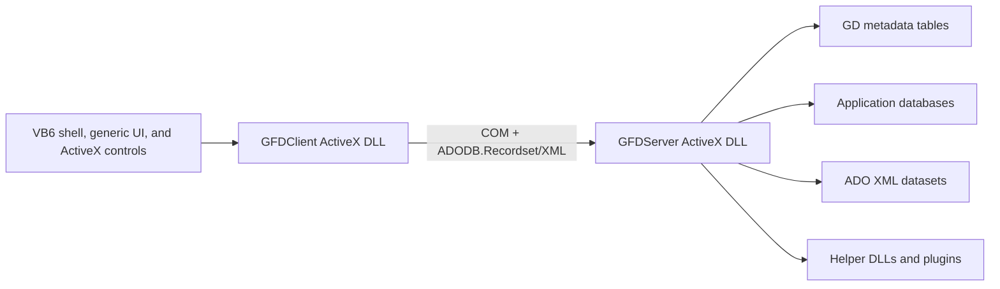
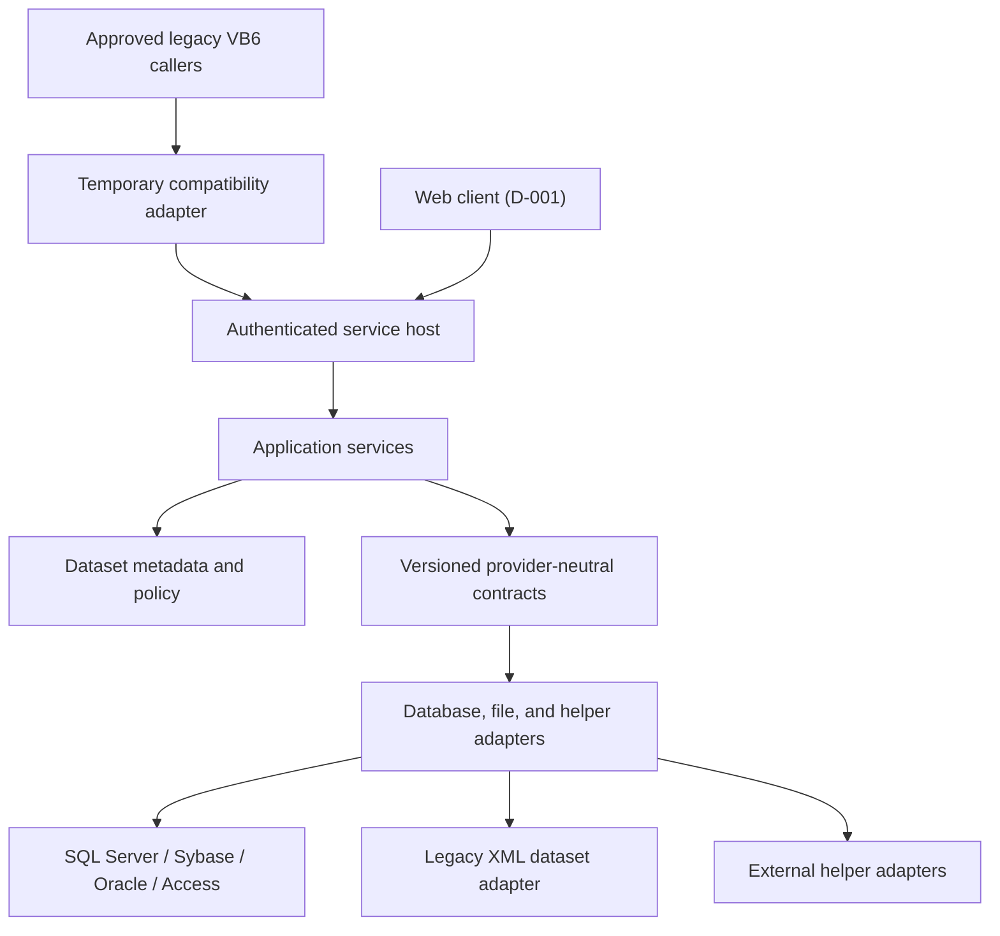
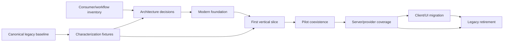

# GDFramework Migration Master Plan and Design

**Status:** Controlled working baseline  
**Version:** 0.6  
**Date:** 10 September 2026  
**Owner:** Migration technical lead  
**Legacy source baseline:** `${LEGACY_SOURCE_ROOT}`; see [section 23 Legacy baseline](#23-legacy-baseline)  
**Legacy checksum-manifest SHA-256:** `fc29779b9588a41cb9da10c486f1f0b35ca2108baf50fb8892086587ee320027`  
**Functional baseline:** [GDFramework Functional Specification 0.7](GDFramework%20Functional%20Specification.md)  
**Target design:** [GDFramework Modern Web System Design 0.3](MODERN_WEB_SYSTEM_DESIGN.md)  
**Document control:** [DOCUMENT_CONTROL.md](DOCUMENT_CONTROL.md)  
**Consolidates:** the former legacy-baseline, evidence-acquisition, component-inventory, dependency-inventory, provider-matrix, public-API-catalogue, dataset-catalogue, and ADR documents (now sections 23–30); and the superseded 0.1 design/plan drafts (deleted from the working tree; last present in git history at commit bb1991a)

## Change history

| Version | Date | Summary |
|---|---|---|
| 0.2 | 2026-08-01 | Consolidated the separate migration design and migration plan into one master |
| 0.3 | 2026-09-06 | Authority statement, quality-gate definitions, and portability tokens (`${LEGACY_SOURCE_ROOT}`) |
| 0.4 | 2026-09-06 | Metadata schema alignment with functional specification section 28 |
| 0.5 | 2026-09-09 | Evidence-bound gate exit criteria, evidence-unobtainable contingency path, risk register triggers and R-016..R-019, and merge of the inventories, evidence register, catalogues, provider matrix, and ADR register as sections 23–30 |
| 0.6 | 2026-09-10 | Cross-document version citations corrected; D-011 enforced at Phase 0 exit and Gate A; D-009 removed from the Gate C deferrable list; Phase 2 entry aligned with Gate C; decisions D-013..D-016 registered for the design section 34 items; online-only default recorded; technology-neutral testing rule; git-history reference corrected; accountable role and gate per phase and workstream; entry criteria for Phases 3–5 and 7; evidence-bound exit criteria for Phases 2–6; Phase 0 target date; section 19.1 cutover, reconciliation, and rollback criteria; team/skills/cost placeholder with owner and due date |

## 1. Document purpose and authority

This document is the consolidated design, governance, and delivery baseline for
replacing the legacy VB6 GDFramework on a supported platform. It combines the
previous migration design and migration plan so that architectural constraints,
delivery phases, evidence requirements, decisions, risks, and quality gates are
managed together.

This is a documentation-first migration. It is deliberately a controlled
baseline rather than an implementation mandate. No replacement implementation
is authoritative until the applicable evidence, decisions, and phase exit
criteria in this document have been reviewed and approved.

The functional specification is normative for observable behavior,
compatibility, and functional scope. The modern web system design is normative
for the target logical architecture and implementation boundaries. This master
is normative for governance, sequencing, decisions, risks, and quality gates,
but may not silently override a functional requirement or target-design
boundary. An intentional difference requires an approved defect disposition or
ADR linked from the requirement traceability matrix (DOCUMENT_CONTROL.md
section 8). The original 0.1 design and plan drafts are superseded historical
records; they were deleted from the working tree and remain in git history
(last present at commit bb1991a).

### 1.1 Current status

| Area | Status |
|---|---|
| Consolidated design and plan | Controlled working baseline 0.6 |
| Functional reverse-engineering baseline | Version 0.7; framework, generic UI, custom controls, and metadata schema contract documented; deployment-specific row and runtime discovery remains open |
| Requirement traceability | All functional/defect IDs inventoried; source-area and planned-test mapping generated; deployed row, physical DDL, and runtime evidence remains pending where marked |
| Phase 0 | Started: Git repository and initial controlled artifacts established; production provenance and deployed-consumer evidence remain open |
| Replacement code | Not started |
| Target UI | Modern web application selected; UI framework/design system pending ADR and accessibility/performance spike |
| Service transport and deployment topology | Not decided |
| Canonical production VB6 source/binary | Not yet proven |
| Reproducible legacy environment | Not yet available |

### 1.2 Completeness boundary

The legacy source is the behavioral reference during discovery and
characterization. It must not be modified merely to make replacement easier
unless a separately approved stabilization change is required.

Repository source plus the reconstructed metadata database schema defines how
applications are generated. The remaining application-specific evidence is the
populated metadata row set, production physical DDL, referenced application
database objects, helper components, deployed binaries, effective role
assignments, runtime configuration, screenshots, and a functioning legacy
environment. Calendar commitments should not be inferred until the active
deployment population and consumers are known. Collection ownership and
completion criteria are controlled in
[section 24](#24-deployed-application-evidence-acquisition-register).

## 2. Executive direction

GDFramework is a metadata-driven application framework composed of VB6 ActiveX
DLLs, an ActiveX control library, ADO recordsets, database-specific adapters,
COM interfaces, and a generic desktop user interface. It supports dynamic
datasets, client-side editing, server-side persistence, configurable
applications and menus, security, messages, logging, reporting, and multiple
data-source types.

The migration shall be incremental:

1. Establish a controlled, traceable legacy baseline.
2. Recover observable behavior and build repeatable characterization assets.
3. Define stable, technology-neutral contracts at the client/server boundary.
4. Implement a modern server and data layer behind those contracts.
5. Provide a temporary compatibility adapter only for approved legacy callers.
6. Prove behavior through differential, integration, security, and operational
   testing.
7. Move client workflows and controls only after the required server contracts
   are stable.
8. Operate legacy and modern paths side by side until cutover evidence is
   sufficient.
9. Retire all unapproved VB6/COM dependencies and archive the legacy system.

This is not a line-by-line translation. Unsafe legacy behavior—such as raw SQL
exposure, live database objects, unverified caller identity, silent connection
fallback, secret leakage, or falsely reported write success—will not be
preserved as compatibility (policy intent; binding only through DEF-*
dispositions approved under D-011; see DEF-001 credentials and DEF-016
concealed failures in functional specification section 31).

## 3. Current-system baseline

### 3.1 Project inventory

| Area | Legacy project | Primary responsibility |
|---|---|---|
| Interfaces | `AppInterfaces/GDFInterfaces.vbp` | Shared COM interfaces and cross-project types |
| Server | `AppServer/GenFormDataServer.vbp` | Metadata loading, datasets, ADO connections, queries, writes, messages, and configuration |
| Client | `AppClient/GenFormDataClient.vbp` | Client facade, session state, recordset editing, menus, and display configuration |
| Controls | `AppControls/GFDGUICtls.vbp` | VB6 ActiveX toolbar, panel, splitter, dropdown, lookup, and Outlook-style controls |
| GUI | `GenData/AppGUI/GenFormDataGUI.vbp` | Main shell, generic metadata-driven form, navigation, dialogs, export, and print |
| Aggregator | `AppServer/GDAggregator.vbp` | Aggregation and specialist server-side orchestration |
| Harnesses | `Z_Harness_*` and `AppControls/test` | Helper/plugin examples and minimal manual integration hosts |
| Shared copies | `AppShared` and `AppClient/AppClient` | Duplicate or divergent sources requiring provenance analysis |

Using the reproducible counting rule recorded in [section 23.2](#23-legacy-baseline)—recursive
physical lines in `.frm`, `.bas`, `.cls`, `.ctl`, and `.pag` files, including
duplicate/source-only files—the core GDFramework tree contains 123 files and
55,504 lines. Including the separately located `GenData/AppGUI` tree gives 160
files and 79,100 lines. These are inventory measures, not claims about compiled
membership. Several projects contain machine-specific references to obsolete or
unavailable COM libraries. Duplicate source trees and differing project/binary
lineages mean a timestamp or matching product name cannot prove deployment.

### 3.2 Current request flow



### 3.3 Important legacy behavior

- Dataset definitions and parameters are loaded from database metadata.
- Dataset results are cached and refreshed using per-dataset flags.
- ADO recordsets are marshalled directly or serialized as ADO XML.
- Client recordsets track pending insert, update, and delete operations.
- The server constructs and executes DML from metadata and changed field values.
- Supported or retained provider paths include SQL Server, Sybase, Oracle,
  Access, XML files, stored procedures, and helper-based simple services.
- The server and client expose COM objects and mutable internal collections.
- UI configuration, applications, menus, messages, reports, security, and user
  settings are modeled as datasets.
- The generic form builds toolbar commands, views, fields, filtering, grouping,
  reporting, and CRUD behavior from metadata and effective security.
- The custom controls have a public COM surface and VB6 property-bag contract
  that must be imported or replaced deliberately where active consumers exist.

### 3.4 Planning assumptions

- The legacy system remains operational during most of the migration.
- Existing database schemas remain unchanged unless a phase explicitly approves
  a backward-compatible change.
- Server/data behavior is migrated before the principal UI.
- Some VB6 callers may require a temporary compatibility path.
- The legacy source is not currently a clean, reproducible build baseline.
- A reproducible 32-bit VB6 build/runtime environment and production-like
  provider fixtures are not currently available.
- The migration workspace currently contains planning material but no
  replacement implementation.
- A supported development SDK, build image, and integration environments must be
  provisioned before modern project creation.

## 4. Drivers, goals, and boundaries

### 4.1 Drivers for change

#### Platform and operability

- VB6 and historical COM dependencies are difficult to build, deploy, register,
  and support on current Windows environments.
- Projects depend on old machine paths, 32-bit controls, CDO, Office libraries,
  and unavailable custom binaries.
- There is no automated legacy build or regression suite.
- Duplicate source trees obscure the authoritative implementation.

#### Security and correctness

- The server exposes internal database facilities and arbitrary SQL paths.
- Caller-provided identity is accepted without a trusted authentication boundary.
- SQL values are concatenated instead of consistently parameterized.
- Batch writes can partially commit.
- Some client write methods report success after a server failure.
- Unknown connection names may silently fall back to the system database.
- Tracked legacy configuration contains plaintext credential material.

#### Maintainability

- Business behavior, transport, persistence, caching, UI, and logging are
  interwoven.
- Public APIs exchange implementation-specific ADO objects.
- Provider-specific SQL is assembled throughout the data layer.
- Error handling relies on Boolean returns, global messages, suppressed errors,
  and mutable out-parameters rather than a stable result model.

### 4.2 Goals

The migrated system shall:

- Preserve approved business behavior, user workflows, and data semantics.
- Replace COM/ADO recordset contracts with explicit, versioned contracts.
- Authenticate identity at a trusted boundary and authorize every operation.
- Use parameterized commands and explicit provider adapters.
- Make a logical change set atomic unless partial success is explicitly designed.
- Support side-by-side validation, gradual routing, and reversible cutover.
- Provide structured diagnostics, audit events, health checks, and correlation.
- Build and test from a clean, documented environment.
- Isolate provider-specific behavior from application policy.
- Allow the future UI technology to be selected independently from early server
  migration.
- Preserve metadata-driven application definition rather than compiling each
  business screen into a bespoke implementation.

### 4.3 Non-goals for the first increment

- Reproducing known security defects for compatibility.
- Redesigning application database schemas without an approved need.
- Replacing every client and control in a single release.
- Selecting a UI framework before workflows and integration constraints are
  inventoried.
- Adopting an ORM as the source of truth for dynamic metadata-defined datasets.
- Treating successful compilation as proof of behavioral equivalence.
- Implementing historical, dormant, source-only, or documented-only features
  without an identified consumer or explicit product decision.

## 5. Governing design principles

1. **Behavior before replacement.** Capture current inputs, outputs, side
   effects, event order, persistence, and failure behavior before rewriting a
   path.
2. **Explicit boundaries.** Do not expose connections, commands, mutable caches,
   provider objects, or UI implementation types outside infrastructure.
3. **Secure by construction.** Identity is established by the host, not supplied
   as an ordinary request parameter.
4. **Provider isolation.** SQL dialect, parameter syntax, type mapping, and
   connection behavior belong in provider adapters.
5. **Atomic commands.** One logical change set has one explicit transaction
   policy and one structured result.
6. **Incremental compatibility.** Compatibility adapters translate legacy
   contracts; they do not contaminate the modern core.
7. **Observable operation.** Every request has a correlation identifier,
   structured outcome, duration, and safe diagnostic context.
8. **No hidden fallbacks.** Unknown datasets, parameters, connections, providers,
   command keys, and critical options fail explicitly.
9. **Test real boundaries.** Exercise serialization, transport, commands,
   transactions, response parsing, failure behavior, and cleanup with real
   implementations or purpose-built fixtures.
10. **Technology decisions follow evidence.** Do not scaffold a target stack
    until its architectural decision and relevant entry criteria are approved.

## 6. Governance and ownership

### 6.1 Required controlled artifacts

The migration shall maintain:

- Functional reverse-engineering specification and requirements traceability.
- Current-system and active-consumer inventory.
- Public COM/control/API inventory.
- Dataset, parameter, security, report, and business-action catalog.
- Database/provider compatibility matrix.
- Characterization and differential-test catalog.
- Architecture Decision Records (ADRs).
- Legacy defect disposition register: **preserve**, **fix**, or **retire**.
- Risk, issue, dependency, and decision registers with owners and review dates.
- Phase entry/exit evidence and quality-gate decisions.
- Deployment, cutover, reconciliation, and rollback runbooks.
- Compatibility usage/retirement measures.
- Legacy retirement and archival checklist.

### 6.2 Change control

- A phase begins only after its entry criteria are met.
- Contract, security, provider, coexistence, scope, or UI-direction changes
  require a recorded decision.
- Replacement changes are accepted only with tests appropriate to the boundary.
- No compatibility exception may expose raw SQL, live database objects,
  connection credentials, or unverified identity.
- Known legacy defects must have an approved disposition before differential
  results are accepted.
- Open decisions shall not be silently converted into implementation defaults.

### 6.3 Definition of done

A migration item is complete only when:

- Behavior, state transitions, and failure cases are specified.
- Implementation respects approved dependency and security boundaries.
- Automated tests cover observable behavior.
- Provider-specific behavior is integration-tested where applicable.
- Security, diagnostics, cleanup, and operational support are verified.
- Documentation, runbooks, and traceability are updated.
- No unresolved high-severity defect is hidden behind a compatibility layer.
- The applicable acceptance criterion and phase/gate evidence are recorded.

### 6.4 Required roles

Named individuals may fill multiple roles, but every responsibility must exist.

| Role | Responsibility |
|---|---|
| Product/domain owner | Approves behavior, defect disposition, scope, and workflow acceptance |
| Legacy technical owner | Explains deployment history, metadata, providers, binaries, and consumers |
| Migration technical lead | Owns architecture, sequencing, dependency rules, and quality gates |
| Database owner | Supplies schemas, fixtures, provider constraints, and reconciliation evidence |
| Security owner | Approves identity, authorization, secrets, audit, and threat model |
| Operations owner | Owns deployment, monitoring, recovery, rollback, and support transfer |
| Test/quality owner | Owns characterization, integration, differential evidence, and exit reports |
| UI/workflow owner | Owns user research, accessibility, integration constraints, and client acceptance |

## 7. Proposed logical architecture

The target client is a modern web application as defined in
[MODERN_WEB_SYSTEM_DESIGN.md](MODERN_WEB_SYSTEM_DESIGN.md). The final runtime,
web framework, and host remain open decisions, but the following separation
shall hold whether the service boundary uses HTTP, gRPC for controlled internal
integration, a managed process, or a container.



### 7.1 Solution boundaries

| Boundary | Responsibility | Must not contain |
|---|---|---|
| Contracts | Versioned request, response, error, and event types | ADO, COM, UI, connections, commands |
| Application | Use cases, authorization, orchestration, and transaction intent | Provider-specific SQL syntax |
| Dataset model | Dataset definitions, parameters, keys, cache/update policy | Transport or UI concerns |
| Infrastructure | Connections, dialects, SQL execution, files, and plugin adapters | Caller authorization decisions |
| Host | Authentication, validation, routing, health, and diagnostics | Business rules embedded in endpoints |
| Compatibility | Approved COM/ADO/ADO-XML translation and routing | New business logic or raw SQL access |
| Client | User workflows, state, and presentation | Direct database access |

### 7.2 Technology-neutral logical layout

No implementation projects shall be scaffolded until the required decisions are
approved. The following names describe logical responsibilities, not a language,
framework, packaging scheme, or prescribed repository layout:

```text
contracts
application-services
dataset-model-and-policy
provider-infrastructure
authenticated-host
legacy-compatibility-boundary
characterization-tests
contract-tests
provider-integration-tests
compatibility-and-differential-tests
```

Hosts and adapters depend on application contracts. The application layer does
not depend on COM, ADO recordsets, provider implementations, or a UI toolkit.

## 8. Contract and compatibility design

### 8.1 Contract rules

- Contracts are versioned independently from implementations.
- No public contract returns a live connection, command, transaction, recordset,
  cache, or mutable server collection.
- Requests have explicit identifiers, parameters, paging, ordering, security
  scope, and consistency requirements.
- Results distinguish validation, authentication, authorization, conflict,
  provider, timeout, cancellation, and unexpected failures.
- Dates, time zones, decimals, binary values, strings, enumerations, and nulls
  have defined serialization rules.
- Dataset and field identifiers come from validated metadata; callers cannot
  inject arbitrary SQL fragments.
- UI command identity uses stable semantic keys rather than caption or position.

### 8.2 Core conceptual contracts

| Contract | Purpose |
|---|---|
| `SessionContext` | Trusted subject, roles/claims, application, workstation context, and correlation ID |
| `DatasetDefinition` | Dataset identity, provider, query/update policy, columns, keys, security, and cache policy |
| `DatasetParameter` | Name, type, value, validation, and required/optional status |
| `DatasetQuery` | Dataset identity, parameters, paging, sort, and refresh/consistency option |
| `DatasetResult` | Schema, rows, continuation information, and version/concurrency values |
| `ChangeSet` | Dataset identity and ordered insert/update/delete changes |
| `ChangeResult` | Overall outcome plus per-row success, conflict, validation, and generated-key data |
| `SystemMessage` | Typed application/system message with audience and validity window |
| `Problem` | Stable error code, safe message, correlation ID, and optional field details |

The exact wire format is an open decision. JSON over HTTP is the current default
candidate (non-binding candidate pending D-002; see the design document §13
candidate note) because it is inspectable and accessible to compatibility and
modern clients. gRPC remains an option for controlled native clients.

### 8.3 Compatibility translation

If a real legacy consumer must remain active, the compatibility adapter may:

- Accept an approved legacy method shape.
- Convert an ADO recordset or ADO XML stream into `DatasetQuery` or `ChangeSet`.
- Invoke the modern application boundary under a trusted identity.
- Convert `DatasetResult` to the minimum required legacy shape.
- Map structured errors to the legacy Boolean/message convention while emitting
  a reliable correlated diagnostic event.
- Preserve exact active COM/control property names and enum values only at the
  compatibility boundary where an identified consumer requires them.

The adapter shall not expose the modern connection factory, accept raw SQL,
trust caller-supplied identity/audit values, or become a permanent source of new
business behavior.

## 9. Dataset, persistence, and provider design

### 9.1 Metadata loading and validation

Legacy metadata shall first be imported into a typed model without changing its
approved meaning. Validation occurs before an affected dataset becomes
available:

- Dataset and connection identifiers exist and are unique.
- Provider type is supported and active.
- Query/update policy is internally consistent.
- Update tables and key columns are declared and allow-listed.
- Parameter markers map one-to-one to typed parameters.
- Cache keys include every value and security scope that can affect results.
- Security policy is explicit; absence is not accidentally unrestricted.
- Unsupported historical options are diagnosed, not silently ignored.

Invalid metadata blocks only the affected capability where safe and produces an
actionable startup or configuration diagnostic.

### 9.2 Connection resolution and secrets

A connection factory resolves only an exact configured connection identifier.
An explicit `System` identifier may represent the system database. Blank,
unknown, inactive, or ambiguous identifiers fail rather than falling back
(policy intent; binding only through DEF-* dispositions approved under D-011;
see DEF-016 concealed failures).

Secrets are supplied by the deployment environment or approved secret store.
They are not returned through application contracts, stored in source, displayed
to users, or written to logs (policy intent; binding only through DEF-*
dispositions approved under D-011; see DEF-001 credentials).

### 9.3 Query execution

- Values are bound as typed command parameters.
- Provider adapters own placeholder syntax, quoting, and type mapping.
- Metadata-derived identifiers are validated against the loaded definition.
- Paging and limits prevent accidental unbounded datasets.
- Cancellation and command timeouts flow from host to provider.
- Provider resources are disposed deterministically.
- Ordering is explicit wherever consumers rely on it.

### 9.4 Change execution

A `ChangeSet` is validated before any write:

1. Authenticate and authorize the subject.
2. Resolve the dataset and update policy.
3. Validate fields, types, required values, keys, and audit/concurrency values.
4. Begin the required transaction.
5. Execute inserts, updates, and deletes with typed parameters.
6. Apply optimistic concurrency rules.
7. Commit only if the change-set policy is satisfied.
8. Return generated keys, reconciled stamps, and accurate per-row outcomes.

Unexpected failure rolls back the transaction and returns a failure result.
Partial success is allowed only for a use case explicitly designed, documented,
and approved to permit it (policy intent; binding only through DEF-*
dispositions approved under D-011; see DEF-016 concealed failures and
DEF-012/DEF-013 stale state).

### 9.5 Caching

- Caches hold immutable results, not shared mutable recordsets.
- Keys include dataset version, application/security scope, and every
  result-affecting parameter.
- Entries have explicit lifetime and invalidation rules.
- Writes publish invalidation only after commit.
- Forced refresh bypasses lookup but does not weaken authorization.
- Cross-user and cross-application isolation is tested.

The first vertical slice may operate without caching. Caching is added after
parity is proven and measured need is demonstrated.

## 10. Security, errors, and observability

### 10.1 Identity and authorization

The host establishes identity through an approved mechanism such as integrated
Windows authentication or an organization identity provider. A username in a
request is context to validate, never proof of identity.

- Every dataset declares read/change policies.
- Administrative operations use explicit policies rather than mutable client
  flags.
- Application, user, role, and audit identifiers used for filtering or writing
  are derived from the trusted session or independently authorized.
- Keeping a VB6 client does not justify keeping legacy authentication.
- Every protected UI command and server operation is evaluated against effective
  authorization before exposure or execution.

### 10.2 Audit and sensitive data

Security-sensitive operations record subject, action, dataset, outcome,
correlation ID, and timestamp. SQL text where sensitive, passwords, tokens,
connection strings, and unredacted sensitive field values are not logged.

### 10.3 Error model

Application methods return a structured result or raise a controlled exception
that the host translates into a stable `Problem`. Boolean success is not the
only error channel.

Expected categories are:

- Invalid request or metadata.
- Unauthenticated or unauthorized.
- Dataset, parameter, field, provider, or connection not found.
- Validation or optimistic-concurrency conflict.
- Provider unavailable or dependency protocol failure.
- Timeout or cancellation.
- Unexpected internal failure.

### 10.4 Diagnostics and health

Each operation records:

- Correlation and operation identifiers.
- Authenticated subject identifier.
- Dataset and provider identifiers.
- Duration and row counts.
- Transaction and cache outcome.
- Stable error code on failure.

Health checks distinguish host health from individual provider availability.

## 11. Verification and testing strategy

| Test type | Purpose |
|---|---|
| Characterization | Record current VB6 behavior for representative datasets, UI controls, workflows, and failures |
| Contract | Prove request/response compatibility independent of host technology |
| Provider integration | Exercise real serialization, commands, parameters, transactions, failures, and cleanup |
| Compatibility | Compare adapter behavior with captured VB6/COM/ADO behavior |
| Differential | Run equivalent requests/workflows against legacy and modern implementations and compare normalized results |
| UI/control behavior | Verify public control contracts, persisted defaults, events, keyboard behavior, and shell/generic-form integration |
| Security | Reject impersonation, unauthorized access, identifier injection, raw SQL, and secret leakage |
| Operational | Verify startup validation, health, timeout, cancellation, retry, recovery, deployment, and rollback |
| Performance | Measure agreed dataset sizes, concurrent users, latency, memory, exports, and long-running operations |

Tests use real implementations, protocol-level fixtures, disposable integration
environments, or small purpose-built fakes at protocol boundaries. Mocking
frameworks that substitute generated doubles for real boundaries are
prohibited in every runtime selected under D-008; CONTRIBUTING.md and design
section 29 restate this rule.

Quantitative acceptance targets are controlled in
[functional specification section 44 Non-functional requirements](GDFramework%20Functional%20Specification.md#44-non-functional-requirements). A phase or gate
may strengthen those targets through an approved decision but may not replace
them with an unmeasurable statement.

Golden files normalize nondeterministic timestamps, generated identifiers,
unspecified row ordering, and provider-specific diagnostic text. Normalization
must not conceal a material behavioral difference.

Representative characterization shall include:

- Simple typed parameterized read.
- Cached read and explicit refresh.
- Dynamic/disconnected predicates and user/application scope.
- Insert with generated key.
- Single- and multi-row update.
- Physical and logical delete.
- Optimistic concurrency conflict.
- Stored procedure and action dataset.
- XML dataset and helper/plugin call.
- Null, date, decimal, binary, Unicode, escaping, and ordering cases.
- Generic UI toolbar, panel, splitter, navigation, filtering, grouping, search,
  CRUD, reporting, export, print, and popup/docking behavior.

## 12. Workstreams

| Workstream | Scope | Accountable role (section 6.4) |
|---|---|---|
| A. Legacy baseline | Source provenance, build recovery, releases, controls, dependencies, and active consumers | Legacy technical owner |
| B. Behavior | Functional specification, characterization, dataset catalog, and differential fixtures | Test/quality owner (dispositions: Product/domain owner) |
| C. Architecture | Contracts, ADRs, security, error model, observability, and technology choices | Migration technical lead |
| D. Modern server | Application services, typed metadata, providers, transactions, cache, and messages | Migration technical lead (providers: Database owner) |
| E. Compatibility | Approved COM/ADO translation, side-by-side routing, telemetry, and retirement | Operations owner |
| F. Client/UI | Workflow inventory, target UI, client migration, generic UI, and control replacement | UI/workflow owner |
| G. Delivery | Source control, build pipeline, environments, deployment, monitoring, cutover, and rollback | Operations owner |

Each phase in section 13 names its accountable role and the gate (section 18)
that closes it; the accountable role signs the phase exit evidence.

Workstreams overlap only when their inputs are stable. Provider work can begin
after its matrix, contracts, and first slice are approved; it does not wait for
the final UI decision.

## 13. Phase plan

### Phase 0 — Establish the controlled baseline

**Objective:** Know exactly what is being migrated and make every change
traceable.

**Accountable:** Legacy technical owner (workstream A) with the Migration
technical lead for decisions and registers. **Gate:** A.

**Target exit date:** 2026-10-31, aligned with the last section 16 risk
review date. This is a proposed target until the Migration technical lead
confirms it at the first planning review (section 22); it exists so that the
section 20 estimation deferral has a defined end, and it moves only by a
recorded decision.

**Activities**

1. Initialize source control and contribution rules for the migration workspace.
2. Record the legacy path, checksums, project files, archives, and file inventory.
3. Identify authoritative copies for duplicated server, shared, client, GUI, and
   control sources.
4. Inventory released EXE/DLL/OCX/type-library versions, compatibility modes,
   COM identifiers, and registration/deployment evidence.
5. Recover the VB6 project build order and required 32-bit dependencies.
6. Inventory third-party controls, Office/CDO dependencies, helper binaries, and
   service plugins.
7. Identify every production application and machine that activates GDFramework
   components.
8. Establish owners for product, databases, infrastructure, security,
   operations, testing, and user workflows.
9. Create the ADR template and controlled decision/risk registers.

**Deliverables**

- Section 23 legacy baseline and checksum manifest (section 23.3).
- Section 25 component inventory with the deployment-evidence column filled
  (EV-004).
- Section 26 dependency inventory with deployed versions recorded (EV-004).
- Active-consumer and deployment inventory (target: section 25 and section 24
  EV-009 rows).
- Initial source-provenance and scope ADRs (section 30; D-009).
- Legacy defect disposition policy ADR (section 30; D-011), approved before
  Phase 1 records any DEF-* disposition.
- Evidence-acquisition deadline for every Critical EV package (see
  [Evidence-unobtainable path](#evidence-unobtainable-path)).

**Evidence packages:** EV-004, EV-009 (section 24).

**Exit criteria**

- Every active binary maps to a source project or an owned external dependency
  (EV-004).
- Authoritative source is identified for the first vertical slice (D-009).
- Defect disposition policy approved (D-011) so Phase 1 dispositions are
  recorded under an approved policy.
- Active consumers and deployment locations are known (EV-009).
- Unavailable dependencies have an owner and disposition (section 26).
- Gate A evidence recorded (section 18).

### Phase 1 — Recover behavior and characterization assets

**Objective:** Produce evidence that distinguishes a compatible replacement from
a plausible rewrite.

**Accountable:** Test/quality owner (workstream B); defect dispositions by
the Product/domain owner. **Gate:** B.

**Activities**

1. Provision or document a reproducible 32-bit legacy build/runtime environment.
2. Complete the functional specification and source/metadata/test traceability.
3. Inventory public COM methods, control properties/events/enums, property bags,
   and recordset schemas.
4. Execute the controlled evidence packages in
   [section 24](#24-deployed-application-evidence-acquisition-register), including export of
   dataset definitions, parameters, providers, update keys, cache rules,
   security, applications, menus, screens, fields, reports, and messages.
5. Select representative read, write, provider, control, and UI workflows.
6. Capture normalized inputs, outputs, database effects, messages, UI outcomes,
   and failure behavior.
7. Classify observed defects as preserve, fix, or retire.
8. Build protocol fixtures for ADO XML and active external adapters.

**Deliverables**

- Section 27 public API catalogue completed from production type libraries.
- Section 28 dataset and metadata catalogue populated from deployed rows
  (EV-001, EV-001A, EV-002).
- Section 29 provider compatibility matrix with production status confirmed.
- Characterization fixture set and execution instructions (EV-003).
- Legacy defect dispositions recorded in functional specification section 31
  (DEF-001..DEF-037) under the D-011 policy (EV-010).
- Completed functional traceability baseline for the selected slice
  (DOCUMENT_CONTROL.md section 8).
- Replace the section 44 measurement profiles with observed production
  percentiles (EV-007 partial) and retain the originals for regression
  comparison.

**Evidence packages:** EV-001, EV-001A, EV-002, EV-003, EV-006, EV-008,
EV-010 (section 24); EV-007 partial for the measurement profiles.

**Exit criteria**

- First read/write and client-workflow slices have reproducible fixtures
  (EV-003, EV-008).
- Null, date, decimal, Unicode, generated-key, concurrency, event, persistence,
  and failure behavior are documented.
- Selected legacy scenarios can be repeated reliably (EV-003).
- Security defects are explicitly excluded from compatibility (policy intent;
  binding only through DEF-* dispositions approved under D-011; see DEF-001
  credentials).
- Gate B evidence recorded (section 18).

### Phase 2 — Approve architecture and create the modern foundation

**Objective:** Turn approved decisions into a minimal buildable solution.

**Accountable:** Migration technical lead (workstream C); delivery items by
the Operations owner (workstream G). **Gate:** C.

**Entry criteria**

- Phase 1 fixtures exist for the selected vertical slice.
- Gate C decision rule met: authentication (D-005), first provider (D-004),
  and runtime (D-008) are decided and not deferred; transport (D-002), host
  topology (D-003), compatibility duration (D-006), and dataset wire contract
  (D-007) are decided or explicitly deferred with a documented safe default.
- Supported SDK, build image, CI, and test environment are available.

**Activities**

1. Resolve or formally defer required open decisions.
2. Create ADRs for runtime, transport, authentication, data access, deployment,
   and compatibility.
3. Scaffold only approved solution projects.
4. Enforce dependency and architecture rules.
5. Define versioned query, result, change-set, problem, and session contracts.
6. Add correlation, structured logging, startup validation, health checks, and
   secret injection.
7. Create test projects and reusable integration fixtures.
8. Establish continuous build, test, dependency, and security checks.

**Deliverables**

- Buildable modern solution.
- Contract version 1.
- Approved ADR set.
- CI definition and clean-build image.
- Test environment documentation.

**Exit criteria**

- A clean checkout builds without machine-specific absolute references
  (NFR-BUILD-001).
- Contract and architecture tests pass (design WDES-004, WDES-005, WDES-006;
  NFR-OBS-001 for correlation on every contract).
- Secrets are external to source and logs (NFR-SEC-003).
- No infrastructure type is exposed through the application boundary
  (design section 13; WDES-004).
- Gate C evidence recorded (section 18).

### Phase 3 — Implement the first vertical slice

**Objective:** Prove the end-to-end migration pattern with one representative
read and one representative write.

**Accountable:** Migration technical lead (workstream D); provider evidence by
the Database owner. **Gate:** D.

**Entry criteria**

- Gate C passed (section 18).
- The slice's datasets are selected and their EV-001, EV-002, and EV-003
  evidence is complete (Gate B).
- A provider integration environment for the first provider (D-004) exists
  with a least-privilege service identity.

**Recommended slice**

- Read: a parameterized, user-scoped metadata dataset.
- Write: a small updateable configuration dataset with a composite key and
  concurrency behavior.

The exact datasets are selected during Phase 1 from production relevance and
fixture availability.

**Activities**

1. Load and validate only metadata required for the selected datasets.
2. Implement exact connection resolution for the first provider.
3. Implement parameterized query execution and result serialization.
4. Implement authorization for the selected datasets.
5. Implement atomic change-set execution and conflict reporting.
6. Compare normalized legacy and modern reads and database effects.
7. Verify approved differences for corrected defects.
8. Add compatibility translation only for an identified pilot consumer.
9. Add operational metrics and correlated failure diagnostics.

**Deliverables**

- Production-shaped vertical slice.
- Differential and security test reports.
- Pilot deployment, reconciliation, and rollback procedure.

**Exit criteria**

- Selected reads match approved legacy behavior (differential fixtures from
  EV-003; approved differences recorded as DEF-* dispositions).
- Writes are atomic and return accurate outcomes (NFR-REL-001, NFR-PERF-003).
- Impersonation, injection, raw database access, and unknown-connection fallback
  fail safely (NFR-SEC-001, NFR-SEC-002, NFR-SEC-003).
- Pilot operation is observable and reversible (NFR-OBS-001, NFR-OBS-002;
  section 19.1 rollback rehearsal).
- Gate D evidence recorded (section 18).

### Phase 4 — Expand server and provider coverage

**Objective:** Migrate remaining server capabilities in controlled groups.

**Accountable:** Migration technical lead (workstream D); each provider by
the Database owner. **Gate:** E, provider/capability criteria; the EV-007
service criteria of Gate E close at Phase 5 exit.

**Entry criteria**

- Gate D passed (section 18).
- D-004 decided for every provider in the next capability group, and D-010
  recorded before any schema change the group needs.
- D-014 decided before the first group that needs durable jobs, and D-015
  decided before group 3 (metadata administration).

**Capability groups**

1. Core dataset reads, dynamic parameters, and refresh behavior.
2. Inserts, updates, deletes, generated keys, audit stamps, and concurrency.
3. Metadata administration and application configuration.
4. Menus, security, user settings, display definitions, and system messages.
5. Stored procedures and action datasets.
6. XML datasets.
7. Aggregation and specialist server paths confirmed as in scope.
8. Simple-service helpers and plugins.
9. Remaining active providers.

Each group repeats: characterize, approve defect dispositions, implement
contract/application behavior, implement or extend its provider adapter, run
integration/differential/security tests, pilot route, and record exit evidence.

**Deliverables**

- One exit-evidence record per capability group (differential, integration,
  and security reports; DEF-* dispositions used; provider matrix rows updated).
- Section 29 provider compatibility matrix with real integration status for
  every active provider.
- Metadata import and versioned publication path (design sections 11.2 and
  28.2) operating for the migrated groups.

**Exit criteria**

- Every in-scope server capability has an approved disposition (DEF-* rows
  in functional specification section 31 and EV-010).
- Every active provider has real integration evidence (section 29; design
  WDES-011; NFR-REL-002 cleanup soak per provider).
- Operational limits and performance are measured against the Phase 1
  calibrated profiles (NFR-PERF-001, NFR-PERF-003, NFR-PERF-004, NFR-SCALE-001;
  EV-007 partial).
- Unretired legacy server calls are explicitly listed and measured
  (NFR-COMP-001).
- Gate E provider/capability evidence recorded (section 18).

### Phase 5 — Operate compatibility and pilot migration

**Objective:** Move real consumers without a flag-day deployment.

**Accountable:** Operations owner (workstreams E and G). **Gate:** E
(service criteria, EV-007 complete).

**Entry criteria**

- Phase 4 exit evidence recorded for the capability groups the pilot uses.
- D-012 (routing unit) decided with an ADR, and D-006 decided for any
  compatibility consumer in the pilot.
- Section 19.1 reconciliation method and rollback triggers approved by the
  Operations and Database owners, and rollback rehearsed once in a
  nonproduction environment.

**Activities**

1. Select the smallest representative pilot application/cohort.
2. Deploy the modern host and, only if required, compatibility adapter.
3. Route selected datasets or workflows to the modern path.
4. Compare results and database effects during a controlled observation period.
5. Exercise rollback without data repair.
6. Expand by cohort only after exit review.
7. Measure every compatibility call and remaining dependency.

**Evidence packages:** EV-007 complete (section 24); NFR-PERF, NFR-SCALE,
NFR-REL, NFR-AVAIL, and NFR-DR thresholds measured against observed production
percentiles.

**Exit criteria**

- Pilot service levels and correctness thresholds are met (EV-007; functional
  specification section 44).
- Rollback has been rehearsed in production under the section 19.1 criteria.
- No critical dependency exists only in an operator workstation configuration
  (NFR-BUILD-001; EV-009).
- Compatibility usage is measurable and declining (NFR-COMP-001).
- Gate E evidence recorded (section 18).

### Phase 6 — Select and migrate the client experience

**Objective:** Replace the VB6 client facade, generic UI, and ActiveX controls
based on documented workflows rather than source-file resemblance.

**Accountable:** UI/workflow owner (workstream F). **Gate:** F.

**Entry criteria**

- Modern server contracts are stable for the workflows being migrated.
- Target UI decision D-001 is approved.
- Active forms, controls, toolbar/panel/splitter behavior, Office/printing
  integrations, accessibility, keyboard, and performance expectations are
  inventoried, and any inventoried offline need is confirmed against the
  online-only default (D-016; design sections 7.6 and 34).

**Activities**

1. Map every active control and client method to user workflows and acceptance
   scenarios.
2. Prototype the highest-risk UI and operating-system integrations.
3. Define a client architecture that consumes only versioned service contracts.
4. Migrate one complete workflow at a time.
5. Reproduce approved generic-form metadata/security behavior and custom-control
   interactions with native modern components.
6. Validate usability, accessibility, localization, keyboard behavior, high DPI,
   export, printing, responsiveness, and operational support.
7. Retire corresponding ActiveX controls and COM calls only after adoption.

**Exit criteria**

- All in-scope workflows have acceptance evidence (EV-008; functional
  specification FR-ACC-003..007, FR-ACC-014, FR-ACC-015; NFR-ACC-001,
  NFR-UI-001, NFR-I18N-001, NFR-PERF-002).
- No modern UI performs direct database access (design WDES-002, WDES-004).
- Office, Windows, control, and printing dependencies have supported
  replacements (FR-DEP-001, FR-DEP-003; design section 9).
- Relevant VB6 client/OCX components can be removed from deployment
  (section 25 CMP-* rows marked retirable).
- Gate F evidence recorded (section 18).

### Phase 7 — Cut over and retire the legacy framework

**Objective:** Remove production dependence on VB6/COM GDFramework components.

**Accountable:** Operations owner (workstream G); retirement decision by the
Product/domain owner. **Gate:** G.

**Entry criteria**

- Gates E and F passed for every in-scope capability and workflow.
- Every consumer in the EV-009 inventory is migrated or has a formally
  accepted residual disposition with an owner.
- The section 19.1 cutover checklist is complete and the rollback window
  length is approved.

**Activities**

1. Confirm zero or explicitly accepted residual compatibility traffic.
2. Complete reconciliation, security, and audit review.
3. Freeze legacy configuration changes for final migration.
4. Execute final cutover and enhanced monitoring.
5. Retain tested rollback for the agreed window.
6. Remove COM registration and obsolete runtime dependencies in stages.
7. Archive source, binaries, type libraries, dependencies, build VM, metadata,
   fixtures, and operational records according to policy.
8. Close residual risks or transfer them formally to product ownership.

**Exit criteria**

- Production has no unapproved GDFramework COM dependencies.
- Support, recovery, monitoring, and ownership are transferred.
- Legacy secrets and deployment artifacts are removed from active systems.
- Retirement decision and evidence are recorded.

**Evidence and exit mapping (Phase 7, Gates F and G):** client-workflow
acceptance at Gate F is judged against the EV-008 workflow and visual evidence;
retirement at Gate G is judged against the NFR-COMP-001 compatibility retirement
dashboard and the EV-009 consumer inventory, in which every consumer must be
marked retired or formally accepted as residual.

### Evidence-unobtainable path

Phase 0 exit sets a dated deadline for each Critical evidence package in
section 24 (EV-001, EV-002, EV-003, EV-004, EV-006, EV-009). If any Critical
package cannot be obtained by its deadline, the product/domain owner may
formally accept characterization from the reviewed source (section 23) plus the
reconstructed metadata schema (functional specification section 28) at
"reduced confidence". The acceptance is recorded as an ADR in section 30 and
must contain:

- the list of requirements downgraded to RUNTIME-VERIFY in the traceability
  matrix (DOCUMENT_CONTROL.md section 8);
- an expanded pilot scope and observation period for Phase 5; and
- an explicit rollback window during which the legacy path remains deployable.

The reduced-confidence acceptance satisfies the affected Gate A or Gate B
criterion only for the packages it names; it does not waive security criteria
(NFR-SEC-001..003) or the D-011 disposition policy. Risks R-002, R-003, R-013,
and R-017 reference this path.

## 14. Initial ordered backlog

| Order | Item | Output |
|---:|---|---|
| 1 | Establish migration source control and contribution rules | Traceable workspace |
| 2 | Hash and inventory the legacy source and binaries | Reproducible source reference |
| 3 | Resolve duplicate-source and binary provenance | Canonical files per project/slice |
| 4 | Inventory active consumers and deployments | Confirmed migration scope |
| 5 | Recover VB6 build order and dependencies | Build/run instructions and VM plan |
| 6 | Complete public COM/control surface and UI-use catalog | Approved API/control catalog |
| 7 | Export dataset/parameter/application metadata | Dataset and workflow catalog |
| 8 | Confirm active databases, providers, and plugins | Provider matrix |
| 9 | Select first read/write/client slices | Approved pilot scope |
| 10 | Capture repeatable legacy fixtures | Characterization evidence |
| 11 | Decide authentication, transport, and host topology | ADRs |
| 12 | Provision supported SDK, CI, and integration environments | Build foundation |
| 13 | Scaffold the approved solution only after Gate C | First modern code |

## 15. Dependencies and critical path



The critical path begins with provenance, deployed metadata-row/consumer discovery,
behavior fixtures, and architecture decisions. UI implementation is
intentionally not on the early critical path, but UI/control reverse engineering
is an early evidence activity.

## 16. Risk register

| ID | Risk and impact | Severity | Owner | Status | Trigger | Review date | Mitigation and evidence |
|---|---|---|---|---|---|---|---|
| R-001 | Wrong source copy selected; replacement matches an unused version | Critical | Legacy technical owner | Active | A deployed binary hash (EV-004) matches no repository project output, or two lineages both claim production | 2026-09-30 | Hash deployed artifacts and compare project/type-library/runtime identity; see [legacy baseline](#23-legacy-baseline). |
| R-002 | Legacy environment cannot be reproduced; no reliable behavioral oracle | Critical | Legacy technical owner | Open | EV-003 not delivered by its Phase 0 exit deadline, or a selected scenario cannot be repeated twice | 2026-09-30 | Capture a controlled VM and archive installers/registration manifests; Phase 1 evidence pending. If the deadline passes, apply the [Evidence-unobtainable path](#evidence-unobtainable-path). |
| R-003 | Hidden consumers; cutover breaks an untracked application | Critical | Operations owner | Open | Registry/deployment inspection or compatibility telemetry shows a caller absent from EV-009 | 2026-09-30 | Inspect deployment/registry evidence and instrument compatibility calls; consumer inventory pending. If EV-009 cannot be completed by its deadline, apply the [Evidence-unobtainable path](#evidence-unobtainable-path). |
| R-004 | Provider differences; query/type behavior diverges | High | Database owner | Open | A differential fixture diverges and the cause is attributed to provider type/dialect behavior | 2026-09-30 | Execute real provider tests and normalized differential fixtures; see [provider matrix](#29-provider-compatibility-matrix). |
| R-005 | Unsafe behavior mistaken for compatibility; security defects survive | Critical | Security owner | Active | A DEF-* row classified as a security defect is proposed with Decision "preserve" | 2026-09-30 | Apply the defect register and security gate; see [defect dispositions](GDFramework%20Functional%20Specification.md#31-legacy-defects-and-compatibility-decisions). |
| R-006 | Relied-upon partial-write behavior; atomic correction changes workflow | High | Product/domain owner | Open | Characterization or EV-010 interviews show a workflow that depends on a partially committed batch | 2026-09-30 | Characterize production effects and approve an explicit disposition before implementation. |
| R-007 | Executable metadata assumptions; generic definitions cannot be imported safely | High | Migration technical lead | Open | EV-001 export contains identifiers or SQL fragments that fail section 9.1 validation | 2026-09-30 | Classify/validate identifiers and migrate unsafe definitions explicitly after metadata export. |
| R-008 | Cache changes cause leakage or stale results | Critical | Migration technical lead | Open | A cache isolation/invalidation test fails, or a stale result is observed during pilot reconciliation | 2026-09-30 | Disable initially, define complete scoped keys, and test isolation/invalidation. |
| R-009 | UI scope expands early and stalls server migration | Medium | Migration technical lead | Controlled | UI implementation work is requested before D-001 approval or Phase 6 entry | 2026-09-30 | Keep UI implementation behind Phase 6 entry criteria while completing UI characterization in Phase 1. |
| R-010 | Compatibility becomes permanent | High | Product/domain owner | Open | Compatibility call volume (NFR-COMP-001) fails to decline across two consecutive review periods | 2026-09-30 | Approve duration/owner, time-box support, and measure every legacy call. |
| R-011 | No production-like test data creates false parity confidence | High | Test/quality owner | Open | Gate B approaches without a production-shaped integration data set | 2026-09-30 | Obtain curated anonymized data or a controlled integration environment. |
| R-012 | Unmanaged SDK/toolchain creates workstation-specific builds | High | Operations owner | Open | A build succeeds on one workstation and fails on the CI image or a second workstation | 2026-09-30 | Approve D-008 and pin toolchain/dependencies/CI image before scaffolding. |
| R-013 | Missing deployed metadata rows prevent enumeration of which schema-defined application behavior is active | Critical | Database owner | Open | EV-001 not delivered by its Phase 0 exit deadline, or exported rows fail validation against the section 28 schema | 2026-09-30 | Export all active metadata rows and populate the schema-derived catalogue as Gate B evidence; see [dataset catalogue](#28-dataset-and-metadata-catalogue). If the deadline passes, apply the [Evidence-unobtainable path](#evidence-unobtainable-path). |
| R-014 | Historical features are mistaken for active scope | Medium | Product/domain owner | Controlled | A feature is proposed for implementation without a consumer/runtime record or product decision | 2026-09-30 | Require a consumer/runtime record or explicit product decision before inclusion. |
| R-015 | Control behavior is simplified prematurely and generic UI parity fails | High | UI/workflow owner | Controlled | A control or command replacement is proposed without a mapped FR-CTL-* or FR-CMD-* requirement | 2026-09-30 | Use the FR-CMD-* and FR-CTL-* requirements plus requirement-level acceptance mappings. |
| R-016 | Loss of access to the legacy evidence share; reviewed source can no longer be re-verified | High | Legacy technical owner | Open | `${LEGACY_SOURCE_ROOT}` is unreachable, or re-verification against the section 23.3 manifest reports a mismatch | 2026-10-15 | Repository checksum baseline in section 23 plus a controlled copy of the source and dependency media held under EV-003. |
| R-017 | Deployed production binaries are never located; source-to-binary reconciliation cannot complete | Critical | Operations owner | Open | EV-004 search exhausts the candidate machines in EV-009 without a matching binary set | 2026-10-31 | Apply the [Evidence-unobtainable path](#evidence-unobtainable-path): reduced-confidence acceptance, RUNTIME-VERIFY downgrades, expanded pilot, and rollback window. |
| R-018 | Third-party control licensing or availability blocks characterization or coexistence (GridEX, JSBBar, Sheridan, Office/CDO) | High | Legacy technical owner | Open | Licence, redistribution right, or install media for DEP-008, DEP-015, DEP-016, DEP-003, or DEP-004 cannot be obtained for the legacy runtime | 2026-11-15 | Record licence/redistribution status per section 26; characterize from the behavioural contract (functional specification §26) where the binary cannot be run; do not assume redistribution rights. |
| R-019 | Key-person dependency on the legacy technical owner | High | Migration technical lead | Open | The legacy technical owner is unavailable for a full review period or gives notice of departure | 2026-10-07 | Documented VM/build instructions per EV-003 and paired reviewers on every Phase 0/1 evidence package. |

Owners are role owners until named people are assigned (named during Phase 0
per DOCUMENT_CONTROL.md section 7). Each review updates the
status, date, mitigation evidence, and any resulting decision/issue; absence of
new evidence does not silently close a risk.

## 17. Architecture decision register

| ID | Decision and evidence required | Owner | Required by | Status | ADR record |
|---|---|---|---|---|---|
| D-001 | Web target selected. Choose the browser framework and design system through an accessibility/performance spike covering generic grid, form, tree, dialog, splitter, lookup, chart, command, printing, and download workflows. | UI/workflow owner | Phase 6 entry | Direction selected | Pending framework ADR (add as section 30.N) |
| D-002 | Service transport: compare HTTP/JSON, gRPC, messaging, and in-process boundaries against consumers, hosting, diagnostics, and compatibility. | Migration technical lead | Gate C (decide, or defer with a documented safe default) | Open | None raised (add as section 30.N) |
| D-003 | Host topology: select managed service/process/container topology from operational and network constraints. | Operations owner | Gate C (decide, or defer with a documented safe default) | Open | None raised (add as section 30.N) |
| D-004 | Supported providers: confirm production use and retirement/support intent for SQL Server, Sybase, Oracle, Access, XML, and plugins. | Database owner | Gate C for first provider; Gate E for all | Open | None raised (add as section 30.N) |
| D-005 | Authentication: select trusted user/service identity and delegation mechanism. | Security owner | Gate C | Open | None raised (add as section 30.N) |
| D-006 | Compatibility duration: identify consumers, scope, owner, support window, and retirement threshold. | Product/domain owner | Gate C for first compatibility consumer (decide, or defer with a documented safe default) | Open | None raised (add as section 30.N) |
| D-007 | Dataset wire contract: select row, columnar, streaming, or typed use-case contracts using characterized payloads. | Migration technical lead | Gate C (decide, or defer with a documented safe default) | Open | None raised (add as section 30.N) |
| D-008 | Implementation runtime/platform: select a currently supported runtime only after host, operational, skills, and lifecycle evidence is available. | Migration technical lead | Gate C | Open | None raised (add as section 30.N) |
| D-009 | Canonical legacy source: reconcile source, project, deployed binary, type library, and runtime behavior. | Legacy technical owner | Gate A | Open | None raised (add as section 30.N) |
| D-010 | Database schema policy: retain schemas by default and approve any concurrency/audit/compatibility change separately. | Database owner | Before first schema change | Open; no-change default | None raised (add as section 30.N) |
| D-011 | Legacy defect disposition policy: define approval authority and preserve/fix/retire criteria. | Product/domain owner | Gate B entry (before any DEF-* disposition is recorded) | Open | None raised (add as section 30.N) |
| D-012 | Side-by-side routing unit: select dataset, application group, workflow, or cohort using rollback/reconciliation evidence. | Operations owner | Phase 5 entry | Open | None raised (add as section 30.N) |
| D-013 | Metadata/platform store: select the transactional store for versioned metadata, publication state, preferences, messages, jobs, and audit pointers against version/query needs, migrations, backup/restore, HA, operations, and licensing (design section 34). | Migration technical lead | Gate C | Open | None raised (add as section 30.N) |
| D-014 | Queue, cache, and object storage: select durable queue, distributed cache, and object storage against delivery/lease semantics, durability, encryption, expiry, scale, portability, and support (design sections 6.2, 21, 34). | Operations owner | Phase 3 entry (first job or export slice) | Open | None raised (add as section 30.N) |
| D-015 | Metadata authoring scope: import-only first release versus governed web authoring, including approval model and ownership (design sections 11.4, 34). | Product/domain owner | Phase 4 entry | Open | None raised (add as section 30.N) |
| D-016 | Offline behavior: the client is online-only by default (design section 7.6); any offline editing requires an ADR covering encrypted storage, conflict, expiry, and support. | UI/workflow owner | Phase 6 entry (confirm against inventoried needs) | Default adopted (online-only) | None raised (add as section 30.N if the default is challenged) |

The first provider is the *output* of D-004, not an input to it; the SQL Server
candidate listed in section 29 is unapproved and carries no default status
until the D-004 ADR is recorded. Accepted decisions are recorded as ADR
subsections of section 30 and linked from the "ADR record" column above.

## 18. Quality gates

Every exit criterion names the evidence package (EV-*, section 24),
non-functional requirement (NFR-*, functional specification section 44),
defect disposition (DEF-*, functional specification section 31), or decision
(D-*, section 17) that satisfies it. A gate is passed only when each named
item is recorded with the status the criterion requires; the section 24
"Priority/gate" column is authoritative for which gate each package serves.

### Gate A — Baseline trustworthy

- EV-004 complete: source, project, archive, deployed binary, and type-library
  provenance recorded and reconciled to the section 23 lineage.
- EV-009 complete: active consumers and deployment locations identified.
- Section 23 checksum-manifest identity recorded and re-verified against the
  reviewed source (section 23.3).
- Section 25 CMP-* "Deployment evidence" and section 26 DEP-* "Evidence/status"
  columns filled for every active component and dependency; build/runtime
  dependencies documented.
- D-009 first-slice canonical source approved with an ADR recorded in
  section 30 and linked from section 17.
- D-011 defect disposition policy approved with an ADR recorded in section 30
  and linked from section 17 (this satisfies the Gate B entry condition).
- If EV-004 or EV-009 is not obtained by its Phase 0 exit deadline, the
  [Evidence-unobtainable path](#evidence-unobtainable-path) is the only
  alternative route through this gate.

### Gate B — Behavior understood

**Entry condition**

- D-011 (defect disposition policy) approved with an ADR recorded in section
  30 and linked from section 17 *before* any DEF-* disposition is recorded
  (enforced at Phase 0 exit and Gate A). Dispositions recorded before D-011
  approval are not gate evidence and must be re-approved under the policy.

**Exit criteria**

- EV-001 complete: deployed metadata rows required for the slice exported and
  validated against the reconstructed schema contract (functional
  specification section 28).
- EV-001A complete, or a documented deferral listing the physical-DDL
  assumptions the slice depends on.
- EV-002 complete for the datasets in the slice.
- EV-003 complete: representative dataset, control, and workflow fixtures are
  repeatable in the reproducible legacy runtime.
- EV-006 complete: provider/data-type/security/event/persistence edge cases are
  covered using the effective role/user matrix.
- EV-005 complete for any helper, service, or plugin the slice depends on;
  otherwise the dependency is recorded as excluded from the slice.
- EV-008 complete for the slice workflows.
- EV-010 complete: business behaviour decisions recorded with named approvers.
- Every row DEF-001..DEF-037 in functional specification section 31 carries a
  Decision other than Pending, with Approvers and Approval date filled.
- If a Critical package (EV-001, EV-002, EV-003, EV-006) is not obtained by its
  deadline, the [Evidence-unobtainable path](#evidence-unobtainable-path)
  applies to that package only.

### Gate C — Architecture approved

- D-004 (first provider), D-005, and D-008 decided and not deferred, each with
  an ADR recorded in section 30 and linked from section 17.
- D-002, D-003, D-006, and D-007 applicable to the first vertical slice
  decided or explicitly deferred with a documented safe default, each with an
  ADR recorded in section 30 and linked from section 17. D-009 is not
  deferrable here; it was approved at Gate A.
- D-011 approved (carried forward from Gate A and the Gate B entry condition).
- D-001 is not a Gate C dependency and remains a Phase 6 entry decision.
- Public contracts expose no infrastructure objects.
- Security and operations owners approve their boundaries.

### Gate D — Vertical slice proven

- Differential, integration, security, recovery, and cleanup tests pass for the
  slice.
- NFR-REL-001 met for the slice: writes are atomic and accurately reported.
- NFR-SEC-001, NFR-SEC-002, and NFR-SEC-003 pass for the slice: impersonation,
  injection, raw database access, and secret leakage fail safely.
- NFR-OBS-001 and NFR-OBS-002 met for the slice: pilot deployment and rollback
  are safe and observable with correlated diagnostics, and every failed
  operation is diagnosable by authorized support without exposing sensitive
  values.
- NFR-BUILD-001 met: the slice builds, tests, and packages from a clean
  checkout on the pinned build image with no machine-specific paths.

### Gate E — Capability ready

- In-scope provider/capability coverage is complete; D-004 decided for every
  active provider.
- EV-007 complete: production volume and service characteristics recorded.
  The provider/capability criteria above are judged at Phase 4 exit against
  the Phase 1 calibrated profiles (EV-007 partial); this criterion and the
  next close at Phase 5 exit.
- NFR-PERF-001, NFR-PERF-002, NFR-PERF-003, NFR-PERF-004, NFR-SCALE-001,
  NFR-REL-001, NFR-REL-002, NFR-REL-003, NFR-AVAIL-001, and NFR-DR-001 measured
  against the EV-007 observed production percentiles and met.
- Residual legacy dependencies are enumerated and measured (NFR-COMP-001).

### Gate F — Client workflow ready

- Workflow, keyboard, export, print, and performance acceptance pass against the
  EV-008 workflow and visual evidence.
- NFR-ACC-001 (accessibility), NFR-UI-001 (user interface), and NFR-I18N-001
  (localization) pass for the migrated workflows.
- Generic UI/security/control behavior is traceable to the functional baseline
  (FR-CMD-*, FR-CTL-*).
- Corresponding legacy client/OCX dependencies can be removed.

### Gate G — Retirement ready

- NFR-COMP-001 retirement dashboard shows compatibility use at zero or formally
  accepted as residual.
- EV-009 consumer inventory shows every consumer retired or formally accepted.
- Cutover, reconciliation, and rollback are rehearsed.
- Support ownership, secret removal, and archival requirements are satisfied.

## 19. Deployment, coexistence, and retirement rules

The target topology remains open, but the design must support:

- A modern host deployed independently from clients.
- An optional compatibility component installed only where required.
- Side-by-side routing by an approved unit such as dataset, application group,
  workflow, or pilot cohort.
- Immediate routing rollback without reversing valid committed database changes.
- Versioned contracts allowing clients and server to upgrade independently
  within a supported compatibility window.
- Forward- and backward-compatible database migrations while old and new paths
  coexist.

Rollback is a routing/deployment operation, not a substitute for transaction
correctness or data reconciliation. Compatibility telemetry must identify its
consumer, method/workflow, volume, outcome, and retirement owner.

### 19.1 Cutover, reconciliation, and rollback criteria

These criteria apply to every pilot route (Phase 5), every cohort expansion,
and the final cutover (Phase 7). The Operations owner maintains the executable
runbook; this section fixes what the runbook must contain.

**Reconciliation method**

- Scope: for each routed dataset or workflow, the normalized read results
  (design section 28.4 shadow reads) and the database effects of writes
  (affected rows, generated keys, audit stamps, row versions) are compared
  between the legacy and modern paths over the observation period.
- Comparison rule: values are compared after type normalization (null,
  decimal scale, date/time kind, Unicode); ordering differences are tolerated
  only where the DataClass declares no order; every other difference is a
  discrepancy.
- Tolerance: zero unexplained discrepancies. A discrepancy is explained only by
  an approved DEF-* disposition or an ADR-recorded intentional difference.
- Observation period: at least one full business cycle of the routed workflow
  (including any COB or scheduled processing it depends on) and no less than
  10 business days, unless the Product/domain owner records a shorter period
  with the reason.
- Sign-off: the Database owner confirms database effects, the Test/quality
  owner confirms result comparison, and the Product/domain owner accepts any
  explained difference. All three are recorded before cohort expansion.

**Rollback triggers** (any one triggers rollback of the affected routing unit
within the runbook's stated time, without waiting for root cause)

- Any unexplained write discrepancy.
- Unexplained read discrepancies affecting more than 0.1% of compared rows in
  a day, or any discrepancy in a security- or money-bearing field.
- Any NFR-SEC-001, NFR-SEC-002, or NFR-SEC-003 failure.
- Unexpected failure rate above the NFR-SCALE-001 threshold, or NFR-PERF-001
  or NFR-PERF-003 breached for two consecutive measurement windows.
- Any transaction with `unknown` outcome that is not reconciled within the
  runbook's stated time.
- A request from the Product/domain, Security, or Operations owner.

**Rollback rules**

- Rollback re-routes to the legacy path; it never reverses valid committed
  database changes (section 19). Committed modern writes must be readable by
  the legacy path, which is why D-010 retains schemas by default.
- Rollback is rehearsed in a nonproduction environment before Phase 5 entry
  and in production during the first pilot before cohort expansion.
- The rollback window after final cutover is proposed as 30 calendar days and
  is approved by the Product/domain and Operations owners at Phase 7 entry;
  legacy routes stay available read-only or fully for that window (design
  section 28.6).

**Cutover checklist** (Phase 7 entry; each item has a named signatory)

1. Gates E and F evidence recorded.
2. Reconciliation sign-off for every routed unit.
3. EV-009 consumer inventory: every consumer migrated or accepted residual.
4. Rollback rehearsed and the window approved.
5. Legacy configuration freeze date and communication issued.
6. Enhanced monitoring, on-call, and support handover confirmed
   (NFR-OBS-001, NFR-OBS-002, NFR-AVAIL-001).
7. Backup and restore for migration-owned state exercised within RTO/RPO
   (NFR-DR-001).
8. Secret rotation plan for legacy credentials (DEF-001) ready to execute.

## 20. Estimation and evidence reporting

Calendar estimates, cost, and staffing are produced at Phase 0 exit (target
2026-10-31, section 13), when the team knows:

- Active consumers and workflows.
- Active dataset, screen, control, and report definitions.
- Providers and plugins used in production.
- Build and integration-environment availability.
- Required compatibility duration.
- Team composition, skill coverage, and allocation.

**Team, skills, and cost (placeholder until Phase 0 exit).** The Migration
technical lead owns the estimate and delivers it as a section 30 ADR by
2026-11-15 (the last section 16 review date), covering: named people per
section 6.4 role; skill coverage for VB6/COM reading, each active provider,
the D-008 runtime, accessibility, and operations; the gap-closure plan for
any uncovered skill; and a phase-by-phase cost range with its assumptions.
Until that ADR exists, no calendar commitment beyond the Phase 0 target date
is made.

Until then, progress is reported using evidence:

- Components inventoried / total discovered.
- Active consumers confirmed / candidates.
- Metadata tables exported / required.
- Datasets and workflows characterized / in scope.
- Provider scenarios passing / required.
- Requirements linked to source/metadata/tests.
- Modern routes piloted / planned.
- Compatibility calls by component and trend.
- Open decisions and risks by severity and age.

## 21. Consolidated acceptance criteria

This master design is ready to govern implementation when:

- Current-system inventory has named owners and evidence.
- Canonical source and deployed binary lineage are approved for the first slice.
- Deployed metadata rows and referenced database objects required by the slice are available.
- As at Gate C: D-004 (first provider), D-005, and D-008 are decided and not
  deferred; D-002, D-003, D-006, and D-007 applicable to the first slice are
  decided or explicitly deferred with a documented safe default; D-009 and
  D-011 were approved at Gate A; each carries an ADR record link in section 17.
  D-001 is required only for Phase 6, D-012 for Phase 5, D-010 before any
  schema change, and D-013..D-016 by the phase named in section 17.
- Representative read, write, and client-workflow slices are approved.
- Authentication, authorization, audit, and secret responsibilities are approved.
- Compatibility scope, telemetry, owner, duration, and retirement condition agree.
- Provider integration environments exist for the first slice.
- Operational ownership and deployment topology are understood.
- Stakeholders approve which legacy defects are preserved, fixed, or retired.
- Gate B and Gate C evidence is recorded before replacement scaffolding begins.

The eventual replacement is functionally equivalent only when all applicable
functional requirements and quality gates have test evidence, all intentional
differences are approved, all in-scope workflows have acceptance evidence, and
no unapproved legacy dependency remains.

## 22. Immediate review agenda

The first controlled planning review shall answer:

1. Which deployed applications and machines currently depend on GDFramework?
2. Which source projects and released binaries represent production?
3. Which metadata databases, application databases, providers, and plugins are
   active?
4. Can a representative legacy environment be executed safely and repeatedly?
5. Who approves behavior changes when the legacy behavior is defective?
6. Which identity provider and deployment boundaries are available?
7. Which read dataset, write dataset, and complete user workflow best represent
   the first vertical slice?
8. How long must each VB6 consumer coexist with the replacement?
9. Which Windows, Office, printing, keyboard, and accessibility needs
   constrain the target UI, and does any inventoried need challenge the
   online-only default (D-016)?
10. Who owns each Phase 0/1 artifact, risk, and architecture decision?

Replacement implementation begins only after the applicable evidence, design
decisions, entry criteria, and quality gates are approved.

## 23. Legacy baseline

**Status:** Initial controlled repository snapshot; production identity unproven. Captured 6 September 2026.  

### 23.1 Evidence roots

| Token/scope | Reviewed location | Portable use |
|---|---|---|
| `${LEGACY_SOURCE_ROOT}` | `\\ds423\shared\Documents\Workfiles\Visual Studio Projects\VB6\GDFramework` | Configure externally; do not embed the machine path in build logic |
| GUI sibling | `${LEGACY_SOURCE_ROOT}/../GenData/AppGUI` | Included because the active shell/generic UI is outside the core root |

The source is evidence, not yet proven to be the production-deployed source.
Checksums establish exactly what was reviewed; they do not prove deployment.

### 23.2 Reproducible inventory rule

The source-size measurement recursively includes `.frm`, `.bas`, `.cls`,
`.ctl`, and `.pag` physical files, including duplicates and source-only files.
It excludes binaries, resource sidecars, documents, archives, and project files
from line counts but includes all files in the checksum inventory.

| Scope | VB source files | Physical lines |
|---|---:|---:|
| Core GDFramework tree | 123 | 55,504 |
| Core plus `GenData/AppGUI` | 160 | 79,100 |
| Supplied `.vbp` manifests across both scopes | 16 | Not applicable |

### 23.3 Generated baseline evidence

| Artifact | Purpose |
|---|---|
| `../baseline/legacy-file-inventory.csv` | Path, size, timestamp, extension, and SHA-256 for every captured file |
| `../baseline/legacy-source.sha256` | Portable checksum list using scope-relative paths |
| `../baseline/legacy-source-manifest.sha256` | SHA-256 identity of the checksum list itself |

Current checksum-manifest identity:
`fc29779b9588a41cb9da10c486f1f0b35ca2108baf50fb8892086587ee320027`.

Regenerate these only through `tools/Build-ControlledArtifacts.ps1`. A changed
manifest requires review of affected requirements and a new controlled baseline
version.

### 23.4 Known provenance limitations

- Standard, build, duplicate, shared, source-only, archive, and binary lineages
  disagree.
- The retained GUI executable aligns with an older build manifest, not enough to
  identify the active standard source.
- External OCXs, helpers, database metadata, registration state, and production
  deployment manifests remain incomplete.
- Current hashes identify the reviewed files only; deployed binary hashes must
  be added when collected.

### 23.5 Phase 0 exit evidence still required

- Production deployment and COM registration inventory.
- Controlled legacy VM/build instructions and dependency media.
- Source-to-deployed-binary reconciliation.
- Named owners and approval for the canonical first-slice source.
- Active consumer/application inventory.

## 24. Deployed-application evidence acquisition register

**Status:** Active discovery register  

The metadata database schema has been reconstructed in functional specification
section 28 and is sufficient to define how metadata drives the generic
application. The evidence below is needed to instantiate that known model for
named deployments and to verify physical database and runtime details. These
are controlled gate inputs, not optional research tasks. The "Priority/gate"
column is authoritative for gate assignment; section 18 cites these packages by
ID. Deadlines for Critical packages are set at Phase 0 exit under the
[Evidence-unobtainable path](#evidence-unobtainable-path).

| ID | Evidence package | Owner | Priority/gate | Secure collection and completion criterion | Status |
|---|---|---|---|---|---|
| EV-001 | Active GD metadata row population | Database owner | Critical / Gate B | Read-only export of sanitized rows for every populated metadata table; preserve IDs, relationships, ordering, option values, and inactive records needed for interpretation; secrets redacted and separately referenced | Schema model complete; deployed rows pending |
| EV-001A | Production metadata physical DDL | Database owner | High / Gate B (or documented deferral); before replacement metadata persistence | DDL confirms exact physical types, nullability, defaults, indexes, uniqueness, foreign-key enforcement, cascades, triggers, and deployment-specific additions against functional specification section 28 | Logical schema inferred; physical confirmation pending |
| EV-002 | Referenced application database objects | Database owner | Critical / Gate B per slice | DDL for tables/views/procedures/functions, result schemas, permissions, dependencies, and side effects for every active DataClass/action | Pending |
| EV-003 | Reproducible legacy runtime | Legacy technical owner | Critical / Gate B | Controlled VM/image, OS/runtime/OCX registration, installers, configuration template, build/run instructions, and repeatable selected scenarios | Pending |
| EV-004 | Deployed EXE/DLL/OCX/type libraries | Operations owner | Critical / Gate A | File hashes, versions, LIBIDs/CLSIDs/ProgIDs, bitness, registered locations, machine/application consumers, and deployment manifest | Pending |
| EV-005 | Helper/service/plugin implementations | Legacy technical owner | High / affected slice | Binary/type library/configuration, protocol behavior, inputs/outputs/failures, owner, consumers, and safe fixture | Pending |
| EV-006 | Effective role/user matrix | Security owner | Critical / Gate B | Sanitized representative subjects covering active/inactive/default/admin/denied/cross-application cases and effective command/data access | Pending |
| EV-007 | Production volume and service characteristics | Operations owner | High / Gate E (partial in Phase 1 for section 44 measurement profiles) | Row/column/export distributions, concurrency, latency, refresh intervals, timeouts, availability, backup/RTO/RPO, and peak periods | Pending |
| EV-008 | User workflows and visual evidence | UI/workflow owner | High / Gate B, Gate F, and Phase 6 | Screen recordings/screenshots plus task narratives for every active application, popup, keyboard path, export/print flow, and known relied-upon quirk | Pending |
| EV-009 | Active consumer/deployment inventory | Operations owner | Critical / Gate A; consumer retirement at Gate G | Every process/machine/user group activating GD COM components, frequency/criticality, owner, configuration profile, and retirement path | Pending |
| EV-010 | Business behavior interviews | Product/domain owner | High / Gate B | Decisions on ambiguous behavior and every legacy defect, with linked requirement/defect IDs and named approver | Pending |

### 24.1 Collection controls

- Work from read-only snapshots or transactionally consistent exports.
- Never place live passwords, access tokens, private keys, or unredacted
  connection strings in this repository.
- Hash every binary/export and record collection time, source system, tool,
  collector, sanitization, and retention/access policy.
- Preserve source identifiers and referential relationships when data is
  sanitized.
- Add each accepted item to the appropriate catalogue and requirement rows.
- A package is complete only when another authorized team member can reproduce
  or inspect it from the recorded instructions.

The absence of EV-001 rows does not reopen the metadata schema model. It limits
only the enumeration of actual deployed applications, screens, DataClasses,
permissions, reports, and user-specific configuration. EV-001A may refine
physical storage details but may not silently change the functional semantics
already reconstructed from schema and source evidence.

### 24.2 Application-completeness rule

A deployed application may be marked fully specified only when it has:

1. application/group and security catalogue entries;
2. complete navigation and screen definitions;
3. every field/control/command and DataClass mapped;
4. referenced database/helper behavior documented;
5. representative role-based runtime evidence;
6. acceptance scenarios and test IDs; and
7. no unresolved critical metadata, runtime, or defect-disposition gap.

## 25. Component inventory

**Status:** Repository inventory complete; deployed status pending  

This inventory distinguishes supplied project membership from production use.
Detailed responsibilities and source lineage are normative in functional
specification sections 37, 40, and 42.

| ID | Manifest/family | Type and role | Repository disposition | Deployment evidence |
|---|---|---|---|---|
| CMP-001 | `GenData/AppGUI/GenFormDataGUI.vbp` | Standard EXE; active shell and generic UI candidate | Initial standard GUI membership baseline | Pending |
| CMP-002 | `GenData/AppGUI/GenFormDataGUI_Build.vbp` | Older Standard EXE build manifest | Historical/alternate | Retained `GFDGUI.exe` needs reconciliation |
| CMP-003 | `AppClient/GenFormDataClient.vbp` | ActiveX DLL; client facade | Initial standard client baseline | Pending |
| CMP-004 | `AppClient/GenFormDataClient_Build.vbp` | Older client DLL manifest | Historical/alternate | Pending |
| CMP-005 | `AppClient/AppClient/GenFormDataClient.vbp` | Duplicate nested client project | Broken-path lineage evidence | None |
| CMP-006 | `AppClient/AppClient/GenFormDataClient_Build.vbp` | Duplicate nested build project | Broken-path lineage evidence | None |
| CMP-007 | `AppServer/GenFormDataServer.vbp` | ActiveX DLL; server/data facade | Initial server membership candidate; divergent defects recorded | Pending |
| CMP-008 | `AppShared/GenFormDataServer.vbp` | Alternate server project/source | Repair/divergence evidence | Pending |
| CMP-009 | `AppServer/GDAggregator.vbp` | ActiveX DLL; aggregation | Compiled specialist candidate | Pending |
| CMP-010 | `AppShared/GDAggregator.vbp` | Duplicate aggregation manifest | Lineage evidence | Pending |
| CMP-011 | `AppControls/GFDGUICtls.vbp` | ActiveX Control library | Public control compatibility evidence | Pending |
| CMP-012 | `AppControls/test/Project1.vbp` | Standard EXE; panel smoke host | Development-only | Not production |
| CMP-013 | `AppInterfaces/GDFInterfaces.vbp` | ActiveX DLL; extension/shared contracts | Interface/type-library evidence | Pending |
| CMP-014 | `AppShared/IGDFramework.vbp` | Older marker/form interface DLL | Historical/alternate | Pending |
| CMP-015 | `Z_Harness_GDHelperDll/Z_Harness_GDHelperDll.vbp` | Helper validation harness DLL | Incomplete example | Not an oracle |
| CMP-016 | `Z_Harness_RDS_Plugin/RDS_Plugin.vbp` | Simple Service/RDS adapter example | Incomplete external example | Not core scope without consumer evidence |

### 25.1 Required deployment fields

For every active component add: deployed path/machine, file hash, version,
LIBID/CLSID/ProgID, bitness, registration mechanism, calling applications,
configuration profile, owner, support criticality, and retirement disposition.

## 26. Dependency inventory

**Status:** Repository-visible dependencies catalogued; installed/deployed versions pending  

| ID | Dependency | Observed use | Planned treatment | Evidence/status |
|---|---|---|---|---|
| DEP-001 | VB6 runtime and OLE Automation | All legacy projects | Replace; retain only approved coexistence automation | Deployed runtime inventory pending |
| DEP-002 | ADO 2.5 | Client, server, GUI, interfaces, harness | Replace with versioned tabular contracts; boundary adapter if required | Source verified |
| DEP-003 | CDO 1.21/MAPI | Logging and mail notification | Supported notification service | Production use pending |
| DEP-004 | Excel Automation 9.0/Office paths | Export | File generation without installed Office by default | Workflow evidence pending |
| DEP-005 | Microsoft Scripting Runtime | File/configuration/XML handling | Platform file APIs | Source verified |
| DEP-006 | `SecureLogPass` | Client/server/aggregator secret handling | Secret store; recover contract only if deployed | External binary/status pending |
| DEP-007 | GD internal COM binaries | Cross-project calls | Explicit modules/services plus temporary compatibility | Exact deployed identities pending |
| DEP-008 | GridEX 1.6/2.0 | Grid, popup, print/export | Modern grid behavior replacement | Both generations require characterization |
| DEP-009 | Microsoft Forms 2.0 | Popup/list UI | Replace; do not assume redistribution rights | Deployed use pending |
| DEP-010 | `MSCOMCTL.OCX`/`COMCTL32.OCX` | Toolbar, tab, tree, status, image list | Native modern controls | Source verified |
| DEP-011 | `RICHTX32.OCX` | Message/debug/control text | Replace and preserve supported markup | Source verified |
| DEP-012 | `COMDLG32.OCX` | File/color/font dialogs | Native supported dialogs | Source verified |
| DEP-013 | `MSCHRT20.OCX` | Chart view | Modern chart engine only if in scope | Feature unfinished/runtime verification pending |
| DEP-014 | `MSCAL.OCX` | Calendar popup | Supported date picker | Source verified |
| DEP-015 | `JSBBar16.OCX` | Active shell navigation | Replace from behavioral contract | Source verified; deployed version pending |
| DEP-016 | Sheridan `ssa3d30.ocx` | Custom-control rendering | Visual implementation detail | No direct modern dependency |
| DEP-017 | `MSDERUN.DLL` | Aggregator manifest | Verify use; do not migrate by assumption | Runtime evidence pending |
| DEP-018 | External RDS COM server | Example plugin | Exclude unless consumer evidence appears | Unavailable/source incomplete |

For every deployed dependency record exact version/hash, license/redistribution
status, installer/registration, consumers, owner, supported replacement, test
environment, and retirement condition.

## 27. Public API catalogue

**Status:** Repository-visible control and extension contracts documented; full deployed COM extraction pending  

| Surface | Normative detail | Repository status | Required next evidence |
|---|---|---|---|
| Custom control library | Functional specification §26: exact properties, types/access, methods, event signatures, enums/numeric values, defaults, property bags, and UI consumers | 209 unique public declarations checked; no names absent from specification | Extract production OCX type library and compare DISPIDs/GUIDs/binary compatibility |
| Extension interfaces | Functional specification §24 | Source contracts documented | Deployed helper DLLs and type libraries |
| Client facade | Functional specification §§8–12, 15–23, 40–41 | Behavior catalogued; exact automation signature table incomplete | Production `GFDClient` type library: methods, parameter flags/types, return types, DISPIDs, GUIDs |
| Server facade | Functional specification §§16, 18, 22, 25, 27, 40–41 | Behavior catalogued; exact automation signature table incomplete | Production `GFDServer`/aggregator type libraries and registered classes |
| Shared interfaces/types | Functional specification §§24, 37, 40 | Project/source inventory complete | Reconcile source with deployed `GDFInterfaces` binary |
| GUI form contract | Functional specification §§9–15 and §26.9 | Active repository-visible behavior documented | Runtime form consumers, screenshots, external `IForm` callers |

### 27.1 Required COM row format

Each extracted public member shall record component/version, LIBID, interface
IID, class CLSID/ProgID, member name, DISPID, invoke kind, parameter order,
ByVal/ByRef/optional/default flags, COM/VB type, return type, event source IID,
source evidence, deployed consumer, compatibility disposition, and test ID.

The exact production type library—not a source file name—is the authority for a
coexistence binary contract.

## 28. Dataset and metadata catalogue

**Status:** Metadata schema contract reconstructed; deployed row population and referenced database objects pending  

The catalogue structure below is inferred from the metadata database schema,
the metadata reference documents, the archived physical-object inventory, and
the fields and relationships consumed by the VB6 source. “Pending” means that
the active deployment's rows have not yet populated the catalogue; it does not
mean the metadata entity or its generic UI semantics are unknown.

| Catalogue area | Reconstructed schema/source | What deployed rows must supply | Status |
|---|---|---|---|
| Application groups/applications | `dsp_app_grp`, `dsp_app` | Every active group/application, startup/defaults, options, captions, ownership | Schema-defined; row population pending |
| Connections | `dsp_db` and connection profiles | Logical ID/name, provider, safe connection metadata, timeout, active consumers | Schema-defined; rows pending and secrets must be redacted |
| DataClasses | `dsp_dc_defn` | ID/name, source operation, connection, query/procedure, cursor/cache/refresh, update table, keys, audit/concurrency, consumers | Schema-defined; row population pending |
| Parameters | static, dynamic, additional parameter metadata | Ordered name/type/marker, source, default, required/write/security, refresh semantics | Schema-defined; row population pending |
| Navigation | group/application/menu/submenu metadata | Complete ordered navigation trees, icons, targets, personal-menu rules | Schema-defined; row population pending |
| Display definitions | `dsp_defn_ctl`, `dsp_scrn_defn` | One screen and element specification per active ID, view/options, captions, fields, commands | Schema-defined; row population pending |
| Security | user/role/application/display capability metadata | Sanitized users, roles, memberships, effective permissions, inactive/default cases | Schema-defined; row population pending |
| Reports/tree definitions | report, cross-tab, chart, tree metadata | Definition, input dataset, fields/groups/formats/output/action | Schema-defined; row population pending |
| Messages/system parameters | message and parameter metadata | Type/audience/time window, polling, configuration aliases/defaults | Schema-defined; row population pending |
| Database objects | referenced tables/views/procedures/functions | DDL, parameter/result schemas, side effects, permissions, dependencies | Pending per application database |
| External actions | helper/service class metadata | ProgID/interface, inputs/outputs/errors, consumers, deployment | Pending deployed component collection |

### 28.1 Required DataClass record

Each active DataClass receives a stable catalogue ID and records its metadata
source row, provider/connection, operation text or procedure, parameter contract,
result schema, ordering/paging, cache/invalidation, security scope, update policy,
keys/stamps, business consumers, data classification, representative fixture,
requirement IDs, and acceptance-test IDs.

No deployed screen or business action may be declared completely specified until
all referenced DataClasses and database objects have catalogue records.

## 29. Provider compatibility matrix

**Status:** Source capabilities identified; production use and real integration evidence pending  

| Legacy type | Provider/source | Source capability | Production status | Required compatibility evidence | Initial disposition |
|---:|---|---|---|---|---|
| 1 | Sybase through ADO/ODBC | Implemented | Unknown | Connection, parameter types, null/date/decimal/binary, procedure, transaction, timeout/reconnect | Decide in D-004 |
| 2 | SQL Server through SQLOLEDB | Implemented | Unknown | Same core matrix plus identity/generated key and affected-row/concurrency behavior | Candidate first provider; unapproved |
| 3 | Oracle 8+ ADO provider | Implemented | Unknown | Named/positional binding, dates/decimals, procedure/ref-cursor behavior, transaction/error mapping | Decide in D-004 |
| 4 | Microsoft Access through ODBC | Implemented | Unknown | File locking, concurrency, types, generated keys, multi-row transaction limits | Decide in D-004 |
| 5 | XML file/blob | Implemented | Unknown | ADO XML schema/data fidelity, encoding, null/type/order, file failure and cleanup | Decide in D-004 |
| 6 | Simple Service helper DLL | Implemented adapter boundary; retained harness incomplete | Unknown | Deployed helper protocol, connect/query/disconnect, serialization, failure and cleanup | Exclude unless active consumer proven |
| Historical/future | DCOM, Excel reader, delimited text, Trade Server | Documented intention only | Unknown | Implementation and active metadata/consumer | Excluded until proven |

### 29.1 Common provider test matrix

Every approved provider must pass actual serialization, typed binding, injection
resistance, null/empty distinction, Unicode, date/time zone, decimal precision,
binary data, deterministic ordering, row limits, stored procedure, generated
key, optimistic concurrency, commit/rollback, cancellation, timeout, reconnect,
resource cleanup, safe diagnostics, and representative performance tests.

## 30. Architecture decision records

Architecture decision records are controlled as subsections of this section. Each record uses the template below; the record identifier `ADR-NNN` is separate from the `D-NNN` decision-register identifier in section 17, and the decision table must carry the final ADR subsection link and status. An ADR is approved only when its affected functional/NFR requirements, acceptance tests, security/operational consequences, and rollback are explicit.

### 30.1 Record template
#### ADR-NNN — Decision title

**Status:** Proposed  
**Date:** YYYY-MM-DD  
**Owner:** Role and named person  
**Decision register ID:** D-NNN  
**Affected requirements:** FR-… / NFR-…  
**Baseline manifest:** `../baseline/legacy-source-manifest.sha256`

##### Context and evidence

State the problem, constraints, characterized behavior, consumers, risks, and
links to source/metadata/test evidence.

##### Options considered

| Option | Benefits | Costs/risks | Evidence |
|---|---|---|---|
| A | | | |
| B | | | |

##### Decision

Record the selected option and its scope. A decision must not silently override
the functional specification.

##### Consequences

Record migration, compatibility, security, operational, testing, and retirement
effects.

##### Validation and rollback

List acceptance-test IDs, metrics, observation period, rollback trigger, and
rollback procedure.

##### Approval

| Role | Name | Decision | Date |
|---|---|---|---|
| | | | |

### 30.2 Approved and proposed records

No ADR has yet been raised. Add each new record as `### 30.N ADR-NNN — Title` and link it from section 17.

## Appendix A — Source-document disposition

| Source document | Material consolidated here | Disposition |
|---|---|---|
| `README.md` | Repository purpose, source-system location, status | README remains the repository entry point and links here |
| `MIGRATION_DESIGN-0.1.md` (former archive draft) | Architecture, contracts, data, security, testing, deployment, provenance, decisions, acceptance | Deleted from the working tree; retained in git history (last present at bb1991a) |
| `MIGRATION_PLAN-0.1.md` (former archive draft) | Governance, workstreams, phases, backlog, critical path, risks, gates, estimation, roles, agenda | Deleted from the working tree; retained in git history (last present at bb1991a) |
| `LEGACY_BASELINE.md` (former) | Evidence roots, inventory rule, checksum manifest, provenance limitations | Absorbed as section 23 |
| `EVIDENCE_ACQUISITION.md` (former) | EV-001..EV-010 evidence packages, collection controls, completeness rule | Absorbed as section 24 |
| `COMPONENT_INVENTORY.md` (former) | CMP-001..CMP-016 project/binary inventory | Absorbed as section 25 |
| `DEPENDENCY_INVENTORY.md` (former) | DEP-001..DEP-018 dependency inventory | Absorbed as section 26 |
| `PUBLIC_API_CATALOG.md` (former) | Public COM/control/API surface and required row format | Absorbed as section 27 |
| `DATASET_CATALOG.md` (former) | Metadata catalogue areas and DataClass record format | Absorbed as section 28 |
| `PROVIDER_MATRIX.md` (former) | Provider capability, production status, and test matrix | Absorbed as section 29 |
| `docs/adr/` template (former) | ADR template and register | Absorbed as section 30 |
| `NON_FUNCTIONAL_REQUIREMENTS.md` (former) | NFR-PERF/SCALE/REL/AVAIL/DR/SEC/OBS/ACC/UI/I18N/COMP/BUILD requirements | Moved to functional specification section 44 |
| `DEFECT_DISPOSITION.md` (former) | DEF-001..DEF-037 dispositions with Decision, Approvers, and Approval date | Moved to functional specification section 31 |
| `REQUIREMENTS_TRACEABILITY.md` (former) | Requirement-to-source/test traceability matrix | Moved to DOCUMENT_CONTROL.md section 8 |
| `docs/GDFramework Functional Specification.md` | Normative observable behavior, classifications, defects, non-functional requirements, and source evidence | Separate normative functional baseline; linked rather than duplicated to avoid divergent copies |
