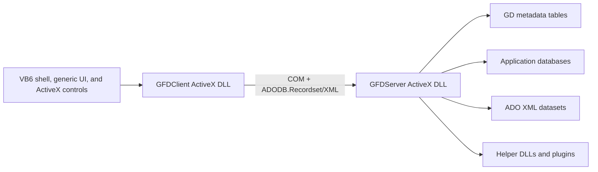
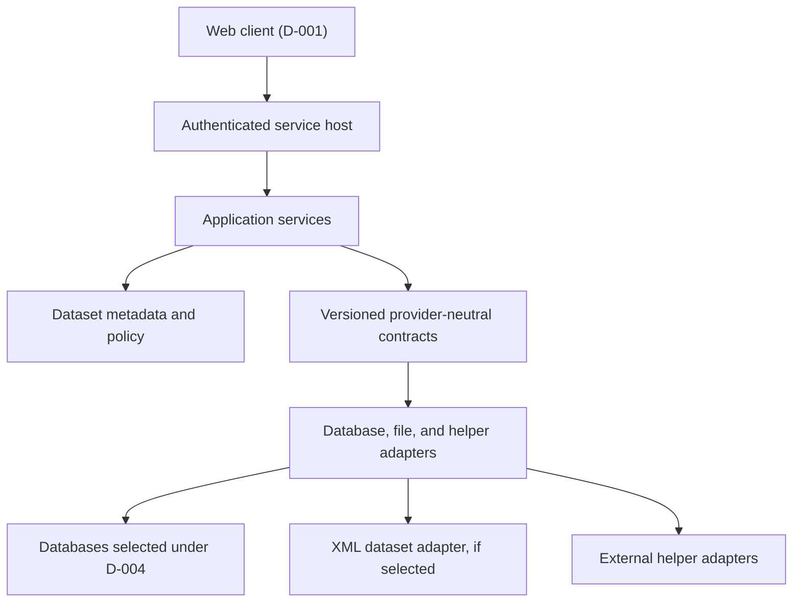
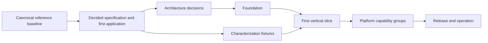

# GDFramework Rebuild Master Plan and Design

**Status:** Controlled working baseline  
**Version:** 0.9  
**Date:** 13 September 2026  
**Owner:** Migration technical lead  
**Reference source baseline:** `${LEGACY_SOURCE_ROOT}`; see [section 23 Legacy baseline](#23-legacy-baseline). Nothing else exists: no deployed instance, metadata database, user, or consumer  
**Legacy checksum-manifest SHA-256:** `fc29779b9588a41cb9da10c486f1f0b35ca2108baf50fb8892086587ee320027`  
**Functional baseline:** [GDFramework Functional Specification 0.10](GDFramework%20Functional%20Specification.md)  
**Target design:** [GDFramework Modern Web System Design 0.6](MODERN_WEB_SYSTEM_DESIGN.md)  
**Document control:** [DOCUMENT_CONTROL.md](DOCUMENT_CONTROL.md)  
**Consolidates:** the former legacy-baseline, evidence-acquisition, component-inventory, dependency-inventory, provider-matrix, public-API-catalogue, dataset-catalogue, and ADR documents (now sections 23–30); and the superseded 0.1 design/plan drafts (deleted from the working tree; last present in git history at commit bb1991a)

## Change history

| Version | Date | Summary |
|---|---|---|
| 0.2 | 2026-08-01 | Consolidated the separate migration design and migration plan into one master |
| 0.3 | 2026-09-06 | Authority statement, quality-gate definitions, and portability tokens (`${LEGACY_SOURCE_ROOT}`) |
| 0.4 | 2026-09-06 | Metadata schema alignment with functional specification section 28 |
| 0.5 | 2026-09-09 | Evidence-bound gate exit criteria, evidence-unobtainable contingency path, risk register triggers and R-016..R-019, and merge of the inventories, evidence register, catalogues, provider matrix, and ADR register as sections 23–30 |
| 0.6 | 2026-09-10 | Cross-document version citations corrected; D-011 enforced at Phase 0 exit and Gate A; D-009 removed from the Gate C deferrable list; Phase 2 entry aligned with Gate C; decisions D-013..D-016 registered for the design section 34 items; online-only default recorded; technology-neutral testing rule; git-history reference corrected; accountable role and gate per phase and workstream; entry criteria for Phases 3–5 and 7; evidence-bound exit criteria for Phases 2–6; Phase 0 target date; section 19.1 cutover, reconciliation, and rollback criteria; team/skills/cost placeholder with owner and due date |
| 0.7 | 2026-09-10 | D-017 desktop-bound behavior reinterpretation registered and added to Phase 6 entry; D-014 and D-015 timing aligned between sections 13 and 17; Phase 0 target-date rationale corrected; Phase 0 activity 9 reworded as maintenance; section 6.1 clarified as registers within the four documents; risk status vocabulary defined; DEF range extended to DEF-038; Gate D cites NFR-PERF-003; section 19.1 measurement window defined; D-001 owns the browser support matrix; Phase 0 target date and estimation due date removed so the plan carries no delivery dates |
| 0.8 | 2026-09-10 | Premise corrected: the legacy system is not deployed anywhere and no metadata, users, or consumers exist, so the document becomes a rebuild plan. Coexistence, pilot, cutover, retirement, compatibility, and evidence-acquisition content removed; sections 1, 2, 3.4, 4.3, 5, 6.1, 8.3, 11–22, 23.5, 24, 25–29, and Appendix A rewritten or trimmed in place so that section numbers cited by the other documents remain valid. Phases reduced to 0–5 and gates to A–F; D-006 and D-012 closed; D-001 moved to Gate C; D-015 adopted (authoring first); D-018..D-020 registered; risks that assumed a deployed instance closed; penetration test placed at Phase 5 exit; section 3.5 records the prototypes as reference implementations and adopts their sample application as the first application |
| 0.9 | 2026-09-13 | Design-review reconciliation: coordinate scope in D-017, Gate C deferral consistency, Phase 3 threat-model work, test-layer mapping, and baseline references; historical phase references retained in change history |

## 1. Document purpose and authority

This document is the consolidated governance and delivery baseline for
rebuilding GDFramework as a modern web platform. The legacy VB6 system is not
deployed anywhere. No production instance, metadata database, application
database, user population, helper binary, or dependent consumer exists. The
reviewed source tree and its documents, identified by the checksum baseline in
section 23, are the only evidence, and they serve as the behavioral reference
for the rebuild rather than as a system to be migrated. This plan therefore
contains no coexistence, side-by-side routing, cutover, or legacy retirement.

This is a documentation-first rebuild. It is deliberately a controlled
baseline rather than an implementation mandate. No replacement implementation
is authoritative until the applicable decisions and phase exit criteria in
this document have been reviewed and approved.

The functional specification is normative for observable behavior and
functional scope. The modern web system design is normative for the target
logical architecture and implementation boundaries. This master is normative
for governance, sequencing, decisions, risks, and quality gates, but may not
silently override a functional requirement or target-design boundary. An
intentional difference requires an approved defect disposition, a section
32.1 reinterpretation under D-017, or an ADR linked from the requirement
traceability matrix (DOCUMENT_CONTROL.md section 8). The original 0.1 design
and plan drafts are superseded historical records; they were deleted from the
working tree and remain in git history (last present at commit bb1991a).

### 1.1 Current status

| Area | Status |
|---|---|
| Consolidated plan | Controlled working baseline 0.9 |
| Functional reference baseline | Version 0.10; framework, generic UI, custom controls, and metadata schema contract documented from source; no deployment-specific rows exist or will exist |
| Requirement traceability | All functional/defect IDs inventoried; test mapping generated; rows that assumed a deployed legacy instance are marked not applicable |
| Phase 0 | Started: Git repository and controlled artifacts established; canonical source copies not yet chosen (D-009) |
| Replacement code | Not started |
| Target UI | Modern web application selected; framework and design system pending the D-001 ADR at Gate C |
| Service transport and deployment topology | Not decided |
| First application to be authored | The reference application embedded in the runtime prototype (`prototype/gdframework-web-mockup.html`): Operations Hub and Risk & Controls, covering all seven screen families; confirmed at Gate B (section 22) |

### 1.2 Evidence boundary

The reviewed source tree plus the reconstructed metadata schema define the
framework engine and the configuration grammar. No populated metadata rows,
physical DDL, application database, helper binary, role assignment, runtime
recording, or running environment exists, and none will be obtained. The
reference source is not built or run; behavior is characterized by reading
source and documents.

Where the functional specification marks a requirement `METADATA-DEPENDENT`,
`RUNTIME-VERIFY`, `PHYSICAL-DDL-VERIFY`, or `NOT APPLICABLE`, the rebuild
resolves it by a recorded product or design decision (section 17), not by
further discovery. Applications, navigation, screens, DataClasses, roles,
reports, and messages are authored anew in the rebuilt platform through its
own authoring tool (D-015). Section 24 states the consequences of each missing
evidence class.

## 2. Executive direction

GDFramework is a metadata-driven application framework composed of VB6 ActiveX
DLLs, an ActiveX control library, ADO recordsets, database-specific adapters,
COM interfaces, and a generic desktop user interface. Its source and documents
describe dynamic datasets, client-side editing, server-side persistence,
configurable applications and menus, security, messages, logging, reporting,
and multiple data-source types. That description is the reference for the
rebuild.

The rebuild shall be incremental:

1. Establish a controlled, traceable reference baseline.
2. Complete the functional specification from source and record a product
   decision for every ambiguity, defect, dormant feature, and desktop-bound
   behavior.
3. Decide the architecture and technology, then build the foundation.
4. Deliver one end-to-end vertical slice: an authored application, server,
   provider, and browser client.
5. Expand platform capability in controlled groups behind measurable gates.
6. Release, operate, and support the platform and its first application.

This is not a line-by-line translation. Unsafe legacy behavior, such as raw SQL
exposure, live database objects, unverified caller identity, silent connection
fallback, secret leakage, or falsely reported write success, will not be
reproduced (binding through DEF-* dispositions approved under D-011; see
DEF-001 credentials and DEF-016 concealed failures in functional specification
section 31).

## 3. Reference-system baseline

### 3.1 Project inventory

| Area | Legacy project | Primary responsibility |
|---|---|---|
| Interfaces | `AppInterfaces/GDFInterfaces.vbp` | Shared COM interfaces and cross-project types |
| Server | `AppServer/GenFormDataServer.vbp` | Metadata loading, datasets, ADO connections, queries, writes, messages, and configuration |
| Client | `AppClient/GenFormDataClient.vbp` | Client facade, session state, recordset editing, menus, and display configuration |
| Controls | `AppControls/GFDGUICtls.vbp` | VB6 ActiveX toolbar, panel, splitter, dropdown, lookup, and Outlook-style controls |
| GUI | `GenData/AppGUI/GenFormDataGUI.vbp` | Main shell, generic metadata-driven form, navigation, dialogs, export, and print |
| Aggregator | `AppServer/GDAggregator.vbp` | Aggregation and specialist server-side orchestration |
| Harnesses | `Z_Harness_*` and `AppControls/test` | Helper/plugin examples and minimal manual integration hosts |
| Shared copies | `AppShared` and `AppClient/AppClient` | Duplicate or divergent sources requiring provenance analysis |

Using the reproducible counting rule recorded in [section 23.2](#23-legacy-baseline)—recursive
physical lines in `.frm`, `.bas`, `.cls`, `.ctl`, and `.pag` files, including
duplicate/source-only files—the core GDFramework tree contains 123 files and
55,504 lines. Including the separately located `GenData/AppGUI` tree gives 160
files and 79,100 lines. These are inventory measures, not claims about compiled
membership. Several projects contain machine-specific references to obsolete or
unavailable COM libraries. Duplicate source trees and differing project/binary
lineages mean a timestamp or matching product name cannot prove deployment.

### 3.2 Current request flow



### 3.3 Important legacy behavior

- Dataset definitions and parameters are loaded from database metadata.
- Dataset results are cached and refreshed using per-dataset flags.
- ADO recordsets are marshalled directly or serialized as ADO XML.
- Client recordsets track pending insert, update, and delete operations.
- The server constructs and executes DML from metadata and changed field values.
- Supported or retained provider paths include SQL Server, Sybase, Oracle,
  Access, XML files, stored procedures, and helper-based simple services.
- The server and client expose COM objects and mutable internal collections.
- UI configuration, applications, menus, messages, reports, security, and user
  settings are modeled as datasets.
- The generic form builds toolbar commands, views, fields, filtering, grouping,
  reporting, and CRUD behavior from metadata and effective security.
- The custom controls have a public COM surface and VB6 property-bag contract
  that is reference material for the modern component library (design section 9).

### 3.4 Planning assumptions

- No legacy instance runs anywhere, so nothing must remain operational during
  the rebuild and nothing is cut over or retired.
- No application database exists. Each authored application defines or
  connects to its own data sources under D-004 and D-010.
- The reference source is not a clean, reproducible build baseline and will
  not be built or run. Behavior is characterized by reading source and
  documents; where the source is ambiguous, a product decision fixes the
  behavior.
- The workspace contains planning material, two single-file prototypes, and
  no replacement implementation. The prototypes are reference implementations
  of the target layouts and of the authoring workflow (section 3.5); they are
  not production code.
- A supported development SDK, build image, and integration environments must
  be provisioned before modern project creation.

### 3.5 Reference implementations of the target layouts

Two single-file, dependency-free prototypes under `prototype/` are the
reference implementations of what the rebuilt platform must look like. They
embed their metadata and sample data as JSON and run in a browser without a
server. Where a prototype and the design document differ, the design governs
(MODERN_WEB_SYSTEM_DESIGN.md header note).

| Prototype | What it demonstrates | Role in the plan |
|---|---|---|
| `gdframework-web-mockup.html` (GD Workspace) | The end-user shell, navigation, tabs, personalization, messages, export, print, responsive layout, and themes, with a sample application that exercises every screen family: Order register (grid), Customer records (field), Inventory by product (master-detail), Repricing action and Run limit check (action), Regional hierarchy (tree/detail), Customer products (junction), and Sales performance (chart) | Layout reference for design sections 7–9 and the definition of the first application (Phase 1) |
| `gdframework-admin-mockup.html` (GD Studio) | Metadata authoring: applications, navigation, screens, fields, commands, DataClasses, connections, value lists, reports, security, validation results, version history, draft comparison, impact, publication checklist, and rollback | Reference for the D-015 authoring tool (design section 11.4) |

The sample application in the runtime prototype, called the *reference
application* in this plan, is the first application to be authored. It is
representative by construction, because it was built to cover the platform
surface, and it needs no business owner to exist before the platform can be
built. A business application replaces or joins it when one is defined.

## 4. Drivers, goals, and boundaries

### 4.1 Drivers for change

#### Platform and operability

- VB6 and historical COM dependencies are difficult to build, deploy, register,
  and support on current Windows environments.
- Projects depend on old machine paths, 32-bit controls, CDO, Office libraries,
  and unavailable custom binaries.
- There is no automated legacy build or regression suite.
- Duplicate source trees obscure the authoritative implementation.

#### Security and correctness

- The server exposes internal database facilities and arbitrary SQL paths.
- Caller-provided identity is accepted without a trusted authentication boundary.
- SQL values are concatenated instead of consistently parameterized.
- Batch writes can partially commit.
- Some client write methods report success after a server failure.
- Unknown connection names may silently fall back to the system database.
- Tracked legacy configuration contains plaintext credential material.

#### Maintainability

- Business behavior, transport, persistence, caching, UI, and logging are
  interwoven.
- Public APIs exchange implementation-specific ADO objects.
- Provider-specific SQL is assembled throughout the data layer.
- Error handling relies on Boolean returns, global messages, suppressed errors,
  and mutable out-parameters rather than a stable result model.

### 4.2 Goals

The migrated system shall:

- Preserve approved business behavior, user workflows, and data semantics.
- Replace COM/ADO recordset contracts with explicit, versioned contracts.
- Authenticate identity at a trusted boundary and authorize every operation.
- Use parameterized commands and explicit provider adapters.
- Make a logical change set atomic unless partial success is explicitly designed.
- Support incremental delivery and reversible releases.
- Provide structured diagnostics, audit events, health checks, and correlation.
- Build and test from a clean, documented environment.
- Isolate provider-specific behavior from application policy.
- Preserve metadata-driven application definition rather than compiling each
  business screen into a bespoke implementation.

### 4.3 Non-goals for the first increment

- Reproducing known defects without an approved disposition.
- Building or running the legacy VB6 source.
- Any compatibility layer for COM, ADO, or VB6 callers.
- Selecting a UI framework before its accessibility and performance spike
  passes (D-001).
- Adopting an ORM as the source of truth for dynamic metadata-defined datasets.
- Treating successful compilation as proof of behavioral equivalence.
- Implementing historical, dormant, source-only, or documented-only features
  without an explicit product decision.

## 5. Governing design principles

1. **Behavior before replacement.** Capture current inputs, outputs, side
   effects, event order, persistence, and failure behavior before rewriting a
   path.
2. **Explicit boundaries.** Do not expose connections, commands, mutable caches,
   provider objects, or UI implementation types outside infrastructure.
3. **Secure by construction.** Identity is established by the host, not supplied
   as an ordinary request parameter.
4. **Provider isolation.** SQL dialect, parameter syntax, type mapping, and
   connection behavior belong in provider adapters.
5. **Atomic commands.** One logical change set has one explicit transaction
   policy and one structured result.
6. **No coexistence layer.** The rebuild exposes only modern contracts;
   nothing translates legacy COM, ADO, or VB6 shapes.
7. **Observable operation.** Every request has a correlation identifier,
   structured outcome, duration, and safe diagnostic context.
8. **No hidden fallbacks.** Unknown datasets, parameters, connections, providers,
   command keys, and critical options fail explicitly.
9. **Test real boundaries.** Exercise serialization, transport, commands,
   transactions, response parsing, failure behavior, and cleanup with real
   implementations or purpose-built fixtures.
10. **Technology decisions follow evidence.** Do not scaffold a target stack
    until its architectural decision and relevant entry criteria are approved.

## 6. Governance and ownership

### 6.1 Required controlled artifacts

The rebuild shall maintain:

- Functional reference specification and requirements traceability.
- Reference-system component and dependency inventory.
- Public control/API reference derived from source.
- Dataset, parameter, security, report, and business-action catalog for every
  authored application.
- Provider compatibility matrix.
- Characterization and conformance-test catalog.
- Architecture Decision Records (ADRs).
- Legacy defect disposition register: **preserve**, **fix**, or **retire**.
- Desktop-bound behavior reinterpretation register (functional specification
  section 32.1, decision D-017).
- Risk, issue, dependency, and decision registers with owners and review dates.
- Phase entry/exit evidence and quality-gate decisions.
- Deployment, release, and rollback runbooks.
- Reference-source archival record.

These are sections and registers within the four controlled documents
(DOCUMENT_CONTROL.md section 1), or artifacts generated from them, not
additional documents.

### 6.2 Change control

- A phase begins only after its entry criteria are met.
- Contract, security, provider, scope, or UI-direction changes
  require a recorded decision.
- Replacement changes are accepted only with tests appropriate to the boundary.
- No exception may expose raw SQL, live database objects, connection
  credentials, or unverified identity.
- Known legacy defects must have an approved disposition before conformance
  results are accepted.
- Open decisions shall not be silently converted into implementation defaults.

### 6.3 Definition of done

A migration item is complete only when:

- Behavior, state transitions, and failure cases are specified.
- Implementation respects approved dependency and security boundaries.
- Automated tests cover observable behavior.
- Provider-specific behavior is integration-tested where applicable.
- Security, diagnostics, cleanup, and operational support are verified.
- Documentation, runbooks, and traceability are updated.
- No unresolved high-severity defect is hidden behind a compatibility layer.
- The applicable acceptance criterion and phase/gate evidence are recorded.

### 6.4 Required roles

Named individuals may fill multiple roles, but every responsibility must exist.

| Role | Responsibility |
|---|---|
| Product/domain owner | Approves behavior, defect disposition, scope, and workflow acceptance |
| Legacy technical owner | Reads and explains the reference source, its documents, and its lineage; no deployment knowledge exists to recover |
| Migration technical lead | Owns architecture, sequencing, dependency rules, and quality gates |
| Database owner | Supplies schemas, fixtures, provider constraints, and reconciliation evidence |
| Security owner | Approves identity, authorization, secrets, audit, and threat model |
| Operations owner | Owns deployment, monitoring, recovery, rollback, and support transfer |
| Test/quality owner | Owns characterization, integration, differential evidence, and exit reports |
| UI/workflow owner | Owns user research, accessibility, integration constraints, and client acceptance |

## 7. Proposed logical architecture

The target client is a modern web application as defined in
[MODERN_WEB_SYSTEM_DESIGN.md](MODERN_WEB_SYSTEM_DESIGN.md), which is the
normative architecture. This section is the governance summary of the
boundaries the design must keep. The final runtime, web framework, and host
remain open decisions, but the following separation shall hold whether the
service boundary uses HTTP, gRPC for controlled internal integration, a managed
process, or a container.



### 7.1 Solution boundaries

| Boundary | Responsibility | Must not contain |
|---|---|---|
| Contracts | Versioned request, response, error, and event types | ADO, COM, UI, connections, commands |
| Application | Use cases, authorization, orchestration, and transaction intent | Provider-specific SQL syntax |
| Dataset model | Dataset definitions, parameters, keys, cache/update policy | Transport or UI concerns |
| Infrastructure | Connections, dialects, SQL execution, files, and plugin adapters | Caller authorization decisions |
| Host | Authentication, validation, routing, health, and diagnostics | Business rules embedded in endpoints |
| Client | User workflows, state, and presentation | Direct database access |

### 7.2 Technology-neutral logical layout

No implementation projects shall be scaffolded until the required decisions are
approved. The following names describe logical responsibilities, not a language,
framework, packaging scheme, or prescribed repository layout:

```text
contracts
application-services
dataset-model-and-policy
provider-infrastructure
authenticated-host
characterization-tests
contract-tests
provider-integration-tests
conformance-tests
```

Hosts and adapters depend on application contracts. The application layer does
not depend on COM, ADO recordsets, provider implementations, or a UI toolkit.

## 8. Contract design

### 8.1 Contract rules

- Contracts are versioned independently from implementations.
- No public contract returns a live connection, command, transaction, recordset,
  cache, or mutable server collection.
- Requests have explicit identifiers, parameters, paging, ordering, security
  scope, and consistency requirements.
- Results distinguish validation, authentication, authorization, conflict,
  provider, timeout, cancellation, and unexpected failures.
- Dates, time zones, decimals, binary values, strings, enumerations, and nulls
  have defined serialization rules.
- Dataset and field identifiers come from validated metadata; callers cannot
  inject arbitrary SQL fragments.
- UI command identity uses stable semantic keys rather than caption or position.

### 8.2 Core conceptual contracts

| Contract | Purpose |
|---|---|
| `SessionContext` | Trusted subject, roles/claims, application, workstation context, and correlation ID |
| `DatasetDefinition` | Dataset identity, provider, query/update policy, columns, keys, security, and cache policy |
| `DatasetParameter` | Name, type, value, validation, and required/optional status |
| `DatasetQuery` | Dataset identity, parameters, paging, sort, and refresh/consistency option |
| `DatasetResult` | Schema, rows, continuation information, and version/concurrency values |
| `ChangeSet` | Dataset identity and ordered insert/update/delete changes |
| `ChangeResult` | Overall outcome plus per-row success, conflict, validation, and generated-key data |
| `SystemMessage` | Typed application/system message with audience and validity window |
| `Problem` | Stable error code, safe message, correlation ID, and optional field details |

The exact wire format is an open decision. JSON over HTTP is the current default
candidate (non-binding candidate pending D-002; see the design document §13
candidate note) because it is inspectable and tool-friendly. gRPC remains an
option for controlled internal integration.

### 8.3 No compatibility translation

No legacy caller exists, so no adapter translates COM methods, ADO recordsets,
or ADO XML streams, and the design's Appendix B legacy-to-web responsibility
map is reference material only. The modern contracts are the only public
surface. Exact legacy COM names, enum values, and property-bag keys recorded in
functional specification section 26 inform the modern component contracts;
they are not preserved as binary compatibility.

## 9. Dataset, persistence, and provider design

### 9.1 Metadata loading and validation

Authored metadata is compiled into a typed model that preserves the entity
semantics of functional specification section 28. Validation occurs before an
affected dataset becomes available:

- Dataset and connection identifiers exist and are unique.
- Provider type is supported and active.
- Query/update policy is internally consistent.
- Update tables and key columns are declared and allow-listed.
- Parameter markers map one-to-one to typed parameters.
- Cache keys include every value and security scope that can affect results.
- Security policy is explicit; absence is not accidentally unrestricted.
- Unsupported historical options are diagnosed, not silently ignored.

Invalid metadata blocks only the affected capability where safe and produces an
actionable startup or configuration diagnostic.

### 9.2 Connection resolution and secrets

A connection factory resolves only an exact configured connection identifier.
An explicit `System` identifier may represent the system database. Blank,
unknown, inactive, or ambiguous identifiers fail rather than falling back
(policy intent; binding only through DEF-* dispositions approved under D-011;
see DEF-016 concealed failures).

Secrets are supplied by the deployment environment or approved secret store.
They are not returned through application contracts, stored in source, displayed
to users, or written to logs (policy intent; binding only through DEF-*
dispositions approved under D-011; see DEF-001 credentials).

### 9.3 Query execution

- Values are bound as typed command parameters.
- Provider adapters own placeholder syntax, quoting, and type mapping.
- Metadata-derived identifiers are validated against the loaded definition.
- Paging and limits prevent accidental unbounded datasets.
- Cancellation and command timeouts flow from host to provider.
- Provider resources are disposed deterministically.
- Ordering is explicit wherever consumers rely on it.

### 9.4 Change execution

A `ChangeSet` is validated before any write:

1. Authenticate and authorize the subject.
2. Resolve the dataset and update policy.
3. Validate fields, types, required values, keys, and audit/concurrency values.
4. Begin the required transaction.
5. Execute inserts, updates, and deletes with typed parameters.
6. Apply optimistic concurrency rules.
7. Commit only if the change-set policy is satisfied.
8. Return generated keys, reconciled stamps, and accurate per-row outcomes.

Unexpected failure rolls back the transaction and returns a failure result.
Partial success is allowed only for a use case explicitly designed, documented,
and approved to permit it (policy intent; binding only through DEF-*
dispositions approved under D-011; see DEF-016 concealed failures and
DEF-012/DEF-013 stale state).

### 9.5 Caching

- Caches hold immutable results, not shared mutable recordsets.
- Keys include dataset version, application/security scope, and every
  result-affecting parameter.
- Entries have explicit lifetime and invalidation rules.
- Writes publish invalidation only after commit.
- Forced refresh bypasses lookup but does not weaken authorization.
- Cross-user and cross-application isolation is tested.

The first vertical slice may operate without caching. Caching is added after
parity is proven and measured need is demonstrated.

## 10. Security, errors, and observability

### 10.1 Identity and authorization

The host establishes identity through an approved mechanism such as integrated
Windows authentication or an organization identity provider. A username in a
request is context to validate, never proof of identity.

- Every dataset declares read/change policies.
- Administrative operations use explicit policies rather than mutable client
  flags.
- Application, user, role, and audit identifiers used for filtering or writing
  are derived from the trusted session or independently authorized.
- Every protected UI command and server operation is evaluated against effective
  authorization before exposure or execution.

### 10.2 Audit and sensitive data

Security-sensitive operations record subject, action, dataset, outcome,
correlation ID, and timestamp. SQL text where sensitive, passwords, tokens,
connection strings, and unredacted sensitive field values are not logged.

### 10.3 Error model

Application methods return a structured result or raise a controlled exception
that the host translates into a stable `Problem`. Boolean success is not the
only error channel.

Expected categories are:

- Invalid request or metadata.
- Unauthenticated or unauthorized.
- Dataset, parameter, field, provider, or connection not found.
- Validation or optimistic-concurrency conflict.
- Provider unavailable or dependency protocol failure.
- Timeout or cancellation.
- Unexpected internal failure.

### 10.4 Diagnostics and health

Each operation records:

- Correlation and operation identifiers.
- Authenticated subject identifier.
- Dataset and provider identifiers.
- Duration and row counts.
- Transaction and cache outcome.
- Stable error code on failure.

Health checks distinguish host health from individual provider availability.

## 11. Verification and testing strategy

| Test type | Purpose |
|---|---|
| Characterization | Record the reference behavior, read from source and documents, for representative datasets, UI controls, workflows, and failures as expected outcomes |
| Contract | Prove request/response compatibility independent of host technology |
| Provider integration | Exercise real serialization, commands, parameters, transactions, failures, and cleanup |
| Conformance | Run requests and workflows against the expected outcomes recorded in the functional specification and its approved dispositions |
| UI/control behavior | Verify public control contracts, persisted defaults, events, keyboard behavior, and shell/generic-form integration |
| Security | Reject impersonation, unauthorized access, identifier injection, raw SQL, and secret leakage |
| Operational | Verify startup validation, health, timeout, cancellation, retry, recovery, deployment, and rollback |
| Performance | Measure agreed dataset sizes, concurrent users, latency, memory, exports, and long-running operations |

Tests use real implementations, protocol-level fixtures, disposable integration
environments, or small purpose-built fakes at protocol boundaries. Mocking
frameworks that substitute generated doubles for real boundaries are
prohibited in every runtime selected under D-008; CONTRIBUTING.md and design
section 29 restate this rule.

Quantitative acceptance targets are controlled in
[functional specification section 44 Non-functional requirements](GDFramework%20Functional%20Specification.md#44-non-functional-requirements). A phase or gate
may strengthen those targets through an approved decision but may not replace
them with an unmeasurable statement.

Golden files normalize nondeterministic timestamps, generated identifiers,
unspecified row ordering, and provider-specific diagnostic text. Normalization
must not conceal a material difference from the specified behavior.

Representative characterization shall include:

- Simple typed parameterized read.
- Cached read and explicit refresh.
- Dynamic/disconnected predicates and user/application scope.
- Insert with generated key.
- Single- and multi-row update.
- Physical and logical delete.
- Optimistic concurrency conflict.
- Stored procedure and action dataset.
- XML dataset and registered extension adapter call, where D-004 and D-019
  bring them into scope.
- Null, date, decimal, binary, Unicode, escaping, and ordering cases.
- Generic UI toolbar, panel, splitter, navigation, filtering, grouping, search,
  CRUD, reporting, export, print, and popup/docking behavior.

The layer mapping to modern design section 29 is: Characterization to
Conformance; UI/control behavior to Component and Screen renderer; Operational
to Workflow, Reliability, and Deployment. Shared boundary tests reuse evidence.

## 12. Workstreams

| Workstream | Scope | Accountable role (section 6.4) |
|---|---|---|
| A. Reference baseline | Source provenance, canonical copies, controls, dependencies, and archival | Legacy technical owner |
| B. Behavior | Functional specification, characterization from source, product decisions, and conformance fixtures | Test/quality owner (dispositions and reinterpretations: Product/domain owner) |
| C. Architecture | Contracts, ADRs, security, error model, observability, and technology choices | Migration technical lead |
| D. Platform server | Application services, typed metadata, providers, transactions, cache, and messages | Migration technical lead (providers: Database owner) |
| E. Application authoring | Metadata authoring tool, first application definitions, and configuration governance | Product/domain owner |
| F. Client/UI | Web shell, generic screen engine, component library, and accessibility | UI/workflow owner |
| G. Delivery | Source control, build pipeline, environments, deployment, monitoring, release, and rollback | Operations owner |

Each phase in section 13 names its accountable role and the gate (section 18)
that closes it; the accountable role signs the phase exit evidence.

Workstreams overlap only when their inputs are stable. Provider work can begin
after its matrix, contracts, and first slice are approved.

## 13. Phase plan

No phase carries a calendar date. Each phase exits on its gate evidence.

### Phase 0 — Establish the reference baseline

**Objective:** Know exactly what the reference source contains and make every
change traceable.

**Accountable:** Legacy technical owner (workstream A) with the Migration
technical lead for decisions and registers. **Gate:** A.

**Activities**

1. Initialize source control and contribution rules for the workspace.
2. Record the reference path, checksums, project files, archives, and file
   inventory (section 23).
3. Choose the canonical copy for each duplicated server, shared, client, GUI,
   and control source (D-009).
4. Inventory third-party controls, Office/CDO dependencies, and helper
   binaries as reference material (section 26); none is deployed.
5. Establish owners for product, databases, infrastructure, security,
   operations, testing, and user workflows.
6. Maintain the ADR record template (section 30.1) and the controlled
   decision and risk registers (sections 16 and 17).

**Deliverables**

- Section 23 baseline and checksum manifest (section 23.3).
- Section 25 component inventory with the reference role of every project.
- Section 26 dependency inventory with the planned modern treatment.
- Canonical-source ADR (section 30; D-009).
- Legacy defect disposition policy ADR (section 30; D-011), approved before
  Phase 1 records any DEF-* disposition.

**Exit criteria**

- Canonical source is identified per component (D-009), with an ADR.
- Defect disposition policy approved (D-011), with an ADR.
- Named owners recorded in DOCUMENT_CONTROL.md section 7.
- Gate A evidence recorded (section 18).

### Phase 1 — Complete the behavioral baseline and product decisions

**Objective:** Turn the source-derived specification into a decided,
testable baseline and define the first application to be authored.

**Accountable:** Test/quality owner (workstream B); dispositions and
reinterpretations by the Product/domain owner. **Gate:** B.

**Activities**

1. Complete the functional specification from source and resolve every
   `RUNTIME-VERIFY` and `DOCUMENT CONFLICT` row by reading or by a recorded
   product decision.
2. Record a Decision for every DEF-* row under D-011.
3. Record a D-017 decision for every functional specification section 32.1
   row.
4. Decide scope for dormant, unfinished, PLM, aggregation, and limit features
   (D-020) and for extension contracts (D-019).
5. Adopt the reference application from the runtime prototype (section 3.5)
   as the first application and complete its definition: screens, DataClasses,
   roles, reports, and acceptance scenarios, with a named owner.
6. Build source-derived characterization fixtures: expected inputs, outputs,
   database effects, messages, UI outcomes, and failure behavior.

**Deliverables**

- Functional specification with no Pending DEF-* row and no undecided
  section 32.1 row.
- Section 28 catalogue populated for the first application.
- Characterization fixture set and execution instructions.
- Completed functional traceability baseline for the first application
  (DOCUMENT_CONTROL.md section 8).

**Exit criteria**

- Every DEF-001..DEF-038 row carries a Decision other than Pending with
  Approvers and Approval date.
- Every section 32.1 row carries a D-017 decision.
- First application scope approved by the Product/domain owner.
- Null, date, decimal, Unicode, generated-key, concurrency, event,
  persistence, and failure behavior are specified as expected outcomes.
- Gate B evidence recorded (section 18).

### Phase 2 — Approve architecture and create the foundation

**Objective:** Turn approved decisions into a minimal buildable solution.

**Accountable:** Migration technical lead (workstream C); delivery items by
the Operations owner (workstream G). **Gate:** C.

**Entry criteria**

- Gate B passed.
- Gate C decision rule met: D-001, D-004 (first provider), D-005, D-008, and
  D-013 decided and not deferred; D-002, D-003, D-007, D-014, D-015 (approval model), and D-016 decided or
  explicitly deferred with a documented safe default.
- Supported SDK, build image, CI, and test environment are available.

**Activities**

1. Resolve or formally defer the required open decisions.
2. Create ADRs for client framework, runtime, transport, authentication,
   metadata store, data access, deployment, and queue/cache/object storage.
3. Run the D-001 accessibility and performance spike (design section 32).
4. Scaffold only approved solution projects.
5. Enforce dependency and architecture rules.
6. Define versioned query, result, change-set, problem, and session contracts.
7. Add correlation, structured logging, startup validation, health checks, and
   secret injection.
8. Create test projects and reusable integration fixtures.
9. Establish continuous build, test, dependency, and security checks.

**Deliverables**

- Buildable solution with client, API, and worker skeletons.
- Contract version 1.
- Approved ADR set.
- CI definition and clean-build image.
- Test environment documentation.

**Exit criteria**

- A clean checkout builds without machine-specific absolute references
  (NFR-BUILD-001).
- Contract and architecture tests pass (design WDES-004, WDES-005, WDES-006;
  NFR-OBS-001 for correlation on every contract).
- Secrets are external to source and logs (NFR-SEC-003).
- No infrastructure type is exposed through the application boundary
  (design section 13; WDES-004).
- Gate C evidence recorded (section 18).

### Phase 3 — Deliver the first vertical slice

**Objective:** Prove the end-to-end platform pattern with one authored
application: metadata, server, provider, and browser.

**Accountable:** Migration technical lead (workstream D) with the UI/workflow
owner (workstream F) and the Product/domain owner (workstream E). **Gate:** D.

**Entry criteria**

- Gate C passed (section 18).
- The first application's metadata is authored for the slice screens and its
  fixtures exist (Gate B).
- A provider integration environment for the first provider (D-004) exists
  with a least-privilege service identity.

**Slice content**

- The Order register (grid) and Customer records (field) screens of the
  reference application, with navigation, toolbar commands, criteria, lookup,
  and secured query and change, matching the runtime prototype's layout.
- The minimum authoring path needed to define those screens (D-015).
- The first provider adapter and the metadata store (D-013).
- Structured telemetry and health.

**Activities**

1. Compile and publish only the metadata required for the slice.
2. Implement exact connection resolution for the first provider.
3. Implement parameterized query execution and typed result serialization.
4. Implement authorization for the slice's DataClasses, screens, and commands.
5. Implement atomic change-set execution and conflict reporting.
6. Implement the shell, navigation, generic grid and field screens, and
   command bar in the selected framework.
7. Verify conformance with the characterization fixtures and approved
   dispositions.
8. Add operational metrics and correlated failure diagnostics.
9. Complete slice threat-model work and accessibility acceptance cases; record
   security-owner review before Gate D, extending the approved Gate C boundaries.

**Deliverables**

- Running vertical slice in the integration environment.
- Conformance, security, and accessibility test reports for the slice.
- Deployment and rollback procedure for the slice.

**Exit criteria**

- Slice behavior matches the fixtures; every difference is an approved
  disposition.
- Writes are atomic and return accurate outcomes (NFR-REL-001, NFR-PERF-003).
- Impersonation, injection, raw database access, and unknown-connection
  fallback fail safely (NFR-SEC-001, NFR-SEC-002, NFR-SEC-003).
- The slice screens pass keyboard and screen-reader checks (NFR-ACC-001).
- Operation is observable (NFR-OBS-001, NFR-OBS-002) and the deployment can
  be rolled back.
- Gate D evidence recorded (section 18).

### Phase 4 — Expand platform capability

**Objective:** Deliver the remaining platform capabilities in controlled
groups until the functional specification's in-scope surface is covered.

**Accountable:** Migration technical lead (workstream D); UI groups by the
UI/workflow owner; each provider by the Database owner. **Gate:** E.

**Entry criteria**

- Gate D passed (section 18).
- D-004 decided for every provider in the next capability group, and D-010
  recorded before any application database design the group needs.
- D-014 decided before the first group that needs durable jobs.
- D-018 decided before group 1 (format tokens).

**Capability groups**

1. Core dataset reads, dynamic parameters, refresh, and format tokens.
2. Inserts, updates, deletes, generated keys, audit stamps, and concurrency.
3. Complete metadata authoring, validation, versioning, publication, and
   rollback (design section 11).
4. Menus, security, personalization, user settings, and system messages.
5. Remaining screen families: master-detail, action, tree/detail, junction,
   and chart.
6. Stored procedures and action datasets.
7. Reports, export, print, and durable jobs.
8. XML datasets and registered extension adapters, where D-004 and D-019
   bring them into scope.
9. Aggregation and limit processing, only where D-020 brings them into scope.
10. Remaining providers selected under D-004.

Each group repeats: specify expected outcomes, implement contract and
application behavior, implement or extend its provider adapter or component,
run conformance, integration, security, and accessibility tests, and record
exit evidence.

**Deliverables**

- One exit-evidence record per capability group.
- Section 29 provider matrix with real integration status for every selected
  provider.
- Section 28 catalogue complete for the first application.

**Exit criteria**

- Every in-scope functional specification section 33 scenario (FR-ACC-001 to
  FR-ACC-018) passes.
- Every selected provider has real integration evidence (section 29; design
  WDES-011; NFR-REL-002 cleanup soak per provider).
- NFR-PERF-001, NFR-PERF-002, NFR-PERF-003, NFR-PERF-004, and NFR-SCALE-001
  are met at the section 44 measurement profiles in load tests.
- Gate E evidence recorded (section 18).

### Phase 5 — Release readiness and operation

**Objective:** Put the platform and its first application into production
with support, recovery, and security evidence.

**Accountable:** Operations owner (workstream G); security evidence by the
Security owner. **Gate:** F.

**Entry criteria**

- Gate E passed.
- Production environment, secrets, identity integration, monitoring, backup,
  and on-call ownership exist (design section 27).

**Activities**

1. Complete the accessibility, localization, and layout acceptance
   (NFR-ACC-001, NFR-UI-001, NFR-I18N-001) across all supported workflows.
2. Commission independent penetration testing (design section 15.3) and close
   its findings.
3. Exercise backup and restore within the NFR-DR-001 objectives.
4. Complete runbooks (design section 30.2) and support handover.
5. Release to production and begin the NFR-AVAIL-001 monitoring period.

**Exit criteria**

- FR-ACC-019 evidence recorded for every section 44 requirement, with
  NFR-AVAIL-001 by the post-release monitoring report and NFR-DR-001 by the
  restore exercise.
- Penetration test findings of critical or high severity closed; the report is
  linked from the NFR-SEC-003 evidence.
- Runbooks, monitoring, and ownership are in place (design section 30).
- Gate F evidence recorded (section 18).

## 14. Initial ordered backlog

| Order | Item | Output |
|---:|---|---|
| 1 | Establish source control and contribution rules | Traceable workspace |
| 2 | Hash and inventory the reference source and binaries | Reproducible reference |
| 3 | Resolve duplicate-source provenance | Canonical files per project (D-009) |
| 4 | Approve the defect disposition policy and record every DEF-* decision | Decided register |
| 5 | Record D-017 decisions for every desktop-bound behavior | Decided section 32.1 |
| 6 | Define the first application and its acceptance scenarios | Approved slice scope |
| 7 | Capture source-derived characterization fixtures | Expected outcomes |
| 8 | Decide client framework, runtime, authentication, transport, and metadata store | ADRs |
| 9 | Provision supported SDK, CI, and integration environments | Build foundation |
| 10 | Scaffold the approved solution after Gate C | First modern code |

## 15. Dependencies and critical path



The critical path begins with provenance, the decided specification, the
first application definition, and the architecture decisions. Because there is
no legacy client to keep serving, the browser client is part of the first
vertical slice and the D-001 framework decision sits at Gate C.

## 16. Risk register

| ID | Risk and impact | Severity | Owner | Status | Trigger | Review date | Mitigation and evidence |
|---|---|---|---|---|---|---|---|
| R-001 | Wrong source copy chosen as the reference; the rebuild specifies behavior from an unused variant | High | Legacy technical owner | Active | Two lineages of the same component differ in behavior and neither is clearly later | 2026-09-30 | Compare project manifests, archives, and type-library lineage per component and record the choice in the D-009 ADR; see [legacy baseline](#23-legacy-baseline). |
| R-002 | No behavioral oracle; source reading misstates behavior and the rebuild inherits the misreading | High | Test/quality owner | Open | A `RUNTIME-VERIFY` row cannot be resolved by reading, or two readers disagree | 2026-09-30 | Resolve each such row by a recorded product decision in Phase 1 and test the decided behavior, not the guess. |
| R-003 | Hidden consumers | — | — | Closed: not applicable | No deployed instance or consumer exists | — | Closed on 2026-09-10 when the premise was corrected. |
| R-004 | Provider differences; query/type behavior diverges from the typed contract | High | Database owner | Open | A provider integration test diverges from the contract and the cause is provider dialect or type behavior | 2026-09-30 | Execute real provider tests per [provider matrix](#29-provider-compatibility-matrix) before a provider is declared supported. |
| R-005 | Unsafe behavior reproduced as parity; security defects survive | Critical | Security owner | Active | A DEF-* row classified as a security defect is proposed with Decision "Preserve" | 2026-09-30 | Apply the defect register and security gate; see [defect dispositions](GDFramework%20Functional%20Specification.md#31-legacy-defects-and-compatibility-decisions). |
| R-006 | Specification ambiguity discovered late changes a delivered workflow | High | Product/domain owner | Open | A capability group exit finds a requirement whose expected outcome was never decided | 2026-09-30 | Phase 1 exit requires every `RUNTIME-VERIFY` and `DOCUMENT CONFLICT` row resolved; unresolved rows block Gate B. |
| R-007 | Authoring accepts executable or unsafe definitions | High | Migration technical lead | Open | An authored definition passes validation while containing raw SQL fragments, unregistered helpers, or credentials | 2026-09-30 | Compiler validation rules in section 9.1 and design section 11.3; security tests in design section 29. |
| R-008 | Cache changes cause leakage or stale results | Critical | Migration technical lead | Open | A cache isolation or invalidation test fails | 2026-09-30 | Disable initially, define complete scoped keys, and test isolation/invalidation. |
| R-009 | Framework chosen without the spike; accessibility or performance shortfall found late | High | UI/workflow owner | Controlled | A D-001 ADR is proposed without the design section 32 spike evidence | 2026-09-30 | Gate C requires the spike results in the D-001 ADR. |
| R-010 | Compatibility becomes permanent | — | — | Closed: not applicable | No compatibility layer exists | — | Closed on 2026-09-10 when the premise was corrected. |
| R-011 | No realistic test data creates false confidence | High | Test/quality owner | Open | Gate D approaches without volume-realistic synthetic data at the section 44 profiles | 2026-09-30 | Generate synthetic data sets at the measurement profiles for the first application and keep them under version control. |
| R-012 | Unmanaged SDK/toolchain creates workstation-specific builds | High | Operations owner | Open | A build succeeds on one workstation and fails on the CI image or a second workstation | 2026-09-30 | Approve D-008 and pin toolchain/dependencies/CI image before scaffolding. |
| R-013 | Missing deployed metadata rows | — | — | Closed: not applicable | No deployed metadata exists; applications are authored | — | Closed on 2026-09-10 when the premise was corrected. |
| R-014 | Historical features are mistaken for active scope | Medium | Product/domain owner | Controlled | A feature is proposed for implementation without a product decision | 2026-09-30 | Require an explicit product decision (D-019, D-020, or section 31) before inclusion. |
| R-015 | Control behavior is simplified prematurely and generic UI parity fails | High | UI/workflow owner | Controlled | A control or command replacement is proposed without a mapped FR-CTL-* or FR-CMD-* requirement | 2026-09-30 | Use the FR-CMD-* and FR-CTL-* requirements plus requirement-level acceptance mappings. |
| R-016 | Loss of access to the reference source share; the baseline can no longer be re-verified | High | Legacy technical owner | Open | `${LEGACY_SOURCE_ROOT}` is unreachable, or re-verification against the section 23.3 manifest reports a mismatch | 2026-10-15 | Repository checksum baseline in section 23 plus a controlled archival copy of the source and documents. |
| R-017 | Deployed production binaries never located | — | — | Closed: not applicable | No deployment exists to reconcile against | — | Closed on 2026-09-10 when the premise was corrected. |
| R-018 | Third-party control licensing blocks characterization or coexistence | — | — | Closed: not applicable | The legacy runtime is not built or run, so no third-party control is needed | — | Closed on 2026-09-10 when the premise was corrected. |
| R-019 | Key-person dependency on the reader of the reference source | High | Migration technical lead | Open | The legacy technical owner is unavailable for a full review period or gives notice of departure | 2026-10-07 | Paired reviewers on every Phase 0/1 specification package and written reading notes per component. |

Owners are role owners until named people are assigned (named during Phase 0
per DOCUMENT_CONTROL.md section 7). Each review updates the status, date,
mitigation evidence, and any resulting decision/issue; absence of new evidence
does not silently close a risk. Status values: *Open* means the mitigation has
not yet produced evidence; *Active* means the trigger condition is currently
observed or the mitigation is in progress; *Controlled* means the mitigation is
in place and the risk is monitored for its trigger; *Closed: not applicable*
means the risk assumed a deployed legacy instance and is retained only so the
identifier stays stable.

## 17. Architecture decision register

| ID | Decision and evidence required | Owner | Required by | Status | ADR record |
|---|---|---|---|---|---|
| D-001 | Web target selected. Choose the browser framework and design system through an accessibility/performance spike covering generic grid, form, tree, dialog, splitter, lookup, chart, command, printing, and download workflows (design section 32). The ADR also owns and publishes the browser support matrix (design section 10.3). | UI/workflow owner | Gate C | Direction selected | Pending framework ADR (add as section 30.N) |
| D-002 | Service transport: compare HTTP/JSON, gRPC, messaging, and in-process boundaries against hosting, diagnostics, and tooling. | Migration technical lead | Gate C (decide, or defer with a documented safe default) | Open | None raised (add as section 30.N) |
| D-003 | Host topology: select managed service/process/container topology from operational and network constraints. | Operations owner | Gate C (decide, or defer with a documented safe default) | Open | None raised (add as section 30.N) |
| D-004 | Supported providers: choose which database and file providers the rebuilt platform supports, from the needs of authored applications; the reference implementation's SQL Server, Sybase, Oracle, Access, XML, and helper providers are lineage, not a target list. | Database owner | Gate C for the first provider; Phase 4 entry for each further provider | Open | None raised (add as section 30.N) |
| D-005 | Authentication: select trusted user/service identity and delegation mechanism. | Security owner | Gate C | Open | None raised (add as section 30.N) |
| D-006 | Compatibility duration | — | — | Closed: not applicable (no legacy consumer exists) | None |
| D-007 | Dataset wire contract: select row, columnar, streaming, or typed use-case contracts using representative payloads. | Migration technical lead | Gate C (decide, or defer with a documented safe default) | Open | None raised (add as section 30.N) |
| D-008 | Implementation runtime/platform: select a currently supported runtime from host, operational, skills, and lifecycle evidence. | Migration technical lead | Gate C | Open | None raised (add as section 30.N) |
| D-009 | Canonical reference source: choose the authoritative copy per component among duplicate and divergent trees, archives, and retained binaries. | Legacy technical owner | Gate A | Open | None raised (add as section 30.N) |
| D-010 | Application database schema policy: each authored application designs or connects to its own database with the platform; the legacy metadata DDL is reference only. Any shared-schema convention is approved separately. | Database owner | Before the first application database design | Open; per-application default | None raised (add as section 30.N) |
| D-011 | Legacy defect disposition policy: define approval authority and preserve/fix/retire criteria. Because no deployed user exists, the expected default is Fix or Retire; Preserve requires a recorded product reason. | Product/domain owner | Gate B entry (before any DEF-* disposition is recorded) | Open | None raised (add as section 30.N) |
| D-012 | Side-by-side routing unit | — | — | Closed: not applicable (nothing to route between) | None |
| D-013 | Metadata/platform store: select the transactional store for versioned metadata, publication state, preferences, messages, jobs, and audit pointers (design section 34). | Migration technical lead | Gate C | Open | None raised (add as section 30.N) |
| D-014 | Queue, cache, and object storage: select durable queue, distributed cache, and object storage (design sections 6.2, 21, 34). | Operations owner | Phase 4 entry, before the first capability group that needs durable jobs; Phase 3 entry instead if the first slice includes a job or export | Open | None raised (add as section 30.N) |
| D-015 | Metadata authoring scope: governed web authoring is a first-release capability because no legacy metadata rows exist to import (design section 11.4). The ADR records the approval model and ownership. | Product/domain owner | Gate C (approval model); the minimum authoring path is part of Phase 3 | Adopted: authoring first | Pending ADR for the approval model (add as section 30.N) |
| D-016 | Offline behavior: the client is online-only by default (design section 7.6); any offline editing requires an ADR covering encrypted storage, conflict, expiry, and support. | UI/workflow owner | Gate C (confirm) | Default adopted (online-only) | None raised (add as section 30.N if the default is challenged) |
| D-017 | Desktop-bound behavior and legacy control scope: approve, for each row of functional specification section 32.1, the web equivalent proposed in design section 7.7 (identity, shell layout, element coordinates, detach and reattach, diagnostics, print, export, messages), and decide the legacy control scope rows FR-CTL-API-005 and FR-CTL-USE-005..007. No user evidence exists; these are product choices. FR-INV-012 forbids silent removal. | Product/domain owner with the UI/workflow owner | Gate B | Open | None raised (add as section 30.N) |
| D-018 | Format token model: define the technology-neutral display and output format tokens and the mapping from the legacy VBA-format semantics (FR-ELEM-008). | Migration technical lead | Phase 4 entry, before capability group 1 | Open | None raised (add as section 30.N) |
| D-019 | Extension contract scope: decide which of the legacy helper contracts (validation, function, simple service, database helper; functional specification section 24 and FR-EXT-DB-001) become registered adapter contracts in the rebuild, and which are retired. | Migration technical lead | Phase 4 entry, before capability group 8 | Open | None raised (add as section 30.N) |
| D-020 | PLM, aggregation, and limit-processing scope: decide whether any of the specialist components in functional specification sections 27 and 43 (FR-PLM-001, FR-PLM-006, FR-AGG-*, FR-LIMIT-*) is in scope for the rebuild; the default is out of scope. | Product/domain owner | Gate B | Open; default out of scope | None raised (add as section 30.N) |

The first provider is the *output* of D-004, not an input to it; the SQL Server
candidate listed in section 29 is unapproved and carries no default status
until the D-004 ADR is recorded. Accepted decisions are recorded as ADR
subsections of section 30 and linked from the "ADR record" column above.
Decisions marked *Closed: not applicable* assumed a deployed legacy instance
and are retained only so the identifier stays stable.

## 18. Quality gates

Every exit criterion names the non-functional requirement (NFR-*, functional
specification section 44), defect disposition (DEF-*, functional
specification section 31), acceptance scenario (FR-ACC-*, functional
specification section 33), or decision (D-*, section 17) that satisfies it. A
gate is passed only when each named item is recorded with the status the
criterion requires.

### Gate A — Reference baseline trustworthy

- Section 23 checksum-manifest identity recorded and re-verified against the
  reviewed source (section 23.3).
- Section 25 CMP-* reference roles and section 26 DEP-* treatments recorded
  for every component and dependency.
- D-009 canonical source approved per component with an ADR recorded in
  section 30 and linked from section 17.
- D-011 defect disposition policy approved with an ADR recorded in section 30
  and linked from section 17.
- Named owners recorded in DOCUMENT_CONTROL.md section 7.

### Gate B — Behavior decided

**Entry condition**

- D-011 approved *before* any DEF-* disposition is recorded. Dispositions
  recorded before D-011 approval are not gate evidence and must be re-approved
  under the policy.

**Exit criteria**

- Every row DEF-001..DEF-038 in functional specification section 31 carries a
  Decision other than Pending, with Approvers and Approval date filled.
- Every functional specification section 32.1 row carries a D-017 decision,
  and D-020 is recorded.
- Every `RUNTIME-VERIFY` and `DOCUMENT CONFLICT` row is resolved by reading or
  by a recorded decision.
- The first application's scope, owner, and acceptance scenarios are approved.
- Characterization fixtures exist for the first application's slice screens.

### Gate C — Architecture approved

- D-001, D-004 (first provider), D-005, D-008, and D-013 decided and not
  deferred, each with an ADR recorded in section 30 and linked from section
  17; the D-001 ADR includes the design section 32 spike evidence and the
  browser support matrix.
- D-002, D-003, D-007, D-014, D-015 (approval model), and D-016 decided or
  explicitly deferred with a documented safe default, each with an ADR.
- Public contracts expose no infrastructure objects.
- Security and operations owners approve their boundaries.

### Gate D — Vertical slice proven

- Conformance, integration, security, accessibility, recovery, and cleanup
  tests pass for the slice.
- NFR-REL-001 met for the slice: writes are atomic and accurately reported.
- NFR-PERF-003 met for the slice's write path at the section 44
  interactive-change profile.
- NFR-SEC-001, NFR-SEC-002, and NFR-SEC-003 pass for the slice: impersonation,
  injection, raw database access, and secret leakage fail safely.
- NFR-ACC-001 keyboard and screen-reader checks pass for the slice screens.
- NFR-OBS-001 and NFR-OBS-002 met for the slice: every failed operation is
  diagnosable by authorized support without exposing sensitive values.
- NFR-BUILD-001 met: the slice builds, tests, and packages from a clean
  checkout on the pinned build image with no machine-specific paths.

### Gate E — Platform capability complete

- Every in-scope acceptance scenario FR-ACC-001 to FR-ACC-018 passes for the
  first application.
- D-004 decided for every selected provider, and every selected provider has
  real integration evidence (section 29; design WDES-011; NFR-REL-002 soak).
- NFR-PERF-001, NFR-PERF-002, NFR-PERF-003, NFR-PERF-004, and NFR-SCALE-001
  met at the section 44 measurement profiles in load tests.
- The section 28 catalogue is complete for the first application.

### Gate F — Release ready

- FR-ACC-019 evidence recorded for every section 44 requirement: NFR-ACC-001,
  NFR-UI-001, and NFR-I18N-001 across all supported workflows; NFR-REL-003
  restart recovery; NFR-DR-001 by the documented restore exercise;
  NFR-AVAIL-001 by the post-release monitoring report.
- Penetration test completed by an independent party with critical and high
  findings closed, linked from the NFR-SEC-003 evidence.
- Runbooks, monitoring, on-call, backup, and support ownership are in place
  (design section 30).
- Deployment artifacts are reproducible, promoted, health-checked, and
  rollbackable (design WDES-018).

## 19. Release, deployment, and rollback rules

There is no legacy path to fall back to, so rollback means reverting the
rebuilt platform to its previous release, never routing to a legacy system.
The design must support:

- A platform host deployed independently from the client assets, with
  versioned contracts allowing clients and server to upgrade independently
  within a supported compatibility window (design section 13).
- Immutable, promoted release artifacts and metadata versions so that any
  release and any metadata publication can be rolled back to the previous
  known-good version (design sections 11.2 and 27.2; WDES-007, WDES-018).
- Forward- and backward-compatible database migrations across one release
  boundary so that a rollback never requires data repair (design section 27.2).
- Rollback rehearsed in a nonproduction environment before every production
  release.

Rollback is a deployment operation, not a substitute for transaction
correctness. A metadata publication is rolled back by reactivating the
superseded version (design section 11.2); a platform release is rolled back by
redeploying the previous artifacts. NFR-COMP-001 (legacy adapter
compatibility) is marked not applicable in functional specification section
44 because no legacy adapter or consumer exists.

## 20. Estimation and evidence reporting

Calendar estimates, cost, and staffing are produced at Phase 1 exit, when the
first application's scope is approved and the team knows:

- The decided functional surface and its dispositions.
- The first application's screens, DataClasses, roles, and reports.
- The providers selected under D-004.
- Build and integration-environment availability.
- Team composition, skill coverage, and allocation.

The Migration technical lead owns the estimate and delivers it as a section
30 ADR covering: named people per section 6.4 role; skill coverage for reading
VB6/COM source, each selected provider, the D-008 runtime, the D-001 client
framework, accessibility, and operations; the gap-closure plan for any
uncovered skill; and a phase-by-phase cost range with its assumptions. Until
that ADR exists, no calendar commitment of any kind is made, and this plan
carries no delivery dates.

Progress is reported using evidence:

- Requirements resolved / requirements marked `RUNTIME-VERIFY` or
  `DOCUMENT CONFLICT`.
- DEF-* and section 32.1 rows decided / total.
- Screens, DataClasses, and roles authored for the first application / planned.
- Capability groups complete / in scope.
- FR-ACC-* scenarios passing / in scope.
- Provider scenarios passing / required.
- Open decisions and risks by severity and age.

## 21. Consolidated acceptance criteria

This master is ready to govern implementation when:

- The reference baseline has named owners and a checksum identity (Gate A).
- Canonical source is approved per component (D-009).
- Every legacy defect has an approved disposition and every desktop-bound
  behavior has a D-017 decision (Gate B).
- The first application to be authored is defined and owned.
- As at Gate C: D-001, D-004 (first provider), D-005, D-008, and D-013 are
  decided and not deferred; D-002, D-003, D-007, D-014, D-015, and D-016 are
  decided or explicitly deferred with a documented safe default; each carries
  an ADR record link in section 17. D-010 is required before the first
  application database design, D-018 before Phase 4 group 1, D-019 before
  Phase 4 group 8, and D-020 at Gate B.
- Authentication, authorization, audit, and secret responsibilities are
  approved.
- Provider integration environments exist for the first slice.
- Operational ownership and deployment topology are understood.
- Gate B and Gate C evidence is recorded before replacement scaffolding begins.

The rebuilt platform is complete for its first release when every applicable
functional requirement and quality gate has test evidence, every intentional
difference is an approved disposition or decision, and every in-scope workflow
has acceptance evidence (design section 36).

## 22. Immediate review agenda

The first controlled planning review shall answer:

1. Which source copies are canonical for each duplicated component (D-009)?
2. Who approves behavior decisions where the source is ambiguous or
   defective (D-011)?
3. Is the reference application from the runtime prototype (section 3.5)
   confirmed as the first application, who owns it, and do its Order register
   and Customer records screens form the vertical slice?
4. Which desktop-bound behaviors in functional specification section 32.1
   should the web platform reinterpret, and is Detach needed at all (D-017)?
5. Are any of the PLM, aggregation, limit-processing, or helper-extension
   capabilities in scope (D-019, D-020)?
6. Which identity provider and deployment boundaries are available (D-003,
   D-005)?
7. Which database providers do the authored applications need (D-004)?
8. Which browser framework candidates enter the D-001 spike?
9. Who owns each Phase 0/1 artifact, risk, and architecture decision?

Replacement implementation begins only after the applicable decisions, entry
criteria, and quality gates are approved.

## 23. Legacy baseline

**Status:** Controlled repository snapshot of the reference source. Captured 6 September 2026. No deployed instance exists to compare it with.  

### 23.1 Evidence roots

| Token/scope | Reviewed location | Portable use |
|---|---|---|
| `${LEGACY_SOURCE_ROOT}` | `\\ds423\shared\Documents\Workfiles\Visual Studio Projects\VB6\GDFramework` | Configure externally; do not embed the machine path in build logic |
| GUI sibling | `${LEGACY_SOURCE_ROOT}/../GenData/AppGUI` | Included because the active shell/generic UI is outside the core root |

The source is the reference for the rebuild. Checksums establish exactly what
was reviewed.

### 23.2 Reproducible inventory rule

The source-size measurement recursively includes `.frm`, `.bas`, `.cls`,
`.ctl`, and `.pag` physical files, including duplicates and source-only files.
It excludes binaries, resource sidecars, documents, archives, and project files
from line counts but includes all files in the checksum inventory.

| Scope | VB source files | Physical lines |
|---|---:|---:|
| Core GDFramework tree | 123 | 55,504 |
| Core plus `GenData/AppGUI` | 160 | 79,100 |
| Supplied `.vbp` manifests across both scopes | 16 | Not applicable |

### 23.3 Generated baseline evidence

| Artifact | Purpose |
|---|---|
| `../baseline/legacy-file-inventory.csv` | Path, size, timestamp, extension, and SHA-256 for every captured file |
| `../baseline/legacy-source.sha256` | Portable checksum list using scope-relative paths |
| `../baseline/legacy-source-manifest.sha256` | SHA-256 identity of the checksum list itself |

Current checksum-manifest identity:
`fc29779b9588a41cb9da10c486f1f0b35ca2108baf50fb8892086587ee320027`.

Regenerate these only through `tools/Build-ControlledArtifacts.ps1`. A changed
manifest requires review of affected requirements and a new controlled baseline
version.

### 23.4 Known provenance limitations

- Standard, build, duplicate, shared, source-only, archive, and binary lineages
  disagree.
- The retained GUI executable aligns with an older build manifest, not enough to
  identify the active standard source.
- External OCXs, helpers, database metadata, registration state, and production
  deployment manifests remain incomplete.
- Current hashes identify the reviewed files only; deployed binary hashes must
  be added when collected.

### 23.5 Accepted baseline limitations

The following will not be resolved, because no deployment exists to resolve
them against, and are accepted as permanent limitations of the reference:

- Source-to-binary reconciliation of the retained EXE/DLL/OCX files; they are
  lineage evidence only (DEF-027).
- Registration state, deployment manifests, and machine inventories.
- Which of the divergent source copies was ever shipped; D-009 chooses the
  reference copy on technical merit.
- Runtime behavior that only a running build would reveal; such rows are
  resolved by product decision (section 1.2).

## 24. Evidence boundary

**Status:** Closed; no further evidence will be acquired

The former evidence-acquisition register (EV-001..EV-010) assumed a deployed
legacy instance from which metadata rows, DDL, binaries, role matrices, volume
characteristics, workflow recordings, and interviews could be obtained. None of
those sources exists. The register is withdrawn; the table below records what
each missing evidence class would have supplied and how the rebuild resolves
its absence.

| Missing evidence | What it would have supplied | How the rebuild resolves it |
|---|---|---|
| Populated metadata rows | Which applications, screens, DataClasses, and options were configured | Applications are authored anew in the rebuilt platform (D-015); the schema contract in functional specification section 28 is the grammar |
| Physical metadata DDL | Exact types, indexes, defaults, and constraints | The metadata store schema is a rebuild design decision (D-013), derived from the logical model |
| Application database objects | Tables, views, procedures, and side effects behind DataClasses | Each authored application designs or connects to its own database (D-004, D-010) |
| Deployed binaries and type libraries | Which source produced production behavior | Not needed; D-009 chooses the reference copy on technical merit |
| Helper and plugin implementations | Which extension contracts were used | D-019 decides which contracts the platform offers |
| Effective role and user matrix | Real authorization cases | Roles are authored per application; the security test matrix uses representative synthetic subjects |
| Production volume and service characteristics | Calibrated NFR profiles | The section 44 provisional profiles stand until a recorded decision changes them |
| Workflow recordings and screenshots | Exact UI behavior and relied-upon quirks | Behavior is specified from source; the target layouts are shown by the prototypes (section 3.5); desktop-bound rows are decided under D-017 |
| Business interviews | Dispositions grounded in user reliance | Dispositions are product decisions under D-011 with the default of Fix or Retire |

### 24.1 Collection controls

The only evidence handling rule that remains is for the reference source
itself: work from the read-only checksummed snapshot (section 23), never place
credentials from the reviewed configuration files (DEF-001) in this repository,
and record the checksum identity with every document version.

### 24.2 Application-completeness rule

An authored application may be marked fully specified only when it has:

1. application/group and security catalogue entries;
2. complete navigation and screen definitions;
3. every field/control/command and DataClass mapped;
4. referenced database and adapter behavior documented;
5. representative role-based acceptance scenarios and test IDs; and
6. no unresolved metadata or defect-disposition gap.

## 25. Component inventory

**Status:** Repository inventory complete; nothing is deployed  

This inventory distinguishes supplied project membership from the role each
project plays as reference material.
Detailed responsibilities and source lineage are normative in functional
specification sections 37, 40, and 42.

| ID | Manifest/family | Type and role | Repository disposition | Reference role |
|---|---|---|---|---|
| CMP-001 | `GenData/AppGUI/GenFormDataGUI.vbp` | Standard EXE; active shell and generic UI candidate | Initial standard GUI membership baseline | Primary reference for shell and generic UI behavior |
| CMP-002 | `GenData/AppGUI/GenFormDataGUI_Build.vbp` | Older Standard EXE build manifest | Historical/alternate | Lineage only |
| CMP-003 | `AppClient/GenFormDataClient.vbp` | ActiveX DLL; client facade | Initial standard client baseline | Primary reference for client behavior |
| CMP-004 | `AppClient/GenFormDataClient_Build.vbp` | Older client DLL manifest | Historical/alternate | Lineage only |
| CMP-005 | `AppClient/AppClient/GenFormDataClient.vbp` | Duplicate nested client project | Broken-path lineage evidence | None |
| CMP-006 | `AppClient/AppClient/GenFormDataClient_Build.vbp` | Duplicate nested build project | Broken-path lineage evidence | None |
| CMP-007 | `AppServer/GenFormDataServer.vbp` | ActiveX DLL; server/data facade | Initial server membership candidate; divergent defects recorded | Primary reference for server and data behavior, subject to D-009 |
| CMP-008 | `AppShared/GenFormDataServer.vbp` | Alternate server project/source | Repair/divergence evidence | Reference for D-009 comparison |
| CMP-009 | `AppServer/GDAggregator.vbp` | ActiveX DLL; aggregation | Compiled specialist candidate | Reference only unless D-020 brings aggregation into scope |
| CMP-010 | `AppShared/GDAggregator.vbp` | Duplicate aggregation manifest | Lineage evidence | Lineage only |
| CMP-011 | `AppControls/GFDGUICtls.vbp` | ActiveX Control library | Public control behavior reference | Reference for modern component contracts |
| CMP-012 | `AppControls/test/Project1.vbp` | Standard EXE; panel smoke host | Development-only | Not production |
| CMP-013 | `AppInterfaces/GDFInterfaces.vbp` | ActiveX DLL; extension/shared contracts | Interface/type-library evidence | Reference for D-019 adapter contracts |
| CMP-014 | `AppShared/IGDFramework.vbp` | Older marker/form interface DLL | Historical/alternate | Lineage only |
| CMP-015 | `Z_Harness_GDHelperDll/Z_Harness_GDHelperDll.vbp` | Helper validation harness DLL | Incomplete example | Not an oracle |
| CMP-016 | `Z_Harness_RDS_Plugin/RDS_Plugin.vbp` | Simple Service/RDS adapter example | Incomplete external example | Out of scope unless D-019 admits the contract |

### 25.1 Deployment fields

No component is deployed, so no deployment fields (path, hash, registration,
consumers) are required. Retained binaries are catalogued in functional
specification section 42.3 as lineage.

## 26. Dependency inventory

**Status:** Repository-visible dependencies catalogued; none is installed or deployed  

| ID | Dependency | Observed use | Planned treatment | Evidence/status |
|---|---|---|---|---|
| DEP-001 | VB6 runtime and OLE Automation | All legacy projects | Replace | Reference only |
| DEP-002 | ADO 2.5 | Client, server, GUI, interfaces, harness | Replace with versioned tabular contracts | Source verified |
| DEP-003 | CDO 1.21/MAPI | Logging and mail notification | Supported notification service | Reference only |
| DEP-004 | Excel Automation 9.0/Office paths | Export | Server-side file generation without Office | Reference only |
| DEP-005 | Microsoft Scripting Runtime | File/configuration/XML handling | Platform file APIs | Source verified |
| DEP-006 | `SecureLogPass` | Client/server/aggregator secret handling | Secret store | Reference only; contract not recoverable |
| DEP-007 | GD internal COM binaries | Cross-project calls | Explicit modules/services | Reference only |
| DEP-008 | GridEX 1.6/2.0 | Grid, popup, print/export | Modern grid behavior replacement | Both generations characterized from source and documents |
| DEP-009 | Microsoft Forms 2.0 | Popup/list UI | Replace | Reference only |
| DEP-010 | `MSCOMCTL.OCX`/`COMCTL32.OCX` | Toolbar, tab, tree, status, image list | Native modern controls | Source verified |
| DEP-011 | `RICHTX32.OCX` | Message/debug/control text | Replace and preserve supported markup | Source verified |
| DEP-012 | `COMDLG32.OCX` | File/color/font dialogs | Native supported dialogs | Source verified |
| DEP-013 | `MSCHRT20.OCX` | Chart view | Modern chart engine | Feature unfinished in the reference; chart family is in scope through FR-CHART-* |
| DEP-014 | `MSCAL.OCX` | Calendar popup | Supported date picker | Source verified |
| DEP-015 | `JSBBar16.OCX` | Active shell navigation | Replace from behavioral contract | Source verified |
| DEP-016 | Sheridan `ssa3d30.ocx` | Custom-control rendering | Visual implementation detail | No direct modern dependency |
| DEP-017 | `MSDERUN.DLL` | Aggregator manifest | Not migrated | Reference only |
| DEP-018 | External RDS COM server | Example plugin | Excluded unless D-019 admits the contract | Unavailable/source incomplete |

No dependency is installed or deployed. The inventory records what the
reference source used and the planned modern equivalent; no licence,
redistribution, or registration work is required.

## 27. Public API reference

**Status:** Source-derived reference complete; no binary contract is preserved

| Surface | Normative detail | Use in the rebuild |
|---|---|---|
| Custom control library | Functional specification §26: properties, methods, events, enums, defaults, and property bags (209 unique public declarations) | Behavioral reference for the modern component library (design section 9); not a binary contract |
| Extension interfaces | Functional specification §24 | Basis for the D-019 adapter contract decision |
| Client facade | Functional specification §§8–12, 15–23, 40–41 | Behavioral reference for the web shell and Session, Preference, and Message services |
| Server facade | Functional specification §§16, 18, 22, 25, 27, 40–41 | Behavioral reference for the Query, Change, and Action services |
| Shared interfaces/types | Functional specification §§24, 37, 40 | Reference only |
| GUI form contract | Functional specification §§9–15 and §26.9 | Behavioral reference for the generic screen engine |

### 27.1 COM identifiers

No COM extraction, DISPID, LIBID, or CLSID record is required, because no
consumer binds to the legacy binaries. The identifiers recorded in functional
specification section 42.3 are lineage only.

## 28. Dataset and metadata catalogue

**Status:** Schema contract reconstructed; catalogue populated by authoring

The catalogue structure below follows the metadata schema reconstructed in
functional specification section 28, which is the configuration grammar of the
rebuilt platform. No deployed rows exist. The catalogue is populated as
applications are authored in the rebuilt platform (D-015), starting with the
first application in Phase 1 and its slice screens in Phase 3.

| Catalogue area | Schema source | Authored content | Status |
|---|---|---|---|
| Application groups/applications | `dsp_app_grp`, `dsp_app` | Every group and application, startup defaults, options, captions, ownership | Authored per application |
| Connections | `dsp_db` and connection profiles | Logical ID/name, provider, timeout; secrets by reference only | Authored per application under D-004 |
| DataClasses | `dsp_dc_defn` | ID/name, source operation, connection, query/procedure, cursor/cache/refresh, update table, keys, audit/concurrency | Authored per application |
| Parameters | static, dynamic, additional parameter metadata | Ordered name/type/marker, source, default, required/write/security, refresh semantics | Authored per application |
| Navigation | group/application/menu/submenu metadata | Ordered navigation, icons, targets, personal-menu rules | Authored per application |
| Display definitions | `dsp_defn_ctl`, `dsp_scrn_defn` | One screen and element specification per screen, options, captions, fields, commands | Authored per application |
| Security | user/role/application/display capability metadata | Roles, memberships, effective permissions | Authored per application; subjects from the D-005 identity provider |
| Reports/tree definitions | report, cross-tab, chart, tree metadata | Definition, input dataset, fields/groups/formats/output | Authored per application |
| Messages/system parameters | message and parameter metadata | Type/audience/time window, configuration defaults | Authored per application |
| Database objects | referenced tables/views/procedures/functions | DDL, parameter/result schemas, side effects, permissions | Designed with each application (D-010) |
| External actions | registered adapter metadata | Adapter ID, inputs/outputs/errors | Authored only for contracts D-019 admits |

### 28.1 Required DataClass record

Each authored DataClass receives a stable catalogue ID and records its
provider/connection, operation text or procedure, parameter contract, result
schema, ordering/paging, cache/invalidation, security scope, update policy,
keys/stamps, consumers within the application, data classification,
representative fixture, requirement IDs, and acceptance-test IDs.

No authored screen or business action may be declared completely specified
until all referenced DataClasses and database objects have catalogue records.

## 29. Provider compatibility matrix

**Status:** Candidate list; nothing is supported until D-004 selects it and the section 29.1 matrix passes

| Legacy type | Provider/source | Reference capability | Required evidence before support | Candidate disposition |
|---:|---|---|---|---|
| 1 | Sybase through ADO/ODBC | Implemented in the reference | Connection, parameter types, null/date/decimal/binary, procedure, transaction, timeout/reconnect | Only if an authored application needs it (D-004) |
| 2 | SQL Server | Implemented in the reference | Core matrix plus identity/generated key and affected-row/concurrency behavior | Candidate first provider; unapproved until the D-004 ADR |
| 3 | Oracle | Implemented in the reference | Named/positional binding, dates/decimals, procedure/ref-cursor behavior, transaction/error mapping | Only if an authored application needs it (D-004) |
| 4 | Microsoft Access | Implemented in the reference | File locking, concurrency, types, generated keys, multi-row transaction limits | Not recommended; only by D-004 with a recorded reason |
| 5 | XML file/blob | Implemented in the reference | Schema/data fidelity, encoding, null/type/order, file failure and cleanup | Only if an authored application needs file sources (D-004) |
| 6 | Simple Service helper | Adapter boundary implemented in the reference; harness incomplete | Adapter protocol, connect/query/disconnect, serialization, failure and cleanup | Only if D-019 defines the contract and an application needs it |
| Historical/future | DCOM, Excel reader, delimited text, Trade Server | Documented intention only | Not applicable | Excluded |

### 29.1 Common provider test matrix

Every approved provider must pass actual serialization, typed binding, injection
resistance, null/empty distinction, Unicode, date/time zone, decimal precision,
binary data, deterministic ordering, row limits, stored procedure, generated
key, optimistic concurrency, commit/rollback, cancellation, timeout, reconnect,
resource cleanup, safe diagnostics, and representative performance tests.

## 30. Architecture decision records

Architecture decision records are controlled as subsections of this section. Each record uses the template below; the record identifier `ADR-NNN` is separate from the `D-NNN` decision-register identifier in section 17, and the decision table must carry the final ADR subsection link and status. An ADR is approved only when its affected functional/NFR requirements, acceptance tests, security/operational consequences, and rollback are explicit.

### 30.1 Record template
#### ADR-NNN — Decision title

**Status:** Proposed  
**Date:** YYYY-MM-DD  
**Owner:** Role and named person  
**Decision register ID:** D-NNN  
**Affected requirements:** FR-… / NFR-…  
**Baseline manifest:** `../baseline/legacy-source-manifest.sha256`

##### Context and evidence

State the problem, constraints, characterized behavior, consumers, risks, and
links to source/metadata/test evidence.

##### Options considered

| Option | Benefits | Costs/risks | Evidence |
|---|---|---|---|
| A | | | |
| B | | | |

##### Decision

Record the selected option and its scope. A decision must not silently override
the functional specification.

##### Consequences

Record migration, compatibility, security, operational, testing, and retirement
effects.

##### Validation and rollback

List acceptance-test IDs, metrics, observation period, rollback trigger, and
rollback procedure.

##### Approval

| Role | Name | Decision | Date |
|---|---|---|---|
| | | | |

### 30.2 Approved and proposed records

No ADR has yet been raised. Add each new record as `### 30.N ADR-NNN — Title` and link it from section 17.

## Appendix A — Source-document disposition

| Source document | Material consolidated here | Disposition |
|---|---|---|
| `README.md` | Repository purpose, source-system location, status | README remains the repository entry point and links here |
| `MIGRATION_DESIGN-0.1.md` (former archive draft) | Architecture, contracts, data, security, testing, deployment, provenance, decisions, acceptance | Deleted from the working tree; retained in git history (last present at bb1991a) |
| `MIGRATION_PLAN-0.1.md` (former archive draft) | Governance, workstreams, phases, backlog, critical path, risks, gates, estimation, roles, agenda | Deleted from the working tree; retained in git history (last present at bb1991a) |
| `LEGACY_BASELINE.md` (former) | Evidence roots, inventory rule, checksum manifest, provenance limitations | Absorbed as section 23 |
| `EVIDENCE_ACQUISITION.md` (former) | EV-001..EV-010 evidence packages, collection controls, completeness rule | Withdrawn; section 24 now records the evidence boundary and why no package can be obtained |
| `COMPONENT_INVENTORY.md` (former) | CMP-001..CMP-016 project/binary inventory | Absorbed as section 25 |
| `DEPENDENCY_INVENTORY.md` (former) | DEP-001..DEP-018 dependency inventory | Absorbed as section 26 |
| `PUBLIC_API_CATALOG.md` (former) | Public COM/control/API surface and required row format | Absorbed as section 27 as a source-derived reference; COM row format withdrawn |
| `DATASET_CATALOG.md` (former) | Metadata catalogue areas and DataClass record format | Absorbed as section 28 |
| `PROVIDER_MATRIX.md` (former) | Provider capability and test matrix | Absorbed as section 29 as a candidate list |
| `docs/adr/` template (former) | ADR template and register | Absorbed as section 30 |
| `NON_FUNCTIONAL_REQUIREMENTS.md` (former) | NFR-PERF/SCALE/REL/AVAIL/DR/SEC/OBS/ACC/UI/I18N/COMP/BUILD requirements | Moved to functional specification section 44 |
| `DEFECT_DISPOSITION.md` (former) | DEF-001..DEF-037 dispositions with Decision, Approvers, and Approval date | Moved to functional specification section 31 |
| `REQUIREMENTS_TRACEABILITY.md` (former) | Requirement-to-source/test traceability matrix | Moved to DOCUMENT_CONTROL.md section 8 |
| `docs/GDFramework Functional Specification.md` | Normative observable behavior, classifications, defects, non-functional requirements, and source evidence | Separate normative functional baseline; linked rather than duplicated to avoid divergent copies |
