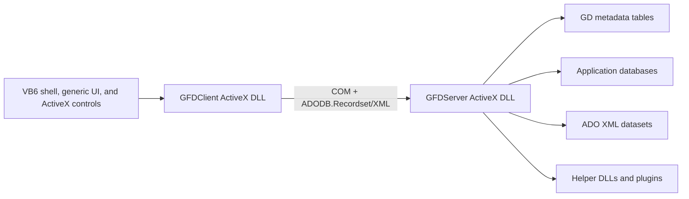
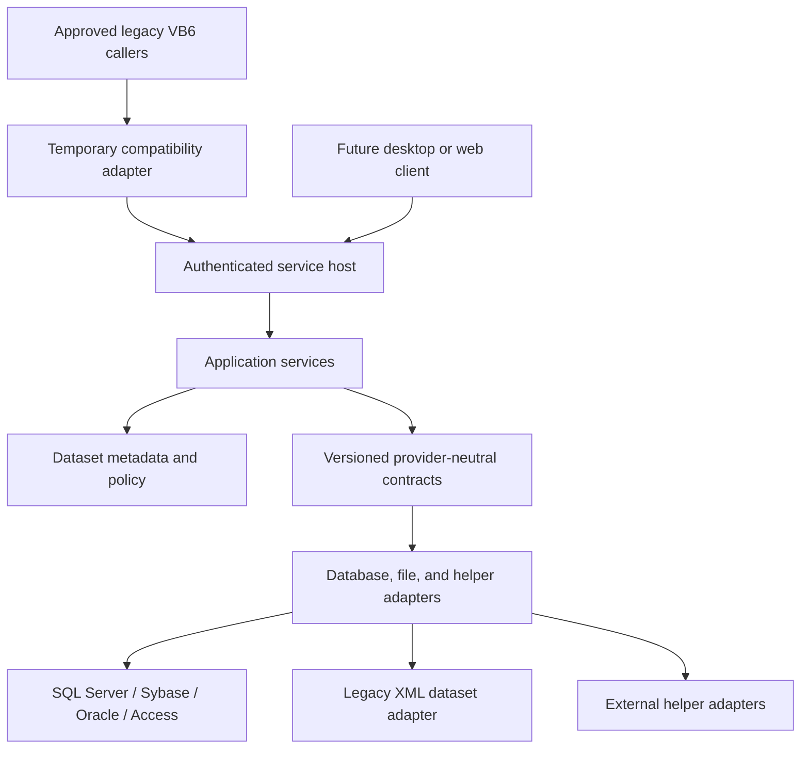
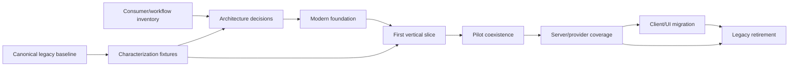

# GDFramework Migration Master Plan and Design

**Status:** Controlled working baseline  
**Version:** 0.4  
**Date:** 6 September 2026  
**Legacy source baseline:** `${LEGACY_SOURCE_ROOT}`; see [LEGACY_BASELINE.md](LEGACY_BASELINE.md)  
**Legacy checksum-manifest SHA-256:** `fc29779b9588a41cb9da10c486f1f0b35ca2108baf50fb8892086587ee320027`  
**Functional baseline:** [GDFramework Functional Specification 0.5](GDFramework%20Functional%20Specification.md)  
**Document control:** [DOCUMENT_CONTROL.md](DOCUMENT_CONTROL.md)  
**Consolidates:** `README.md` and the superseded 0.1 design/plan under `docs/archive`

## 1. Document purpose and authority

This document is the consolidated design, governance, and delivery baseline for
replacing the legacy VB6 GDFramework on a supported platform. It combines the
previous migration design and migration plan so that architectural constraints,
delivery phases, evidence requirements, decisions, risks, and quality gates are
managed together.

This is a documentation-first migration. It is deliberately a controlled
baseline rather than an implementation mandate. No replacement implementation
is authoritative until the applicable evidence, decisions, and phase exit
criteria in this document have been reviewed and approved.

The functional specification is normative for observable behavior,
compatibility, and functional scope. This master is normative for governance,
architecture, sequencing, and quality gates, but may not silently override a
functional requirement. An intentional difference requires an approved defect
disposition or ADR linked from the requirement traceability matrix. The original
design and plan are superseded historical records under `docs/archive`.

### 1.1 Current status

| Area | Status |
|---|---|
| Consolidated design and plan | Controlled working baseline 0.4 |
| Functional reverse-engineering baseline | Version 0.5; framework, generic UI, custom controls, and metadata schema contract documented; deployment-specific row and runtime discovery remains open |
| Requirement traceability | All functional/defect IDs inventoried; source-area and planned-test mapping generated; deployed row, physical DDL, and runtime evidence remains pending where marked |
| Phase 0 | Started: Git repository and initial controlled artifacts established; production provenance and deployed-consumer evidence remain open |
| Replacement code | Not started |
| Target UI | Not decided |
| Service transport and deployment topology | Not decided |
| Canonical production VB6 source/binary | Not yet proven |
| Reproducible legacy environment | Not yet available |

### 1.2 Completeness boundary

The legacy source is the behavioral reference during discovery and
characterization. It must not be modified merely to make replacement easier
unless a separately approved stabilization change is required.

Repository source plus the reconstructed metadata database schema defines how
applications are generated. The remaining application-specific evidence is the
populated metadata row set, production physical DDL, referenced application
database objects, helper components, deployed binaries, effective role
assignments, runtime configuration, screenshots, and a functioning legacy
environment. Calendar commitments should not be inferred until the active
deployment population and consumers are known. Collection ownership and
completion criteria are controlled in
[EVIDENCE_ACQUISITION.md](EVIDENCE_ACQUISITION.md).

## 2. Executive direction

GDFramework is a metadata-driven application framework composed of VB6 ActiveX
DLLs, an ActiveX control library, ADO recordsets, database-specific adapters,
COM interfaces, and a generic desktop user interface. It supports dynamic
datasets, client-side editing, server-side persistence, configurable
applications and menus, security, messages, logging, reporting, and multiple
data-source types.

The migration shall be incremental:

1. Establish a controlled, traceable legacy baseline.
2. Recover observable behavior and build repeatable characterization assets.
3. Define stable, technology-neutral contracts at the client/server boundary.
4. Implement a modern server and data layer behind those contracts.
5. Provide a temporary compatibility adapter only for approved legacy callers.
6. Prove behavior through differential, integration, security, and operational
   testing.
7. Move client workflows and controls only after the required server contracts
   are stable.
8. Operate legacy and modern paths side by side until cutover evidence is
   sufficient.
9. Retire all unapproved VB6/COM dependencies and archive the legacy system.

This is not a line-by-line translation. Unsafe legacy behavior—such as raw SQL
exposure, live database objects, unverified caller identity, silent connection
fallback, secret leakage, or falsely reported write success—will not be
preserved as compatibility.

## 3. Current-system baseline

### 3.1 Project inventory

| Area | Legacy project | Primary responsibility |
|---|---|---|
| Interfaces | `AppInterfaces/GDFInterfaces.vbp` | Shared COM interfaces and cross-project types |
| Server | `AppServer/GenFormDataServer.vbp` | Metadata loading, datasets, ADO connections, queries, writes, messages, and configuration |
| Client | `AppClient/GenFormDataClient.vbp` | Client facade, session state, recordset editing, menus, and display configuration |
| Controls | `AppControls/GFDGUICtls.vbp` | VB6 ActiveX toolbar, panel, splitter, dropdown, lookup, and Outlook-style controls |
| GUI | `GenData/AppGUI/GenFormDataGUI.vbp` | Main shell, generic metadata-driven form, navigation, dialogs, export, and print |
| Aggregator | `AppServer/GDAggregator.vbp` | Aggregation and specialist server-side orchestration |
| Harnesses | `Z_Harness_*` and `AppControls/test` | Helper/plugin examples and minimal manual integration hosts |
| Shared copies | `AppShared` and `AppClient/AppClient` | Duplicate or divergent sources requiring provenance analysis |

Using the reproducible counting rule recorded in `LEGACY_BASELINE.md`—recursive
physical lines in `.frm`, `.bas`, `.cls`, `.ctl`, and `.pag` files, including
duplicate/source-only files—the core GDFramework tree contains 123 files and
55,504 lines. Including the separately located `GenData/AppGUI` tree gives 160
files and 79,100 lines. These are inventory measures, not claims about compiled
membership. Several projects contain machine-specific references to obsolete or
unavailable COM libraries. Duplicate source trees and differing project/binary
lineages mean a timestamp or matching product name cannot prove deployment.

### 3.2 Current request flow



### 3.3 Important legacy behavior

- Dataset definitions and parameters are loaded from database metadata.
- Dataset results are cached and refreshed using per-dataset flags.
- ADO recordsets are marshalled directly or serialized as ADO XML.
- Client recordsets track pending insert, update, and delete operations.
- The server constructs and executes DML from metadata and changed field values.
- Supported or retained provider paths include SQL Server, Sybase, Oracle,
  Access, XML files, stored procedures, and helper-based simple services.
- The server and client expose COM objects and mutable internal collections.
- UI configuration, applications, menus, messages, reports, security, and user
  settings are modeled as datasets.
- The generic form builds toolbar commands, views, fields, filtering, grouping,
  reporting, and CRUD behavior from metadata and effective security.
- The custom controls have a public COM surface and VB6 property-bag contract
  that must be imported or replaced deliberately where active consumers exist.

### 3.4 Planning assumptions

- The legacy system remains operational during most of the migration.
- Existing database schemas remain unchanged unless a phase explicitly approves
  a backward-compatible change.
- Server/data behavior is migrated before the principal UI.
- Some VB6 callers may require a temporary compatibility path.
- The legacy source is not currently a clean, reproducible build baseline.
- A reproducible 32-bit VB6 build/runtime environment and production-like
  provider fixtures are not currently available.
- The migration workspace currently contains planning material but no
  replacement implementation.
- A supported development SDK, build image, and integration environments must be
  provisioned before modern project creation.

## 4. Drivers, goals, and boundaries

### 4.1 Drivers for change

#### Platform and operability

- VB6 and historical COM dependencies are difficult to build, deploy, register,
  and support on current Windows environments.
- Projects depend on old machine paths, 32-bit controls, CDO, Office libraries,
  and unavailable custom binaries.
- There is no automated legacy build or regression suite.
- Duplicate source trees obscure the authoritative implementation.

#### Security and correctness

- The server exposes internal database facilities and arbitrary SQL paths.
- Caller-provided identity is accepted without a trusted authentication boundary.
- SQL values are concatenated instead of consistently parameterized.
- Batch writes can partially commit.
- Some client write methods report success after a server failure.
- Unknown connection names may silently fall back to the system database.
- Tracked legacy configuration contains plaintext credential material.

#### Maintainability

- Business behavior, transport, persistence, caching, UI, and logging are
  interwoven.
- Public APIs exchange implementation-specific ADO objects.
- Provider-specific SQL is assembled throughout the data layer.
- Error handling relies on Boolean returns, global messages, suppressed errors,
  and mutable out-parameters rather than a stable result model.

### 4.2 Goals

The migrated system shall:

- Preserve approved business behavior, user workflows, and data semantics.
- Replace COM/ADO recordset contracts with explicit, versioned contracts.
- Authenticate identity at a trusted boundary and authorize every operation.
- Use parameterized commands and explicit provider adapters.
- Make a logical change set atomic unless partial success is explicitly designed.
- Support side-by-side validation, gradual routing, and reversible cutover.
- Provide structured diagnostics, audit events, health checks, and correlation.
- Build and test from a clean, documented environment.
- Isolate provider-specific behavior from application policy.
- Allow the future UI technology to be selected independently from early server
  migration.
- Preserve metadata-driven application definition rather than compiling each
  business screen into a bespoke implementation.

### 4.3 Non-goals for the first increment

- Reproducing known security defects for compatibility.
- Redesigning application database schemas without an approved need.
- Replacing every client and control in a single release.
- Selecting a UI framework before workflows and integration constraints are
  inventoried.
- Adopting an ORM as the source of truth for dynamic metadata-defined datasets.
- Treating successful compilation as proof of behavioral equivalence.
- Implementing historical, dormant, source-only, or documented-only features
  without an identified consumer or explicit product decision.

## 5. Governing design principles

1. **Behavior before replacement.** Capture current inputs, outputs, side
   effects, event order, persistence, and failure behavior before rewriting a
   path.
2. **Explicit boundaries.** Do not expose connections, commands, mutable caches,
   provider objects, or UI implementation types outside infrastructure.
3. **Secure by construction.** Identity is established by the host, not supplied
   as an ordinary request parameter.
4. **Provider isolation.** SQL dialect, parameter syntax, type mapping, and
   connection behavior belong in provider adapters.
5. **Atomic commands.** One logical change set has one explicit transaction
   policy and one structured result.
6. **Incremental compatibility.** Compatibility adapters translate legacy
   contracts; they do not contaminate the modern core.
7. **Observable operation.** Every request has a correlation identifier,
   structured outcome, duration, and safe diagnostic context.
8. **No hidden fallbacks.** Unknown datasets, parameters, connections, providers,
   command keys, and critical options fail explicitly.
9. **Test real boundaries.** Exercise serialization, transport, commands,
   transactions, response parsing, failure behavior, and cleanup with real
   implementations or purpose-built fixtures.
10. **Technology decisions follow evidence.** Do not scaffold a target stack
    until its architectural decision and relevant entry criteria are approved.

## 6. Governance and ownership

### 6.1 Required controlled artifacts

The migration shall maintain:

- Functional reverse-engineering specification and requirements traceability.
- Current-system and active-consumer inventory.
- Public COM/control/API inventory.
- Dataset, parameter, security, report, and business-action catalog.
- Database/provider compatibility matrix.
- Characterization and differential-test catalog.
- Architecture Decision Records (ADRs).
- Legacy defect disposition register: **preserve**, **fix**, or **retire**.
- Risk, issue, dependency, and decision registers with owners and review dates.
- Phase entry/exit evidence and quality-gate decisions.
- Deployment, cutover, reconciliation, and rollback runbooks.
- Compatibility usage/retirement measures.
- Legacy retirement and archival checklist.

### 6.2 Change control

- A phase begins only after its entry criteria are met.
- Contract, security, provider, coexistence, scope, or UI-direction changes
  require a recorded decision.
- Replacement changes are accepted only with tests appropriate to the boundary.
- No compatibility exception may expose raw SQL, live database objects,
  connection credentials, or unverified identity.
- Known legacy defects must have an approved disposition before differential
  results are accepted.
- Open decisions shall not be silently converted into implementation defaults.

### 6.3 Definition of done

A migration item is complete only when:

- Behavior, state transitions, and failure cases are specified.
- Implementation respects approved dependency and security boundaries.
- Automated tests cover observable behavior.
- Provider-specific behavior is integration-tested where applicable.
- Security, diagnostics, cleanup, and operational support are verified.
- Documentation, runbooks, and traceability are updated.
- No unresolved high-severity defect is hidden behind a compatibility layer.
- The applicable acceptance criterion and phase/gate evidence are recorded.

### 6.4 Required roles

Named individuals may fill multiple roles, but every responsibility must exist.

| Role | Responsibility |
|---|---|
| Product/domain owner | Approves behavior, defect disposition, scope, and workflow acceptance |
| Legacy technical owner | Explains deployment history, metadata, providers, binaries, and consumers |
| Migration technical lead | Owns architecture, sequencing, dependency rules, and quality gates |
| Database owner | Supplies schemas, fixtures, provider constraints, and reconciliation evidence |
| Security owner | Approves identity, authorization, secrets, audit, and threat model |
| Operations owner | Owns deployment, monitoring, recovery, rollback, and support transfer |
| Test/quality owner | Owns characterization, integration, differential evidence, and exit reports |
| UI/workflow owner | Owns user research, accessibility, integration constraints, and client acceptance |

## 7. Proposed logical architecture

The final runtime and host are open decisions, but the following separation
shall hold whether the modern boundary uses HTTP, gRPC, a Windows service, a
container, IIS, or an in-process compatibility component.



### 7.1 Solution boundaries

| Boundary | Responsibility | Must not contain |
|---|---|---|
| Contracts | Versioned request, response, error, and event types | ADO, COM, UI, connections, commands |
| Application | Use cases, authorization, orchestration, and transaction intent | Provider-specific SQL syntax |
| Dataset model | Dataset definitions, parameters, keys, cache/update policy | Transport or UI concerns |
| Infrastructure | Connections, dialects, SQL execution, files, and plugin adapters | Caller authorization decisions |
| Host | Authentication, validation, routing, health, and diagnostics | Business rules embedded in endpoints |
| Compatibility | Approved COM/ADO/ADO-XML translation and routing | New business logic or raw SQL access |
| Client | User workflows, state, and presentation | Direct database access |

### 7.2 Technology-neutral logical layout

No implementation projects shall be scaffolded until the required decisions are
approved. The following names describe logical responsibilities, not a language,
framework, packaging scheme, or prescribed repository layout:

```text
contracts
application-services
dataset-model-and-policy
provider-infrastructure
authenticated-host
legacy-compatibility-boundary
characterization-tests
contract-tests
provider-integration-tests
compatibility-and-differential-tests
```

Hosts and adapters depend on application contracts. The application layer does
not depend on COM, ADO recordsets, provider implementations, or a UI toolkit.

## 8. Contract and compatibility design

### 8.1 Contract rules

- Contracts are versioned independently from implementations.
- No public contract returns a live connection, command, transaction, recordset,
  cache, or mutable server collection.
- Requests have explicit identifiers, parameters, paging, ordering, security
  scope, and consistency requirements.
- Results distinguish validation, authentication, authorization, conflict,
  provider, timeout, cancellation, and unexpected failures.
- Dates, time zones, decimals, binary values, strings, enumerations, and nulls
  have defined serialization rules.
- Dataset and field identifiers come from validated metadata; callers cannot
  inject arbitrary SQL fragments.
- UI command identity uses stable semantic keys rather than caption or position.

### 8.2 Core conceptual contracts

| Contract | Purpose |
|---|---|
| `SessionContext` | Trusted subject, roles/claims, application, workstation context, and correlation ID |
| `DatasetDefinition` | Dataset identity, provider, query/update policy, columns, keys, security, and cache policy |
| `DatasetParameter` | Name, type, value, validation, and required/optional status |
| `DatasetQuery` | Dataset identity, parameters, paging, sort, and refresh/consistency option |
| `DatasetResult` | Schema, rows, continuation information, and version/concurrency values |
| `ChangeSet` | Dataset identity and ordered insert/update/delete changes |
| `ChangeResult` | Overall outcome plus per-row success, conflict, validation, and generated-key data |
| `SystemMessage` | Typed application/system message with audience and validity window |
| `Problem` | Stable error code, safe message, correlation ID, and optional field details |

The exact wire format is an open decision. JSON over HTTP is the current default
candidate because it is inspectable and accessible to compatibility and modern
clients. gRPC remains an option for controlled native clients.

### 8.3 Compatibility translation

If a real legacy consumer must remain active, the compatibility adapter may:

- Accept an approved legacy method shape.
- Convert an ADO recordset or ADO XML stream into `DatasetQuery` or `ChangeSet`.
- Invoke the modern application boundary under a trusted identity.
- Convert `DatasetResult` to the minimum required legacy shape.
- Map structured errors to the legacy Boolean/message convention while emitting
  a reliable correlated diagnostic event.
- Preserve exact active COM/control property names and enum values only at the
  compatibility boundary where an identified consumer requires them.

The adapter shall not expose the modern connection factory, accept raw SQL,
trust caller-supplied identity/audit values, or become a permanent source of new
business behavior.

## 9. Dataset, persistence, and provider design

### 9.1 Metadata loading and validation

Legacy metadata shall first be imported into a typed model without changing its
approved meaning. Validation occurs before an affected dataset becomes
available:

- Dataset and connection identifiers exist and are unique.
- Provider type is supported and active.
- Query/update policy is internally consistent.
- Update tables and key columns are declared and allow-listed.
- Parameter markers map one-to-one to typed parameters.
- Cache keys include every value and security scope that can affect results.
- Security policy is explicit; absence is not accidentally unrestricted.
- Unsupported historical options are diagnosed, not silently ignored.

Invalid metadata blocks only the affected capability where safe and produces an
actionable startup or configuration diagnostic.

### 9.2 Connection resolution and secrets

A connection factory resolves only an exact configured connection identifier.
An explicit `System` identifier may represent the system database. Blank,
unknown, inactive, or ambiguous identifiers fail rather than falling back.

Secrets are supplied by the deployment environment or approved secret store.
They are not returned through application contracts, stored in source, displayed
to users, or written to logs.

### 9.3 Query execution

- Values are bound as typed command parameters.
- Provider adapters own placeholder syntax, quoting, and type mapping.
- Metadata-derived identifiers are validated against the loaded definition.
- Paging and limits prevent accidental unbounded datasets.
- Cancellation and command timeouts flow from host to provider.
- Provider resources are disposed deterministically.
- Ordering is explicit wherever consumers rely on it.

### 9.4 Change execution

A `ChangeSet` is validated before any write:

1. Authenticate and authorize the subject.
2. Resolve the dataset and update policy.
3. Validate fields, types, required values, keys, and audit/concurrency values.
4. Begin the required transaction.
5. Execute inserts, updates, and deletes with typed parameters.
6. Apply optimistic concurrency rules.
7. Commit only if the change-set policy is satisfied.
8. Return generated keys, reconciled stamps, and accurate per-row outcomes.

Unexpected failure rolls back the transaction and returns a failure result.
Partial success is allowed only for a use case explicitly designed, documented,
and approved to permit it.

### 9.5 Caching

- Caches hold immutable results, not shared mutable recordsets.
- Keys include dataset version, application/security scope, and every
  result-affecting parameter.
- Entries have explicit lifetime and invalidation rules.
- Writes publish invalidation only after commit.
- Forced refresh bypasses lookup but does not weaken authorization.
- Cross-user and cross-application isolation is tested.

The first vertical slice may operate without caching. Caching is added after
parity is proven and measured need is demonstrated.

## 10. Security, errors, and observability

### 10.1 Identity and authorization

The host establishes identity through an approved mechanism such as integrated
Windows authentication or an organization identity provider. A username in a
request is context to validate, never proof of identity.

- Every dataset declares read/change policies.
- Administrative operations use explicit policies rather than mutable client
  flags.
- Application, user, role, and audit identifiers used for filtering or writing
  are derived from the trusted session or independently authorized.
- Keeping a VB6 client does not justify keeping legacy authentication.
- Every protected UI command and server operation is evaluated against effective
  authorization before exposure or execution.

### 10.2 Audit and sensitive data

Security-sensitive operations record subject, action, dataset, outcome,
correlation ID, and timestamp. SQL text where sensitive, passwords, tokens,
connection strings, and unredacted sensitive field values are not logged.

### 10.3 Error model

Application methods return a structured result or raise a controlled exception
that the host translates into a stable `Problem`. Boolean success is not the
only error channel.

Expected categories are:

- Invalid request or metadata.
- Unauthenticated or unauthorized.
- Dataset, parameter, field, provider, or connection not found.
- Validation or optimistic-concurrency conflict.
- Provider unavailable or dependency protocol failure.
- Timeout or cancellation.
- Unexpected internal failure.

### 10.4 Diagnostics and health

Each operation records:

- Correlation and operation identifiers.
- Authenticated subject identifier.
- Dataset and provider identifiers.
- Duration and row counts.
- Transaction and cache outcome.
- Stable error code on failure.

Health checks distinguish host health from individual provider availability.

## 11. Verification and testing strategy

| Test type | Purpose |
|---|---|
| Characterization | Record current VB6 behavior for representative datasets, UI controls, workflows, and failures |
| Contract | Prove request/response compatibility independent of host technology |
| Provider integration | Exercise real serialization, commands, parameters, transactions, failures, and cleanup |
| Compatibility | Compare adapter behavior with captured VB6/COM/ADO behavior |
| Differential | Run equivalent requests/workflows against legacy and modern implementations and compare normalized results |
| UI/control behavior | Verify public control contracts, persisted defaults, events, keyboard behavior, and shell/generic-form integration |
| Security | Reject impersonation, unauthorized access, identifier injection, raw SQL, and secret leakage |
| Operational | Verify startup validation, health, timeout, cancellation, retry, recovery, deployment, and rollback |
| Performance | Measure agreed dataset sizes, concurrent users, latency, memory, exports, and long-running operations |

Tests use real implementations, protocol-level fixtures, disposable integration
environments, or small purpose-built fakes. Mockito and substitute mocking
frameworks are prohibited.

Quantitative acceptance targets are controlled in
[NON_FUNCTIONAL_REQUIREMENTS.md](NON_FUNCTIONAL_REQUIREMENTS.md). A phase or gate
may strengthen those targets through an approved decision but may not replace
them with an unmeasurable statement.

Golden files normalize nondeterministic timestamps, generated identifiers,
unspecified row ordering, and provider-specific diagnostic text. Normalization
must not conceal a material behavioral difference.

Representative characterization shall include:

- Simple typed parameterized read.
- Cached read and explicit refresh.
- Dynamic/disconnected predicates and user/application scope.
- Insert with generated key.
- Single- and multi-row update.
- Physical and logical delete.
- Optimistic concurrency conflict.
- Stored procedure and action dataset.
- XML dataset and helper/plugin call.
- Null, date, decimal, binary, Unicode, escaping, and ordering cases.
- Generic UI toolbar, panel, splitter, navigation, filtering, grouping, search,
  CRUD, reporting, export, print, and popup/docking behavior.

## 12. Workstreams

| Workstream | Scope |
|---|---|
| A. Legacy baseline | Source provenance, build recovery, releases, controls, dependencies, and active consumers |
| B. Behavior | Functional specification, characterization, dataset catalog, and differential fixtures |
| C. Architecture | Contracts, ADRs, security, error model, observability, and technology choices |
| D. Modern server | Application services, typed metadata, providers, transactions, cache, and messages |
| E. Compatibility | Approved COM/ADO translation, side-by-side routing, telemetry, and retirement |
| F. Client/UI | Workflow inventory, target UI, client migration, generic UI, and control replacement |
| G. Delivery | Source control, build pipeline, environments, deployment, monitoring, cutover, and rollback |

Workstreams overlap only when their inputs are stable. Provider work can begin
after its matrix, contracts, and first slice are approved; it does not wait for
the final UI decision.

## 13. Phase plan

### Phase 0 — Establish the controlled baseline

**Objective:** Know exactly what is being migrated and make every change
traceable.

**Activities**

1. Initialize source control and contribution rules for the migration workspace.
2. Record the legacy path, checksums, project files, archives, and file inventory.
3. Identify authoritative copies for duplicated server, shared, client, GUI, and
   control sources.
4. Inventory released EXE/DLL/OCX/type-library versions, compatibility modes,
   COM identifiers, and registration/deployment evidence.
5. Recover the VB6 project build order and required 32-bit dependencies.
6. Inventory third-party controls, Office/CDO dependencies, helper binaries, and
   service plugins.
7. Identify every production application and machine that activates GDFramework
   components.
8. Establish owners for product, databases, infrastructure, security,
   operations, testing, and user workflows.
9. Create the ADR template and controlled decision/risk registers.

**Deliverables**

- `LEGACY_BASELINE.md` and checksum manifest.
- `COMPONENT_INVENTORY.md`.
- `DEPENDENCY_INVENTORY.md`.
- Active-consumer and deployment inventory.
- Initial source-provenance and scope ADRs.

**Exit criteria**

- Every active binary maps to a source project or an owned external dependency.
- Authoritative source is identified for the first vertical slice.
- Active consumers and deployment locations are known.
- Unavailable dependencies have an owner and disposition.

### Phase 1 — Recover behavior and characterization assets

**Objective:** Produce evidence that distinguishes a compatible replacement from
a plausible rewrite.

**Activities**

1. Provision or document a reproducible 32-bit legacy build/runtime environment.
2. Complete the functional specification and source/metadata/test traceability.
3. Inventory public COM methods, control properties/events/enums, property bags,
   and recordset schemas.
4. Execute the controlled evidence packages in
   [EVIDENCE_ACQUISITION.md](EVIDENCE_ACQUISITION.md), including export of
   dataset definitions, parameters, providers, update keys, cache rules,
   security, applications, menus, screens, fields, reports, and messages.
5. Select representative read, write, provider, control, and UI workflows.
6. Capture normalized inputs, outputs, database effects, messages, UI outcomes,
   and failure behavior.
7. Classify observed defects as preserve, fix, or retire.
8. Build protocol fixtures for ADO XML and active external adapters.

**Deliverables**

- `PUBLIC_API_CATALOG.md`.
- `DATASET_CATALOG.md`.
- `PROVIDER_MATRIX.md`.
- Characterization fixture set and execution instructions.
- Legacy defect disposition register.
- Completed functional traceability baseline for the selected slice.

**Exit criteria**

- First read/write and client-workflow slices have reproducible fixtures.
- Null, date, decimal, Unicode, generated-key, concurrency, event, persistence,
  and failure behavior are documented.
- Selected legacy scenarios can be repeated reliably.
- Security defects are explicitly excluded from compatibility.

### Phase 2 — Approve architecture and create the modern foundation

**Objective:** Turn approved decisions into a minimal buildable solution.

**Entry criteria**

- Phase 1 fixtures exist for the selected vertical slice.
- Authentication, host topology, first provider, transport, and compatibility
  mechanism are decided.
- Supported SDK, build image, CI, and test environment are available.

**Activities**

1. Resolve or formally defer required open decisions.
2. Create ADRs for runtime, transport, authentication, data access, deployment,
   and compatibility.
3. Scaffold only approved solution projects.
4. Enforce dependency and architecture rules.
5. Define versioned query, result, change-set, problem, and session contracts.
6. Add correlation, structured logging, startup validation, health checks, and
   secret injection.
7. Create test projects and reusable integration fixtures.
8. Establish continuous build, test, dependency, and security checks.

**Deliverables**

- Buildable modern solution.
- Contract version 1.
- Approved ADR set.
- CI definition and clean-build image.
- Test environment documentation.

**Exit criteria**

- A clean checkout builds without machine-specific absolute references.
- Contract and architecture tests pass.
- Secrets are external to source and logs.
- No infrastructure type is exposed through the application boundary.

### Phase 3 — Implement the first vertical slice

**Objective:** Prove the end-to-end migration pattern with one representative
read and one representative write.

**Recommended slice**

- Read: a parameterized, user-scoped metadata dataset.
- Write: a small updateable configuration dataset with a composite key and
  concurrency behavior.

The exact datasets are selected during Phase 1 from production relevance and
fixture availability.

**Activities**

1. Load and validate only metadata required for the selected datasets.
2. Implement exact connection resolution for the first provider.
3. Implement parameterized query execution and result serialization.
4. Implement authorization for the selected datasets.
5. Implement atomic change-set execution and conflict reporting.
6. Compare normalized legacy and modern reads and database effects.
7. Verify approved differences for corrected defects.
8. Add compatibility translation only for an identified pilot consumer.
9. Add operational metrics and correlated failure diagnostics.

**Deliverables**

- Production-shaped vertical slice.
- Differential and security test reports.
- Pilot deployment, reconciliation, and rollback procedure.

**Exit criteria**

- Selected reads match approved legacy behavior.
- Writes are atomic and return accurate outcomes.
- Impersonation, injection, raw database access, and unknown-connection fallback
  fail safely.
- Pilot operation is observable and reversible.

### Phase 4 — Expand server and provider coverage

**Objective:** Migrate remaining server capabilities in controlled groups.

**Capability groups**

1. Core dataset reads, dynamic parameters, and refresh behavior.
2. Inserts, updates, deletes, generated keys, audit stamps, and concurrency.
3. Metadata administration and application configuration.
4. Menus, security, user settings, display definitions, and system messages.
5. Stored procedures and action datasets.
6. XML datasets.
7. Aggregation and specialist server paths confirmed as in scope.
8. Simple-service helpers and plugins.
9. Remaining active providers.

Each group repeats: characterize, approve defect dispositions, implement
contract/application behavior, implement or extend its provider adapter, run
integration/differential/security tests, pilot route, and record exit evidence.

**Exit criteria**

- Every in-scope server capability has an approved disposition.
- Every active provider has real integration evidence.
- Operational limits and performance are measured against agreed workloads.
- Unretired legacy server calls are explicitly listed and measured.

### Phase 5 — Operate compatibility and pilot migration

**Objective:** Move real consumers without a flag-day deployment.

**Activities**

1. Select the smallest representative pilot application/cohort.
2. Deploy the modern host and, only if required, compatibility adapter.
3. Route selected datasets or workflows to the modern path.
4. Compare results and database effects during a controlled observation period.
5. Exercise rollback without data repair.
6. Expand by cohort only after exit review.
7. Measure every compatibility call and remaining dependency.

**Exit criteria**

- Pilot service levels and correctness thresholds are met.
- Rollback has been rehearsed.
- No critical dependency exists only in an operator workstation configuration.
- Compatibility usage is measurable and declining.

### Phase 6 — Select and migrate the client experience

**Objective:** Replace the VB6 client facade, generic UI, and ActiveX controls
based on documented workflows rather than source-file resemblance.

**Entry criteria**

- Modern server contracts are stable for the workflows being migrated.
- Target UI decision D-001 is approved.
- Active forms, controls, toolbar/panel/splitter behavior, Office/printing
  integrations, accessibility, keyboard, performance, and offline expectations
  are inventoried.

**Activities**

1. Map every active control and client method to user workflows and acceptance
   scenarios.
2. Prototype the highest-risk UI and operating-system integrations.
3. Define a client architecture that consumes only versioned service contracts.
4. Migrate one complete workflow at a time.
5. Reproduce approved generic-form metadata/security behavior and custom-control
   interactions with native modern components.
6. Validate usability, accessibility, localization, keyboard behavior, high DPI,
   export, printing, responsiveness, and operational support.
7. Retire corresponding ActiveX controls and COM calls only after adoption.

**Exit criteria**

- All in-scope workflows have acceptance evidence.
- No modern UI performs direct database access.
- Office, Windows, control, and printing dependencies have supported replacements.
- Relevant VB6 client/OCX components can be removed from deployment.

### Phase 7 — Cut over and retire the legacy framework

**Objective:** Remove production dependence on VB6/COM GDFramework components.

**Activities**

1. Confirm zero or explicitly accepted residual compatibility traffic.
2. Complete reconciliation, security, and audit review.
3. Freeze legacy configuration changes for final migration.
4. Execute final cutover and enhanced monitoring.
5. Retain tested rollback for the agreed window.
6. Remove COM registration and obsolete runtime dependencies in stages.
7. Archive source, binaries, type libraries, dependencies, build VM, metadata,
   fixtures, and operational records according to policy.
8. Close residual risks or transfer them formally to product ownership.

**Exit criteria**

- Production has no unapproved GDFramework COM dependencies.
- Support, recovery, monitoring, and ownership are transferred.
- Legacy secrets and deployment artifacts are removed from active systems.
- Retirement decision and evidence are recorded.

## 14. Initial ordered backlog

| Order | Item | Output |
|---:|---|---|
| 1 | Establish migration source control and contribution rules | Traceable workspace |
| 2 | Hash and inventory the legacy source and binaries | Reproducible source reference |
| 3 | Resolve duplicate-source and binary provenance | Canonical files per project/slice |
| 4 | Inventory active consumers and deployments | Confirmed migration scope |
| 5 | Recover VB6 build order and dependencies | Build/run instructions and VM plan |
| 6 | Complete public COM/control surface and UI-use catalog | Approved API/control catalog |
| 7 | Export dataset/parameter/application metadata | Dataset and workflow catalog |
| 8 | Confirm active databases, providers, and plugins | Provider matrix |
| 9 | Select first read/write/client slices | Approved pilot scope |
| 10 | Capture repeatable legacy fixtures | Characterization evidence |
| 11 | Decide authentication, transport, and host topology | ADRs |
| 12 | Provision supported SDK, CI, and integration environments | Build foundation |
| 13 | Scaffold the approved solution only after Gate C | First modern code |

## 15. Dependencies and critical path



The critical path begins with provenance, deployed metadata-row/consumer discovery,
behavior fixtures, and architecture decisions. UI implementation is
intentionally not on the early critical path, but UI/control reverse engineering
is an early evidence activity.

## 16. Risk register

| ID | Risk and impact | Severity | Owner | Status | Review date | Mitigation and evidence |
|---|---|---|---|---|---|---|
| R-001 | Wrong source copy selected; replacement matches an unused version | Critical | Legacy technical owner | Active | 2026-09-30 | Hash deployed artifacts and compare project/type-library/runtime identity; see [legacy baseline](LEGACY_BASELINE.md). |
| R-002 | Legacy environment cannot be reproduced; no reliable behavioral oracle | Critical | Legacy technical owner | Open | 2026-09-30 | Capture a controlled VM and archive installers/registration manifests; Phase 1 evidence pending. |
| R-003 | Hidden consumers; cutover breaks an untracked application | Critical | Operations owner | Open | 2026-09-30 | Inspect deployment/registry evidence and instrument compatibility calls; consumer inventory pending. |
| R-004 | Provider differences; query/type behavior diverges | High | Database owner | Open | 2026-09-30 | Execute real provider tests and normalized differential fixtures; see [provider matrix](PROVIDER_MATRIX.md). |
| R-005 | Unsafe behavior mistaken for compatibility; security defects survive | Critical | Security owner | Active | 2026-09-30 | Apply the defect register and security gate; see [defect dispositions](DEFECT_DISPOSITION.md). |
| R-006 | Relied-upon partial-write behavior; atomic correction changes workflow | High | Product/domain owner | Open | 2026-09-30 | Characterize production effects and approve an explicit disposition before implementation. |
| R-007 | Executable metadata assumptions; generic definitions cannot be imported safely | High | Migration technical lead | Open | 2026-09-30 | Classify/validate identifiers and migrate unsafe definitions explicitly after metadata export. |
| R-008 | Cache changes cause leakage or stale results | Critical | Migration technical lead | Open | 2026-09-30 | Disable initially, define complete scoped keys, and test isolation/invalidation. |
| R-009 | UI scope expands early and stalls server migration | Medium | Migration technical lead | Controlled | 2026-09-30 | Keep UI implementation behind Phase 6 entry criteria while completing UI characterization in Phase 1. |
| R-010 | Compatibility becomes permanent | High | Product/domain owner | Open | 2026-09-30 | Approve duration/owner, time-box support, and measure every legacy call. |
| R-011 | No production-like test data creates false parity confidence | High | Test/quality owner | Open | 2026-09-30 | Obtain curated anonymized data or a controlled integration environment. |
| R-012 | Unmanaged SDK/toolchain creates workstation-specific builds | High | Operations owner | Open | 2026-09-30 | Approve D-008 and pin toolchain/dependencies/CI image before scaffolding. |
| R-013 | Missing deployed metadata rows prevent enumeration of which schema-defined application behavior is active | Critical | Database owner | Open | 2026-09-30 | Export all active metadata rows and populate the schema-derived catalogue as Gate B evidence; see [dataset catalogue](DATASET_CATALOG.md). |
| R-014 | Historical features are mistaken for active scope | Medium | Product/domain owner | Controlled | 2026-09-30 | Require a consumer/runtime record or explicit product decision before inclusion. |
| R-015 | Control behavior is simplified prematurely and generic UI parity fails | High | UI/workflow owner | Controlled | 2026-09-30 | Use functional sections 15 and 26 plus requirement-level acceptance mappings. |

Owners are role owners until named people are assigned. Each review updates the
status, date, mitigation evidence, and any resulting decision/issue; absence of
new evidence does not silently close a risk.

## 17. Architecture decision register

| ID | Decision and evidence required | Owner | Required by | Status | ADR |
|---|---|---|---|---|---|
| D-001 | Target UI: compare browser, native desktop, and hybrid choices against workflows, Windows/Office/printing, accessibility, control, and offline constraints. | UI/workflow owner | Phase 6 entry | Open | Pending |
| D-002 | Service transport: compare HTTP/JSON, gRPC, messaging, and in-process boundaries against consumers, hosting, diagnostics, and compatibility. | Migration technical lead | Gate C | Open | Pending |
| D-003 | Host topology: select managed service/process/container topology from operational and network constraints. | Operations owner | Gate C | Open | Pending |
| D-004 | Supported providers: confirm production use and retirement/support intent for SQL Server, Sybase, Oracle, Access, XML, and plugins. | Database owner | Gate C for first provider; Gate E for all | Open | Pending |
| D-005 | Authentication: select trusted user/service identity and delegation mechanism. | Security owner | Gate C | Open | Pending |
| D-006 | Compatibility duration: identify consumers, scope, owner, support window, and retirement threshold. | Product/domain owner | Gate C for first compatibility consumer | Open | Pending |
| D-007 | Dataset wire contract: select row, columnar, streaming, or typed use-case contracts using characterized payloads. | Migration technical lead | Gate C | Open | Pending |
| D-008 | Implementation runtime/platform: select a currently supported runtime only after host, operational, skills, and lifecycle evidence is available. | Migration technical lead | Gate C | Open | Pending |
| D-009 | Canonical legacy source: reconcile source, project, deployed binary, type library, and runtime behavior. | Legacy technical owner | Gate A | Open | Pending |
| D-010 | Database schema policy: retain schemas by default and approve any concurrency/audit/compatibility change separately. | Database owner | Before first schema change | Open; no-change default | Pending |
| D-011 | Legacy defect disposition policy: define approval authority and preserve/fix/retire criteria. | Product/domain owner | Gate B | Open | Pending |
| D-012 | Side-by-side routing unit: select dataset, application group, workflow, or cohort using rollback/reconciliation evidence. | Operations owner | Phase 5 entry | Open | Pending |

Accepted decisions are recorded as ADRs under `docs/adr`.

## 18. Quality gates

### Gate A — Baseline trustworthy

- Source, project, archive, deployed binary, and type-library provenance recorded.
- Active consumers and deployments identified.
- Build/runtime dependencies documented.
- First-slice canonical source approved.

### Gate B — Behavior understood

- Representative dataset, control, and workflow fixtures are repeatable.
- Provider/data-type/security/event/persistence edge cases are covered.
- Deployed metadata rows required for the slice are exported and validated against the reconstructed schema contract.
- Defect dispositions are approved.

### Gate C — Architecture approved

- D-002 through D-009 applicable to the first vertical slice are approved or
  explicitly deferred with a safe documented default; D-001 is not a Gate C
  dependency and remains a Phase 6 entry decision.
- Public contracts expose no infrastructure objects.
- Security and operations owners approve their boundaries.

### Gate D — Vertical slice proven

- Differential, integration, security, recovery, and cleanup tests pass.
- Writes are atomic and accurately reported.
- Pilot deployment and rollback are safe and observable.

### Gate E — Capability ready

- In-scope provider/capability coverage is complete.
- Performance and operational thresholds are met.
- Residual legacy dependencies are enumerated and measured.

### Gate F — Client workflow ready

- Workflow, accessibility, keyboard, export, print, and performance acceptance
  pass.
- Generic UI/security/control behavior is traceable to the functional baseline.
- Corresponding legacy client/OCX dependencies can be removed.

### Gate G — Retirement ready

- Compatibility use is zero or formally accepted.
- Cutover, reconciliation, and rollback are rehearsed.
- Support ownership, secret removal, and archival requirements are satisfied.

## 19. Deployment, coexistence, and retirement rules

The target topology remains open, but the design must support:

- A modern host deployed independently from clients.
- An optional compatibility component installed only where required.
- Side-by-side routing by an approved unit such as dataset, application group,
  workflow, or pilot cohort.
- Immediate routing rollback without reversing valid committed database changes.
- Versioned contracts allowing clients and server to upgrade independently
  within a supported compatibility window.
- Forward- and backward-compatible database migrations while old and new paths
  coexist.

Rollback is a routing/deployment operation, not a substitute for transaction
correctness or data reconciliation. Compatibility telemetry must identify its
consumer, method/workflow, volume, outcome, and retirement owner.

## 20. Estimation and evidence reporting

Calendar estimates are produced after Phase 0, when the team knows:

- Active consumers and workflows.
- Active dataset, screen, control, and report definitions.
- Providers and plugins used in production.
- Build and integration-environment availability.
- Required compatibility duration.
- Team composition, skill coverage, and allocation.

Until then, progress is reported using evidence:

- Components inventoried / total discovered.
- Active consumers confirmed / candidates.
- Metadata tables exported / required.
- Datasets and workflows characterized / in scope.
- Provider scenarios passing / required.
- Requirements linked to source/metadata/tests.
- Modern routes piloted / planned.
- Compatibility calls by component and trend.
- Open decisions and risks by severity and age.

## 21. Consolidated acceptance criteria

This master design is ready to govern implementation when:

- Current-system inventory has named owners and evidence.
- Canonical source and deployed binary lineage are approved for the first slice.
- Deployed metadata rows and referenced database objects required by the slice are available.
- Decisions D-002 through D-009 and D-011 applicable to the first slice are
  resolved or safely deferred. D-001 is required only for Phase 6, D-012 for
  Phase 5, and D-010 before any schema change.
- Representative read, write, and client-workflow slices are approved.
- Authentication, authorization, audit, and secret responsibilities are approved.
- Compatibility scope, telemetry, owner, duration, and retirement condition agree.
- Provider integration environments exist for the first slice.
- Operational ownership and deployment topology are understood.
- Stakeholders approve which legacy defects are preserved, fixed, or retired.
- Gate B and Gate C evidence is recorded before replacement scaffolding begins.

The eventual replacement is functionally equivalent only when all applicable
functional requirements and quality gates have test evidence, all intentional
differences are approved, all in-scope workflows have acceptance evidence, and
no unapproved legacy dependency remains.

## 22. Immediate review agenda

The first controlled planning review shall answer:

1. Which deployed applications and machines currently depend on GDFramework?
2. Which source projects and released binaries represent production?
3. Which metadata databases, application databases, providers, and plugins are
   active?
4. Can a representative legacy environment be executed safely and repeatedly?
5. Who approves behavior changes when the legacy behavior is defective?
6. Which identity provider and deployment boundaries are available?
7. Which read dataset, write dataset, and complete user workflow best represent
   the first vertical slice?
8. How long must each VB6 consumer coexist with the replacement?
9. Which Windows, Office, printing, keyboard, accessibility, and offline needs
   constrain the target UI?
10. Who owns each Phase 0/1 artifact, risk, and architecture decision?

Replacement implementation begins only after the applicable evidence, design
decisions, entry criteria, and quality gates are approved.

## Appendix A — Source-document disposition

| Source document | Material consolidated here | Disposition |
|---|---|---|
| `README.md` | Repository purpose, source-system location, status | README remains the repository entry point and links here |
| `docs/archive/MIGRATION_DESIGN-0.1.md` | Architecture, contracts, data, security, testing, deployment, provenance, decisions, acceptance | Superseded historical design draft |
| `docs/archive/MIGRATION_PLAN-0.1.md` | Governance, workstreams, phases, backlog, critical path, risks, gates, estimation, roles, agenda | Superseded historical delivery draft |
| `docs/GDFramework Functional Specification.md` | Normative observable behavior, classifications, defects, and source evidence | Separate normative functional baseline; linked rather than duplicated to avoid divergent copies |
