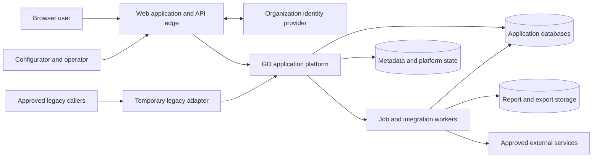
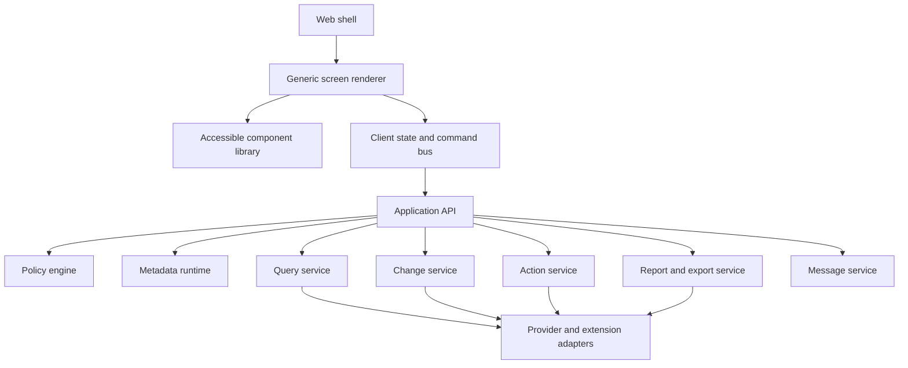
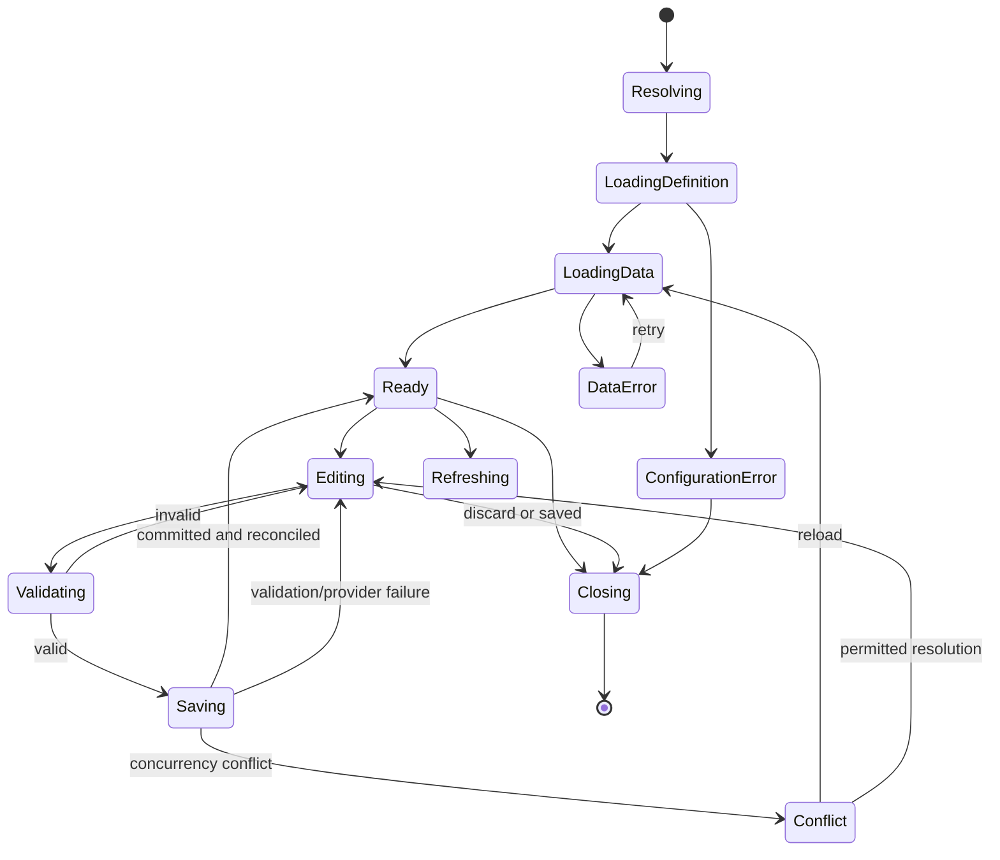
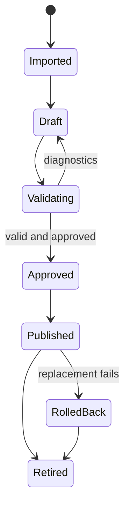
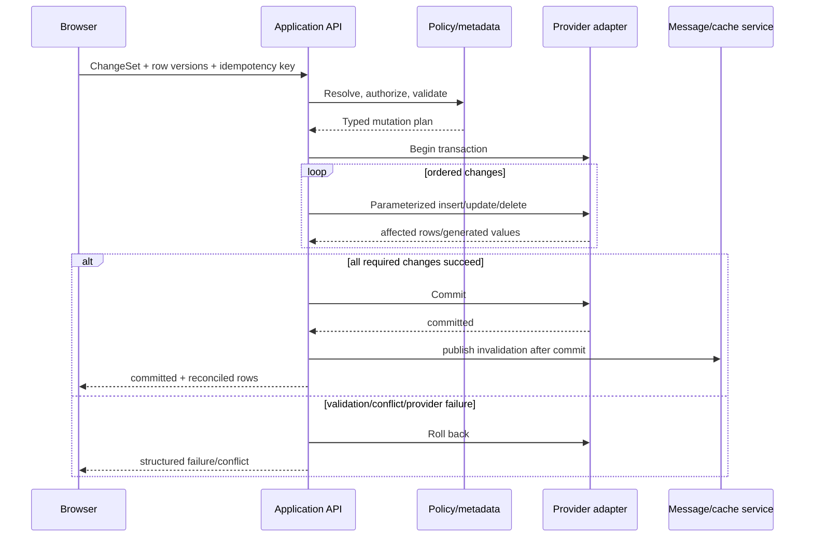
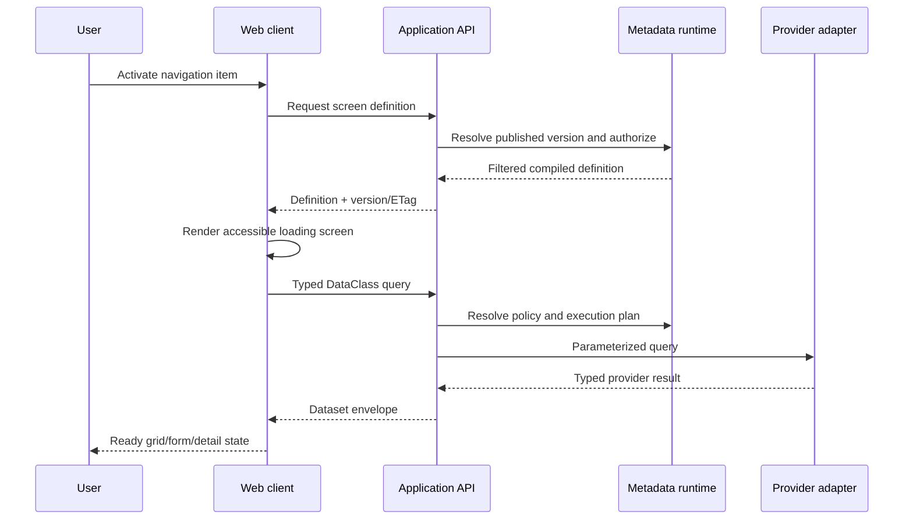

# GDFramework Modern Web System Design

**Status:** Controlled working design baseline 0.1  
**Date:** 6 September 2026  
**Target:** Modern web-based equivalent of the GDFramework application platform  
**Functional authority:** [GD Framework Functional Specification 0.5](GDFramework%20Functional%20Specification.md)  
**Delivery authority:** [GDFramework Migration Master Plan and Design 0.4](MIGRATION_MASTER.md)  
**Technology status:** Product and framework selections intentionally deferred; browser and web-platform architecture selected

**Interactive references:** [Runtime web mockup](../prototype/gdframework-web-mockup.html) and [GD Studio administration mockup](../prototype/gdframework-admin-mockup.html)

## 1. Purpose and authority

This document defines the complete target design for a modern web-based
equivalent of the legacy GDFramework. It translates the reverse-engineered
functional specification into an implementable browser, service, data,
security, integration, deployment, and operational architecture.

The target is not a collection of individually hard-coded replacement pages.
It is a metadata-driven application platform. A common web shell and generic
screen engine shall construct applications, navigation, fields, grids,
commands, validation, data access, reports, security, and personalization from
versioned metadata. Application-specific components are permitted only where
the generic model has an explicitly approved extension point.

This document governs target-system structure. The functional specification
remains normative for observable behavior and compatibility. If this design and
a functional requirement conflict, the functional requirement prevails until
an approved decision changes it. Legacy defects are not automatically preserved;
their outcomes are controlled in [DEFECT_DISPOSITION.md](DEFECT_DISPOSITION.md).

## 2. Design scope

### 2.1 Included

The design covers:

- browser application shell, responsive layout, navigation, tabs, popups,
  global commands, status, notifications, and controlled sign-out;
- metadata acquisition, validation, compilation, versioning, publication,
  caching, and runtime interpretation;
- the generic screen engine and all seven legacy screen families;
- the web component equivalents of every legacy custom control used by the
  shell or generic form;
- grids, field forms, master-detail, actions, trees, junction editing, charts,
  lookup controls, filtering, searching, grouping, sorting, personalization,
  change indication, refresh, printing, reports, and file export;
- typed DataClass queries, parameters, joins, caching, CRUD, transactions,
  concurrency, audit stamping, provider translation, and generated keys;
- identity, authorization, field/command security, secrets, audit, privacy, and
  defensive handling of executable legacy metadata;
- asynchronous messages, long-running jobs, external adapters, compatibility,
  observability, recovery, deployment, testing, migration, and retirement;
- controlled accommodation of Aggregator and Limit Server behavior when
  deployed evidence confirms those modules are active scope.

### 2.2 Excluded unless separately approved

- preserving insecure or erroneous behavior merely because it existed;
- installing ActiveX controls, COM components, VB6 runtimes, or Microsoft
  Office on an end-user computer;
- allowing the browser to connect directly to a database, file share, helper
  DLL, or service credential;
- accepting arbitrary SQL, provider names, connection strings, type names, or
  executable code from a browser request;
- reproducing dormant, unfinished, source-only, or historical PLM features
  without an identified consumer and approved scope decision;
- selecting a programming language, UI framework, database product, cloud,
  container platform, or identity vendor in this baseline.

## 3. Design outcomes

The system shall provide the following outcomes:

1. A user opens a supported browser, authenticates once, and sees only the
   applications, navigation, screens, data, fields, and commands they may use.
2. The same generic web runtime can host all metadata-defined applications.
3. The server is the authority for metadata, authorization, validation,
   transactions, provider access, audit, and executable actions.
4. Configuration changes are versioned, validated, previewable, publishable,
   reversible, and attributable.
5. A screen definition produces deterministic UI and service behavior across
   supported browsers and locales.
6. Legacy DataClass semantics can be imported without exposing legacy
   implementation objects in modern contracts.
7. Individual applications or DataClasses can move incrementally while legacy
   and modern paths coexist under controlled routing.
8. Operations can diagnose every request using a correlation identifier and
   can distinguish host, metadata, authorization, application-database,
   provider, extension, and client failures.

## 4. Governing design principles

- **Metadata first:** application behavior is configuration, not duplicated UI
  code.
- **Server authority:** the browser may improve usability but cannot grant
  access, validate security, or determine transaction truth.
- **Semantic identity:** stable IDs and command keys drive behavior; captions,
  icons, positions, and localized text are presentation.
- **Typed boundaries:** dates, times, decimals, nulls, binaries, keys, versions,
  enums, and failures have explicit representations.
- **Safe by construction:** values are parameterized, identifiers are
  allow-listed, secrets are externalized, and unsafe legacy metadata is rejected
  or translated during import.
- **Atomic by default:** a change set commits completely or not at all unless a
  separately specified workflow permits partial success.
- **Accessible by default:** keyboard, focus, semantic roles, contrast, zoom,
  screen readers, and reduced motion are component acceptance criteria.
- **Progressive delivery:** provider, workflow, and application coverage is
  expanded behind measurable gates rather than by a single cutover.
- **Replaceable infrastructure:** contracts and application rules do not depend
  on a UI framework, database driver, COM, ADO, or hosting vendor.
- **Observable operation:** an outcome that cannot be correlated, audited, and
  supported is incomplete.

## 5. Actors and system boundaries

| Actor | Target interaction |
|---|---|
| Business user | Uses configured applications, queries and edits data, runs actions and reports, personalizes views, and receives messages |
| Privileged user | Performs approved high-risk or administrative commands subject to explicit policies and audit |
| Application configurator | Imports, authors, validates, previews, publishes, and retires metadata versions |
| Support operator | Reviews safe diagnostics, health, job outcomes, metadata versions, and correlation traces |
| Security administrator | Manages identity mappings, roles, policies, access reviews, and emergency revocation |
| Database owner | Registers approved connections, provider capabilities, DDL contracts, and service identities |
| Integration owner | Maintains external action, validation, lookup, reporting, and service adapters |
| Migration operator | Imports legacy metadata, compares legacy and modern results, and controls routing/cutover |
| Automated client | Uses an explicitly published API contract and service identity; it never impersonates an interactive user by request fields |

The browser, public API edge, application platform, worker processes, metadata
store, application databases, identity provider, secret store, object storage,
and external integrations are separate trust and failure boundaries.

## 6. Target architecture

### 6.1 Context



### 6.2 Runtime containers

| Container | Responsibility | Scaling/state model |
|---|---|---|
| Web client | Shell, renderer, interaction state, accessibility, local presentation preferences, and API orchestration | Static assets; per-tab transient state; no trusted business state |
| Web/API edge | TLS termination, authentication integration, security headers, routing, request limits, and static asset delivery | Horizontally scalable and stateless |
| Application API | Session context, metadata delivery, query/change/action orchestration, authorization, validation, transactions, preferences, and messages | Horizontally scalable; durable state externalized |
| Metadata compiler | Imports legacy rows, validates references and options, produces immutable runtime bundles, and calculates compatibility diagnostics | On demand and during publication; deterministic output |
| Job worker | Exports, reports, large queries, scheduled work, external calls, and retryable processing | Horizontally scalable with durable queue and leases |
| Provider adapters | Typed query/change execution and dialect translation for each approved data source | Hosted with API or workers; bounded connection pools |
| Metadata store | Versioned definitions, role mappings, personalization, messages, jobs, audit pointers, and publication state | Transactional database with backup and migration controls |
| Distributed cache | Optional immutable metadata and query result caches, invalidation, and short-lived coordination | Non-authoritative; safe to discard and rebuild |
| Object storage | Generated report/export files and large immutable artifacts | Encrypted, lifecycle-controlled, access by short-lived authorization |
| Telemetry platform | Structured logs, traces, metrics, alerts, dashboards, and audit export | Separate access boundary and retention policy |
| Compatibility adapter | Translates only approved legacy COM/ADO shapes to modern contracts | Temporary, isolated, measured, and removable |

### 6.3 Component dependencies



The renderer depends only on a published web view model. It does not interpret
raw database rows, connection details, SQL, provider-specific types, or legacy
bit masks. The metadata compiler translates those concerns into a normalized
runtime bundle.

## 7. Web application shell

### 7.1 Page structure

The authenticated page shall contain:

1. a skip link and accessibility landmarks;
2. an application header with product/application identity, global commands,
   status, help, notifications, and user menu;
3. a collapsible navigation region;
4. a resizable divider on sufficiently wide displays;
5. a workspace holding one or more screen tabs;
6. an optional contextual details/popup layer;
7. a live status region for request and validation feedback;
8. a nonvisual route/state layer so URLs can restore permitted application,
   screen, tab, subkey, and safe criteria state.

On narrow viewports, navigation becomes a modal drawer and details reflow below
or into a full-screen dialog. No required function may depend on hover, precise
mouse movement, or desktop window coordinates.

### 7.2 Application selection

- The API returns only authorized active applications in authorized groups.
- The user's valid default application opens first; otherwise the first valid
  application is selected or a choice page is shown.
- Switching application changes the route, navigation, metadata bundle,
  command context, message scope, and personalization scope.
- If a dirty screen would be discarded, the shell presents Save, Discard, and
  Cancel according to authorization and screen capability.
- A switch never transfers one application's cached data or permissions into
  another application's context.

### 7.3 Navigation

The target navigation component replaces both legacy Outlook-bar and tree
modes with one responsive semantic model supporting configured presentation
variants:

- ordered groups and terminal items;
- icons with text alternatives or decorative semantics;
- two-level Outlook-style grouping where configured;
- arbitrary-depth trees where valid child relationships exist;
- expand/collapse, initial expansion, selection, keyboard arrows, Home/End,
  type-ahead, and Enter/Space activation;
- application-owned items and user-defined shortcuts;
- authorized drag/reorder or explicit Move controls for personal menus;
- optimistic personalization updates with rollback on failure;
- refresh when publication, authorization, or relevant system messages change.

Only terminal items with an authorized screen target are activatable. Missing,
inactive, cyclic, unauthorized, or orphaned targets produce compiler diagnostics
and are excluded from the published navigation bundle.

### 7.4 Workspace, tabs, and dialogs

- A normal navigation action opens or activates a uniquely keyed workspace tab.
- Metadata controls whether multiple instances of a screen are allowed and
  whether subkeys form part of tab identity.
- Tab labels use configured captions and expose dirty, loading, error, and
  attention state without relying on color alone.
- Closing a dirty tab invokes the common unsaved-change protocol.
- Modal child screens use accessible dialogs with focus trapping, Escape/Close
  rules, focus restoration, and background inertness.
- Modeless legacy popups become workspace panels, nonmodal dialogs, or separate
  routes according to their interaction contract; browser popup windows are not
  the default.
- Split positions and last active tab may be stored as user preferences but
  shall be clamped to a usable layout when viewport or zoom changes.

### 7.5 Global command bar

The global command bar exposes semantic commands such as application switch,
refresh metadata, export all, messages, help, diagnostics, and sign out. Each
command has a stable key, visible label, optional icon, tooltip/help text,
keyboard behavior, authorization policy, enabled predicate, progress state, and
result announcement. Position and caption never determine command identity.

### 7.6 Startup and shutdown

Startup proceeds as follows:

1. load versioned static assets under a restrictive security policy;
2. establish or resume an authenticated session;
3. retrieve session capabilities and valid application choices;
4. select the requested/default application;
5. retrieve the published shell/navigation metadata bundle;
6. restore permitted user preferences and route;
7. connect the message channel; and
8. render the first usable state with loading placeholders and retryable errors.

Sign-out and session expiry clear tokens, user-specific caches, in-memory rows,
draft edits, message channels, and sensitive diagnostics. Browser unload is not
trusted to persist changes. Dirty work must be explicitly saved; a best-effort
navigation warning is a usability aid, not a transaction mechanism.

## 8. Generic screen engine

### 8.1 Compiled screen definition

For each published display definition, the metadata runtime exposes a compiled
`ScreenDefinition` containing:

- application, screen, version, caption, subcaption, icon, help, and screen type;
- master, detail, lookup, action, report, and tree DataClass references;
- field definitions in deterministic position/order;
- filter, search, sort, grouping, paging, refresh, popup, and child rules;
- command definitions and authorization requirements;
- layout regions, responsive hints, widths, alignment, frozen columns, and
  visibility rules;
- data types, formats, locale rules, defaults, mandatory state, edit behavior,
  value-list/lookup references, and validation policies;
- key, identity, concurrency, audit, and mutation policy;
- helper/extension references translated to approved adapter IDs;
- user-personalization capability and bounds;
- diagnostics showing ignored or translated legacy options.

The definition is immutable after publication and identified by application,
screen, and metadata version. The browser shall never merge unrelated versions
inside one screen instance.

### 8.2 Screen lifecycle



The renderer shall expose explicit loading, empty, ready, editing, validating,
saving, refreshing, conflict, forbidden, configuration-error, data-error, and
offline/unreachable states. Controls are enabled from capability and state, not
ad hoc event order.

### 8.3 Screen type mapping

| Legacy type | Web equivalent | Required behavior |
|---|---|---|
| 1 Grid | Virtualized data grid page | Typed columns, paging/virtualization, selection, editing, sorting, grouping, filtering, context commands, personalization, export, refresh, and change highlighting |
| 2 Field | Responsive record form | Label/control/help/error association, ordered focus, defaults, lookup, validation, record navigation where configured, and CRUD commands |
| 3 Master-detail | Coordinated master region and detail grid/form | Stable master selection, detail parameter propagation, child refresh, parent/child insert-update-delete, dirty-state coordination, and transactional policy |
| 4 Command/action | Parameter form and action result view | Typed inputs, confirmation, idempotency where required, server execution, progress, cancellation semantics, and structured result |
| 5 Tree/detail | Accessible hierarchical browser with detail panel | Lazy/eager loading policy, selection-driven detail query, expansion state, keyboard support, and key overrides |
| 6 Junction insert | Dual-list or searchable association editor | Available/selected sets, duplicate prevention, bulk association, validation, and atomic insertion |
| 7 Chart | Accessible chart with data table | Metadata-defined series/category/format, filtering, resize, text summary/table alternative, image/export policy, and no information conveyed only by color |

An unsupported or internally inconsistent type is rejected during metadata
publication. The runtime shall not silently substitute a grid.

### 8.4 Field and column types

The component registry maps normalized metadata field types to accessible web
controls. It shall support at minimum:

- read-only text and formatted value;
- single-line and multiline Unicode text;
- integer, decimal, percentage, and currency input;
- date, time, local date-time, and instant input with explicit time-zone rules;
- Boolean checkbox/switch where meaning is unambiguous;
- single-select dropdown, radio group, and autocomplete;
- multi-select list/tag picker where a deployed contract requires it;
- lookup text plus search action and returned key/display values;
- icon/image indicator with textual alternative;
- hyperlink and approved application command;
- hidden keys, audit fields, row versions, and computed fields;
- popup/subscreen launchers; and
- criteria-only operators and value controls.

The browser uses native semantics where they meet the interaction contract and
the shared component library otherwise. Metadata cannot inject markup, script,
styles, event handlers, URLs, or arbitrary component names.

### 8.5 Layout

Legacy absolute positions are imported as ordering and grouping hints, not raw
pixel coordinates. The layout engine uses responsive grid regions with:

- explicit label/control association;
- minimum/maximum widths and documented overflow;
- deterministic order across viewport sizes;
- one-column reflow at narrow widths;
- sticky or frozen behavior only where it leaves required content reachable;
- resizable regions with keyboard alternatives;
- user preferences bounded by metadata and accessibility rules; and
- print-specific layout separate from interactive layout.

### 8.6 Validation and defaults

Validation is defined once in the normalized metadata model and executed at two
levels:

- the browser performs immediate type, required, length, range, format,
  cross-field, and lookup feedback for usability; and
- the server repeats all authoritative rules, authorization, current-data,
  concurrency, helper, and business validation before execution.

Defaults are evaluated by the server when they depend on user, role,
application, database, time, sequence, or other trusted context. A client may
display server-provided defaults but may not invent audit or authority values.
Validation results identify the stable field ID, code, localized message key,
severity, and optional remediation. Focus moves to the first invalid field only
after a submit attempt and without discarding the full error summary.

### 8.7 Value lists and lookups

- Small static value lists may be included in the screen bundle.
- Large, dynamic, secured, or parameterized lists use a paged lookup endpoint.
- Stored row values are distinct from displayed localized labels.
- Dependencies between fields invalidate and reload affected values.
- Unknown retained legacy values remain visible and diagnosable even when no
  longer selectable for new input, if the business contract requires this.
- Lookup results return approved key/display fields only.
- Search is debounced and cancellable; short-query limits prevent broad scans.

### 8.8 Commands and command bus

All shell, screen, grid, row, field, popup, and context-menu actions are
registered as semantic commands. A command definition contains:

| Property | Meaning |
|---|---|
| `key` | Stable protocol identifier, including mapped legacy toolbar keys where compatibility requires them |
| `scope` | Global, application, screen, selection, row, field, or dialog |
| `labelKey` | Localizable label; never used as identity |
| `iconKey` | Approved design-system icon |
| `policy` | Server authorization policy and optional client capability hint |
| `enableWhen` | Safe declarative state predicate over compiled context |
| `confirmation` | None, confirm, typed confirmation, or reason required |
| `execution` | Local presentation action, query, change, server action, report, export, or navigation |
| `concurrency` | Reentrant, single-flight, queued, or mutually exclusive group |
| `shortcut` | Optional nonconflicting keyboard shortcut |

The web command bar preserves the behavioral role of `CSFPToolbar` and
`CSFPButton`, including configured ordering, visibility, enabled state,
tooltips, grouped actions, and a frozen construction phase. It does not preserve
pixel-level rendering or ActiveX event plumbing.

## 9. Web component equivalence

| Legacy control | Modern component | Preserved contract | Web-specific treatment |
|---|---|---|---|
| `CSFPToolbar` | Semantic command bar | ordered button collection, command keys, visibility, enabled state, click routing, freeze/build behavior | roving focus, overflow menu, responsive collapse, ARIA toolbar semantics |
| `CSFPButton` | Command button/menu button | caption, key, icon, tooltip, pressed/enabled/visible state, click event | native button semantics, loading state, touch target, no caption-based dispatch |
| `CSFPButtons` | Command collection model | indexed/keyed access and ordered mutation during construction | immutable published collection; keyed state updates |
| `CSFPPanel` | Layout panel/surface | border, caption, child containment, resize participation | CSS layout regions, semantic heading/region, responsive sizing |
| `CSFPSplitter` | Resizable separator | linked panes, min/max bounds, drag completion and position | pointer and keyboard resizing, ARIA separator, saved bounded preference |
| `CSFPDropDown` | Select/combobox | values, selected key, display text, enabled/read-only state, change event | accessible listbox/combobox, async paging when required |
| `CSFPTextLookup` | Lookup input with search trigger | editable/display text, lookup button event, host-provided retrieval | lookup dialog/service owned by host; control never executes SQL |
| Outlook bar hierarchy | Navigation groups/tree | group/items, order, selected item, expansion, icon/caption, activation | unified responsive navigation, arbitrary-depth tree support where metadata defines it |
| Legacy grid OCX | Data grid | columns, rows, selection, editing, grouping, sorting, filtering, frozen columns, context actions | virtualization, semantic table/grid modes, server paging, keyboard and screen-reader acceptance |
| Legacy tabs/docking | Workspace tab/panel system | active screen identity, close, resize, modal/modeless relationships | route integration, responsive panels, no OS-level docking dependency |
| Tooltip helper | Design-system tooltip/help | delayed contextual description | never the sole source of required information; keyboard/touch accessible |

Component properties that affect observable behavior remain part of the
compiled view model. Design-time property pages, window handles, COM persistence
bags, device-context drawing, and ActiveX lifecycle events have no target-system
equivalent.

## 10. Client architecture and state

### 10.1 State ownership

| State | Owner | Persistence |
|---|---|---|
| Published definitions and capability hints | Server; cached by client by version | Browser cache with version/ETag; never authoritative for access |
| Authentication/session | Identity and API edge | Secure, short-lived mechanism selected by security ADR |
| Current route/application/tab | Web client | URL plus optional session restoration |
| Query criteria, sort, page, selection | Screen instance | URL only when safe; otherwise memory/session state |
| Draft row edits | Screen instance | Memory by default; no silent durable storage of sensitive data |
| Saved layouts/filters/formats/menus | Server preference service | Versioned per subject/application/screen |
| Data/query cache | Server; optional short client reuse | Scoped, expiring, invalidated; cleared on sign-out |
| Jobs and generated files | Server/worker | Durable state and controlled object storage |
| Notifications | Server message service | Durable delivery/read state where required |

### 10.2 Request coordination

- Every screen instance has a cancellation scope.
- A later query supersedes an earlier query for the same purpose; stale
  responses are ignored by request ID.
- Saves use single-flight behavior per change set.
- Navigation and metadata publication changes do not silently destroy drafts.
- Retry is automatic only for safe idempotent reads or operations with an
  explicit idempotency key and known outcome.
- The browser distinguishes offline, API unreachable, dependency unavailable,
  timeout, cancellation, and application errors.

### 10.3 Browser support

The product shall support the organization-approved evergreen browser set. The
support matrix must define minimum versions, operating systems, assistive
technology combinations, cookie/storage constraints, download behavior, and
enterprise security policies. Unsupported browsers receive a clear blocking
message before application data is loaded.

The web client shall use progressive enhancement and standards-based APIs. It
shall not require extensions, ActiveX, Java applets, installed Office, local
administrator rights, mapped drives, or direct access to internal databases.

## 11. Metadata platform

### 11.1 Metadata domains

The normalized target model preserves the semantics of these legacy families:

| Domain | Principal entities |
|---|---|
| Application | Application group, application, shell options, defaults, ownership, active state |
| Connection | Logical data source, provider type, timeout, capabilities, safe secret reference, active state |
| DataClass | Query/action source, read/write routing, parameter set, cursor/paging/cache policy, keys, mutation, audit, concurrency, join, marshalling/import lineage |
| Navigation | Menu, submenu/item, parent relationship, sequence, caption, icon, target, ownership, personal shortcut state |
| Display | Screen/display definition, screen type, master/detail relation, popup mode, filter strategy, report, options, helper references, refresh |
| Element | Field/column identity, position/order, data binding, type, format, default, key, visibility, editability, lookup, validation, grouping, sizing, master-detail role |
| Parameter | Parameter, set, ordered membership, type, source, default/current binding, substitution marker, dynamic context |
| Report/tree | Report, report column/operation, tree relation/key override, chart definition, output policy |
| Security | Role, subject mapping, application access, screen/command/field policy, active/default state |
| Personalization | Layout, visible columns, order, width, sort, group, filter, format, menu/shortcut, application preference |
| System | Named settings, messages, message store/delivery state, error/audit records, ID allocation lineage |

### 11.2 Version and publication model

Metadata is managed as immutable versions:



- An import records source system, extraction time, row hashes, schema version,
  tool version, warnings, and operator.
- Draft changes use stable IDs and revision control.
- Validation produces errors, warnings, translations, and unsupported-option
  diagnostics with exact entity paths.
- Publication is atomic for an application scope. Users see either the previous
  or new complete version.
- Active sessions receive a version-change notification. New screens use the
  new version; existing dirty screens are not force-reloaded.
- Rollback republishes a known-good immutable version; it does not edit history.
- Every API result records the metadata version that governed it.

### 11.3 Compilation and validation

The compiler shall:

1. parse source rows without executing them;
2. normalize legacy nulls, booleans, option arrays/bit fields, enum values,
   identifiers, ordering, and data types;
3. resolve all foreign references and detect cycles/orphans/duplicates;
4. translate screen, element, command, validation, parameter, and provider
   options into typed structures;
5. reject executable client code, unregistered helpers, raw credentials,
   malformed identifiers, unsafe substitution, and unknown critical options;
6. calculate effective defaults and inheritance explicitly;
7. validate provider capabilities and read/write consistency;
8. validate security coverage and deny by default when ambiguous;
9. produce shell, navigation, screen, dataset, policy, report, and localization
   bundles; and
10. generate a deterministic digest for audit, cache, and deployment comparison.

Warnings may be published only under an approved rule. Errors block the
affected publication unit. The compiler output is reproducible from the same
input, compiler version, and approved environment-independent configuration.

### 11.4 Authoring and administration

The initial migration may be import-only. If web authoring is added, it shall
use the same APIs and validation pipeline as automated imports and support:

- search and dependency navigation;
- schema-aware editors rather than raw JSON/SQL fields where possible;
- side-by-side version differences;
- impact analysis listing applications, screens, DataClasses, roles, reports,
  and tests affected;
- preview against a nonproduction environment and representative roles;
- maker/checker approval for security, connection, action, and executable
  integration changes;
- scheduled publication and one-action rollback; and
- complete audit history with reasons.

## 12. Application services

### 12.1 Session service

Builds the trusted `SessionContext` from host-established identity, current
application selection, effective roles/claims, locale, time zone, correlation
context, and supported client/API versions. It never accepts caller-provided
roles or audit identity as authority.

### 12.2 Definition service

Returns authorized, compiled, versioned shell/navigation/screen definitions.
It applies policy filtering so unauthorized applications, navigation items,
screens, fields, and commands are not disclosed. The API still enforces the
same policies on execution.

### 12.3 Query service

Resolves a stable DataClass ID, validates parameters, authorization, limits,
sort/filter policy, and consistency request, then invokes a provider adapter.
It returns a typed schema, rows, total/continuation information when supported,
metadata/data version tokens, safe warnings, and correlation details.

### 12.4 Change service

Processes ordered inserts, updates, and deletes as an authorized `ChangeSet`.
It applies defaults, validation, field write policy, keys, generated identity,
audit stamps, logical/physical delete rules, optimistic concurrency,
transactions, reconciliation, and post-commit invalidation/messages.

### 12.5 Action service

Executes only registered action definitions. Actions declare input/output
schemas, policy, timeout, transaction behavior, idempotency, side effects,
confirmation level, synchronous/asynchronous mode, and adapter. Arbitrary
procedure names or helper identifiers from browser requests are rejected.

### 12.6 Preference service

Stores validated personal menus, layouts, visible columns, widths, order,
grouping, sorting, filters, formats, split positions, and application defaults.
Each preference is scoped to subject, application, screen, metadata compatibility
range, and type. Invalid or obsolete fields are ignored with diagnostics and
can be reset to published defaults.

### 12.7 Message service

Stores and delivers typed messages by subject, role, application, group, or
system audience with validity windows, priority, acknowledgement/read state,
and safe payload. It supports polling fallback and a live server-to-browser
channel. Delivery is at least once; clients de-duplicate by message ID.

### 12.8 Report and export service

Generates metadata-defined tabular reports, cross-tabs, charts, print-ready
documents, and workbook-compatible files without desktop Office automation.
Small exports may stream synchronously; large outputs are durable jobs. The
service rechecks authorization at generation and download time and applies field
security, locale, formatting, row limits, classification, retention, and audit.

### 12.9 Administration service

Provides policy-controlled metadata import/publication, cache invalidation,
job management, system-message administration, safe diagnostics, configuration
status, and support actions. Operational access is separate from business-user
access and is never enabled by a client-side flag.

## 13. Service contracts

### 13.1 Protocol baseline

The browser/API boundary shall use TLS-protected, versioned HTTP APIs with a
documented machine-readable contract. JSON is the default structured format;
streaming downloads use appropriate file media types. A live message channel
uses Server-Sent Events or WebSocket after a technology ADR confirms proxy,
scale, and security requirements. Polling remains the compatibility fallback.

Every request carries or receives:

- API version;
- correlation ID;
- authenticated session context at the host;
- application context where required;
- metadata version or compatibility range where state depends on it;
- idempotency key for retryable commands/changes where applicable; and
- conditional version token for cache/concurrency operations.

### 13.2 Logical endpoints

The paths below define responsibilities, not a mandatory framework syntax.

| Method and path | Purpose |
|---|---|
| `GET /api/v1/session` | Current trusted subject, locale, capabilities, authorized applications, and API compatibility |
| `POST /api/v1/session/application` | Select an authorized application context |
| `GET /api/v1/applications/{applicationId}/shell` | Versioned shell options, navigation, global commands, and message settings |
| `GET /api/v1/screens/{screenId}` | Authorized compiled screen definition |
| `POST /api/v1/datasets/{datasetId}/query` | Typed query with parameters, filters, sort, paging, and refresh policy |
| `POST /api/v1/datasets/{datasetId}/changes` | Atomic authorized insert/update/delete change set |
| `POST /api/v1/datasets/{datasetId}/validate` | Optional authoritative preflight validation without commit |
| `GET /api/v1/lookups/{lookupId}` | Paged secured value-list/lookup query |
| `POST /api/v1/actions/{actionId}/executions` | Execute or enqueue a registered action |
| `POST /api/v1/reports/{reportId}/jobs` | Create report/print/export work |
| `GET /api/v1/jobs/{jobId}` | Authorized progress and outcome |
| `POST /api/v1/jobs/{jobId}/cancel` | Request cancellation when supported |
| `GET /api/v1/files/{fileId}` | Authorized, expiring generated-file download |
| `GET/PUT/DELETE /api/v1/preferences/{type}/{scopeId}` | Read, replace, or reset validated user preferences |
| `GET /api/v1/messages` | Current/paged message inbox |
| `GET /api/v1/messages/stream` | Live message and invalidation channel |
| `POST /api/v1/messages/{messageId}/acknowledgement` | Record required acknowledgement/read action |
| `POST /api/v1/admin/metadata/imports` | Create controlled import and validation job |
| `POST /api/v1/admin/metadata/versions/{versionId}/publish` | Approve/publish an immutable version |
| `GET /api/v1/health/live` | Process liveness only |
| `GET /api/v1/health/ready` | Readiness of required platform dependencies, access restricted as appropriate |

### 13.3 Typed dataset envelope

A dataset response contains metadata separately from values:

```json
{
  "datasetId": "orders",
  "definitionVersion": "sha256:...",
  "columns": [
    {
      "id": "orderId",
      "type": "int64",
      "nullable": false,
      "key": true,
      "writable": false
    },
    {
      "id": "amount",
      "type": "decimal",
      "precision": 19,
      "scale": 4,
      "nullable": false,
      "writable": true
    }
  ],
  "rows": [
    {
      "rowId": "opaque-stable-row-token",
      "version": "opaque-concurrency-token",
      "values": { "orderId": 42, "amount": "1250.5000" }
    }
  ],
  "page": { "continuationToken": null, "returned": 1 },
  "correlationId": "..."
}
```

Decimal values use a lossless representation. Instants use ISO 8601 UTC;
date-only and time-only values remain distinct. Binary values use a controlled
download/reference contract when large. Null is distinct from empty string,
zero, false, and absent property. Column IDs, not captions or ordinal position,
bind values.

### 13.4 Query contract

A query contains DataClass ID, typed parameter values, a structured filter
expression, allow-listed sort/group fields, requested page size/continuation,
and refresh/consistency intent. The server validates the expression against the
definition and translates it to provider parameters. Raw SQL fragments are not
part of the public contract.

Filter expressions support approved comparison, range, null, set, contains,
starts-with, logical AND/OR, and context-filter operations according to field
type and provider capability. Complexity, depth, value count, and page limits
are enforced.

### 13.5 Change contract

Each change identifies operation, stable client row token, key, original
version, changed field values, and optional relationship context. The response
contains:

- overall `committed`, `rejected`, `conflict`, `failed`, or `unknown` outcome;
- one result per input row using the client row token;
- generated keys and authoritative values after commit;
- field and row validation problems;
- concurrency conflicts without exposing unauthorized current values;
- transaction/reconciliation status; and
- correlation ID.

An HTTP success code does not mean the business change committed; clients use
the structured outcome. Conversely, expected validation and conflict results
are not reported as unexpected server failures.

### 13.6 Error contract

Errors follow a stable problem structure containing type/code, safe title and
detail, status, correlation ID, retryability, transaction outcome, field
problems, and optional dependency category. Stack traces, SQL, credentials,
connection strings, internal hostnames, and sensitive values are never returned
to a normal client.

## 14. DataClass and provider execution

### 14.1 DataClass model

A target `DatasetDefinition` preserves:

- stable ID/name and source type;
- read connection and optional write connection;
- query, procedure, function, XML, service, or adapter operation identity;
- typed ordered parameters and dynamic bindings;
- result fields and key/order expectations;
- paging, timeout, cache, refresh, and invalidation policy;
- insert/update/delete capability;
- update target, ordered unique key, generated fields, logical delete, audit
  fields, and concurrency fields;
- join definition and duplicate/multiple-match behavior;
- field- and operation-level authorization;
- consumers and metadata lineage; and
- legacy marshalling details only in the importer/compatibility layer.

### 14.2 Provider adapter contract

Each provider implements capability discovery, connection opening, typed command
binding, query, transaction, change execution, cancellation, timeout, error
classification, type normalization, resource cleanup, and health checks.

Provider-specific syntax is isolated in the adapter. Application services
operate on typed commands and validated logical identifiers. Adapters shall be
tested against real supported provider versions for null, decimal, Unicode,
date/time, Boolean, binary, identity, affected rows, concurrency, transaction,
timeout, cancellation, and connection-loss behavior.

Initial candidates identified by legacy evidence are SQL Server, Sybase,
Oracle, Access, XML datasets, and registered service/helper adapters. A provider
is not production-supported until a named deployment requires it and its matrix
passes. Access or local-file sources should normally be migrated or isolated in
a controlled worker rather than mounted into the web tier.

### 14.3 Connection management

- Metadata refers to a logical connection ID, never a secret-bearing string.
- Deployment configuration maps that ID to provider, endpoint/database, secret
  reference, pool, timeout, encryption, and availability policy.
- Unknown, blank, inactive, or ambiguous IDs fail closed.
- Pools are bounded per provider and workload; exhaustion is observable.
- Read and write routing is explicit.
- Connections and transactions never cross public service boundaries.
- Credential rotation does not require metadata republishing.

### 14.4 Query execution

1. Resolve session, application, metadata version, and DataClass.
2. Authorize dataset and field access.
3. Bind dynamic and supplied parameters with trusted values overriding
   authority-sensitive inputs.
4. Validate filter, sort, page, and maximum-cost policy.
5. Build a provider command from the approved definition.
6. Execute with cancellation, timeout, telemetry, and deterministic cleanup.
7. Normalize schema/types and remove unauthorized fields.
8. Apply an approved runtime join or report transformation if defined.
9. Cache only an immutable correctly scoped result.
10. Return the typed envelope and version data.

### 14.5 Runtime joins

Legacy cross-source joins are supported in a bounded join engine when they
cannot be moved safely to a database or service:

- master and child queries execute under the same authorized application
  context;
- join keys and comparison/null rules are declared;
- output contains master fields plus nonduplicate child fields;
- zero, one, and multiple child matches follow explicit metadata policy;
- row and memory limits prevent unbounded in-process joins;
- ordering is deterministic; and
- results never cache across an incomplete security scope.

For large joins, the compiler requires a materialized/database-side strategy or
an asynchronous job rather than interactive in-memory execution.

### 14.6 Change execution and concurrency



Optimistic concurrency requires an explicit version/stamp or approved original
value comparison. Zero affected rows on an expected update/delete is a conflict
or missing-row result, never silent success. If a provider failure leaves commit
outcome unknown, the API returns `unknown`, prevents unsafe automatic retry, and
records reconciliation work.

### 14.7 Caching and refresh

Metadata bundles are strongly versioned and may be cached broadly because they
are immutable after publication. Data caches are optional and disabled by
default for a new DataClass until scope and invalidation are proven.

A data cache key includes DataClass/definition version, application, every
result-affecting parameter/filter/sort/page, locale when formatting is server
side, and security/data-scope fingerprint. Writes invalidate only after commit.
Forced refresh bypasses lookup but cannot weaken authorization. Auto-refresh
pauses while the screen is dirty, hidden, disconnected, or saving and resumes
under an explicit screen policy. Overlapping refresh requests coalesce.

## 15. Security design

### 15.1 Trust model

The browser and all request data are untrusted. Identity is established by the
approved organization identity provider at the host. Session, application,
role, and data-scope authority are derived server-side. Client capability flags
exist only to improve presentation.

### 15.2 Authorization

Authorization combines:

- authenticated subject and service identity;
- application/group entitlement;
- role or claim membership;
- screen, dataset, operation, action, report, administrative, and command policy;
- field read/write policy;
- row/data-scope predicates derived from trusted context; and
- active dates/status and emergency revocation.

The default is deny. Definition delivery is filtered to avoid unnecessary
disclosure, and every data/action endpoint independently authorizes execution.
Role changes invalidate sessions/capability caches within the approved revocation
window.

### 15.3 Web protections

The selected implementation shall provide:

- TLS for all traffic and encryption for managed storage;
- secure authentication token/cookie handling with short lifetime and rotation;
- CSRF protection where browser credentials are ambient;
- restrictive Content Security Policy and no unsafe metadata-injected markup;
- output encoding and safe URL allow-lists;
- clickjacking protection and deliberate embedding policy;
- input/body/filter/page/rate limits;
- dependency, source, secret, container, and infrastructure scanning;
- controlled CORS limited to approved origins;
- download content-disposition/type hardening and malware policy where needed;
- administrative network/access restrictions; and
- independent penetration testing before production cutover.

### 15.4 Secrets and connections

Connection credentials, API keys, certificates, and signing keys live in an
approved secret store or workload identity system. References, not values,
appear in deployment configuration. Secrets are never included in metadata
bundles, API responses, source, telemetry, or generated reports.

### 15.5 Audit

Audit records are append-only under an approved retention policy and capture
time, trusted subject/service, application, operation, target, policy decision,
metadata version, outcome, correlation ID, and change summary. High-risk
administration records before/after definition hashes and approval identity.
Sensitive row values are minimized, classified, masked, or referenced according
to policy.

## 16. Personalization

The system supports saved column visibility/order/width, grouping, sorting,
filters, formats, split position, last/default application, navigation expansion,
and personal shortcuts where enabled. Preferences are data, not executable
metadata.

- Published defaults are immutable for a version.
- User preferences overlay only fields marked personalizable.
- The overlay is validated against stable IDs and bounded values.
- Application and screen versions declare preference compatibility.
- Removed fields/options are ignored and reported, not allowed to break a page.
- Reset deletes the overlay and immediately restores published defaults.
- Preferences follow the authenticated subject and approved profile scope, not
  a specific workstation registry.

## 17. Filtering, search, sort, and grouping

The web UI builds typed expressions from allowed fields and operators. It
supports screen criteria, local result filtering for bounded loaded data,
server-side filtering, context filtering from master/popup/application state,
search next/previous where meaningful, multi-column sort, grouping, and saved
filters.

The compiled definition determines:

- allowed fields/operators and whether case/locale sensitivity is meaningful;
- local versus server execution;
- required criteria and initial defaults;
- maximum expression complexity and set size;
- null/blank handling;
- whether a filter is personal, shared, or fixed; and
- whether result totals are exact, estimated, or unavailable.

SQL-like strings from legacy metadata are parsed and migrated to structured
expressions where possible. Untranslatable executable fragments require an
approved server adapter and are never evaluated in the browser.

## 18. Reporting, charts, printing, and export

### 18.1 Reports

Report definitions identify source dataset/version, authorized fields,
parameters, grouping, aggregates, cross-tab axes, formats, titles, locale,
output types, limits, and retention. Reports use the same query authorization
and provider boundaries as screens.

### 18.2 Charts

Charts are generated from an authorized typed result. The chart component
supports configured categories, series, aggregation, format, legends, labels,
and responsive resize. Every chart has an accessible name, text summary, and
equivalent data table or downloadable accessible representation. Palette and
markers meet contrast and color-independence rules.

### 18.3 Export

- Export current respects current authorized fields, filters, sort, and scope.
- Export all reproduces the legacy workbook-style multi-screen/application
  workflow only for approved datasets and within workload limits.
- Files are generated server-side in supported open or workbook-compatible
  formats without Office automation.
- Formula-injection protection is applied to spreadsheet-compatible output.
- Large exports are jobs with progress, cancellation where safe, expiry, audit,
  and authorized download.
- Hidden fields are not automatically exportable; export authorization is
  evaluated independently.

### 18.4 Printing

Print preview becomes a server-generated print-ready document or an accessible
browser print layout. It preserves captions, columns, formats, page headers,
grouping, and orientation where defined. Browser screen layout is not assumed
to be a printable contract.

## 19. Messages and real-time behavior

System messages support stable type, audience, application scope, priority,
effective/expiry times, display mode, payload, acknowledgement, and status.
Examples include information, warning, forced refresh, metadata/navigation
invalidation, application availability, and session/security notices.

The server publishes through a live channel and retains polling compatibility.
The client de-duplicates, orders where required, defers future messages, ignores
expired messages, announces accessible notifications, and never executes code
from payloads. A refresh message respects dirty-state safeguards. Security or
session revocation overrides local edits after providing the safest permitted
user notice.

## 20. External extensions and specialist services

### 20.1 Extension model

Legacy helper DLLs become registered server-side adapters implementing one of
these typed contracts:

- field/record validation;
- derived value or function;
- lookup/value provider;
- external service request;
- database-specific operation;
- action/job;
- report transformation; or
- notification delivery.

Each registration declares version, owner, input/output schemas, required
policy, timeout, retry/idempotency, side effects, transaction relationship,
secret references, data classification, health, and deployment unit. Metadata
refers only to an approved registration ID. Dynamic loading of an arbitrary
class or executable path is prohibited.

### 20.2 Isolation

Extensions with incompatible runtimes, elevated privileges, local-file access,
or unreliable behavior run out of process behind a constrained protocol. Bulkhead,
timeout, circuit-breaker, and resource limits prevent one extension from
exhausting the platform. Failures are translated to stable categories and
retain correlation across the boundary.

### 20.3 Aggregator

If active scope is confirmed, aggregation definitions become versioned typed
pipelines with explicit input schemas, group keys, operations, ordering,
null/decimal rules, output schema, limits, and deterministic tests. Small
interactive aggregation may run in the application/provider layer; large or
scheduled aggregation runs as a job.

### 20.4 Limit processing

If active scope is confirmed, limit rules, AND/OR sequencing, thresholds,
jurisdiction/COB context, schedules, recipients, violation persistence,
acknowledgement, and notification templates become an independently deployable
rules/job module. It uses explicit rule versions, effective dates, replayable
inputs, idempotent alert creation, audit, and reconciliation. Historical partial
code does not define production truth without deployed metadata and business
approval.

## 21. Jobs and background processing

Long-running exports, reports, bulk actions, scheduled refresh, external calls,
aggregation, and limit checks use durable jobs.

A job contains stable ID, type, owner subject/service, application, metadata
version, policy snapshot/reference, input digest, idempotency key, state,
progress, timestamps, lease, attempts, result/error, output references, expiry,
and correlation lineage. States are queued, running, cancellation-requested,
succeeded, failed, cancelled, and outcome-unknown.

Retries require a classified transient failure and idempotent operation. Poison
jobs stop after a bounded attempt policy and alert support. Workers renew leases;
expired leases are reclaimed only when duplicate execution is safe or guarded
by idempotency. Job output access is reauthorized at read/download time.

## 22. Error handling and user feedback

The web client presents:

- field errors adjacent to fields and in a summary;
- row errors attached to row identity;
- conflict choices that never overwrite silently;
- retry for safe recoverable reads;
- progress and cancellation for long operations;
- persistent correlation ID for support;
- safe actionable wording rather than raw provider errors; and
- status announcements that do not steal focus unnecessarily.

Configuration errors name the affected application/screen/entity for authorized
support users while business users receive a safe unavailable message. A broken
screen does not crash the shell. Global failure pages preserve sign-out and
support correlation access.

## 23. Observability and support

### 23.1 Telemetry

Every operation emits a distributed trace from edge through application,
provider/extension, job, and storage boundaries. Structured fields include
correlation, trace/span, operation, authenticated subject pseudonymous ID,
application, screen/DataClass/action, metadata version, provider/connection ID,
duration, row/byte counts, cache result, transaction result, outcome code, and
retry count.

Metrics cover request rate/latency/errors, authentication/authorization denial,
metadata compile/publication, query/change rows, connection-pool utilization,
cache, message lag, queue depth/age, job duration/outcome, export size, dependency
health, browser error rate, and active versions.

### 23.2 Health

- Liveness proves the process can respond and does not query downstream systems.
- Readiness proves required platform dependencies for new traffic.
- Provider health is reported separately and does not automatically mark every
  application unavailable.
- Deep diagnostics are restricted and never exposed through public anonymous
  health endpoints.

### 23.3 Support views

Authorized support can search by correlation ID, inspect safe request lineage,
metadata version, policy outcome, dependency category, job state, publication
history, and known incidents. Support cannot view secrets or unrestricted data
and cannot impersonate users without a separately audited approved mechanism.

## 24. Performance, scalability, and resilience

The initial measurable floors are defined in
[NON_FUNCTIONAL_REQUIREMENTS.md](NON_FUNCTIONAL_REQUIREMENTS.md): interactive
read p95 ≤2 seconds and p99 ≤5 seconds for the defined profile, first usable UI
≤3 seconds after a successful response, interactive change p95 ≤2 seconds,
large export ≤60 seconds, 50 active sessions, 99.9% monthly service objective,
5-minute host recovery, RTO 4 hours, and RPO 15 minutes for migration-owned
state. Production evidence may strengthen these through controlled change.

### 24.1 Scale strategy

- Static client assets are content-hashed and cacheable.
- APIs and workers are horizontally scalable and hold no required local session
  state.
- Metadata bundles are immutable and cache efficiently by digest.
- Queries use server paging/continuation and result limits.
- Grids virtualize rendering but do not claim all rows are loaded.
- Large exports/reports/actions move to jobs.
- Connection pools, queues, worker concurrency, memory, and response sizes are
  bounded per dependency/workload.
- Backpressure returns explicit retry guidance rather than allowing resource
  collapse.

### 24.2 Resilience

- Timeouts are explicit at edge, application, provider, extension, and job
  boundaries and ordered to preserve useful diagnostics.
- Cancellation propagates where the underlying dependency supports it.
- Circuit breakers apply only to classified dependency failures and do not hide
  authorization or validation errors.
- Retries use jitter and only for safe/idempotent operations.
- Cache loss affects performance, not correctness.
- A metadata publication is atomic and rollbackable.
- Graceful shutdown stops new work, drains bounded in-flight work, and releases
  leases/connections.

## 25. Availability, backup, and disaster recovery

The runtime shall support multiple service instances without session affinity
unless an approved live-channel implementation temporarily requires it. The
metadata/platform database uses managed high-availability capabilities
appropriate to the selected infrastructure. Object storage and queues use
durability policies aligned to job/output retention.

Backups cover metadata versions, publication state, role mappings managed by
the platform, preferences, messages, job state, audit references, and required
configuration. Restore exercises prove the stated RTO/RPO and include integrity
checks, secret/identity reattachment, cache rebuild, and active-version
verification. Application-database recovery remains governed by each owning
system but its objectives and dependencies are recorded.

## 26. Accessibility, responsive design, and localization

All supported workflows shall meet the WCAG 2.2 AA-equivalent acceptance floor
in the NFR baseline. Required behaviors include semantic landmarks/headings,
logical focus order, visible focus, full keyboard operation, screen-reader
names/roles/states, error identification, adequate contrast, non-color cues,
zoom/reflow through 200%, accessible dialogs/grids/trees/menus/tooltips, touch
targets, reduced-motion support, and no timing traps without extension.

All text is Unicode and localizable by stable message keys. Locale and time zone
are explicit session preferences subject to organization policy. Protocol values
are invariant. Date-only, local time, local date-time, and UTC instant remain
distinct. Number, currency, percentage, date, and time formatting is metadata-
driven within an allow-listed formatting model. Sorting/filter semantics that
differ by locale or database are documented and tested.

## 27. Deployment and environment design

### 27.1 Environments

At minimum, separate development, automated integration, test, staging/pilot,
and production environments exist. Each has independent credentials and data
policy. Production metadata/data is not copied to lower environments without
approved sanitization.

### 27.2 Build and release

- A clean checkout on a pinned build image restores, builds, tests, scans, and
  packages reproducibly.
- Client assets, APIs, workers, database migrations, metadata compiler, and
  adapter packages are versioned and traceable to source.
- Artifacts are immutable, signed where required, and promoted rather than
  rebuilt per environment.
- Infrastructure and configuration are reviewable and repeatable.
- Database migrations are forward-tested, backup-aware, and have a rollback or
  forward-recovery plan.
- Release records include compatible API, metadata schema/compiler, client,
  provider, and adapter versions.

### 27.3 Runtime configuration

Environment configuration contains public endpoints, identity authority/client
settings, logical connection mappings, secret references, feature/routing
flags, limits, telemetry destinations, retention, locale defaults, and dependency
timeouts. Configuration is schema-validated at startup. Machine paths and
developer registry state are prohibited.

### 27.4 Deployment topology

The design supports managed processes, containers, or equivalent isolated
services behind an approved web edge. The selected topology must support
horizontal scale, health checks, zero/low-downtime rollout, secret injection,
network policy, telemetry, controlled egress, backups, and rollback. Technology
selection is recorded by ADR without changing the logical boundaries here.

## 28. Migration and coexistence

### 28.1 Migration units

The preferred migration unit is a coherent vertical slice: application/screen,
its DataClasses, provider behavior, actions, reports, security, preferences,
messages, and acceptance fixtures. A slice is not complete when only its visual
page exists.

### 28.2 Metadata import

1. Export deployment rows and production physical DDL under controlled evidence
   handling.
2. Map legacy schema fields/options to normalized entities without changing
   meaning.
3. Preserve stable source IDs and record immutable source hashes.
4. Produce errors/warnings for orphaned references, unsafe SQL substitution,
   unknown options, unregistered helpers, and ambiguous security.
5. Generate a compiled preview and human-readable difference report.
6. Compare representative role/application/screen definitions with legacy.
7. Approve and publish only the slice's validated version.

### 28.3 Data and provider migration

The platform does not require moving every application database initially.
Modern provider adapters may access approved existing databases through least-
privilege service identities. Database schema or stored-procedure changes are
separate controlled decisions with reconciliation and rollback. Where legacy
SQL cannot be safely parameterized or supported, it is replaced by a reviewed
view/procedure/adapter with differential tests.

### 28.4 Side-by-side routing

Routing may select legacy or modern execution by approved application,
DataClass, workflow, or user cohort. It is server-controlled, auditable, rapidly
reversible, and never chosen by an untrusted browser field. Shadow reads may
compare normalized results without exposing modern-only data. Writes are not
dual-executed unless an explicit idempotent reconciliation design proves safety.

### 28.5 Legacy compatibility

An isolated compatibility adapter may translate approved COM methods, ADO
recordsets/XML, legacy parameter conventions, and Boolean/message outcomes for
identified consumers. It records usage, maps trusted identity, rejects raw SQL
and secrets, and has an owner/deprecation date. New browser features never
depend on this adapter.

### 28.6 Cutover and retirement

A slice cuts over only after functional, provider, security, accessibility,
performance, recovery, reconciliation, support, and rollback evidence passes.
Legacy routes remain read-only or available for the approved rollback window.
Retirement requires zero unexplained compatibility use, retained records,
approved rollback expiry, operations acceptance, and removal of VB6/COM/OCX
deployment dependencies from the supported estate.

## 29. Testing and quality strategy

Testing shall follow the repository rule: Mockito and substitute mocking
frameworks are prohibited. Observable behavior is tested with real
implementations, protocol fixtures, lightweight purpose-built fakes, and real
provider/integration environments appropriate to the boundary.

| Test layer | Required coverage |
|---|---|
| Metadata compiler | Every entity/field/option/enum, defaults, nulls, relationships, cycles, invalid references, unsafe input, deterministic digest, publication compatibility |
| Component | Keyboard, focus, semantics, validation, responsive states, toolbar, splitter, dropdown, lookup, navigation, grid, dialog, status, message |
| Screen renderer | All seven screen types, every field type, command/state lifecycle, dirty/close, empty/loading/error/forbidden/conflict states |
| Contract | API schemas, versions, typed values, nulls, errors, pagination, idempotency, conditional versions, backward compatibility |
| Provider integration | Real serialization, parameters, types, queries, transactions, identity, concurrency, failure, timeout, cancellation, cleanup for every supported provider |
| Security | Authentication, cross-user/application isolation, field/row/command policies, injection, XSS, CSRF, secrets, downloads, admin boundaries, revocation |
| Differential | Same imported metadata/input against legacy and modern normalized output or approved intentional difference |
| Workflow | Startup, application switch, navigation, query, criteria/filter, CRUD, master-detail, action, refresh, preferences, report/export/print, messages, shutdown |
| Accessibility | Automated checks plus manual keyboard, screen reader, zoom/reflow, contrast, dialogs, grids, trees, charts, and error handling |
| Performance | NFR profiles, cold/warm cache, concurrency, large exports, long jobs, browser responsiveness, provider pool limits |
| Reliability | Failure at each transaction boundary, unknown outcome, process restart, queue lease, cache loss, dependency outage, publication rollback, 1,000-operation soak |
| Deployment | Clean build, package promotion, configuration validation, migration, health, rolling update, rollback, backup/restore |

Every functional requirement and approved defect disposition maps to one or
more acceptance tests in [REQUIREMENTS_TRACEABILITY.md](REQUIREMENTS_TRACEABILITY.md).
The modern design adds design verification IDs in section 33.

## 30. Operational model

### 30.1 Ownership

Named owners are required for the web client/design system, application API,
metadata compiler/store, each provider, every external adapter, identity/policy,
data protection, telemetry/on-call, and each application slice. An unowned
integration cannot enter production.

### 30.2 Runbooks

Runbooks cover authentication failure, metadata publication failure/rollback,
screen configuration error, provider outage, pool exhaustion, slow query,
transaction outcome unknown, queue backlog, failed/poison job, extension
failure, message lag, export cleanup, secret rotation, access revocation,
incident data handling, restore, and legacy routing rollback.

### 30.3 Service-level indicators

Primary indicators are successful usable screen load, query latency/success,
committed change latency/success, authorization correctness, job completion age,
message delivery lag, dependency availability, metadata publication success,
and browser uncaught-error rate. Availability calculations exclude approved
maintenance but do not hide dependency-caused user failure.

## 31. Privacy and data lifecycle

Data classification is recorded for datasets, fields, exports, reports,
messages, logs, and adapter payloads. The platform minimizes collection and
exposure, applies masking where required, restricts lower-environment use,
records purpose/owner, and enforces retention/deletion policies.

Browser caches and storage shall not persist sensitive datasets beyond the
approved session model. Generated files have owner/scope, encryption, expiry,
revocation, and deletion. Logs avoid row values by default. Support and
telemetry access is role-controlled and audited.

## 32. Technology selection constraints

Later technology selection must demonstrate, through a scored ADR and working
spike, support for:

- accessible virtualized grids, trees, dialogs, splitters, command bars, forms,
  charts, and responsive layouts;
- typed contract generation and validation;
- organization authentication and server-side policy enforcement;
- asynchronous I/O, cancellation, streaming, jobs, live messages, and
  horizontal scale;
- required database drivers and transaction/type behavior;
- secure secret integration and deployment configuration;
- structured telemetry and distributed tracing;
- deterministic builds, dependency scanning, supported lifecycle, and team
  operability; and
- realistic browser performance at the NFR profiles.

The spike shall implement one metadata-defined grid and field form, secured
query/change, lookup, toolbar, splitter/navigation, error handling, tracing,
and a real target provider. A visually impressive shell without the metadata,
security, and data boundaries is not sufficient evidence.

## 33. Design verification requirements

| ID | Requirement |
|---|---|
| WDES-001 | One compiled metadata version shall deterministically produce shell, navigation, screen, dataset, policy, report, and localization bundles with a reproducible digest. |
| WDES-002 | The browser shall render all seven screen types and mapped custom-control behaviors without ActiveX, COM, installed Office, or direct database access. |
| WDES-003 | All application, screen, field, row, command, report, action, and administrative authorization shall be rechecked by the server. |
| WDES-004 | No public request shall accept executable SQL, connection strings, provider types, class names, scripts, markup, or secrets from the browser. |
| WDES-005 | Query and change contracts shall preserve nulls, types, decimal precision, date/time semantics, row identity, key generation, concurrency, and accurate transaction outcomes. |
| WDES-006 | Every published command shall use a stable semantic key independent of caption, icon, position, and localization. |
| WDES-007 | A metadata publication shall be immutable, atomic within its publication scope, attributable, observable, and rollbackable to a known-good version. |
| WDES-008 | Saved personalization shall be scoped, version-compatible, bounded, resettable, and incapable of changing authorization or executable behavior. |
| WDES-009 | Large or long-running report, export, action, aggregation, and limit work shall use durable jobs with bounded retry, authorization, audit, progress, and expiry. |
| WDES-010 | The implementation shall meet every measurable NFR or record an approved time-limited exception with owner, risk, compensating control, and expiry. |
| WDES-011 | Each production provider and external adapter shall pass real integration tests for serialization, transport/execution, response parsing, failure behavior, cleanup, and security. |
| WDES-012 | Every request, provider/extension call, job, failure, and generated output shall be traceable by correlation ID without exposing secrets or unrestricted data. |
| WDES-013 | The complete supported workflow set shall pass automated and manual WCAG 2.2 AA-equivalent acceptance at the defined viewport/zoom profiles. |
| WDES-014 | Side-by-side routing shall be server-controlled, auditable, reversible, and unable to dual-write unless a separately approved reconciliation design proves safety. |
| WDES-015 | Legacy compatibility shall be isolated, measured, owned, time-bounded, and removable without changing modern browser or application contracts. |
| WDES-016 | A broken screen, provider, report, extension, or metadata unit shall fail within its defined boundary and shall not crash or disclose data through the common shell. |
| WDES-017 | Sign-out, expiry, and subject/application switching shall clear or re-scope all sensitive client state, caches, message channels, and drafts according to the unsaved-change policy. |
| WDES-018 | Deployment artifacts shall be reproducible, immutable, version-compatible, scanned, promoted between environments, health-checked, and rollbackable. |

## 34. Decisions required before implementation

The web architecture is selected; these concrete choices remain ADRs rather
than hidden assumptions:

| Decision | Required evidence |
|---|---|
| Browser UI framework and design system | Accessibility and performance spike across grid/form/tree/dialog/splitter/chart workflows |
| API language/runtime and hosting model | Team support, lifecycle, async/streaming, identity, provider drivers, telemetry, scale, and cost |
| Contract style and live channel | HTTP/JSON baseline, schema generation, event proxy behavior, reconnect, security, and compatibility |
| Metadata/platform database | Transaction/version/query needs, migrations, backup/restore, HA, operations, and licensing |
| Queue, cache, and object storage | Delivery/lease semantics, durability, encryption, expiry, scale, portability, and support |
| Authentication and authorization implementation | Organization identity, service identity, role/data-scope model, revocation, audit, and admin separation |
| Provider scope and migration order | Active deployed rows/consumers, real driver tests, database ownership, and retirement strategy |
| Deployment topology and cloud/on-premises placement | Network/database reachability, identity, data residency, operations, resilience, recovery, and cost |
| Metadata authoring scope | Import-only first release versus governed web authoring, approval model, and ownership |
| Offline behavior | Default online-only design; any offline editing requires explicit encrypted storage, conflict, expiry, and support design |

None of these decisions may weaken the logical boundaries, functional
requirements, or acceptance floors without controlled approval.

## 35. Definition of implementation-ready

Implementation may begin with a vertical slice when:

1. the selected slice's deployed metadata rows and referenced database objects
   are catalogued;
2. its legacy behavior and approved defect dispositions have executable
   characterization evidence;
3. technology ADRs for client, API/runtime, identity, provider, metadata store,
   deployment, and test environments are approved;
4. API, metadata, policy, provider, component, and telemetry contracts are
   versioned;
5. accessibility and security threat models identify acceptance cases;
6. environments, secrets, real provider fixtures, CI, artifact promotion,
   monitoring, backup, and rollback are available;
7. requirement-to-test mappings include the slice's functional IDs and
   `WDES-*` design requirements; and
8. product, security, database, UI/workflow, operations, and test owners accept
   the slice plan.

## 36. Definition of complete web equivalent

The web replacement is complete only when:

- every active application, navigation item, screen, field, command, DataClass,
  role, preference, report, action, message, provider, and extension has a
  controlled catalogue entry and implemented disposition;
- all seven in-scope screen families and all required custom-control behaviors
  are provided by the generic web runtime;
- all applicable functional, defect-disposition, NFR, security, accessibility,
  provider, operational, and `WDES-*` tests pass;
- legacy and modern outcomes reconcile for preserved behavior, and every
  intentional difference is approved and communicated;
- production performance, availability, recovery, audit, support, and data
  lifecycle evidence meets the controlled targets;
- all consumers have migrated or have an explicitly accepted retirement path;
- compatibility telemetry shows no unexplained use for the approved observation
  period; and
- VB6, COM, ActiveX/OCX, ADO-recordset remoting, desktop Office automation, and
  legacy deployment dependencies can be removed from the supported production
  estate without loss of required behavior or records.

## Appendix A — Principal end-to-end sequences

### A.1 Open a screen



### A.2 Save edits

1. User invokes the stable Save command.
2. Browser validates visible draft values and presents a complete error summary
   if invalid.
3. Browser sends one change set with row tokens, original versions, changed
   fields, metadata version, and idempotency key.
4. Server authenticates, authorizes, resolves current compatible metadata,
   validates all rows/fields/helpers, and produces a typed mutation plan.
5. Provider executes the plan in the required transaction.
6. On success, generated keys and authoritative stamps reconcile into the
   browser, dirty state clears, and post-commit invalidation/messages publish.
7. On validation failure, draft values remain and fields/rows receive errors.
8. On conflict, the UI offers only approved reload/compare/resolution actions.
9. On rollback or unknown outcome, the UI states that result precisely and does
   not claim success or retry unsafely.

### A.3 Metadata publication

1. Authorized configurator creates an import/draft from source rows.
2. Compiler normalizes and validates the full publication unit.
3. Automated definition, security, provider, component, and regression tests
   run against the immutable candidate digest.
4. Required approvers review differences, diagnostics, impact, and evidence.
5. Publication transaction marks the candidate active and previous version
   retained.
6. Caches key by the new version; a system event notifies active clients.
7. New screen instances use the new version. Dirty existing screens remain on
   their compatible version until saved/closed or safely migrated.
8. Failure triggers controlled rollback to the previous immutable version and
   correlated incident evidence.

### A.4 Large export

1. User invokes an authorized export command with current query state.
2. Server validates fields, scope, size estimate, format, and policy.
3. A durable job records the metadata/query/policy version and input digest.
4. Worker queries pages under bounded resources, formats values, applies
   spreadsheet safety, and writes encrypted output.
5. Progress/events update the client.
6. On completion, the user receives an expiring authorized download reference.
7. Download is reauthorized and audited; file expires and is deleted by policy.

## Appendix B — Legacy-to-web responsibility map

| Legacy responsibility | Target responsibility |
|---|---|
| `MainWindow.frm` shell/navigation/tabs | Web shell, navigation model, workspace/tab manager, global command bus |
| `frmGDGeneric.frm` runtime form generation | Compiled definition service plus generic screen renderer/state machine |
| `CAppClient` orchestration/security/preferences/messages | Browser API client plus server session, preference, and message services |
| `CAppServer` dataset catalogue/service facade | Application API, metadata runtime, query/change/action services |
| `CDB` connection/query/transaction/DML | Logical connection factory and real provider adapters |
| `CDataset` metadata/cache/update policy | Typed `DatasetDefinition`, query/change policy, immutable cache |
| ADO recordsets/XML | Versioned typed dataset/query/change envelopes; compatibility translation only at boundary |
| Custom OCX controls | Accessible shared web component library described in section 9 |
| Helper DLL interfaces | Registered typed server adapters or isolated integration workers |
| Registry/INI/startup switches | Validated environment configuration and user/application preferences |
| Excel automation | Server-side file generation and controlled download |
| VB timers/polling | Managed live message channel, polling fallback, scheduled jobs, and coalesced refresh |
| File/database/error notification logs | Structured traces, logs, metrics, audit, and alert routing |
| COM deployment/registration | Immutable web/service packages, API versions, and deployment manifests |

## Appendix C — Evidence still needed to instantiate the design

The architecture and generic metadata model are defined. The following evidence
is still required to configure and accept named deployed applications:

- populated active/inactive metadata rows with keys and relationships;
- production metadata physical DDL confirmation;
- referenced tables, views, procedures, functions, types, side effects, and
  permissions for each active DataClass/action;
- deployed binaries/helpers/plugins and their actual consumers;
- effective representative roles and data scopes;
- runtime recordings for exact workflows and relied-upon quirks;
- production volume, latency, concurrency, export, availability, and recovery
  characteristics; and
- product decisions for every legacy defect, dormant/historical feature, and
  specialist PLM/Aggregator/Limit capability.

These items populate and verify the design; they do not reopen the schema-derived
metadata contract documented in functional specification section 28.

## Appendix D — Functional coverage map

| Functional specification area | Target design coverage |
|---|---|
| Product, actors, and context (§§4–6) | §§1–6 |
| Startup, splash/loading, and controlled shutdown (§7) | §§7.6, 10.1–10.2, 22, 25 |
| Identity, authorization, and personalization (§8) | §§12.1, 12.6, 15–16, 31 |
| Main shell and global toolbar (§9) | §§7.1–7.2, 7.5, 8.8 |
| Navigation and personal menus (§10) | §§7.3, 12.6, 16 |
| Windows, tabs, docking, splitters, and popups (§11) | §§7.1, 7.4, 8.5, 9 |
| Generic screen lifecycle (§12) | §§8.1–8.2, 10.2, Appendix A |
| Seven screen types (§13) | §8.3 |
| Screen elements, field types, defaults, value lists, and lookups (§14) | §§8.4–8.7 |
| Screen toolbar and commands (§15) | §§7.5, 8.8, 9 |
| DataClasses, parameters, cache, and runtime joins (§16) | §§11, 12.3, 14.1, 14.4–14.7 |
| Criteria, filtering, searching, sorting, and grouping (§17) | §§13.4, 17 |
| Insert, update, delete, keys, audit, transactions, and concurrency (§18) | §§12.4, 13.5, 14.6, Appendix A.2 |
| Refresh and auto-refresh (§19) | §§10.2, 14.7, 19 |
| Grid customization and change indication (§20) | §§8.3, 9, 16–17 |
| Reports, Excel-compatible export, charts, and printing (§21) | §§12.8, 18, 21 |
| Messages, status, logging, errors, and diagnostics (§22) | §§7.1, 12.7, 13.6, 19, 22–23 |
| Asynchronous system messages (§23) | §§12.7, 19, 21 |
| Validation/function/service/database helpers (§24) | §§12.5, 20.1–20.2 |
| Data sources and connection management (§25) | §§14.2–14.4, 15.4 |
| Complete custom-control library and generic UI integration (§26) | §§8.8–9 |
| Aggregator and Limit Server (§27) | §§20.3–20.4, 21 |
| Metadata dictionary and physical-schema lineage (§28) | §§11.1–11.4, 14.1, Appendix C |
| End-to-end interaction sequences (§29) | Appendix A |
| Dormant, unfinished, and historical components (§30) | §§2.2, 20.3–20.4, 28.6 |
| Legacy defects and compatibility decisions (§31) | §§1, 28.5, 29 and controlled defect register |
| Re-platforming invariants (§32) | §§3–4, 33, 36 |
| Minimum replacement acceptance suite (§33) | §§24, 26, 29, 33, 35–36 |
| Discovery backlog and coverage boundary (§§34–35) | §§28, 34–36, Appendix C |
| Source, projects, dependencies, startup grammar, components, internal state, lineage, and PLM boundary (§§36–43) | §§6, 10–11, 14, 20, 27–29, Appendix B–C |
