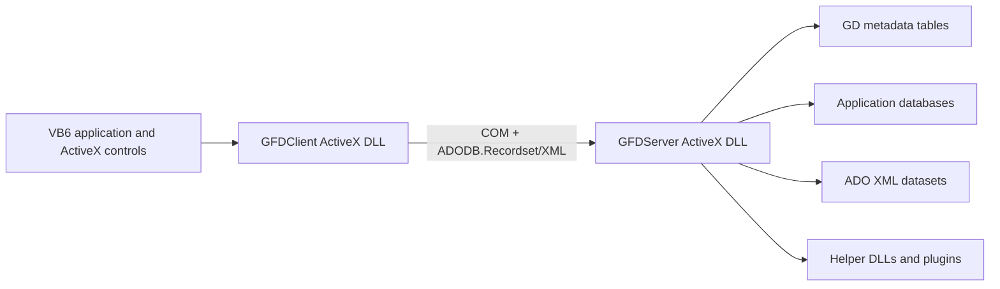
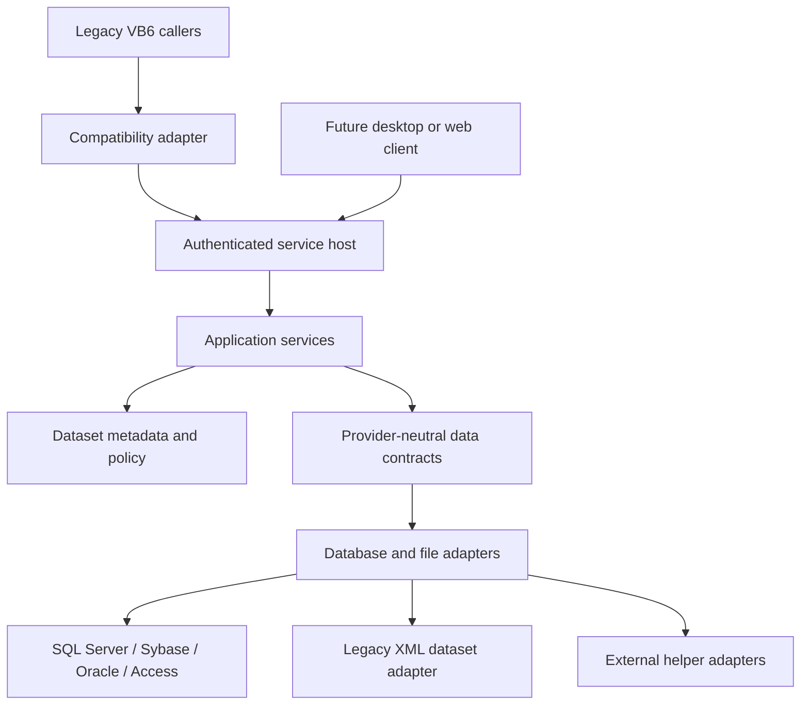

# GDFramework Migration Design

> **Superseded as the working baseline:** This original 0.1 draft is retained
> for traceability. Use [GDFramework Migration Master Plan and Design](../MIGRATION_MASTER.md)
> as the consolidated authoritative draft.

**Status:** Superseded; historical reference only  
**Version:** 0.1  
**Date:** 31 July 2026  
**Source baseline:** `W:\Documents\Workfiles\Visual Studio Projects\VB6\GDFramework`

## 1. Purpose

This document defines the proposed technical direction and the constraints for
migrating GDFramework from VB6 and COM to a supported platform.

It is deliberately a design baseline rather than an implementation mandate.
Items marked as decisions remain open until the evidence listed in the
migration plan has been collected and the relevant stakeholders approve them.

## 2. Executive summary

GDFramework is a metadata-driven application framework composed of VB6 ActiveX
DLLs, an ActiveX control library, ADO recordsets, database-specific adapters,
and COM interfaces. It supports dynamic datasets, client-side editing,
server-side persistence, application configuration, menus, messages, logging,
and several database/provider types.

The recommended migration approach is an incremental replacement:

1. Recover and characterize the observable behavior of the existing system.
2. Define stable, technology-neutral contracts at the client/server boundary.
3. Implement a modern server and data layer behind those contracts.
4. Provide a temporary compatibility adapter for approved VB6 callers.
5. Move clients and controls only after server parity is demonstrated.
6. Operate old and new paths side by side until cutover evidence is sufficient.

This is not a line-by-line translation. Unsafe legacy behavior, such as
exposing raw database objects or accepting unverified client identity, will not
be preserved as part of compatibility.

## 3. Current-system architecture

### 3.1 Project inventory

| Area | Legacy project | Primary responsibility |
|---|---|---|
| Interfaces | `AppInterfaces/GDFInterfaces.vbp` | Shared COM interfaces and cross-project types |
| Server | `AppServer/GenFormDataServer.vbp` | Metadata loading, datasets, ADO connections, queries, writes, messages, configuration |
| Client | `AppClient/GenFormDataClient.vbp` | Client facade, session state, recordset editing, menus, display configuration |
| Controls | `AppControls/GFDGUICtls.vbp` | VB6 ActiveX UI controls |
| Aggregator | `AppServer/GDAggregator.vbp` | Aggregation and server-side orchestration |
| Harnesses | `Z_Harness_*` | Helper/plugin examples and manual integration harnesses |
| Shared copies | `AppShared` and `AppClient/AppClient` | Duplicate or divergent source copies requiring provenance analysis |

The framework is approximately 61,000 lines across 122 VB6 source files.
Several projects contain machine-specific references to obsolete or unavailable
COM libraries.

### 3.2 Current request flow



### 3.3 Important legacy behaviors

- Dataset definitions and parameters are loaded from database metadata.
- Dataset results are cached and refreshed using per-dataset flags.
- ADO recordsets are marshalled directly or serialized as ADO XML.
- Client recordsets track pending insert, update, and delete operations.
- The server constructs SQL for those changes using metadata and field values.
- Database providers include SQL Server, Sybase, Oracle, Access, XML files, and
  helper-based simple services.
- The server and client expose COM objects and mutable internal collections.
- UI configuration, menus, messages, and user settings are themselves modeled
  as datasets.

## 4. Drivers for change

### 4.1 Platform and operability

- VB6 and the historical COM dependencies are difficult to build, deploy, and
  support on current Windows environments.
- Project references depend on old machine paths, 32-bit controls, CDO, Office
  type libraries, and custom binaries.
- The repository has no automated build or regression test suite.
- Duplicate source trees make it unclear which copy is authoritative.

### 4.2 Security and correctness

The initial review identified architectural risks that the replacement must
close:

- The server exposes its internal database layer and arbitrary SQL execution.
- Client-session validation accepts caller-provided identity without
  authentication.
- SQL values are concatenated rather than parameterized.
- Batch writes can partially commit.
- some client write methods report success after server failure.
- Unknown connection names may silently use the system database.

### 4.3 Maintainability

- Business behavior, transport, persistence, caching, UI concerns, and logging
  are interwoven.
- Public APIs exchange implementation-specific ADO objects.
- Database-specific SQL is assembled throughout the data layer.
- Error handling relies on Boolean returns, global messages, and mutable
  out-parameters rather than a consistent result model.

## 5. Goals and non-goals

### 5.1 Goals

The migrated system shall:

- Preserve agreed business behavior and data semantics.
- Replace COM recordset contracts with explicit, versioned contracts.
- Authenticate identity at a trusted boundary and authorize each operation.
- Use parameterized database commands and explicit provider adapters.
- Make multi-row changes atomic where the business operation is atomic.
- Support side-by-side validation and incremental cutover.
- Provide structured diagnostics, audit events, and operational health checks.
- Be buildable and testable from a clean, documented environment.
- Keep provider-specific behavior isolated from application policy.
- Allow the UI decision to be made independently from the server migration.

### 5.2 Non-goals

The first migration increment will not:

- Reproduce known security defects for compatibility.
- Redesign the application database schemas without a separately approved need.
- Replace every client and control in a single release.
- Select a UI framework before user workflows and integration constraints are
  inventoried.
- Adopt an ORM as the source of truth for dynamic, metadata-defined datasets.
- Treat successful compilation as proof of behavioral equivalence.

## 6. Design principles

1. **Behavior before replacement.** Capture current inputs, outputs, side
   effects, and failure behavior before rewriting a path.
2. **Explicit boundaries.** Do not expose connections, commands, mutable
   caches, or provider objects outside infrastructure.
3. **Secure by construction.** Identity is established by the host, not
   supplied as an ordinary application parameter.
4. **Provider isolation.** SQL dialect and connection behavior belong in
   provider adapters.
5. **Atomic commands.** One logical change set has one explicit transaction
   policy and one structured result.
6. **Incremental compatibility.** Compatibility adapters translate legacy
   contracts; they do not contaminate the modern core.
7. **Observable operation.** Every request has a correlation identifier,
   structured outcome, duration, and safe diagnostic context.
8. **No hidden fallbacks.** Unknown datasets, parameters, connections, and
   providers fail explicitly.
9. **Test real boundaries.** Tests exercise serialization, commands,
   transactions, parsing, cleanup, and actual provider behavior where
   compatibility depends on it.

## 7. Proposed logical architecture

The product/runtime choice is provisional, but the following separation should
hold regardless of whether the host is an HTTP service, Windows service, or
in-process compatibility component.



### 7.1 Proposed solution boundaries

| Boundary | Responsibility | Must not contain |
|---|---|---|
| Contracts | Versioned request, response, error, and event types | ADO, COM, UI, connection objects |
| Application | Use cases, authorization, orchestration, transaction intent | Provider-specific SQL syntax |
| Dataset model | Dataset definitions, parameter rules, cache keys, update policy | Transport or UI concerns |
| Infrastructure | Connections, provider dialects, SQL execution, file/plugin adapters | Caller authorization decisions |
| Host | Authentication, request validation, routing, health, diagnostics | Business rules embedded in endpoints |
| Compatibility | COM/ADO XML translation for approved legacy callers | New business logic |
| Client | User workflows and presentation | Direct database access |

### 7.2 Provisional project layout

No projects should be scaffolded until the initial decisions are approved, but
the intended dependency direction is:

```text
src/
  GDFramework.Contracts/
  GDFramework.Application/
  GDFramework.DatasetModel/
  GDFramework.Infrastructure/
  GDFramework.Service/
  GDFramework.Compatibility/
tests/
  GDFramework.CharacterizationTests/
  GDFramework.ContractTests/
  GDFramework.IntegrationTests/
  GDFramework.CompatibilityTests/
docs/
  adr/
```

Dependencies point inward: hosts and adapters depend on application contracts;
the application layer does not depend on COM, ADO recordsets, or a UI toolkit.

## 8. Contract design

### 8.1 Contract rules

- Contracts are versioned independently from implementations.
- No public contract returns a live database connection, command, transaction,
  recordset, or mutable server collection.
- Requests have explicit identifiers, parameters, paging, ordering, and
  consistency requirements.
- Results distinguish validation, authorization, conflict, provider, timeout,
  cancellation, and unexpected failures.
- Dates, decimals, binary values, and nulls have defined serialization rules.
- Field and dataset identifiers come from validated metadata; callers cannot
  inject arbitrary SQL fragments.

### 8.2 Core conceptual contracts

| Contract | Purpose |
|---|---|
| `SessionContext` | Trusted subject, roles/claims, application, workstation context, correlation ID |
| `DatasetDefinition` | Dataset identity, provider, query/update policy, columns, keys, cache policy |
| `DatasetParameter` | Name, type, value, validation, required/optional status |
| `DatasetQuery` | Dataset identity, parameters, paging, sort, refresh/consistency option |
| `DatasetResult` | Schema, rows, continuation information, version/concurrency values |
| `ChangeSet` | Dataset identity and ordered insert/update/delete changes |
| `ChangeResult` | Overall outcome plus per-row success, conflict, validation, and generated-key data |
| `SystemMessage` | Typed application/system message with audience and validity window |
| `Problem` | Stable error code, safe message, correlation ID, and optional field details |

The exact wire format is a decision. JSON over HTTP is the current default
candidate because it is inspectable and accessible from both compatibility and
modern clients. gRPC remains an option for controlled native clients.

### 8.3 Compatibility translation

If a legacy client must remain active during migration, the compatibility
adapter may:

- Accept the legacy method shape.
- Convert an ADO recordset or ADO XML stream into `DatasetQuery` or `ChangeSet`.
- Invoke the modern application boundary.
- Convert `DatasetResult` back to the minimum required legacy shape.
- Map structured errors to the legacy Boolean/message convention while also
  emitting a reliable diagnostic event.

The adapter must not expose the modern connection factory or accept raw SQL.

## 9. Dataset and persistence design

### 9.1 Metadata

Legacy dataset metadata should first be imported into a typed model without
changing its meaning. Validation occurs when metadata is loaded:

- Dataset and connection identifiers must exist and be unique.
- Provider type must be supported.
- Query/update policy must be internally consistent.
- Update tables and key columns must be declared and allow-listed.
- Parameter markers must map one-to-one to typed parameters.
- Cache keys must include every value that can change the result.
- Security policy must be explicit; absence is not treated as unrestricted by
  accident.

Invalid metadata prevents the affected dataset from becoming available and
produces an actionable startup diagnostic.

### 9.2 Connection resolution

A connection factory resolves only an exact configured connection identifier.
An explicit `System` identifier may represent the system database. Blank,
unknown, inactive, or ambiguous identifiers fail rather than falling back.

Secrets are supplied by the deployment environment or an approved secret
store. They are not returned through application contracts or written to logs.

### 9.3 Query execution

- Values are always bound as typed command parameters.
- Provider adapters own placeholder syntax and type mapping.
- Metadata-derived identifiers are validated against the loaded definition.
- Paging and limits are enforced to avoid accidentally returning unbounded
  datasets.
- Cancellation and command timeouts flow from the host to the provider.
- Provider resources are disposed deterministically.

### 9.4 Change execution

A `ChangeSet` is validated before any write:

1. Authenticate and authorize the subject.
2. Resolve the dataset and its update policy.
3. Validate fields, types, required values, and keys.
4. Begin the required transaction.
5. Execute inserts, updates, and deletes with parameters.
6. Apply optimistic concurrency rules.
7. Commit only if the change-set policy is satisfied.
8. Return generated keys and per-row outcomes.

On an unexpected failure, the transaction rolls back and the caller receives a
failure result. Partial success is permitted only for a use case explicitly
designed and documented to allow it.

### 9.5 Caching

Caching is an application concern built around immutable results:

- Cache keys include dataset version, application/security scope, and all
  result-affecting parameters.
- Entries have explicit lifetime and invalidation rules.
- Writes publish invalidation events only after commit.
- A forced refresh bypasses lookup but does not weaken authorization.
- Mutable recordsets are never stored as shared server cache entries.

The first modern vertical slice may operate without caching. Caching is added
only after parity is proven and measured need is demonstrated.

## 10. Security design

### 10.1 Identity

The host establishes identity using an approved mechanism such as integrated
Windows authentication or an organization identity provider. A username in a
request is context to validate, never proof of identity.

### 10.2 Authorization

- Every dataset declares read and change policies.
- Administrative operations use explicit policies rather than mutable
  `IsAdmin` flags.
- Application and user identifiers used in dataset filters are derived from
  the authenticated session or independently authorized.
- The server does not trust client-provided audit users, application IDs, or
  role assignments.

### 10.3 Audit and sensitive data

Security-sensitive operations record subject, action, dataset, outcome,
correlation ID, and timestamp. SQL text, passwords, access tokens, and
unredacted sensitive field values are not logged.

### 10.4 Compatibility boundary

Keeping a VB6 client does not justify keeping legacy authentication. The
compatibility adapter must authenticate the process/user and forward a trusted
identity to the modern application boundary.

## 11. Error handling and observability

### 11.1 Error model

Application methods return a structured result or raise a controlled exception
that the host translates into a stable `Problem`. Boolean success values are
not used as the only error channel.

Expected error categories include:

- Invalid request or metadata
- Unauthenticated
- Unauthorized
- Dataset or connection not found
- Concurrency conflict
- Provider unavailable
- Timeout or cancellation
- Dependency protocol error
- Unexpected internal failure

### 11.2 Diagnostics

Each operation records:

- Correlation and operation identifiers
- Authenticated subject identifier
- Dataset and provider identifiers
- Duration and row counts
- Transaction outcome
- Cache outcome when caching is enabled
- Stable error code on failure

Health checks distinguish host health from individual provider availability.

## 12. Testing strategy

The migration requires evidence at multiple boundaries:

| Test type | Purpose |
|---|---|
| Characterization | Record current VB6 behavior for representative datasets and failures |
| Contract | Prove request/response compatibility independent of host technology |
| Provider integration | Exercise real serialization, commands, parameters, transactions, failures, and cleanup |
| Compatibility | Compare legacy adapter behavior with captured VB6 behavior |
| Differential | Run equivalent requests against old and new implementations and compare normalized results |
| Security | Verify impersonation, unauthorized dataset access, identifier injection, and secret leakage are rejected |
| Operational | Verify startup validation, health reporting, timeout, cancellation, retry, and recovery behavior |

Tests use real implementations, protocol-level fixtures, disposable integration
environments, or small purpose-built fakes. Mockito and substitute mocking
frameworks are prohibited.

Golden files must normalize nondeterministic values such as timestamps,
generated identifiers, record ordering where unspecified, and provider-specific
diagnostic text.

## 13. Deployment and coexistence

The target topology is not yet selected. The design must support:

- A modern host deployed independently from clients.
- An optional compatibility component installed only where legacy callers need
  it.
- Side-by-side routing by dataset, application group, or pilot cohort.
- Immediate rollback to the legacy route without reversing committed database
  changes.
- Versioned contracts allowing clients and server to upgrade independently
  within a supported compatibility window.

Database schema changes, if any, require forward- and backward-compatible
migrations while old and new code run together.

## 14. Source and build provenance

Before translating code, the team must identify the authoritative version of
each duplicated VB6 source file. File timestamps alone are insufficient.
Evidence may include project membership, released binaries, type-library
identity, source-control metadata, and production deployment manifests.

The migration repository should record:

- The selected legacy source baseline and checksum.
- The build order and required 32-bit dependencies.
- The type-library and binary compatibility requirements.
- Known differences between `AppServer`, `AppShared`, and nested client copies.

The legacy source may be imported as a read-only reference or linked through a
documented external path after provenance is agreed.

## 15. Decisions required

| ID | Decision | Options/evidence required | Status |
|---|---|---|---|
| D-001 | Target UI | Browser, WPF, WinForms, hybrid; inventory Windows/Office/control dependencies | Open |
| D-002 | Service transport | JSON/HTTP, gRPC, in-process; assess clients, hosting, diagnostics | Open |
| D-003 | Host topology | Windows service, IIS, container, in-process; assess operations and network boundaries | Open |
| D-004 | Supported providers | Confirm production use of SQL Server, Sybase, Oracle, Access, XML, simple-service plugins | Open |
| D-005 | Authentication | Integrated Windows, organization identity provider, service identity | Open |
| D-006 | Compatibility duration | Which VB6 clients must coexist, and for how long | Open |
| D-007 | Dataset contract | Row-oriented JSON, column-oriented format, or typed endpoints for selected use cases | Open |
| D-008 | Runtime version | Current supported LTS at implementation start, subject to platform policy | Proposed: .NET 10 LTS |
| D-009 | Canonical legacy source | Determine authoritative duplicate files and release baseline | Open |
| D-010 | Database schema policy | No change by default; identify changes required for concurrency, audit, or compatibility | Open |

Each accepted decision should be captured as an Architecture Decision Record in
`docs/adr`.

## 16. Design acceptance criteria

This design is ready to govern implementation when:

- The current-system inventory has named owners and evidence.
- Decisions D-001 through D-006 and D-009 are resolved or explicitly deferred
  with a safe default.
- Representative read and write datasets have been selected for the first
  vertical slice.
- Authentication and authorization responsibilities are approved.
- The compatibility boundary and its retirement condition are agreed.
- Provider integration-test environments are available for the first slice.
- Operational ownership and deployment topology are understood.
- Stakeholders agree which legacy defects must be fixed rather than reproduced.
