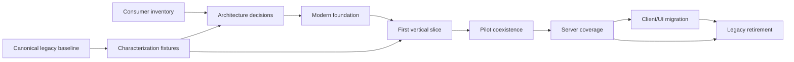

# GDFramework Migration Plan

> **Superseded as the working baseline:** This original 0.1 draft is retained
> for traceability. Use [GDFramework Migration Master Plan and Design](../MIGRATION_MASTER.md)
> as the consolidated authoritative draft.

**Status:** Superseded; historical reference only  
**Version:** 0.1  
**Date:** 31 July 2026  
**Companion historical document:** [Migration design 0.1](MIGRATION_DESIGN-0.1.md)

## 1. Purpose

This document turns the migration design into an evidence-driven sequence of
work. It defines deliverables, dependencies, decision points, risks, and exit
criteria. It intentionally does not invent calendar dates before the legacy
baseline, team capacity, provider availability, and UI scope are known.

## 2. Planning assumptions

- The legacy system remains operational during most of the migration.
- Existing database schemas remain unchanged unless a phase explicitly
  approves a compatible schema change.
- Server/data behavior is migrated before the main UI.
- Some VB6 callers may need a temporary compatibility path.
- The source directory is not currently a Git repository and contains duplicate
  source trees.
- A reproducible VB6 build environment and production-like provider fixtures
  are not currently available.
- The migration workspace currently has no replacement code.
- A supported development SDK must be installed or provisioned before the first
  modern project is created.

## 3. Governance

### 3.1 Required artifacts

The migration will maintain:

- Current-system inventory
- Public COM/API inventory
- Dataset and parameter catalog
- Database/provider compatibility matrix
- Characterization test catalog
- Architecture Decision Records
- Risk and issue register
- Phase exit evidence
- Cutover and rollback runbooks
- Legacy retirement checklist

### 3.2 Change control

- A phase begins only after its entry criteria are met.
- Scope changes that alter contracts, security, provider support, coexistence,
  or UI direction require a recorded decision.
- Known legacy defects are classified as **preserve**, **fix**, or **retire**.
- Replacement code is merged only with tests appropriate to the boundary.
- No compatibility exception may expose raw SQL, database connections, or
  unverified identity.

### 3.3 Definition of done

A migration item is done when:

- Its behavior and failure cases are specified.
- The implementation respects the approved dependency boundaries.
- Automated tests cover the relevant observable behavior.
- Provider-specific behavior is integration-tested where applicable.
- Security and diagnostics are verified.
- Documentation and operational procedures are updated.
- No unresolved high-severity defect is being hidden by a compatibility layer.

## 4. Workstreams

| Workstream | Scope |
|---|---|
| A. Legacy baseline | Source provenance, build recovery, release and dependency inventory |
| B. Behavior | Characterization, dataset catalog, differential test fixtures |
| C. Architecture | Contracts, decisions, security, error model, observability |
| D. Modern server | Application services, metadata model, provider adapters, transactions |
| E. Compatibility | Legacy COM/ADO translation and side-by-side routing |
| F. Client/UI | Workflow inventory, UI selection, client migration, control replacement |
| G. Delivery | Build pipeline, environments, deployment, monitoring, cutover, rollback |

These workstreams overlap only where their inputs are stable. For example,
provider adapter work can begin after the first provider matrix and contract
slice are approved; it does not wait for the final UI decision.

## 5. Phase plan

### Phase 0 — Establish the controlled baseline

**Objective:** Know exactly what is being migrated and make changes traceable.

**Activities**

1. Initialize source control for the migration workspace.
2. Record the legacy source path, checksums, project files, and file inventory.
3. Identify authoritative copies for duplicated server, shared, and client
   files.
4. Inventory released DLL/OCX/type-library versions and COM class identifiers.
5. Document the VB6 project build order.
6. Inventory required third-party controls and custom binaries.
7. Identify production applications that instantiate GDFramework components.
8. Establish owners for database, infrastructure, security, and user workflows.
9. Create the ADR template and decision register.

**Deliverables**

- `LEGACY_BASELINE.md`
- `COMPONENT_INVENTORY.md`
- `DEPENDENCY_INVENTORY.md`
- Baseline checksum manifest
- Initial ADRs for source provenance and supported migration scope

**Exit criteria**

- Every active binary maps to a source project or is recorded as an external
  dependency.
- Authoritative source copies are identified for the first vertical slice.
- Active consumers and deployment locations are known.
- Unavailable dependencies have an owner and disposition.

### Phase 1 — Recover behavior and build characterization assets

**Objective:** Create evidence that can distinguish a compatible replacement
from a plausible rewrite.

**Activities**

1. Provision or document a reproducible 32-bit VB6 build/runtime environment.
2. Inventory public COM methods, properties, events, enums, and recordset
   schemas.
3. Catalog dataset definitions, parameters, provider connections, update keys,
   cache settings, and security expectations.
4. Select representative cases:
   - Simple parameterized read
   - Cached read with refresh
   - Disconnected predicate
   - Insert with generated key
   - Multi-row update
   - Delete
   - Optimistic concurrency conflict
   - XML dataset
   - Stored procedure
   - Helper/plugin call
5. Capture normalized inputs, outputs, database effects, messages, and failure
   behavior.
6. Mark each observed defect as preserve, fix, or retire.
7. Build protocol-level fixtures for ADO XML and relevant external adapters.

**Deliverables**

- `PUBLIC_API_CATALOG.md`
- `DATASET_CATALOG.md`
- `PROVIDER_MATRIX.md`
- Characterization fixture set
- Legacy defect disposition register

**Exit criteria**

- The first read and write vertical slices have reproducible fixtures.
- Null, date, decimal, string-escaping, generated-key, and concurrency behavior
  are documented.
- The team can run the selected legacy scenarios repeatedly.
- Security defects to be corrected are explicitly excluded from compatibility.

### Phase 2 — Approve architecture and create the modern foundation

**Objective:** Turn approved decisions into a minimal buildable solution.

**Entry criteria**

- Phase 1 fixtures exist for the selected vertical slice.
- Authentication, host topology, first provider, and compatibility mechanism
  are decided.
- A supported SDK and build environment are available.

**Activities**

1. Resolve or formally defer the open decisions in the design document.
2. Create ADRs for runtime, transport, authentication, data access, and
   compatibility.
3. Scaffold only the approved solution projects.
4. Establish dependency rules and build enforcement.
5. Define versioned query, result, change-set, and problem contracts.
6. Add structured logging, correlation, configuration validation, health
   checks, and secret injection.
7. Create test projects and reusable integration fixtures.
8. Establish continuous build and test execution.

**Deliverables**

- Buildable modern solution
- Contract version 1
- ADR set
- CI definition
- Test environment documentation

**Exit criteria**

- A clean checkout builds without machine-specific absolute references.
- Contract and architecture tests pass.
- Secrets are external to source and logs.
- No infrastructure type is exposed through the public application boundary.

### Phase 3 — Implement the first vertical slice

**Objective:** Prove the migration pattern end to end with one representative
read and one representative write.

**Recommended slice**

- Read: a parameterized, user-scoped metadata dataset.
- Write: a small updateable configuration dataset with a composite key and
  concurrency behavior.

The exact datasets are selected during Phase 1 based on production relevance
and fixture availability.

**Activities**

1. Load and validate only the metadata needed for the selected datasets.
2. Implement exact connection resolution for the first provider.
3. Implement parameterized query execution and result serialization.
4. Implement authorization for the selected datasets.
5. Implement atomic change-set execution and conflict reporting.
6. Compare normalized legacy and modern read results.
7. Verify approved differences for corrected defects.
8. Add compatibility translation only if a real pilot consumer requires it.
9. Add operational metrics and failure diagnostics.

**Deliverables**

- Production-shaped vertical slice
- Differential test report
- Security test report
- Pilot deployment and rollback procedure

**Exit criteria**

- Selected reads match approved legacy behavior.
- Selected writes are atomic and return accurate outcomes.
- Impersonation, SQL injection, raw database access, and unknown-connection
  fallback tests fail safely.
- Pilot operation is observable and reversible.

### Phase 4 — Expand server and provider coverage

**Objective:** Migrate the remaining server capabilities in controlled groups.

**Capability groups**

1. Core dataset reads and refresh behavior
2. Inserts, updates, deletes, generated keys, and concurrency
3. Metadata administration and application configuration
4. Menus, user settings, display definitions, and system messages
5. Stored procedures and action datasets
6. XML datasets
7. Aggregation
8. Simple-service helpers and plugins
9. Remaining providers

Each group follows the same loop:

1. Select and characterize.
2. Approve defect dispositions.
3. Implement contract/application behavior.
4. Implement or extend the provider adapter.
5. Run integration and differential tests.
6. Pilot route.
7. Record exit evidence.

**Exit criteria**

- All in-scope server capabilities have an approved disposition.
- Every active provider has integration evidence.
- Operational limits and performance are measured against agreed workloads.
- Legacy server calls not yet retired are explicitly listed.

### Phase 5 — Operate the compatibility and pilot migration

**Objective:** Move real consumers without a flag-day deployment.

**Activities**

1. Identify the smallest representative pilot application.
2. Deploy the modern host and, if required, the compatibility adapter.
3. Route selected datasets or workflows to the modern path.
4. Compare results and database effects during a controlled observation period.
5. Exercise rollback without data repair.
6. Expand by cohort only after exit review.
7. Track compatibility calls to identify remaining dependencies.

**Exit criteria**

- Pilot service levels and correctness thresholds are met.
- Rollback has been rehearsed.
- No critical dependency exists only in an operator’s workstation configuration.
- Compatibility usage is measurable and declining.

### Phase 6 — Select and migrate the client experience

**Objective:** Replace the VB6 client facade and ActiveX controls based on
documented user workflows.

**Entry criteria**

- The modern server contract is stable for the workflows being migrated.
- Decision D-001 is approved.
- Active controls, forms, Office integrations, accessibility needs, and offline
  expectations are inventoried.

**Activities**

1. Map controls and client methods to user workflows, not just source files.
2. Prototype the highest-risk UI integrations.
3. Define a client architecture consuming the versioned service contract.
4. Migrate one complete workflow at a time.
5. Validate usability, accessibility, printing/export, keyboard behavior, and
   operational support.
6. Retire corresponding ActiveX controls and COM client calls after adoption.

**Exit criteria**

- All in-scope workflows have acceptance evidence.
- No modern UI performs direct database access.
- Office or Windows integrations have supported replacements.
- The relevant VB6 client components can be removed from deployment.

### Phase 7 — Cut over and retire the legacy framework

**Objective:** Remove production dependence on VB6/COM GDFramework components.

**Activities**

1. Confirm zero or approved residual compatibility traffic.
2. Complete data reconciliation and audit review.
3. Freeze legacy configuration changes.
4. Execute final cutover and monitor.
5. Retain rollback capability for the agreed window.
6. Remove COM registration and obsolete runtime dependencies in stages.
7. Archive source, binaries, type libraries, build environment, and operational
   records according to policy.
8. Close residual risks or transfer them to product ownership.

**Exit criteria**

- Production has no unapproved GDFramework COM dependencies.
- Support, recovery, monitoring, and ownership are transferred.
- Legacy secrets and deployment artifacts are removed from active systems.
- The retirement decision and evidence are recorded.

## 6. Initial backlog

The following backlog is ordered to reduce uncertainty before implementation:

| Order | Item | Output |
|---:|---|---|
| 1 | Establish migration source control and contribution rules | Traceable workspace |
| 2 | Hash and inventory the legacy baseline | Reproducible source reference |
| 3 | Resolve duplicate-source provenance | Canonical files per project |
| 4 | Inventory active consumers and deployed binaries | Migration scope |
| 5 | Recover VB6 build order and dependencies | Build/run instructions |
| 6 | Extract public COM surface | API catalog |
| 7 | Extract dataset/parameter metadata model | Dataset catalog |
| 8 | Confirm active databases/providers | Provider matrix |
| 9 | Select first read/write slices | Approved pilot scope |
| 10 | Capture legacy fixtures | Characterization evidence |
| 11 | Decide authentication and service topology | ADRs |
| 12 | Provision supported SDK and CI environment | Build foundation |
| 13 | Scaffold approved solution | First modern code |

## 7. Dependencies and critical path

The critical path begins with provenance, behavior fixtures, and architecture
decisions. UI implementation is intentionally not on the early critical path.

## 8. Risk register

| Risk | Impact | Early indicator | Mitigation |
|---|---|---|---|
| Wrong source copy selected | Replacement matches an unused version | Binary/type-library mismatch | Hash deployed artifacts; compare project/type-library identity |
| Legacy environment cannot be reproduced | No reliable behavioral oracle | Missing OCX/DLL or registration data | Capture a controlled reference VM; archive installers and manifests |
| Hidden consumers | Cutover breaks an untracked application | COM activation outside inventoried apps | Inventory registry/deployment data and instrument compatibility calls |
| Provider differences | Queries or types behave differently | Null/date/decimal/order mismatches | Real provider integration tests and normalized differential fixtures |
| Unsafe behavior mistaken for compatibility | Security defects survive migration | Request asks to preserve raw SQL or identity override | Defect disposition register and security design gate |
| Partial-write semantics relied upon | Atomic fix changes workflow expectations | Downstream reconciliation assumes partial success | Characterize and obtain explicit business decision |
| Metadata contains executable assumptions | Generic engine cannot safely interpret definitions | SQL fragments in parameter or criteria fields | Classify metadata, validate identifiers, migrate unsafe definitions explicitly |
| Cache behavior changes results | Cross-user leakage or stale data | Results vary with call order/session | Disable cache initially; define complete keys; test isolation |
| UI scope expands early | Server migration stalls | Control-by-control rewrite starts before contract stability | Enforce Phase 6 entry criteria |
| Compatibility becomes permanent | Legacy remains a required runtime | No owner or retirement metric | Time-box support policy and measure every legacy call |
| No production-like test data | False parity confidence | Tests cover only empty/simple datasets | Curated anonymized datasets or controlled integration environments |
| SDK/toolchain unmanaged | Builds differ by workstation | Manual local-only success | Pin supported SDK, dependencies, and CI image |

The risk register should gain named owners and review dates during Phase 0.

## 9. Quality gates

### Gate A — Baseline trustworthy

- Source and deployed binary provenance recorded.
- Active consumers identified.
- Build/runtime dependencies documented.

### Gate B — Behavior understood

- Representative fixtures are repeatable.
- Provider and data-type edge cases are covered.
- Defect dispositions are approved.

### Gate C — Architecture approved

- Host, authentication, transport, provider, and compatibility decisions exist.
- Public contracts expose no infrastructure objects.
- Security review accepts the boundary.

### Gate D — Vertical slice proven

- Differential, integration, security, and recovery tests pass.
- Writes are atomic and accurately reported.
- Pilot can be rolled back safely.

### Gate E — Capability ready

- In-scope provider/capability coverage is complete.
- Performance and operations meet agreed thresholds.
- Residual legacy dependencies are enumerated.

### Gate F — Retirement ready

- Compatibility use is zero or formally accepted.
- Cutover and rollback are rehearsed.
- Support ownership and archival requirements are satisfied.

## 10. Estimation and reporting

Calendar estimates should be produced after Phase 0, when the team knows:

- Number of active consumers and workflows
- Number of active dataset definitions
- Providers actually used in production
- Availability of build and integration environments
- Required compatibility duration
- Team composition and allocation

Until then, report progress using evidence:

- Components inventoried / total discovered
- Active consumers confirmed / candidates
- Datasets characterized / in scope
- Provider scenarios passing / required
- Modern routes piloted / planned
- Compatibility calls by component and trend
- Open risks by severity and age

This avoids presenting an unsupported date as a plan.

## 11. Roles required

Named individuals may fill multiple roles, but the responsibilities must exist:

| Role | Responsibility |
|---|---|
| Product/domain owner | Approves behavior, defect disposition, workflow acceptance |
| Legacy technical owner | Explains deployment history, metadata, providers, and consumers |
| Migration technical lead | Owns architecture, sequencing, and quality gates |
| Database owner | Provides schemas, test environments, provider constraints, reconciliation |
| Security owner | Approves identity, authorization, secrets, audit, threat model |
| Operations owner | Owns deployment, monitoring, recovery, and support |
| Test/quality owner | Owns characterization, differential evidence, and exit reports |
| UI/workflow owner | Owns user research and client acceptance when Phase 6 begins |

## 12. Immediate review agenda

The first planning review should answer:

1. Which deployed applications currently depend on GDFramework?
2. Which source tree and released binary represent production?
3. Which databases and helper plugins are actually active?
4. Can a representative legacy environment be executed safely?
5. Who can approve behavior changes where the legacy behavior is defective?
6. What identity provider and deployment boundary are available?
7. Which one read dataset and one write dataset best represent the framework?
8. How long must any VB6 client coexist with the replacement?
9. What Windows, Office, printing, or offline requirements constrain the future
   UI?
10. Who owns each Phase 0 deliverable and decision?

Replacement implementation begins only after the applicable design and phase
gates are approved.
